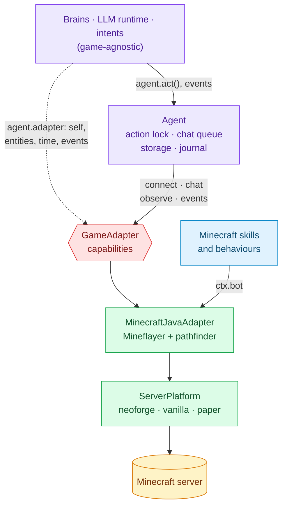

# Game adapters

The agent doesn't talk to Minecraft directly. It holds one **game adapter**, and everything that
is about a particular game (the network client, its connection, what the bot sees, how it moves)
lives behind it. The action lock, chat queue, storage, journal, brains, the LLM runtime and
intents only use the adapter's interface. Minecraft Java is the first adapter and the default;
the [proposal](https://github.com/thereisnotime/golemkit/blob/main/openspec/changes/game-adapters/proposal.md)
has the plan for a second game.



## GameAdapter

`src/core/adapter.ts`. One adapter per agent, reused across reconnects.

| member | what it does |
|---|---|
| `game`, `capabilities` | the game's name and what it can do (see below) |
| `attach(agent)` | once, from the Agent constructor |
| `connect({ username })`, `endSession()`, `disconnect()` | start a session; the agent calls `endSession()` after skills and brains cleaned up; `disconnect()` on stop |
| `connected`, `client` | in the world; the game's own client (Minecraft: the Mineflayer bot) |
| `self()` | username, position, health, food, held item, and a `game` section (dimension, game mode, ...) |
| `observe()` | the snapshot behind `agent.observe()`: self, time, players, nearest entities, inventory |
| `chat(text, to?)`, `command(line)` | send now; the agent's queue does the rate limiting and humanize styling |
| `on(event)`, `off(event)` | `spawn`, `end`, `chat`, `serverMessage`, `hurt`, `health`, `death`, `respawn`, `playerJoined`, `playerLeft`, `gameMode`, `kicked`, `error` |

Optional primitives the core and the brain frameworks use when the game has them:
`start()` (once per agent start), `entities()`, `inventory()`, `time()`, `players()`, `playerPosition()`, `inDanger()`,
`stopMotion()`, `replan()`, `settingsChanged()`, `holdStill()`, `fidget()`, `isMoving()`.

Brains read the game through `agent.adapter` and never touch `agent.bot`. Actions and
behaviours written for one game still get that game's client as `ctx.bot`; its type is
`GameClient`, which each adapter maps to its own client type, so core never names Mineflayer.

## Capabilities

`chat`, `commands`, `move`, `look`, `dig`, `place`, `inventory`, `craft`, `containers`,
`combat`, `eat`, `sleep`, `creative`, `mods`. An action (or its skill, as a default) and a
behaviour list the ones they need:

```ts
export const woodcutting = () => defineSkill({
  name: 'woodcutting',
  capabilities: ['move', 'dig'],
  actions: [chopTree]
})
```

An agent whose adapter lacks one leaves the action out (`agent.unsupported` lists it), so it's
no chat command, no LLM tool and not in `!help`; the behaviours brain hides behaviours the game
can't run. The Minecraft Java adapter supports all of them (`mods` comes from the NeoForge
platform).

## ServerPlatform

Inside the Minecraft adapter, `src/adapters/minecraft-java/platform.ts`: what differs between
server software. `neoforge` (the default) negotiates mod channels, syncs registries, treats
modded blocks as solid and skips packets vanilla definitions can't parse (see
[NeoForge support](./neoforge.md)), and also works on vanilla servers since it only answers
what NeoForge asks; `vanilla` and `paper` add nothing. Pick one with `MC_PLATFORM` or
`server.platform` in a profile or fleet file; `platforms/index.ts` (`platformFor`) maps the
name to a platform.

A platform has a `name`, the `capabilities` it adds (NeoForge: `mods`) and optional hooks:
`install` (process-wide setup such as parser patches), `describe` (text for the connect log
line), `attach` (a fresh client before login), `afterPlugins` and `onLogin` (registry fixes
for modded content).

## Checking the line

`just lint-adapters` (part of `just check`) fails on a Minecraft package import or direct bot
use outside `src/adapters/` and `src/skills/`. `just scope-check` prints the counts per
directory (see [What is game-specific](./scope.md)).
