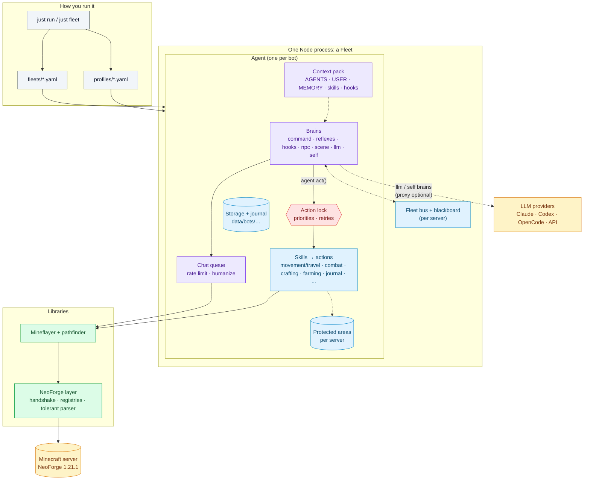
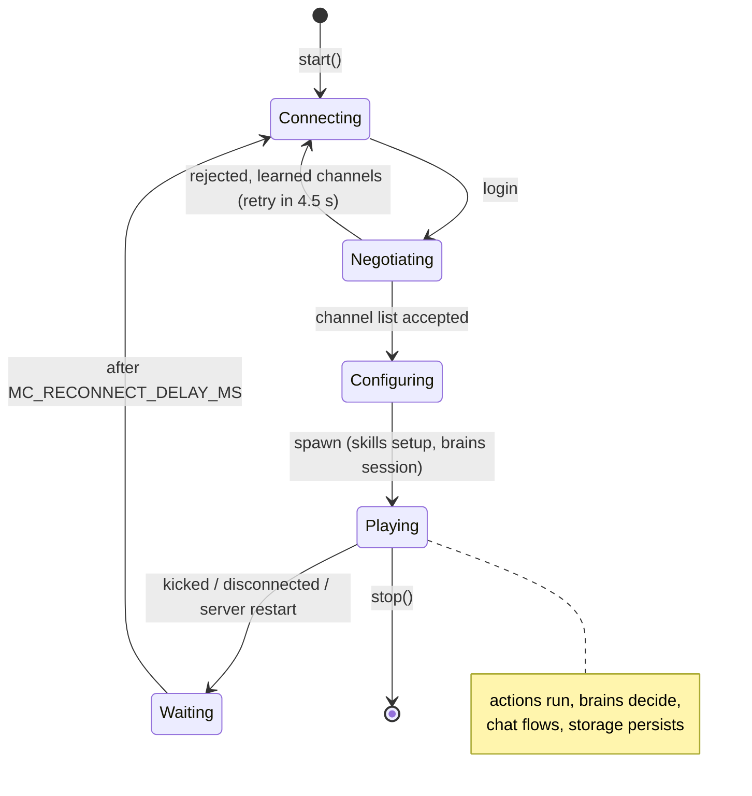
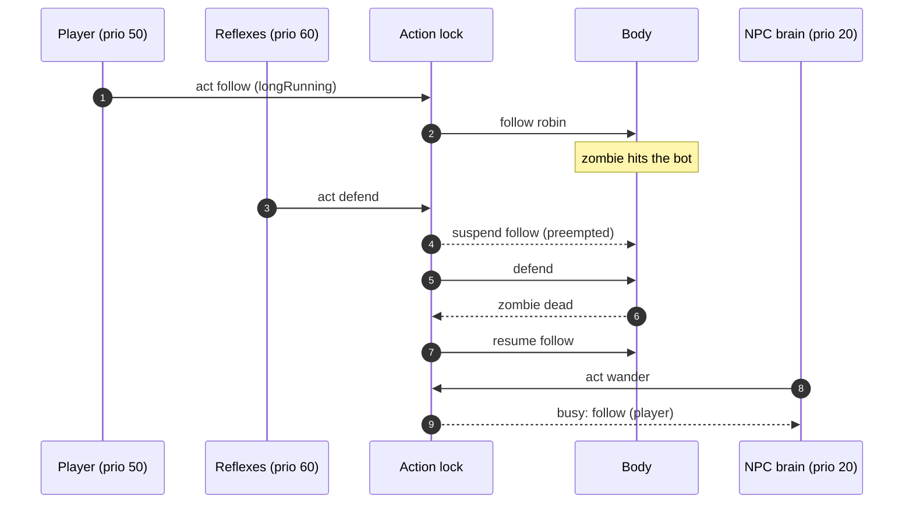

# Architecture

```
variants/<name>.ts      what kind of bot: skills + brains + default persona/settings
profiles/<name>.yaml    a saved instance: variant + username, owners, server, LLM, settings
fleets/<name>.yaml      profiles/variants run together, possibly on several servers
src/brains/             who decides: command (chat), reflexes, npc, llm, ...
src/skills/             what it can do: actions grouped by topic
src/core/               agent lifecycle, action lock, chat, storage, NeoForge layer
```

## The big picture



Brains decide, skills provide actions, the action lock arbitrates the body, and the NeoForge
layer gets everything into a modded server. Variants pick skills and brains; profiles and
fleets pick who, where and how many.

## Agent

`Agent` (src/core/agent.ts) is one bot identity. It survives disconnects: every reconnect is
a new *session* with a fresh mineflayer `Bot`, and skills/brains get their `setup()` /
`session()` hooks called again. The agent owns:

- the action registry and the **action lock** (`act()`), with [retries](../guide/profiles#retries)
- rate-limited chat (`say`, `whisper`, `reply`), since vanilla kicks for spam, optionally
  [humanized](../guide/profiles#humanize-player-like-timing)
- persistent storage (`agent.storage`, JSON under `data/bots/<username>/`)
- the [journal](../guide/journal) (`agent.journal`): typed facts about what happened, with rollups
- learned [protected areas](./world#protected-areas) (`agent.protectedAreas`) per server
- `observe()`: a JSON snapshot of the bot and surroundings, extended by skills and brains
- the event journal (`agent.journal`, JSONL under `data/bots/<username>/journal/`), see [Event journal](../guide/journal.md)
- events: `session`, `sessionEnd`, `chat`, `serverMessage`, `actionStart`, `actionEnd`, `llmUsage`, `chatOut`, `protectedArea`



## Actions

Everything a bot does is an action, defined with `defineAction`:

```ts
const follow = defineAction({
  name: 'follow',
  description: 'Follow a player until stopped.',          // shown in !help and to LLMs
  params: z.object({ player: z.string().optional() }),    // validation + types + tool schema
  longRunning: true,                                      // resumes after being preempted
  async run ({ bot, signal, player: caller }, { player }) {
    ...                                                   // must honour `signal`
    return ok('stopped following')
  }
})
```

- `exclusive` (default true): needs the body and takes the action lock. Set false for
  queries/chat that can run alongside.
- `longRunning`: runs until aborted (follow, guard).
- `internal`: hidden from `!help` and LLM tool lists.
- `run()` returns `ok(msg, data?)`, `fail(msg)`, a string, or nothing.
- Use `goto(bot, goal, signal)`, `holdGoal`, `sleep(ms, signal)`, `checkAborted(signal)` from
  core so actions stop promptly.

### The action lock and priorities

Only one exclusive action runs at a time. Callers have priorities (`PRIORITY` in action.ts):

| caller | priority |
|---|---|
| idle | 10 |
| npc | 20 |
| scene | 25 |
| llm | 30 |
| player | 50 |
| reflex | 60 |
| system | 100 |

A call with higher priority preempts the current action; if that one is `longRunning` it is
suspended and resumed afterwards (a reflex fights a zombie, then the bot goes back to
following you). Equal priority replaces. Lower priority is rejected with `busy: ...`.
`stopActions()` aborts everything and clears the suspended stack.


 `cancelActions(match)` aborts
and drops only the actions matching a predicate (a scene uses it to stop exactly what it
started).

## Skills

```ts
export const farming = () => defineSkill({
  name: 'farming',
  actions: [harvest, plant],
  plugins: [somePlugin],                   // mineflayer plugins, loaded once per session
  setup (agent, bot) { ...; return cleanup }, // per session
  observe (agent, bot) { return { cropsNearby: 12 } }
})
```

Skills are factories so a bot can pass options. `standardSkills()` bundles the common ones.

## Brains

```ts
export const myBrain = (opts) => defineBrain({
  name: 'my-brain',
  start (agent) { agent.on('chat', ...) },        // once
  session (agent, bot) { ...; return cleanup },   // every session
  observe (agent, bot) { return { mood: 'ok' } }, // optional, merged into agent.observe()
  stop (agent) { ... }
})
```

Brains call `agent.act(name, params, { caller: { kind: 'brain', name }, priority })`.
Several brains run at once and negotiate through priorities. Shipped:

- `commandBrain()` maps chat to actions: every action is a command; positional args in schema
  order, `key=value` works, last string param takes the rest of the line.
- `reflexes()` handles self-defence and auto-eat at reflex priority.
- `npcBrain()` keeps NPCs busy on their own: scored behaviours at npc priority, backs off for
  players, LLMs and reflexes. See [NPC brain](../guide/npc-brain.md).
- `sceneBrain()` lets several bots act out scenes together (see [Scenes](../guide/scenes.md)).
- `llmBrain()` lets a language model drive the bot at llm priority, through the same actions
  (as tools, also over MCP). See [LLM brain](../guide/llm-brain.md).
- `selfImprover()` runs a declarative program through the NPC controller and rewrites it with
  one LLM call when an owner teaches it. See [Self-improver](../guide/self-improver.md).

## Bots

```ts
export default defineVariant({
  name: 'buddy',
  username: 'McBuddy',
  skills: standardSkills(),
  brains: [commandBrain(), reflexes()],
  persona: 'cheerful helper',   // for LLM brains
  settings: { home: [0, 64, 0] }
})
```

Run with `node src/cli.ts run <bot>`, or many at once with a fleet file (see
`fleets/example.yaml`). Instance overrides (username, owners, canDig, settings) come from CLI
flags or the fleet file.

## Fleets and multiple servers

Every running agent belongs to a `Fleet` (a fleet of one for `run`). A fleet file can list
several `servers`; each bot entry picks one (`defaults.server` otherwise), logins are
staggered per server and servers start in parallel. When the same username runs on more than
one server, its data goes to `data/bots/<server>/<username>`.

Coordination between bots on the same server (messages never cross servers):

```ts
const fleet = agent.fleet
fleet.peers(agent)                                         // other bots on this server
fleet.send({ from: agent.username, server: agent.serverName, topic: 'cart-broken', to: 'Miner1' })
fleet.subscribe(agent, msg => { ... })                     // addressed to me or broadcast
await fleet.waitFor(agent, m => m.topic === 'ready', 30_000, signal)
const board = fleet.board(agent.serverName)                // shared blackboard per server
board.set('scene', 'act2'); board.watch('scene', v => ...)
```

## NeoForge layer

See README "How it gets in". It lives in `src/core/neoforge/` and is transparent to skills.
Modded blocks are `modded_block` (solid), modded items are `modded#<id>`.
