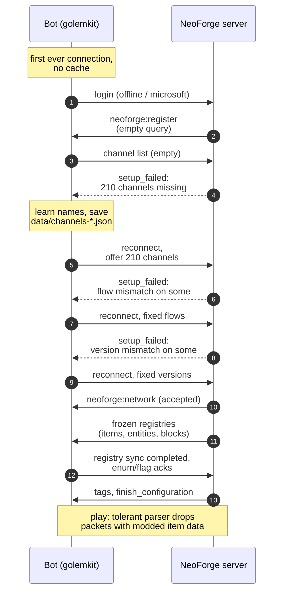

# NeoForge support

Mineflayer only speaks the vanilla protocol. A NeoForge server rejects vanilla clients when
its mods register network channels (any content mod does), so golemkit adds a NeoForge layer
in `src/adapters/minecraft-java/platforms/neoforge/`, the default server platform of the
[Minecraft Java adapter](./adapters.md). Skills and brains never see it.

Everything here is written against NeoForge's 1.21.1 source
(`neoforged/NeoForge`, branch `1.21.1`, `network/payload/` and `network/registration/`).



Later logins start from the cache and are accepted on the first try.

## 1. Channel negotiation

During the configuration phase the server sends an empty `neoforge:register` query and the
client answers with every payload channel it supports, per protocol (configuration / play),
with version, direction (flow) and an optional flag. The server compares lists and either
accepts (`neoforge:network`) or sends `neoforge:modded_network_setup_failed` with a reason per
channel, then disconnects.

The bot can't know a modpack's channels in advance, so it **learns them from the failures**:

1. first attempt offers nothing; the server lists every required channel as missing
2. second attempt offers them; the server reports the expected flow for directional ones
3. third attempt fixes flows; the server reports versions that differ from the default
4. accepted

`ChannelStore` (`channelStore.ts`) applies each failure and caches the result in
`data/channels-<host>-<port>.json`, so later logins pass on the first try. When the modpack
changes, the bot relearns automatically; `just reset-channels` forces it.

Two tricks keep it simple:

- **Everything is offered as optional, on both protocols.** NeoForge silently disables
  optional client channels the server doesn't have, so the bot never needs to know which
  protocol a channel belongs to.
- **NeoForge's own configuration channels are always offered** with their real flows
  (registry sync, config files, data maps, extensible enums, feature flags). The server
  registers them as optional; without them its `CheckExtensibleEnums` task hangs.

## 2. Configuration tasks

After negotiation the server runs NeoForge's configuration tasks. `handshake.ts` answers:

| payload | reply |
|---|---|
| `neoforge:frozen_registry_sync_*` | parsed (see below), then `frozen_registry_sync_completed` |
| `neoforge:config_file` | (none, ignored) |
| `neoforge:known_registry_data_maps` | claims to know all of them (so mandatory ones don't kick us) |
| `neoforge:extensible_enum_data` | `extensible_enum_ack` |
| `neoforge:feature_flags` | `feature_flags_ack` |
| `c:version`, `c:register` | common networking v1 |

Then vanilla configuration finishes and the bot enters the world.

## 3. Unparseable packets

Item stacks carry data components, and modded items carry modded components. Components have
no length prefix, so a stack with an unknown component can't be skipped inside a packet. The
recipe list, the command tree and some inventory/equipment packets fail to parse.

protodef's deserializer turns a parse error into a stream error, which destroys the stream and
silently kills the connection. `tolerantParser.ts` patches `FullPacketParser` to drop the
packet and keep going. Skipped packets are logged once per packet id (all of them at debug
level).

Consequences: inventories and containers can be incomplete when they hold modded items; the
bot doesn't know recipes from the server (mineflayer uses minecraft-data's vanilla recipes).

## 4. Modded item and entity names

During login NeoForge sends its frozen registries: every item, entity type, block and so on,
with the numeric ids this server uses (on mc02: 3111 items, 1778 of them modded; 200 entity
types, 70 modded). `registries.ts` decodes them, caches the item, entity and block maps in
`data/registries-<host>-<port>.json`, and adds the modded entries to each bot's own copy of
the mineflayer registry (minecraft-data maps are shared between bots, so they're copied, never
mutated). It also checks that vanilla ids match minecraft-data and warns if they don't.

The result:

- modded items have real names: `create:andesite_alloy`, `ars_nouveau:source_gem`. They show
  up in inventories and work in actions like `drop`, `deposit` and `equip`;
- modded entities have names and a type: `hostile` if they match a hostile pattern, `object`
  for projectiles/contraptions/effects, `mob` otherwise. Combat and guard only attack
  `hostile` ones.

Hostile patterns: `ars_nouveau:wilden_*` is built in. Add more per bot with
`settings: { moddedHostile: ['somemod:*_zombie'] }` or for everything with
`MC_MODDED_HOSTILE=somemod:ghoul,othermod:*`.

Item stacks that carry modded *data components* still can't be parsed (see section 3), so
those particular stacks remain invisible even though the item's name is known.

## 5. Modded blocks

NeoForge appends modded block states after the vanilla ones, so vanilla state ids stay valid
and anything above the vanilla maximum is modded. prismarine-block would treat those as air,
so the bot would fall through Create casings. `modded.ts` maps them to a stand-in
`modded_block`: a solid, non-diggable full cube. Pathfinding treats machines as walls, which
is the safe default.

Why blocks don't get names like items do: chunks store block *state* ids, and the number of
states each modded block has (its properties) is defined in mod code, not in the registry
snapshot. The block id→name map is cached anyway, for a future step that reads block state
definitions from the mod jars.

Items the registry doesn't know (rare after the sync) show up as `modded#<id>` (`itemName()`).

## Debugging a new server

```bash
MC_LOG_LEVEL=debug just probe
```

shows the negotiation rounds, accepted channel counts, skipped packet ids and the world
snapshot after spawn. If negotiation keeps failing with "nothing new learned", the log lists
the failure reasons it doesn't understand.
