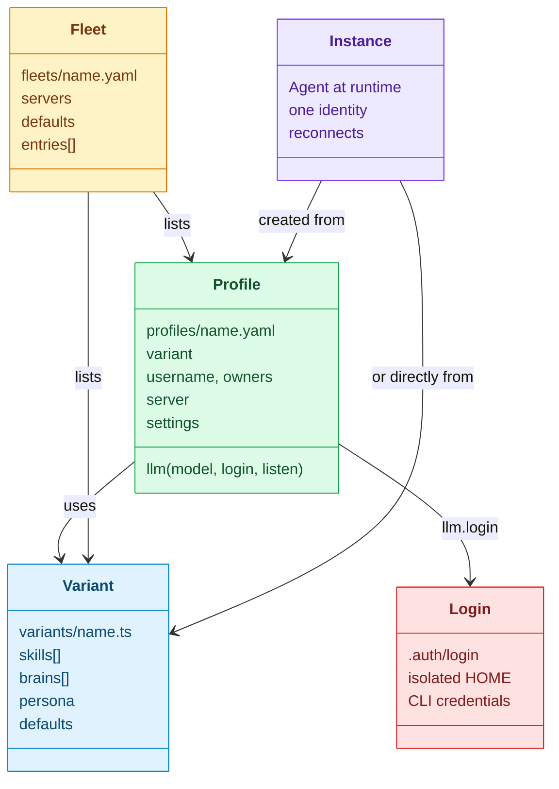
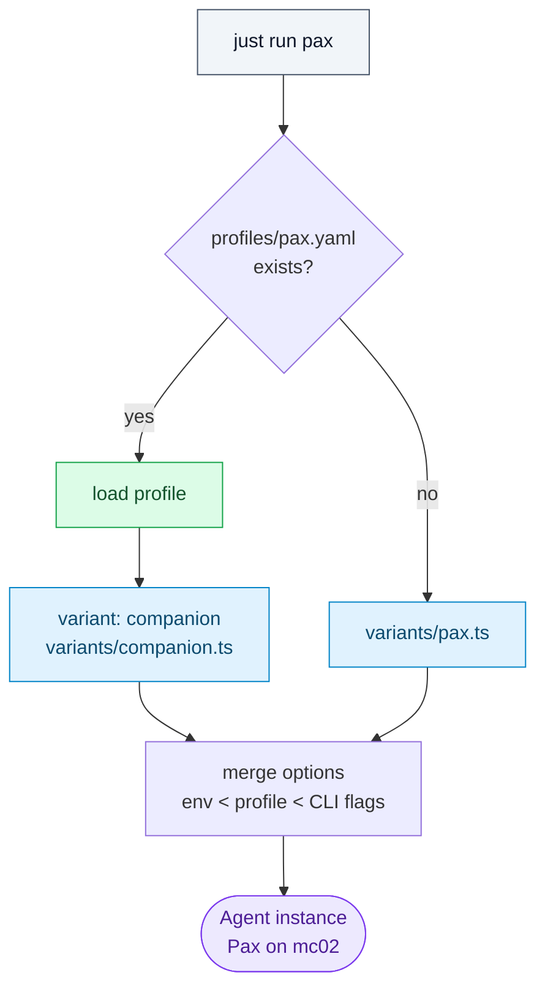
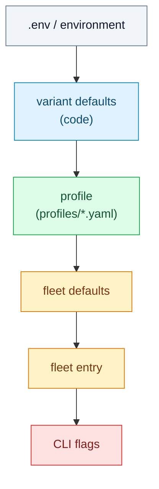

# Variants, profiles, instances, fleets

Five words cover how bots are defined, configured and run.

| term | what it is | where |
|---|---|---|
| **Variant** | a kind of bot: which skills it has, which brains decide, default persona | `variants/<name>.ts` |
| **[Profile](/guide/profiles)** | a saved, named instance config: variant + username, owners, server, LLM, settings | `profiles/<name>.yaml` |
| **Instance** | a running bot (an `Agent`), created from a profile or a variant | runtime |
| **[Fleet](/concepts/architecture#fleets-and-multiple-servers)** | a set of profiles/variants run together in one process, possibly on several servers | `fleets/<name>.yaml` |
| **Login** | an isolated LLM CLI login (the CLI's HOME, holding only its credentials) | `.auth/<login>` |

## Examples in the repo

| variant | what it does | profiles using it |
|---|---|---|
| `buddy` | player assistant driven by `!commands` | `example` |
| `villager` | self-sufficient NPC (needs, routines, chores) | |
| `actor` | performs [scenes](/guide/scenes) with other actors | used by `fleets/scenes.example.yaml` |
| `companion` | LLM companion that talks and acts | `pax` (Sonnet 5.5, subscription token, obeys Robin) |

## How a name is resolved

`just run <name>` and fleet entries accept either a profile or a variant:

## Precedence

Lowest to highest. Each layer only overrides what it sets.

`settings` and `settings.llm` merge one level deep, so a profile can change just the model
and keep the variant's other LLM options.

## When to make what

- **New behaviour or capabilities** (new brains, a different skill set): a new **variant**.
- **Same kind of bot, different identity/config** (another name, owner, model, server,
  persona): a new **profile**. No code.
- **Several bots at once**: a **fleet** listing profiles and/or variants.
- **A second LLM account**: a new **login** (`just llm-login claude --login .auth/alt`) and point
  a profile's `llm.login` at it.
