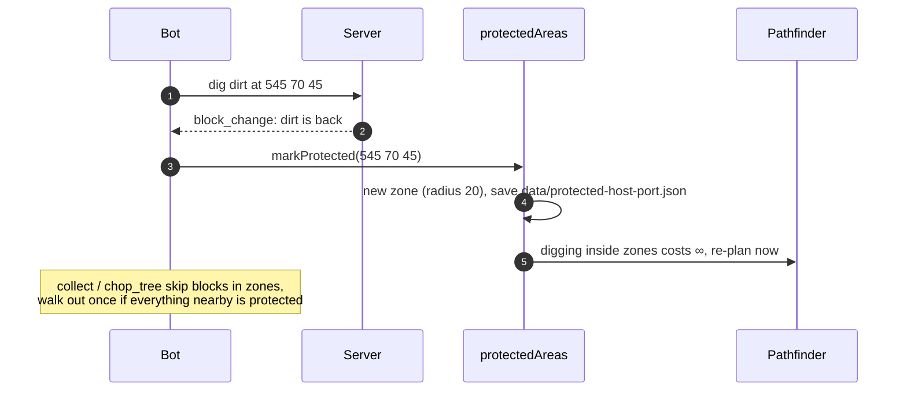
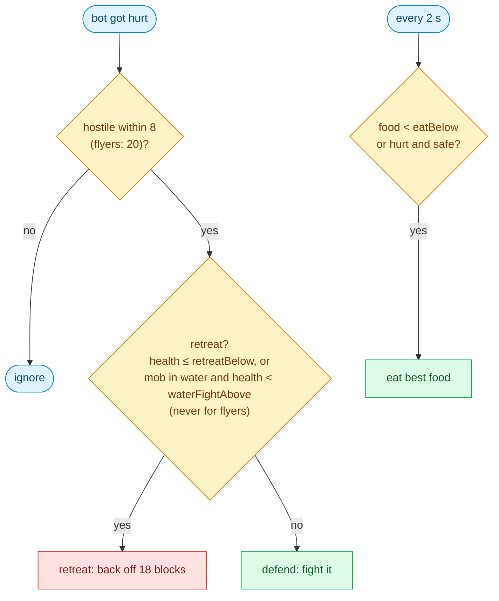

# Movement, protection and combat

How bots get around, what they learn about the world, and how they fight. These live in core
and the standard skills, so every [variant](/concepts/variants-profiles) gets them.

## Long-distance travel

Mineflayer's pathfinder can only plan through chunks the bot has loaded, so a target thousands
of blocks away used to "arrive" without moving. `travel()` (core helper, used by `goto`) walks
in legs:


- `goto` is **long-running**: LLM brains start it in the background and get an `actionDone`
  follow-up with the real outcome; `!goto` in chat replies when it ends.
- It only reports arrival when the bot actually stands at the target.
- [Retries](/guide/profiles#retries) (`retry.actions.goto`) re-run it after "stuck" failures.

```ts
await travel(bot, { x: 640, z: 60 }, signal, { stepBlocks: 64, onProgress: p => log.debug('travel', p) })
```

## Protected areas

Servers refuse block breaking in some places (spawn protection, claims). A refused break looks
like success to mineflayer: it marks the block as air, then the server restores it. Bots learn
these areas instead of looping:



- Zones are saved per server and loaded on every start, for every bot on that server.
- `agent.protectedAreas.isProtected(pos)`, `agent.markProtected(pos)` from code.
- `digBlock()` (skills/world.ts) throws `DigRefusedError` on a refusal; skills that dig use it.
- Delete `data/protected-*.json` if a server's protection changes.

## Hostile mobs

`isHostile()` decides what bots fight. minecraft-data marks some aggressive mobs as plain
"mob", so they're added explicitly; neutral mobs are never targeted proactively.

| | mobs |
|---|---|
| hostile (data says so) | zombie, skeleton, creeper, spider, drowned, witch, ... |
| also hostile | phantom, ghast, slime, magma_cube, shulker, hoglin, ender_dragon |
| never targeted | enderman, piglin, zombified_piglin (neutral), evoker_fangs, skeleton/zombie horses |
| modded | from the [registry sync](/concepts/neoforge#_4-modded-item-and-entity-names); `ars_nouveau:wilden_*` built in, more via `settings.moddedHostile` / `MC_MODDED_HOSTILE` |

**Flying mobs** (phantom, ghast, vex, blaze, breeze, ...) aren't chased on foot: the bot holds
position, tracks them and swings when they dive into reach. Reflexes look up to 20 blocks for
flyers that hit and climbed away, and never try to outrun them.

## Reflexes

The `reflexes()` brain reacts at the highest brain priority (60), preempting everything and
letting long-running actions resume afterwards.



Tune per variant (`reflexes({ ... })`) or per profile:

```yaml
reflexes:
  selfDefense: true
  autoEat: true
  eatBelow: 15          # eat when food drops below this
  retreatBelow: 8       # back off at or below this health; 0 = stand your ground
  waterFightAbove: 14   # don't fight mobs in water below this health; 0 = always fight
```

Pax uses `retreatBelow: 0` and `waterFightAbove: 0`: it always fights back.

## Where this shows up elsewhere

- Deaths, damage and protected areas are recorded in the [journal](../guide/journal).
- [Humanize](../guide/profiles#humanize-player-like-timing) adds reaction and typing delays on
  top of all of this for immersive bots.
- Modded item and mob names come from the [NeoForge registry sync](./neoforge).
