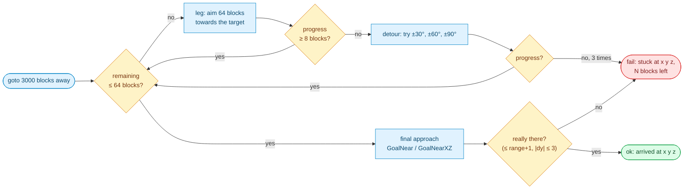
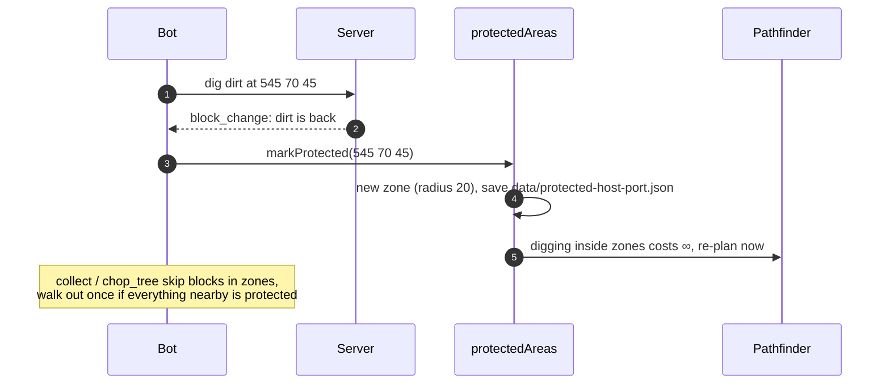
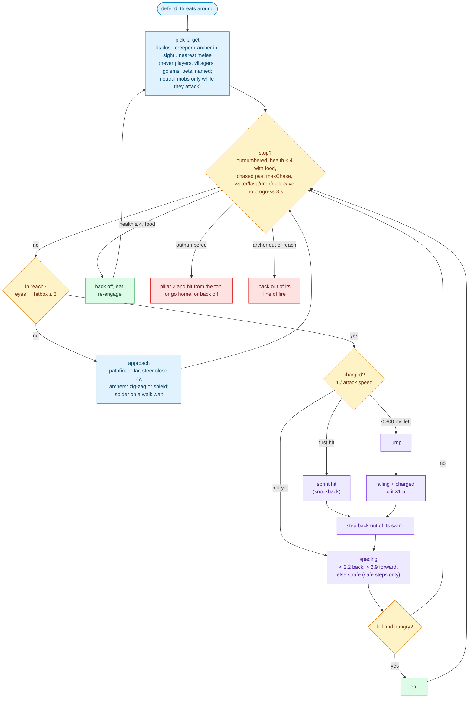

# Movement, protection and combat

How bots get around, what they learn about the world, and how they fight. These live in core
and the standard skills, so every [variant](/concepts/variants-profiles) gets them.

## Long-distance travel

Mineflayer's pathfinder can only plan through chunks the bot has loaded, so a target thousands
of blocks away used to "arrive" without moving. `travel()` (core helper, used by `goto`) walks
in legs:



- `goto` is **long-running**: LLM brains start it in the background and get an `actionDone`
  follow-up with the real outcome; `!goto` in chat replies when it ends.
- It only reports arrival when the bot actually stands at the target.
- [Retries](/guide/profiles#retries) (`retry.actions.goto`) re-run it after "stuck" failures.

```ts
await travel(bot, { x: 640, z: 60 }, signal, { stepBlocks: 64, onProgress: p => log.debug('travel', p) })
```

## Protected areas

Servers refuse block breaking in some places (spawn protection, claims). A refused break looks
like success to mineflayer: it marks the block as air, then the server restores it. Bots learn
these areas instead of looping:



- Zones are saved per server and loaded on every start, for every bot on that server.
- `agent.protectedAreas.isProtected(pos)`, `agent.markProtected(pos)` from code.
- `digBlock()` (skills/world.ts) throws `DigRefusedError` on a refusal; skills that dig use it.
- Delete `data/protected-*.json` if a server's protection changes.

## Hostile mobs

`isHostile()` decides what bots fight. minecraft-data marks some aggressive mobs as plain
"mob", so they're added explicitly; neutral mobs are never targeted proactively.

| | mobs |
|---|---|
| hostile (data says so) | zombie, skeleton, creeper, spider, drowned, witch, ... |
| also hostile | phantom, ghast, slime, magma_cube, shulker, hoglin, ender_dragon |
| never targeted | enderman, piglin, zombified_piglin (neutral), evoker_fangs, skeleton/zombie horses |
| modded | from the [registry sync](/concepts/neoforge#_4-modded-item-and-entity-names); `ars_nouveau:wilden_*` built in, more via `settings.moddedHostile` / `MC_MODDED_HOSTILE` |

**Flying mobs** (phantom, ghast, vex, blaze, breeze, ...) aren't chased on foot: the bot holds
position, tracks them and swings when they dive into reach. Reflexes look up to 20 blocks for
flyers that hit and climbed away, and never try to outrun them.

## Weapons

`fight()` picks what to hit with for each target and re-checks before every swing
(feature flags `combat.*`, live via [`!config_set`](../guide/live-config)):

- **adaptive melee** (`combat.adaptiveWeapon`): scores swords, axes, tridents, maces and tools by
  damage × attack speed with enchantments that apply to this target (Sharpness everywhere,
  Smite vs undead, Bane of Arthropods vs spiders); switches to the hardest single hit when one
  hit kills, and to an axe against shield users. Off: the old fixed sword > axe order.
- **ranged** (`combat.ranged`): with a bow or crossbow and arrows, shoots flyers (phantoms,
  ghasts) and targets more than 6 blocks away, leading moving targets.
- **ranged aim**: arrows are aimed with real arrow physics (gravity 0.05, drag 0.99 per tick)
  and lead the target by its velocity, measured while the bow draws.
- **shield** (`combat.shield`): raises a shield against skeletons, pillagers, blazes and other
  ranged mobs while closing in, and between swings at point-blank archers. A shield already in
  the offhand counts (it used to be missed).

Unknown modded weapons count as a generic sword/axe by name.

## Fighting

`fight()` (loop in `src/skills/fight.ts`, pure decisions in `src/skills/tactics.ts`) runs at
50 ms ticks:



- **Timing**: the swing waits for the held weapon's full charge (sword 625 ms, iron axe 1.1 s,
  stone axe 1.25 s). Switching items resets the charge, so the timer restarts too.
- **Crits** (`combat.crits`): jump when the charge has ≤ 300 ms left, hit once falling. Not in
  water, not under a low ceiling, not against a creeper (no time). The first hit of a fight is a
  sprint hit for knockback instead.
- **Spacing** (`combat.strafe`): zombies reach about 1.4 blocks between centres, the bot 3 blocks
  from its eyes. It keeps 2.2 to 2.9 blocks, strafes between swings, steps back after a hit.
  Every step is checked: no water, lava or fire, no drop over 2 blocks.
- **Archers**: shot with a bow when it has arrows; otherwise approached in a zig-zag sprint, or
  behind a raised shield. When it can't get closer for 3 s it backs out of the line of fire.
- **Spiders** on walls aren't followed; it waits on the ground for them to drop.
- **Chase limit** (`combat.maxChase`, default 16): a fight ends this far from where it started,
  and `defend` caps the total drift, so a reflex fight doesn't drag the bot away from shelter.
- **Outnumbered** (3+ melee mobs within 6, health under half): pillar 2 blocks (zombies can't
  reach feet that high, the bot still reaches their heads) and fight from the top; without
  blocks, go home if it is within 48 blocks, else back off.
- **Sustain**: in a lull (nothing within 4 blocks) it eats when hunger blocks regeneration
  (food < 18), or a golden apple when health ≤ 10. With `combat.disengageToHeal` (default on)
  and health ≤ 4 it backs off ~10 blocks, eats (or, with a full hunger bar, waits a few seconds
  for natural regeneration) and re-engages, even with `retreatBelow: 0`. Standing ground doesn't mean dying.
- **Gear** (`combat.autoArmor`, default on): the reflexes run `gear_up` whenever the inventory
  holds better armour than what is worn (armour points, toughness, Protection; nearly broken
  pieces don't count), and put a totem (health ≤ 10 or no shield) or a shield in the offhand.
  Before this, bots crafted iron armour and never wore it.
- **Reacting**: reflexes start `defend` when hurt (also on any health drop, the backstop for a
  missed hurt event), and before the first hit when a creeper is within 7 blocks or any hostile
  within 4.
- **Night**: `stay_safe` heads home at night with higher priority when the bot has no armour,
  weapon or food; without a home it digs in with `bunker` until morning (needs digging, not
  under a roof already).

Two live benchmarks: `scripts/fight-test.ts` stands the bot outside for a night and counts kills,
deaths and damage taken; `scripts/arena-test.ts` uses an op account to hand out the same gear
after every death and summon the same waves of mobs (2 zombies, a skeleton, a spider, a creeper
every other wave), so runs of different versions compare directly.

## Reflexes

The `reflexes()` brain reacts at the highest brain priority (60), preempting everything and
letting long-running actions resume afterwards.

```mermaid
flowchart TB
  H(["bot got hurt"]) --> M{"hostile within 8<br/>(flyers: 20)?"}
  M -- no --> X(["ignore"])
  M -- yes --> R{"retreat?<br/>health ≤ retreatBelow, or<br/>mob in water and health &lt; waterFightAbove<br/>(never for flyers)"}
  R -- yes --> RT["retreat: back off 18 blocks"]
  R -- no --> DF["defend: fight it"]
  T(["every 2 s"]) --> LOW{"health ≤ 4, mob close,<br/>food (disengageToHeal)?"}
  LOW -- yes --> DF
  LOW -- no --> G{"better armour,<br/>shield or totem? (autoArmor)"}
  G -- yes --> GU["gear_up<br/>(beside the current action)"]
  G -- no --> E{"food &lt; eatBelow<br/>or hurt and safe?"}
  E -- yes --> EAT["eat best food"]
  classDef a fill:#e0f2fe,stroke:#0284c7,color:#0c4a6e
  classDef d fill:#fef3c7,stroke:#d97706,color:#78350f
  classDef g fill:#dcfce7,stroke:#16a34a,color:#14532d
  classDef r fill:#fee2e2,stroke:#dc2626,color:#7f1d1d
  class H,T a
  class M,R,E,LOW,G d
  class DF,EAT,GU g
  class RT r
  class X a
```



Tune per variant (`reflexes({ ... })`) or per [profile](/guide/profiles):

```yaml
reflexes:
  selfDefense: true
  autoEat: true
  eatBelow: 15          # eat when food drops below this
  retreatBelow: 8       # back off at or below this health; 0 = stand your ground
  waterFightAbove: 14   # don't fight mobs in water below this health; 0 = always fight
```

Pax uses `retreatBelow: 0` and `waterFightAbove: 0`: it always fights back. It still backs off
briefly to eat at 4 health or less when it has food (`combat.disengageToHeal`), see
[Fighting](#fighting).

```yaml
combat:                 # all live via !config_set combat.*
  adaptiveWeapon: true
  ranged: true
  shield: true
  crits: true           # jump-crits, sprint into the first hit
  strafe: true          # spacing and strafing between swings
  disengageToHeal: true # back off to eat at <= 4 health when there is food
  autoArmor: true       # wear the best armour, shield/totem in the offhand
  maxChase: 16          # give up a chase this far from where the fight started
```

## Phantoms: bunker

Phantoms fly, so a bot without a weapon can't win against them. When phantoms attack at night
and the bot is unarmed or hurt (and can dig, outside protected areas), reflexes run `bunker`:
dig straight down 3 blocks, seal the hole with a dug block, wait for morning (or until the mobs
leave), climb back out with `climb_out` (dig the block above, jump, place a block underneath, until open sky), and check it really is back at the surface. It won't start when the bot is already under cover. Players and LLMs can call `bunker` and `climb_out` too.

## Tools, stone and wood

Bots climb the tool tiers on their own: stone tools as soon as there is a wooden pickaxe and
three cobblestone, then a furnace, iron (smelted with coal, planks or charcoal) and diamond
tools when diamonds turn up. Stone comes from a safe staircase and strip mine instead of
pathing to buried blocks (never straight down, never next to lava or water), and tall trees are
climbed so no logs stay up there. The upgrade path, the safety checks and how speed is measured
are in [Tool progression and gathering](../guide/progression).

## Whose blocks

By default bots may dig and use **any** block they need (`respectBuilds` off). With
`respectBuilds: true` (profile key, or `!config_set respectBuilds on`) `build` refuses footprints
with blocks that look player-made, unless they're the bot's own work (remembered in `build.own`)
or an owner passes `replace=true`. Spawn protection applies either way: the server enforces it.

Other places still prefer natural sources whatever the setting: woodcutting fells real trees,
strip mining digs natural stone, farm sites avoid builds.

## Falling and drops

The pathfinder never plans drops over 4 blocks, also not into water (mineflayer allows any
height into water by default; off here). Scouting legs aim at the open-sky ground and climb out
with `climb_out` when a leg ends up in a cave or ravine. Death whispers say how many items
dropped (or that there were none); `goto_death` refuses traps where it died twice in 10 minutes.

## Game modes

Bots know their game mode (`gameMode` and a short `gameModeNote` in `observe()`) and notice
when it changes (`gameModeChanged` event).

| mode | what changes |
|---|---|
| survival | everything as described on this page |
| creative | no hunger or damage: reflexes, `keep_fed` and `stay_safe` switch off; `creative_get` puts any item in the inventory; building takes items from the creative inventory instead of gathering; `upgrade_tools` takes the tools instead of mining |
| adventure | hunger and damage apply; breaking/placing is limited by the game |
| spectator | can only fly and watch |

## Where this shows up elsewhere

- Deaths, damage and protected areas are recorded in the [journal](../guide/journal).
- [Humanize](../guide/profiles#humanize-player-like-timing) adds reaction and typing delays on
  top of all of this for immersive bots.
- Modded item and mob names come from the [NeoForge registry sync](./neoforge).
