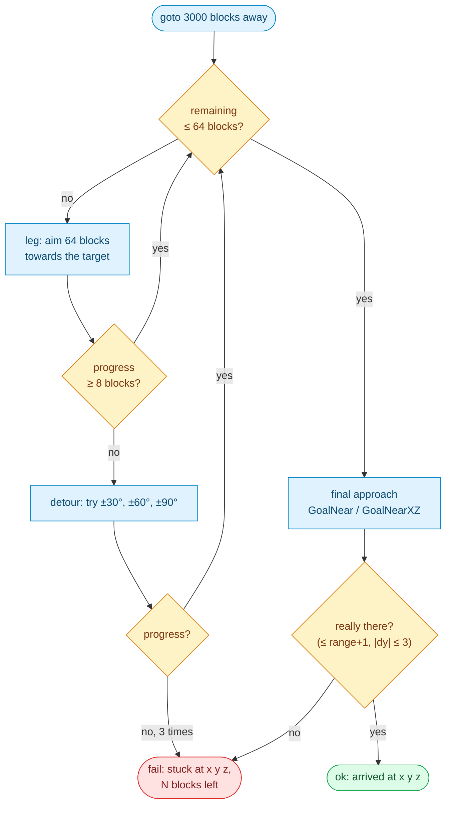
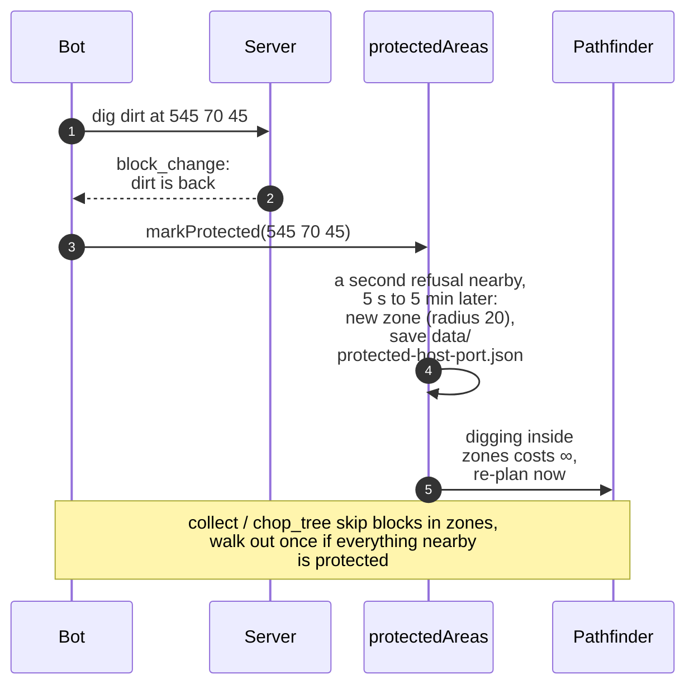
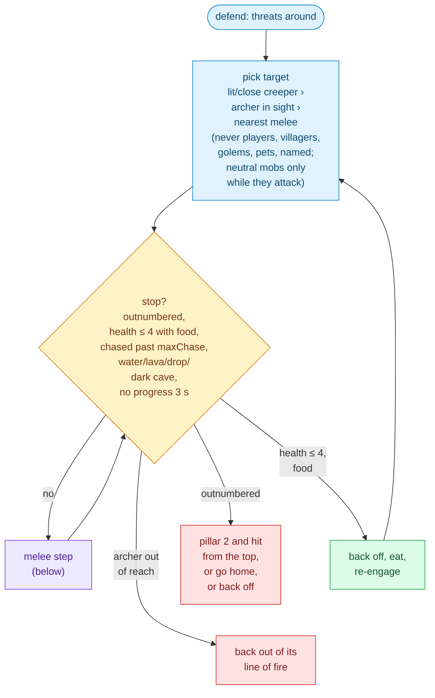
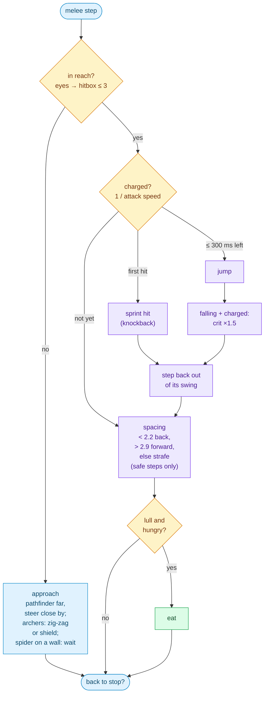
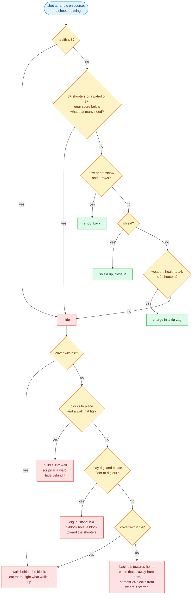
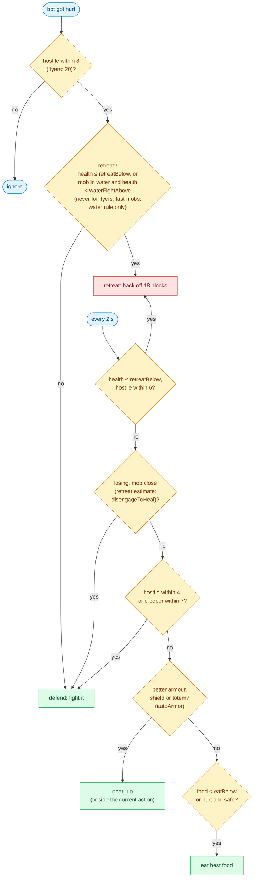

# Movement, protection and combat

How bots get around, what they learn about the world, and how they fight. These live in the
Minecraft Java adapter (`src/adapters/minecraft-java/`: helpers, reflexes) and the standard
skills, so every [variant](/concepts/variants-profiles) gets them.

## Long-distance travel

Mineflayer's pathfinder can only plan through chunks the bot has loaded, so a target thousands
of blocks away used to "arrive" without moving. `travel()` (in
`src/adapters/minecraft-java/helpers.ts`, re-exported from core, used by `goto`) walks in legs:



- `goto` is **long-running**: LLM brains start it in the background and get an `actionDone`
  follow-up with the real outcome; `!goto` in chat replies when it ends.
- It only reports arrival when the bot actually stands at the target.
- It watches the bot's air: the pathfinder walks along lake beds and a sinking bot drowns, so
  below 12 of 20 air the walk stops, the bot gets air the way the [air reflex](#air) does (up,
  through ice or a roof, or to the nearest opening), and the trip carries on (after the third
  time it gives up with "kept running out of air under water").
- The pathfinder prefers dry ground: water costs 3 per block instead of 1, a block of water with
  water above it 2 more, one under a roof within 4 blocks 10 more, and one under ice 30 more
  (`waterStepCost` in `src/skills/airPlan.ts`, set up in the adapter for every movement:
  `goto`, `travel`, `go_home`, `reachMovements`). `travel`'s `avoidWater` raises water to 12.
- [Retries](/guide/profiles#retries) (`retry.actions.goto`) re-run it after "stuck" failures.

```ts
await travel(bot, { x: 640, z: 60 }, signal, { stepBlocks: 64, onProgress: p => log.debug('travel', p) })
```

## Protected areas

Servers refuse block breaking in some places (spawn protection, claims). A refused break looks
like success to mineflayer: it marks the block as air, then the server restores it. Bots learn
these areas instead of looping:



- One refusal is only a suspect: a lag rollback looks the same. A zone needs a second refusal
  within 8 blocks, 5 seconds to 5 minutes after the first (a rollback reverts several blocks at
  once, so refusals in the same burst count once), or a confirmed one (a refused placement inside
  vanilla spawn protection). The pure check is `refusalVerdict` in `src/core/protection.ts`.
- Crop, farmland and plant breaks (tilling and planting in `tend_farm` and `start_farm`, grass
  broken for seeds, kelp) never make a zone (`markProtected(pos, { crop: true })`): a harvest
  rollback during lag once put a false zone over Pax's farm.
- Zones are saved per server and loaded on every start, for every bot on that server.
- `agent.protectedAreas.isProtected(pos)`, `agent.markProtected(pos)` from code.
- `digBlock()` (skills/world.ts) throws `DigRefusedError` on a refusal; skills that dig use it.
- Only the dug block coming back counts. NeoForge echoes the block when digging starts and then
  sends air, and a creative build places the next block into a dug cell within 200 ms: neither
  is a refusal. In creative a sword (or trident, mace) is put away before digging, since a
  creative player can't break blocks with one.
- Delete `data/protected-*.json` if a server's protection changes.

## Hostile mobs

`isHostile()` decides what bots fight. minecraft-data marks some aggressive mobs as plain
"mob", so they're added explicitly; neutral mobs are never targeted proactively.

| | mobs |
|---|---|
| hostile (data says so) | zombie, skeleton, creeper, spider, drowned, witch, ... |
| also hostile | phantom, ghast, slime, magma_cube, shulker, hoglin, ender_dragon |
| never targeted | enderman, piglin, zombified_piglin (neutral), evoker_fangs, skeleton/zombie horses |
| modded | from the [registry sync](/concepts/neoforge#_4-modded-item-and-entity-names); `ars_nouveau:wilden_*` built in, more via `settings.moddedHostile` / `MC_MODDED_HOSTILE` (NeoForge platform) |

**Flying mobs** (phantom, ghast, vex, blaze, breeze, ...) aren't chased on foot: the bot holds
position, tracks them and swings when they dive into reach. Reflexes look up to 20 blocks for
flyers that hit and climbed away, and never try to outrun them.

## Weapons

`fight()` picks what to hit with for each target and re-checks before every swing
(feature flags `combat.*`, live via [`!config_set`](../guide/live-config)):

- **adaptive melee** (`combat.adaptiveWeapon`): scores swords, axes, tridents, maces and tools by
  damage × attack speed with enchantments that apply to this target (Sharpness everywhere,
  Smite vs undead, Bane of Arthropods vs spiders); switches to the hardest single hit when one
  hit kills, and to an axe against a player carrying a shield (an axe hit on a raised shield
  disables it for 5 s). No mob blocks with a shield; vindicators and piglin brutes swing axes,
  which disable the bot's own shield instead. Off: the old fixed sword > axe order.
- **ranged** (`combat.ranged`): with a bow or crossbow and arrows, shoots flyers (phantoms,
  ghasts) and targets more than 6 blocks away, leading moving targets.
- **ranged aim**: arrows are aimed with real arrow physics (gravity 0.05, drag 0.99 per tick)
  and lead the target by its velocity, measured while the bow draws.
- **shield** (`combat.shield`): raises a shield against skeletons, pillagers, blazes and other
  ranged mobs while closing in, and between swings at point-blank archers. A shield already in
  the offhand counts (it used to be missed).

Unknown modded weapons count as a generic sword/axe by name.

## Fighting

`fight()` (loop in `src/skills/fight.ts`, pure decisions in `src/skills/tactics.ts`) runs at
50 ms ticks:



Each melee step:



- **Timing**: the swing waits for the held weapon's full charge (sword 625 ms, iron axe 1.1 s,
  stone axe 1.25 s). Switching items resets the charge, so the timer restarts too.
- **Crits** (`combat.crits`): jump when the charge has ≤ 300 ms left, hit once falling. Not in
  water, not under a low ceiling, not against a creeper (no time). The first hit of a fight is a
  sprint hit for knockback instead.
- **Spacing** (`combat.strafe`): zombies reach about 1.4 blocks between centres, the bot 3 blocks
  from its eyes. It keeps 2.2 to 2.9 blocks, strafes between swings, steps back after a hit.
  Every step is checked: no water, lava or fire, no drop over 2 blocks.
- **Archers**: shot with a bow when it has arrows; otherwise approached in a zig-zag sprint, or
  behind a raised shield. When it can't get closer for 3 s it backs out of the line of fire.
- **Spiders** on walls aren't followed; it waits on the ground for them to drop.
- **Chase limit** (`combat.maxChase`, default 16): measured from where the run of fights started
  (kept until 20 s pass without a fight), and `defend` walks back there afterwards, so reflex
  fights don't drag the bot away from shelter.
- **Creepers first**: a creeper coming within 5 blocks ends the current fight so it gets dealt
  with before its fuse. With a bow and arrows it shoots a creeper from 5+ blocks (not when a
  bodyguard's player is in the line); otherwise it hits once and steps back. A lit fuse within 5
  blocks sends it 7 blocks away until the fizzle (`creeperMove` in `tactics.ts`).
- **Outnumbered** (3+ melee mobs within 6, health under half): it leaves by an escape route, see
  [Leaving fights](#leaving-fights). With `retreat.enabled` off: pillar 2 blocks and fight from
  the top; without blocks, go home if it is within 48 blocks, else back off.
- **Sustain**: in a lull (nothing within 4 blocks) it eats when hunger blocks regeneration
  (food < 18), or a golden apple when health ≤ 10. With `combat.disengageToHeal` (default on)
  it leaves a fight it is losing ([Leaving fights](#leaving-fights)), even with
  `retreatBelow: 0`. Standing ground doesn't mean dying. With `retreat.enabled` off the old rule
  applies: at health ≤ 4 it backs off ~10 blocks, eats (or waits for natural regeneration) and
  re-engages.
- **Gear** (`combat.autoArmor`, default on): the reflexes run `gear_up` whenever the inventory
  holds better armour than what is worn (armour points, toughness, Protection; nearly broken
  pieces don't count), and put a totem (health ≤ 10 or no shield) or a shield in the offhand.
  Before this, bots crafted iron armour and never wore it.
- **Reacting**: reflexes start `defend` when hurt (also on any health drop, the backstop for a
  missed hurt event), and before the first hit when a creeper is within 7 blocks or any hostile
  within 4. Shooters out of reach get `ranged_defense` instead, see [Ranged threats](#ranged-threats).
- **Night**: `stay_safe` heads home at night with higher priority when the bot has no armour,
  weapon or food; without a home it digs in with `bunker` until morning (needs digging, not
  under a roof already).

### Leaving fights

Pax fought to the death: 62 of its 126 deaths were in `defend`, the median health before the
last hit was 1.7, and it had no armour and a stone sword. The old rule left at 4 health, which
against two zombies (3 damage each, a hit a second) is one exchange from dying, and it backed
off at walking pace before eating. `settings.retreat` (`src/skills/retreatPlan.ts`, pure and
tested; glue in `retreat.ts` and `escape.ts`) replaces it with three decisions.

**When to leave.** Every fight tick it estimates what the threats will do over the next
`retreat.hits` attack cycles (default 2, one second each): for each hostile within 12 blocks (16
for archers with a line of sight) it takes the mob's damage per hit and cooldown from a table,
the time it needs to walk into reach, the bot's armour points, toughness and protection (the
vanilla formula), a share of hits blocked by a shield (`shieldBlocks`, 0.4) and the server's
difficulty. It leaves when health is at or below that estimate, or at `retreat.floor` (4)
whatever the estimate says. Two zombies on an unarmoured bot come to 12 damage, so it leaves at
12 instead of 4; one zombie, 6; full iron armour against two zombies, about 5.5. Once leaving it
keeps leaving until health is `hysteresis` (4) above the estimate, so it doesn't step in and out
at the edge. Creepers are left to the creeper rules (their blast would make every creeper a
retreat).

**Where to go.** The escape routes are a list, tried in the order of `retreat.routes` (default
`home, pillar, sprint, bunker`: bunker last, since digging three blocks under a crowd failed in every live try while sprinting worked); leave one out to turn it off. Each has its own check:

| route | does | not when |
|---|---|---|
| `home` | `go_home`, then shuts open wooden doors next to it (`closeDoors`) | no home, home further than `homeRadius` (40), the way home runs through the mobs, a mob that outruns it (vindicator, ravager, wolf...) |
| `pillar` | pillars `pillarHeight` (2) blocks: zombie reach ends below its feet and it still hits their heads; fights from the top, eats, waits to heal | no blocks, may not place, protected area, in water, no room above, an archer (it would be shot off), spiders, endermen, slimes or flyers |
| `bunker` | the `bunker` action: dig down 3, seal the hole, wait for the mobs to leave | may not dig, protected area, in water, already under a roof, nothing to seal with |
| `sprint` | sprints straight away from the mobs (steering around drops, water and walls, jumping when stuck) until the nearest is `sprintDistance` (24) blocks off; 12 blocks ahead still counts | a mob that outruns it |

After the route it eats (when hungry and it has food) and waits until health is `returnAbove`
(16), at most `healSeconds` (60). With `comeBack` on it then fights the mobs that are still around:
after going home the fight is anchored at home (it doesn't walk back out after mobs it left
behind), after the other routes where it left. A mob right on it ends the wait and it fights.
With a melee mob within 3 blocks the pillar and bunker routes first sprint a few blocks off:
in the first live runs every pillar and bunker failed because the zombies' hits knocked the bot
off its spot, and the pathfinder's back-off re-planned under every hit while two zombies kept up.
`maxEscapes` (2) per `defend` run stops it from running in circles; after that, or when no route
works, it falls back to backing off to eat and then fights where it stands. Shooters stay with
`ranged_defense`, which hides behind cover, builds a wall or digs in when a fight ends this way;
when melee mobs are on it as well (zombies while it charges a skeleton, how the mixed duels killed
it) it takes the escape routes instead, since cover doesn't stop a zombie. While an escape runs the
reflexes leave the bot alone (in the first mixed runs `ranged_defense` kept taking over to build
cover with a zombie on the bot).

**Whether to fight in the open at all.** Before `defend` takes on the first mob it counts what is
against it: no armour (under `minArmour` points), night, and `outnumberedAt` (2) or more melee
mobs within 8 blocks. With `avoidFactors` (2) of them it doesn't fight in the open: it goes home
(same checks as the home route) or fights from a 1-wide gap such as a doorway (`avoidRoutes`,
default `home, chokepoint`), and only fights where it stands when neither works. It always fights
when an owner within 16 blocks has a hostile on them, or when every mob close outruns it. A
bolder profile sets `avoidFactors: 3` or `avoidOpen: false`.

The log says why it left and where it went (`retreat: left the fight (health 11 would not
survive 2 zombie for 2 s (about 12 damage)), escaped to a 2-block pillar at 1250 65 445; healed
to 16`), the `defend` result carries the same line, and the status shows it as `event`
(`just status`).

**Live bench** (guard-bench `--duel`, stone sword, no shield, no armour, 16 cobblestone,
`--retreat-below 0` like Pax, 2 minutes per duel, one round each, server time kept; mobs
spawning naturally at night joined some runs, so the numbers are noisy):

| duel | old rule (deaths / damage / kills) | risk retreat (deaths / damage / kills, escapes) |
|---|---|---|
| 3 zombies | 2 / 82 / 15 | 1 / 82 / 14 (pillar 1, sprint 1); 1 / 66 / 14 (sprint 3) |
| zombie, skeleton, creeper (3) | 0 / 32 / 0 (8 mobs came) | 2 / 95 / 3 before the ranged fix; 1 / 75 / 6 after |
| 2 skeletons | 2 / 85 / 6 | 0 / 36 / 4; 1 / 64 / 2 (drowned after a fall into water) |

What the runs taught: the first version's pillar and bunker failed under every hit and the
pathfinder back-off couldn't shake two zombies, so the sprint is steered by hand and contact is
broken before pillaring; digging in under a crowd never worked, so bunker went last; a phantom
overhead blocked every sprint until flyers stopped counting as mobs that outrun the bot; and in
mixed fights `ranged_defense` kept building cover with a zombie on the bot. The sample is too
small to claim fewer deaths; the escapes themselves now work (sprint 16+ blocks clear, pillar up,
healed to 18-20 before coming back).

### Skilled-player techniques

What strong players do in the 1.9+ combat system, and what the bot does with it. The mechanics,
numbers and sources are on [Combat research](./combat-research); the decisions are pure functions
in `src/skills/techniques.ts` (unit-tested in `test/techniques.test.ts`), wired into the fight
loop, `defend` and the reflexes. Each one has a live toggle, on by default except PvP:

- **Hit styles** (`combat.sprintReset`, `combat.sweep`): before every charged hit the loop picks
  one of crit (jump, hit falling, x1.5), sprint hit (a knockback level more, no crit), sweep
  (sword, on the ground, not moving: every mob within a block of the target takes
  1 + damage x level / (level + 1)) or plain. A sweep wins when the extra mobs' damage beats a
  crit's +50% on the target (3+ bunched without Sweeping Edge, 1+ with Sweeping Edge III).
  Knockback wins against creepers, at 8 health or less and with 3+ melee mobs close, and
  whenever a crit isn't possible (water, low ceiling). The sprint hit is a **W-tap**: sprint goes
  off right after the hit (the server ends it anyway) and on again 150 ms before the next charge
  completes, so every such hit carries the sprint knockback, not only the first one.
- **Shield timing** (`combat.shieldMelee`): between swings, when the next one is more than 350 ms
  away, the shield goes up against the melee mob it fights (a shield needs 5 ticks to start
  blocking) and comes down 60 ms before the charge completes. Axe users (vindicators, piglin
  brutes, players with an axe) are blocked too: the axe hit does no damage, then the shield is
  disabled for 5 s, which the bot reads from the server's `set_cooldown` for the shield and
  waits out. A totem that went into the offhand for low health is not swapped out for it.
- **Creeper behind the shield**: a lit fuse the bot can't outrun is faced with the shield up
  while backing off; a blocked explosion does no damage. "Can't outrun": distance plus 2 blocks
  per second (walking away from a creeper that follows) over the rest of the 1.5 s fuse stays
  under the 7 blocks where the fuse stops. Otherwise it runs as before. Fighting one creeper
  while another lights its fuse within 5 blocks switches to the lit one.
- **Totem** (`combat.totem`): at 8 health or less (10 while on fire), or in a fall that would
  kill, a totem of undying goes into the offhand at once (on the health event, not on the 10 s gear check). It stays
  there until health is back above 14.
- **Golden apples** (`combat.goldenApple`): at 8 health or less (12 with three or more melee mobs
  within 4), not with a lit creeper close, it eats a golden apple on the spot while backing off
  (1.6 s; absorption and regeneration II), instead of waiting for a lull or for 4 health.
- **Water bucket** (`combat.waterClutch`): during a fall that would do 3+ damage (or kill), the
  reflexes start `water_bucket`: it holds the bucket and looks down, places water when the ground
  comes within bucket reach of its eyes (4.2 blocks), lands in it and scoops it back up. Burning
  on solid ground, it puts water at its feet and takes it back. Never in the Nether. Very fast
  falls (50+ blocks, close to 4 blocks per tick) can skip the placing window; Feather Falling
  is counted.
- **Enderman gaze** (`combat.endermanGaze`): every `bot.look` (pathfinder, fights, idle looking
  around) is checked against the vanilla rule (view vector vs the enderman's eyes, dot product
  above 1 - 0.025 / distance, within 64 blocks); when it would meet an enderman's eyes the
  pitch is lowered until it doesn't. Endermen already fighting the bot are exempt, and so is a
  carved pumpkin on its head. Arrows aren't wasted on endermen (they teleport away) or breezes.
- **Chokepoints** (`combat.chokepoints`): three or more melee mobs coming and health at half or
  more, `defend` looks for a cell within 6 blocks walled on both sides whose neighbour towards
  the mobs is walled on both sides too (a 1-wide corridor or doorway), walks there and fights
  without strafing, so the mobs reach it one at a time. Under half health the outnumbered rules
  (pillar, home, back off) apply as before.
- **No running from fast mobs** (`combat.fightFastMobs`): the low-health back-off
  (`reflexes.retreatBelow`) doesn't apply to mobs that outrun the bot (vindicators, ravagers,
  spiders, wolves, piglin brutes, hoglins): backing off only turned its back on them. It keeps
  fighting; golden apples and the back-off to eat at 4 health still apply, and so does the
  water back-off (`reflexes.waterFightAbove`) from one standing in water.
- **Warden**: never fought (500 health, its hits go through shields); hit by one, the bot backs off.
- Kept from before: weapon-cooldown timing, crit jumps, the sprinted first hit, spacing and
  strafing, hit-and-step-back, bow lead with arrow physics, shield against archers, pillaring
  when outnumbered, bunkering from phantoms, healing breaks.

Not done, and why: ender pearls (aiming a pearl to a safe spot needs landing prediction and
costs 5 HP; little use against mobs), building cover walls mid-fight against crowds (the
`ranged_defense` reflex already builds cover against archers), cobwebs against spiders, potions.

### Dodging

Most of Pax's deaths are arrows (38 of 126, 34 of them skeletons) and melee mobs (42, 31 of them
zombies), with creepers a distant third. Before this layer the fight loop only defended by
walking: a left/right strafe flipped on a random timer, a short walk back after each hit, and a
zig-zag on the way to an archer. It never looked at an arrow. The dodge layer
(`src/skills/dodgePlan.ts`, pure and tested in `test/dodge-plan.test.ts`; `src/skills/dodge.ts`
wires it to the world) owns how the bot moves during a fight. When to leave a fight stays with
`tactics.ts` and `combat.ts`.

The basic move is a **leap**. Vanilla only sprints forward, but a bot turns in one tick, so it
faces the way it wants to go, sprints and jumps, and snaps back to its target after `leapMs`
(200 ms). A sprint-jump covers about 1.5 blocks in 6 ticks, enough to take the 0.6-wide body out
of an arrow's path or out of a zombie's reach. Every leap is checked first: along the way and
where it lands there must be no wall, water, lava, fire, powder snow or harmful block, and no
drop deeper than `maxDrop` (2). The old `safeStep` only looked one step ahead.

The per-tick techniques sit in a small list (`DODGE_TECHNIQUES`). The first one with an answer
wins, and a new technique is one more entry in the list:

- **Draws** (`combat.dodge.draws`): a skeleton fires 20 ticks after it raises its bow, and the
  raised bow shows in its metadata (living entity flags, hand active). Close by (`drawRange`,
  10 blocks) an arrow is too fast to react to: at 8 blocks it arrives in about 5 ticks, and with
  50 to 100 ms of latency the bot sees it late and its move lands late. So it reacts to the draw
  and leaps a tick before the release, which is enough because the skeleton aims at where the
  bot stands when it lets go. A pillager's crossbow is less predictable: it fires 20 to 39 ticks
  after charging (`is_charging_crossbow` going off), so in that window the bot jukes sideways
  every few hundred ms instead.
- **Arrows** (`combat.dodge.arrows`): every projectile in flight is simulated with its own drag
  and gravity against the bot's box (inflated by the projectile's size and `arrowMargin`), with
  the bot's current motion included. The server sends arrow positions only every 20 ticks, so the
  layer moves each one forward itself from the spawn velocity. When one will hit, it works out
  how far it must move to each side to be clear and how far a leap gets in the ticks left (minus
  `latencyMs`), then leaps to a side that clears in time.
- **Melee timing** (`combat.dodge.meleeTiming`): zombies and most melee mobs swing at most once
  every 20 ticks. The layer notes each mob's swing (the arm-swing animation, or the hit it lands)
  and knows when it can swing again. Its reach comes from vanilla's attack box, which is its own
  box grown by 0.83 on each side and is axis-aligned, so a zombie reaches 1.43 blocks along an
  axis and about 2 on the diagonal. While every close mob is recharging the bot holds its ground
  and hits (no step back after its own hit). Before a mob's swing is ready (`meleeLeadMs` plus
  `latencyMs`) it gets out to the mob's reach plus `meleeMargin`, walking back if that is fast
  enough and leaping along the axis that clears the box soonest if not. The sprint for a W-tap is
  skipped while it does.

Draws and arrows also work outside the melee loop. Against archers without a bow or shield the
bot spends most of the time in `ranged_defense`, walking to cover or backing out of range, and
that is where the first bench showed it getting shot. Those walks now stop when an arrow or draw
leap is due (checked every 150 ms), the bot leaps, and `ranged_defense` decides again from where
it landed.

Which side to leap to is never fixed. Of the sides that are safe and clear in time it picks the
one with fewer mobs where it lands, and between equal sides it picks at random. It also avoids
going the same way three times running, so an archer can't learn the pattern and the bot doesn't
drift off in one direction.

- **Creeper leap** (`combat.dodge.creeperLeap`, off by default, see the bench below): where `tactics.creeperMove` says to back off from
  a lit fuse, it now says `leap`. The bot sprint-jumps away instead of walking, but only as far as
  the fuse needs: it stops once the fuse is out or the creeper is 7.2 blocks off (a fuse stops
  at 7), or after `creeperLeapMs`. The first bench leapt a fixed time, ended up 8 to 9 blocks
  away, and `defend` then gave up the creeper at its chase limit, so it killed none. It steers around unsafe
  ground, and only walks off with the pathfinder when no direction is safe. The shield-or-run
  choice (`creeperEscape`) counts the faster escape (3.5 blocks a second gained instead of 2), so
  more fuses are outrun than blocked.

The fight result counts `dodges` (leaps of every kind) and `arrowsDodged` (arrow or draw leaps
with no projectile hit in the next 1.2 s); `defend` reports them next to the other technique
counters. `just guard-bench --duel ... --dodge on,off` measures the layer against the old
movement.

Bench, 27 Nov 2026 on mc02: stone sword, no shield, no armour, two mobs at a time, 2-minute
rounds, the server's own daytime (`--wait-day`), dodge on and off in the same session. The
rounds are short and the server lagged (one round had a timeout kick), so read these as a
direction, not a measurement:

| duel | dodge | kills | deaths | health lost | per kill | arrow hits | arrows dodged |
|---|---|---|---|---|---|---|---|
| skeleton (2 rounds) | on | 5 | 0 | 36 | 7.2 | 7 | 12 |
| skeleton (2 rounds) | off | 4 | 2 | 107 | 26.8 | 23 | 0 |
| zombie | on | 16 | 1 | 44 | 2.8 | 0 | 0 |
| zombie | off | 17 | 0 | 45 | 2.6 | 0 | 0 |
| creeper (2 rounds, leap on) | on | 4 | 0 | 26 | 6.5 | 0 | 0 |
| creeper (2 rounds) | off | 17 | 0 | 15 | 0.9 | 0 | 0 |
| mixed (2 rounds) | on | 4 | 3 | 112 | 28 | 5 | 9 |
| mixed (2 rounds) | off | 3 | 0 | 48 | 16 | 7 | 1 (a fight left over from the round before; fixed) |

Against skeletons it is clearly better: about a third of the arrow hits and a quarter of the
health lost per kill, no deaths. Most of that came after the dodges were wired into
`ranged_defense` too; before that the first round showed 16 arrow hits for 7 leaps, because a
poorly geared bot spends most of a skeleton fight walking to cover or backing off. Melee timing
did nothing measurable against zombies: the bot still jumps for crits inside a zombie's reach,
and most hits land while it is in the air, where a leap can't start. The creeper leap cost kills
without saving health (the creeper follows, lights again, and the bot spends the round leaping),
so it ships off. The mixed duel is inconclusive: the deaths with dodge on were a skeleton charge
with a zombie on its back and a creeper that blew up while the bot ate, neither a dodge, but the
sample is too small to say the layer is not to blame.

### PvP

Bots don't fight players unless the owner says so. `combat.pvp` picks how far it goes (default
`off` for the framework; Pax's profile doesn't change it):

| Mode | What the bot does |
|---|---|
| `off` | never fights a player |
| `defend` | fights back a player who hits it, or who hits the player it guards while the bodyguard is armed; stops when they haven't hit for 5 s or are more than 10 blocks away |
| `revenge` | `defend`, and remembers players who killed or attacked the bot, an owner or the guarded player (a grudge), and attacks them on sight for `combat.revengeMinutes` (30) or until it killed them `combat.revengeKills` times (1), then forgives them |
| `targets` | attacks the players on `combat.targets`, plus grudges |
| `all` | attacks every player within range, plus everything above |

Safety rails, in every mode:

- owners and `combat.friends` are never fought, and never get a grudge or a place on the target
  list; neither are players in creative or spectator, or the bot itself;
- in the attacking modes (`revenge`, `targets`, `all`) players inside a protected area (learned
  spawn protection or claims, or `world.spawnProtection` around the world spawn) are left alone
  while `combat.spareProtected` is on (default);
- only owners change the mode or the lists (`!pvp`, `!attack_player`, `!hunt_player`,
  `!config_set`); an LLM or [NPC brain](/guide/npc-brain) can't start PvP. Anyone may make it more peaceful
  (`!pvp off`, `!pvp defend` when the mode is higher, `!spare_player`, and "pax pvp off", "pax
  stop attacking", "pax leave bob alone"): the command and intents brains take these from any
  player and ignore everything else non-owners say;
- the kill switch: `!pvp off`, or "pax stop" / `!stop` from an owner, ends every fight with a
  player and every hunt at once; `stop` also drops an attacking mode to `off` (`defend` stays,
  it only answers attacks);
- mode changes are whispered to the owners online; nothing is said in public unless
  `combat.taunts` is on (a short line after a win);
- `reflexes.selfDefense` off turns off `defend`; the attacking modes have their own switch (the mode).

```sh
!pvp                    # mode, targets, grudges and hunts (also !pvp_list, !grudges)
!pvp revenge
!attack_player Bob      # on the target list; switches off/defend/revenge to targets
!hunt_player Bob        # ...and go find them (where they were last seen) and fight them
!spare_player Bob       # off the list, grudge forgiven, fight or hunt ended
!pvp off                # kill switch
!config_set combat.friends Alice,Carol
```

In plain words (intents, owners only): "pax pvp all", "pax attack Bob", "pax hunt Bob",
"pax stop attacking Bob", "pax leave Bob alone", "pax stop attacking" (= PvP off), "pax stop".
"attack" and "hunt" only take the name of a player who is online, so "attack the zombie" or a
typo never adds a target; `!attack_player` adds an offline name.

**Starting a fight.** Every 500 ms the reflexes look for an allowed player within
`combat.pvpEngage` blocks (16) and in sight (or within 4): grudges first, then targets, then
anyone (mode `all`), nearest first. A gear check runs before it starts: the duel odds are the
time the player needs to kill the bot over the time the bot needs to kill them, from health,
armour (the vanilla formula), the best weapon (theirs is what they hold, at least a stone
sword), a shield, a totem and golden apples. Below `combat.pvpMinOdds` (0.7) it doesn't start the
fight; a grudge does with `combat.revengeIgnoresOdds`. A player it gave up on waits a minute.

**Giving up.** Past `combat.pvpChase` blocks (48) from where the fight started, after
`combat.pvpLostSec` seconds (30) without seeing them, or when they pearl or teleport away past
half the chase limit. A hunt (`hunt_player`) walks to where the player was last seen (this
session) and gives up after `combat.huntMinutes` (10).

**Fighting a player** (`combat.pvpTactics`, default on; off = the mob fight loop). Players strafe,
block, crit, shoot, pearl and heal, so the PvP loop (`pvp-fight.ts`, decisions in
`pvp-tactics.ts`) reads the enemy every tick: what they hold, a raised shield (living-entity
flags), a drawn bow, their last swing (so it knows when their hit is charged), velocity from
position samples, their health:

- weapon: the axe against a player who carries a shield (every hit on a raised shield turns it
  off for 5 s, and its big hits lose less to armour), the sword otherwise; swaps happen on the way
  in, since a swap resets the charge; with an axe in hand a raised shield gets hit at once, charged
  or not;
- hits on full charge, jump crits, a sprinted first hit, W-tap sprint hits when the enemy has a
  drop or lava behind them (knock them off) or the bot is losing; aim 2 ticks ahead of their
  movement;
- footwork: sprint in strafing (a faster zig-zag against a drawn bow), step into reach only when
  the hit is (almost) charged, circle at about 3 blocks while it charges (blocking), step back
  inside 2.4, or when their swing is ready and it has no shield; without an axe against a raised
  shield it works round to the side;
- shield: up when an arrow is on course or a bow is drawn at it, and in reach whenever its own
  hit is more than 5 ticks (the raise delay) from charged; down a tick before it hits;
- bow at 12 to 40 blocks with arrows, with lead from arrow physics, unless they block or close in
  faster than a draw takes; melee once close;
- sustain: a totem into the offhand at 10 health, a golden apple at 12 (stepping back while it
  eats), back off to heal when low with nothing to heal with and losing, then come back at 14
  health or 4 more than theirs; normal food when they're 10+ blocks away;
- terrain: never stands with a drop or lava behind (sidesteps to the safe side, or presses
  forward when boxed in), doesn't follow into liquid and stops at the chase limit.

Server rules come first: plenty of servers ban bots or PvP outside arenas. Leave it `off` unless
the server allows it. The bot-vs-bot benchmark is on [Behaviours](../guide/behaviors#pvp-benchmark-just-pvp-bench).

Two live benchmarks: `scripts/fight-test.ts` stands the bot outside for a night and counts kills,
deaths and damage taken; `scripts/arena-test.ts` uses an op account to hand out the same gear
after every death and summon the same waves of mobs (2 zombies, a skeleton, a spider, a creeper
every other wave), so runs of different versions compare directly.

## Ranged threats

Skeletons, strays, bogged, pillagers, witches, blazes, ghasts and drowned holding a trident shoot
from range, so waiting for the first hit (or walking on through the fire) is how bots died. Pax,
starving at food 0 on a find_food leg, was shot by a pillager near its base and only reacted to
the last bolt: the health-drop backstop ignored every drop at food 0 as starvation, and nothing
looked at shooters further than 8 blocks.

Every bot with the combat skill now keeps a ranged watch (`skills/ranged.ts`):

- **Shooters**: those within 24 blocks with a clear line between the bot's eyes and theirs, or
  that hurt it in the last few seconds. A shooter in its range with a line to the bot and looking
  at it counts as aiming.
- **Projectiles**: each arrow, bolt, trident, thrown potion or fireball near the bot is simulated
  forward (gravity and drag per tick, from the spawn packet's velocity or position samples);
  one that passes through the bot's body is an alarm before it lands. The spawn packet names the
  owner, so the shooter is known; arrows from players don't count.
- **Hits from range**: damage events name the shooter. A health drop the event didn't explain
  is blamed on a shooter with a line to the bot, even at food 0, so starving no longer hides a
  pillager.
- **Patrols**: pillagers, vindicators, evokers and ravagers within 24 are counted.

The `ranged_defense` action (reflex priority, so it preempts whatever job runs: find_food,
[find_target](/guide/search), chop_wood_loop; they resume afterwards) answers with `rangedResponse` in
`ranged-plan.ts`:



- **Gear score** (`gearScore`, 0-100): armour points (35 for a full 20), a shield (20), the best
  melee weapon's damage (15 at 8+, slow weapons count a little less), a bow or crossbow with arrows
  (15 at 16+ arrows, nothing without arrows) and health (15 at 20). Against 3 shooters (or a patrol
  of 3) it needs 65, and 5 more for each one beyond (`gearNeeded`). Iron armour, a shield and an
  iron sword at full health score 72.5, so they take on 4 but not 5; with a bow and arrows (87.5)
  up to 7. The same gear at 14 health (68) takes on only 3. With 1 or 2 shooters the gear isn't
  scored; the rest of the chart decides.
- **Cover** (`findCover`): a standable spot within 8 blocks (2 up or down) where a solid block
  is on the line from the bot's head and chest to every shooter's eyes, cheapest first by walking
  distance, with a penalty for walking towards them or ending within 4 blocks of one. If a
  shooter comes round and sees it again it looks for new cover; one walking up within 4 blocks
  is fought there.
- **Building cover** (`planWall`): with no cover within 8, a filler block in the inventory
  (cobblestone and dirt first, then stone, planks, logs...; `pickCoverBlock`) and block placing allowed (`settings.canPlace`), it places a
  wall where it stands: the cells around it that block the head and chest lines to every shooter,
  picked greedily (the cell that blocks most open lines first), each with something solid to place
  against (the block below goes in first). Against one shooter on flat ground that is 2 blocks, a
  1x2 wall towards it; against two on opposite sides 4. When the ground around won't take blocks it
  pillars up 1-2 blocks and walls from there, if that's cheaper (a pillar block counts double).
  Cells its body overlaps and cells in protected areas are never used, and the plan is capped at 6
  blocks (or what it carries). It logs `ranged: building cover at x y z: 2 cobblestone against the
  skeleton`. It first waits to stand still on the ground and plans again from there. Snow layers and
  grass are cells it fills, never faces it places against (`coverCell`; deeper snow is dug out
  first). A wall that turns out not to cover it (seen right away) or that couldn't be placed
  isn't tried again for 10 s, and the log says why it couldn't. The blocks stay where they are afterwards.
- **Hiding time**: behind cover it leaves as soon as every shooter is gone, or at 16+ health with
  nothing shooting at it, and at the latest after 4 s (health 16+), 8 s (12+) or 15 s (below).
  After a fight that went badly (it stopped to heal, got outnumbered or gave up) it hides for 3 s
  at 16+ health, 6 s at 12+, 10 s above 8 and 15 s below (`hideMs`), and stops hiding early when
  healthy and no shooter has a line to it.
- **Retreat cap**: backing off goes straight away from the shooters, but never more than 24 blocks
  (`RETREAT_CAP`) from where the shooting started (a run that ended less than a minute ago counts
  as the same spell). At the cap it stands its ground with a bow, shield or weapon; with none of
  those, or at 8 health or less, it may go 16 blocks further. Before backing off at all it looks for cover up to 14 blocks
  out, so cover wins over distance.
- **Heavy fire** (`heavyFire`: outnumbered for its gear score, or 8 health or less) changes the
  order in the chart: every second in sight is a hit from each shooter, so it takes whichever of
  cover, a wall where it stands or digging in (`digInRefusal`, `digInSeconds`) leaves it the
  shortest time in the open (`exposureHits`), as long as that is under 3 expected hits
  (`SLOW_HITS`). Only when nothing is that quick does it get out of sight, up to 48 blocks
  (`FLEE_CAP`) from where the shooting started, towards home when home lies roughly away from the
  shooters, blocking an arrow with a shield on the way when it has one. The slowest way of hiding
  is the fallback when it can't back off any further. A choice is kept at least 2 s while it still
  works (`holdDecision`), so it doesn't flap between backing off and a cover spot. The numbers and
  the benchmark are under [Ranged safety](../guide/behaviors#ranged-safety).
- **Danger zones** (`core/danger.ts`): every shooter it deals with is remembered where it was seen,
  with a radius of its range + 8 (24 for a skeleton), for 5 minutes after the last sighting; a
  patrol of 3+ is remembered at its middle with a radius of 32 for 10 minutes. Killing the only
  shooter there clears its zone. `find_target` skips scouting waypoints inside a zone or whose
  straight path crosses one, and `chop_tree` (and so `chop_wood_loop` and `gather_materials`)
  skips trees in or past one. `dangerMemory(agent).isInDanger(pos)`, `avoid(points)` and
  `crosses(a, b)` are there for any job; `find_food`, `keep_fed` (search rings and trips to known
  food places) and `hunt` (reaching an animal) skip spots in a zone or past one too. The pure
  `isInDanger`, `avoidZones` and `crossesDanger` take a zone list and a time. Zones are kept in
  memory per agent, not saved, so they are gone after a restart.
- **Eating**: only out of every shooter's sight with nothing in flight at it (`canEatUnderFire`),
  never standing in the open.
- **Ghasts** without a bow, and **blazes** without a bow or shield: cover.
- A melee mob within 3 blocks is fought first; a `defend` already running is only taken over to
  hide, and a bodyguard's `protect` only at 6 health or less.
- `stay_safe` adds a `ranged` danger (score 91, above a starving [keep_fed](/guide/behaviors)'s 90) when a shooter
  has a line to the bot and it is at 12 health or less, or outnumbered for its gear score: it runs
  `ranged_defense` in cover mode. Option `ranged` (default on); reflexes have `rangedDefense`.
  `ranged_defense` takes `build: false` to never place blocks.

## Reflexes

The `reflexes()` brain reacts at the highest brain priority (60), preempting everything and
letting long-running actions resume afterwards.

Climbing out of a cave (`climb_out`, also when `goto` starts underground) is the exception:
while the bot climbs, an attacker that can't hit it in melee (an archer, a mob below the
pillar, one still a few blocks off) doesn't start `retreat` or `defend`; going on up is the
escape (`keepClimbing` in `survival.ts`). A zombie right on it, or a creeper close by, is
fought as usual. A fight that does preempt `goto` pauses the climb rather than failing it:
`goto` ends as preempted, and when it resumes it climbs again from wherever the bot is (two
climbs per run before it gives up).



Besides this loop the reflexes also:

- start `ranged_defense` when a shooter out of melee reach hurts the bot or aims at it (checked
  every 500 ms, see [Ranged threats](#ranged-threats));
- back off from a warden instead of fighting it, and `bunker` from phantoms at night (below);
- move a totem into the offhand at 8 health or less, and start `water_bucket` during a damaging
  fall or while burning (`combat.totem`, `combat.waterClutch`);
- start `air` when the head is under water and the air is low ([below](#air), `reflexes.air`);
- start `defend_player` against a player who hits the bot or its guarded player, with
  `combat.pvp` anything but `off`, and `pvp_engage` against an allowed player in range in the
  attacking modes (see [PvP](#pvp)).

The reflexes all run at the same priority, and an equal priority replaces the running action, so
a referee (`mayReplace` in `src/skills/reflexPlan.ts`, pure, tested in `test/reflex-plan.test.ts`)
decides whether a new reflex may take the body from a running one that a reflex started
(`climb_out`, `retreat`, `ranged_defense`, `defend`, `bunker`, `eat`, `pvp_engage`,
`defend_player`, `water_bucket`, `air`; a player's or a behaviour's action isn't its business):

- the same reflex isn't started again while it runs;
- `water_bucket` (a lethal fall or fire) and `air` (drowning) always go;
- nothing but `water_bucket` takes the body from `air` until it has its air back;
- a reflex keeps the body for 1.5 s (`HOLD_MS`) unless health drops by 4 or more (`SHARP_DROP`)
  since it started;
- `climb_out` and `retreat` aren't interrupted by `ranged_defense`, nor by `defend` or
  `pvp_engage` unless a melee mob is within 2 blocks;
- `ranged_defense` isn't interrupted by `defend` for a melee mob more than 3 blocks away.

Flyers and shooters don't count as melee mobs here. A reflex held back is logged at debug level
(`reflex defend held back: ranged_defense: no melee mob within 3`). Without the referee, a bot
underground with skeletons and a spider switched between `ranged_defense`, `climb_out` and
`defend` every 0.2 to 2 s and died without finishing any.

`reflexes.selfDefense` off turns off all the fighting parts, PvP defence included. In creative
and spectator the mob, hunger and fall reflexes are off.

Tune per variant (`reflexes({ ... })`) or per [profile](/guide/profiles):

```yaml
reflexes:
  selfDefense: true
  autoEat: true
  eatBelow: 15          # eat when food drops below this
  retreatBelow: 8       # back off at or below this health; 0 = stand your ground
  waterFightAbove: 14   # don't fight mobs in water below this health; 0 = always fight
  rangedDefense: true   # shoot back, shield, cover or back off when mobs shoot at it
  air: true             # get air when drowning
  airBelow: 10          # ...at or below this much air (of 20), earlier at low health
```

### Air

Every 250 ms the reflexes check the bot's air, whatever action runs (a furnace or crafting
window open included). With the eyes in water (or a bubble column) and the
air at or below `reflexes.airBelow` (default 10 of 20; 13 at 12 health or less, 16 at 6 or less,
since drowning takes 2 health a second) they stop whatever runs and start `air`.

The air is the bot's own: mineflayer (4.39) copies the air of every entity whose metadata changes
into `bot.oxygenLevel`, so a zombie dipping in and out of a pond near the bot was read as the
bot's air. On 23 Nov 2026 that made the reflex fire at 2 of 20 instead of 10 while Pax smelted
charcoal afloat in a flooded shaft by its farm, and `air` then read "got air" from the zombie and
swam off with none; Pax drowned. `trackOwnAir` (`src/adapters/minecraft-java/air.ts`, installed
for every session) keeps the bot's air from its own metadata packets only and puts
`bot.oxygenLevel` back after every other entity's packet; `test/air-own.test.ts` loads
mineflayer's real entities plugin and shows both the bug and the fix. On 23 Nov 2026
Pax drowned in the frozen lake by its home: the eat reflex and `prepare_trip` (walking to its
pantry) took turns while the air ran out, and the old swim-up only jumped straight up, which does
nothing under ice.

`air` re-plans every tick with `airPlan` (`src/skills/airPlan.ts`, pure, tested in
`test/air-plan.test.ts`) and takes the cheapest way to a breath, in estimated time:

- **up**: the water above the head is open up to air: swim up, looking up;
- **break**: ice or another breakable block within 4 blocks above the head (2 in a row at most):
  centre under it and break it with the best tool, from the floor when the floor is close and
  the block stays in reach (digging off the ground in water is 25 times slower), otherwise
  pinned against it. Ice over water turns into water, so it goes on up through the hole; any
  other block leaves an air pocket for the head, unless water beside it would flow in. Blocks
  in a [protected area](#protected-areas) are never broken, and nothing is broken with
  `canDig` off;
- **swim**: the nearest water cell with air above it (a hole, the edge of the ice) or an air
  pocket within 8 blocks, breadth-first through water with room for the body;
- **none** (sealed in, chunks not loaded): swim up anyway.

Digging sideways into a wall doesn't help under water (the water flows into the hole), so the
pocket is always dug upwards. An open furnace or crafting table window is closed first. Every
re-plan goes to the debug log of `<bot>/action/air` with its kind and target (`air 10/20 at 1099
92 400: up to 1099 95 400: open water up to 95`). It stops at 18 of 20 air (16 with the head out
of water); getting air always comes first, and whenever the air drops below 12 again on the way
out it goes back up. Then it gets out of the water:

- onto a ledge right beside it (the edge of the hole in the ice: swimming into it with jump
  held gives the jump out of water, which the pathfinder doesn't plan);
- out of a pit or shaft whose rim is too high for that (the surface water is 4 cells or less
  with walls around it), one `shaftExit` step at a time (`airPlan.ts`): raise the floor by placing
  dirt, cobblestone, planks or logs in the water under the feet, up to the top water cell (the
  bot is in that one itself, and no jump in water lifts it clear to fill it), dig two blocks out
  of the wall above a side block to make a step and climb into it, pillar up from dry feet, and
  so on until it stands on dry ground beside it. Without blocks it digs steps all the way up.
  Walls that are protected, unbreakable or have water behind them are not dug;
- or else swims to dry land within 12 blocks, so the bot doesn't sink again.

Smelting and crafting at a table get out of the water first (`dryFooting` in
`skills/crafting.ts`): smelting keeps the furnace window open for about 10 s an item, and it
refuses when the only spot that reaches the furnace is in the water. The flooded shaft Pax died
in was its own bunker, dug next to the frozen farm pond; `bunker` now stops digging where water,
ice or lava is beside the hole.

Live test of the shaft: `node --env-file=.env scripts/air-shaft-test.ts <x> <z>
[smelt,window,noblocks]` builds a 1x1 shaft in the air, 3 water with the rim 2 above it and a
furnace on the rim, with a zombie drowning in a sealed pit next to it, and removes everything
afterwards. On mc02 (24 Nov 2026): asked to smelt afloat, the bot refused; put at the bottom with
the furnace window open, the reflex fired at 10 of 20 (the zombie's air no longer counted),
closed the window, surfaced, filled two blocks under itself, dug a step into the wall, dug the
furnace above it out of the way, pillared once and stood on the rim 14 s later (lowest air 9, no
damage); with only a shovel and a pickaxe in dirt walls it dug its way out in 12 s.

Live test: `node --env-file=.env scripts/air-test.ts <x> <z> [ice,roof]` builds a 4-deep tank in
the air with an ice ceiling, then one with a stone roof and an opening 4 blocks to the side,
puts a test bot without tools at the bottom and removes everything afterwards. On mc02 (23 Nov
2026) the bot broke the ice above it by hand from the tank floor (lowest air 5 of 20, no
drowning damage) and climbed onto the ice; under the roof it swam to the opening (lowest air 8). The result says what it did (`out of air under ice: broke 1 ice above, got
air; on dry land at ...`) and lands in the [journal](/guide/journal) with the action. Nothing
but `water_bucket` interrupts it; `travel`'s low-air stop uses the same code.

`rangedDefense` can also be set in the variant, `reflexes({ rangedDefense: false })`; the profile
and `!config_set reflexes.rangedDefense` override it.

Pax uses `retreatBelow: 0` and `waterFightAbove: 0`: it always fights back. It still leaves a
fight it is losing (`combat.disengageToHeal` and `settings.retreat`), see
[Leaving fights](#leaving-fights).

In a profile the `combat` values go under `settings:` (a top-level `combat:` key is ignored with a
warning).
Defaults shown; the full list, techniques and PvP included, is on
[Feature toggles](../guide/live-config):

```yaml
settings:
  combat:                 # all live via !config_set combat.*
    adaptiveWeapon: true
    ranged: true
    shield: true
    crits: true           # jump-crits, sprint into the first hit
    strafe: true          # spacing and strafing between swings
    disengageToHeal: true # leave a losing fight (settings.retreat; the old 4-health rule when retreat is off)
    autoArmor: true       # wear the best armour, shield/totem in the offhand
    maxChase: 16          # give up a chase this far from where the fight started
    pvp: "off"            # defend | revenge | targets | all (see PvP)
    friends: []           # players never fought, in any mode
    targets: []           # attacked on sight with pvp targets/all
    revengeMinutes: 30    # how long a grudge lasts
    spareProtected: true  # leave players in protected areas alone
    taunts: false
```

## Phantoms: bunker

Phantoms fly, so a bot without a weapon can't win against them. When phantoms attack at night
and the bot is unarmed or hurt (and can dig, outside protected areas), reflexes run `bunker`:
dig straight down 3 blocks, seal the hole with a dug block, wait for morning (or until the mobs
leave), climb back out with `climb_out` (dig the block above, jump, place a block underneath, until open sky), and check it really is back at the surface. It won't start when the bot is already under cover. Players and LLMs can call `bunker` and `climb_out` too.

## Tools, stone and wood

Bots climb the tool tiers on their own: stone tools as soon as there is a wooden pickaxe and
three cobblestone, then a furnace, iron (smelted with coal, planks or charcoal) and diamond
tools when diamonds turn up. Stone comes from a safe staircase and strip mine instead of
pathing to buried blocks (never straight down, never next to lava or water), and tall trees are
climbed so no logs stay up there. Going deeper than `mining.safeDepth` (8) needs a weapon, food
and, depending on `mining.gear`, armour or a shield, and a bot losing underground abandons the dig and
climbs out ([safe mining](../guide/progression#safe-mining)). The upgrade path, the safety checks
and how speed is measured are in [Tool progression and gathering](../guide/progression).

## Whose blocks

By default bots may dig and use **any** block they need (`respectBuilds` off). With
`respectBuilds: true` (profile key, or `!config_set respectBuilds on`) `build` refuses footprints
with blocks that look player-made, unless they're the bot's own work (remembered in `build.own`)
or an owner passes `replace=true`. Spawn protection applies either way: the server enforces it.

Other places still prefer natural sources whatever the setting: woodcutting fells real trees,
strip mining digs natural stone, farm sites avoid builds.

## Paths go around base blocks

With digging allowed the pathfinder may tunnel, but never through beds, storage (chests,
barrels, shulker boxes, hoppers), workstations, doors, trapdoors, fence gates, signs, banners,
torches, lanterns, glass or farmland: the Minecraft adapter adds all of them to its never-break
set (`src/adapters/minecraft-java/noBreak.ts`), so paths go around. Mineflayer-pathfinder only
protects chests by itself, and Pax used to walk home through its own bed, pick it up, put it back
and lose its respawn point every few minutes. Explicit digs (`dig`, `clear_area`, building) are
not affected.

## Travel stays on the surface

Long trips (`travel`, used by `goto`, scouting and going home) go in legs of about 64 blocks. Each
leg aims at the **open-sky ground height** at its waypoint (surface legs), not just at x/z: with
digging allowed, an x/z-only goal let the pathfinder tunnel straight through the terrain or drop
into ravines. A leg that ends up more than 12 blocks below both its start and its target under a
roof stops with `TravelUndergroundError`.

`goto` then climbs out (`climb_out`: dig up and pillar, or carve stair steps without blocks) and
tries again; it also climbs out first when it starts deep under a roof on a trip of more than 24
blocks. A fight pauses the climb instead of cancelling it.

## Falling and drops

The pathfinder never plans drops over 4 blocks, also not into water (mineflayer allows any
height into water by default; off here). Scouting legs aim at the open-sky ground and climb out
with `climb_out` when a leg ends up in a cave or ravine.

After a death the adapter works out the real cause (the server's death message, else the last
damage) and the agent keeps it as `lastDeath` in `observe()` for 10 minutes; hooks get it as
`{cause}` and `{deathDetail}` (Pax whispers its owners "I died at {pos}: {cause}. {drops}"), see
the [journal](../guide/journal#what-is-recorded). `recover_drops` goes back for the items when
they can still be had and the spot is safe enough for its gear
([Death drops](../guide/behaviors#death-drops-recover-drops)); `goto_death` refuses traps where
it died twice in 10 minutes.

## Game modes

Bots know their game mode (`gameMode` and a short `gameModeNote` in `observe()`) and notice
when it changes (`gameModeChanged` event).

| mode | what changes |
|---|---|
| survival | everything as described on this page |
| creative | no hunger or damage: reflexes, `keep_fed` and `stay_safe` switch off; `creative_get` puts any item in the inventory; building takes items from the creative inventory instead of gathering; `upgrade_tools` takes the tools instead of mining |
| adventure | hunger and damage apply; breaking/placing is limited by the game |
| spectator | can only fly and watch |

## Where this shows up elsewhere

- Deaths, damage and protected areas are recorded in the [journal](../guide/journal).
- [Humanize](../guide/profiles#humanize-player-like-timing) adds reaction and typing delays on
  top of all of this for immersive bots.
- Modded item and mob names come from the [NeoForge registry sync](./neoforge).
