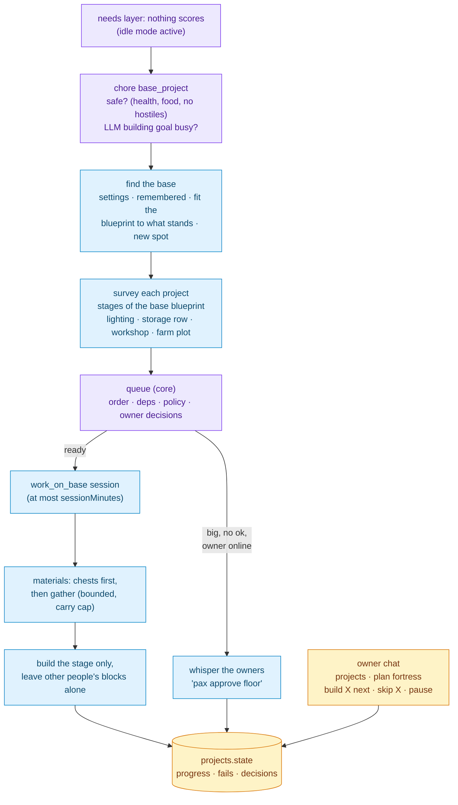

# Base projects

Pax lives in a small fortress at 560 67 -43 that its owner asked it to upgrade: a stone floor,
corner towers, a walkway, torches at the gate. The LLM goal for that stopped at 130 of 648
blocks and stayed paused for days, and with nothing else to do Pax stood around. Base projects
give the bot a long-term job of its own: a queue of improvements to its base that it works
through when nothing else needs doing, by day (or at night, inside finished and lit walls), in
bounded sessions that survive interruptions, deaths and restarts. The owner can look at the
queue, approve, veto, skip and reorder it from chat; big projects wait for an ok.

## What it builds

The base is a blueprint (`settings.projects.template`, default `fortress`) whose `meta.stages`
split it into projects; the rest come after:

| project | what | needs first |
|---|---|---|
| `walls` | foundation, walls, gate door and the gate torches | |
| `farm_plot` | keeps a 3x3 to 5x5 plot inside the walls free for a farm (place `farm_plot`); the floor goes around it. Bots without `start_farm` don't get it | walls |
| `floor` | stone floor inside; columns under another build (a hut, a torch) are left alone | walls, farm_plot |
| `lighting` | `light_up` over the whole base until no spot inside can spawn a mob; re-checked once a day | walls, floor |
| `storage` | four chests against an inside wall (`storage_row`), when there is no chest at the base or every one there is nearly full | floor |
| `workshop` | crafting table and two furnaces (`workshop_row`), when there is no table or no furnace inside | floor |
| `walkway` | walkway behind the walls and the ladder up | walls |
| `towers` | the four corner towers with torches on top | |

`blueprints/outpost.yaml` is a small 9x9 base with the same stages (walls, floor, corner posts),
for a bot with no fortress yet. Any blueprint can be a base: give it `meta.stages`
(`{ name, title, roles, glyphs, after, skipCovered }`; a glyph puts a cell in the stage that names
it, the rest go by role); without stages it is one project, `build`.

## Finding the base, extending it

The bot never rebuilds what stands. It finds the base in this order: `settings.projects.base`
(origin and gate side), the spot it remembered once work started, then it fits the blueprint to
the world at a build in progress (`build.active`), a finished placement, a place named like the
template (or `fortress`, `base`) and home, one block up or down and each gate side, and takes the
fit where the largest share of the walls already stands (at least 30%). For Pax that is the place
`fortress` (560 68 -43) one block down: its old plank walls are v2's walls one block up, and the
walls role accepts planks, so they count as done. With nothing found and the bot at home, a new
base goes on a flat spot near home, picked like `build` picks one, and is remembered once work starts.

Each project is surveyed against the world with the build's own cell check: blocks the role
accepts are done, natural blocks and the bot's own may be dug and replaced, anything else is
somebody's build and is left alone (the build skips those spots instead of failing; see
`autonomous` builds). With `skipCovered` (the floor) a cell with a block on top that isn't part of
the plan (the hut on the old floor, a torch, a chest) is left alone too. Protected areas and the
spawn keep-out are respected as for every build.

## Sessions and materials

A session (`work_on_base`, at most `sessionMinutes`) works the first ready project:

1. the bill of materials for what is still missing, against what it carries and what its chests
   hold (container memory);
2. takes the accepted items out of its own chests (logs too, when wood is short);
3. gathers the rest with `gather_materials` for at most `gatherMinutes`, at most `carry` items a
   session (the rest is for the next session);
4. builds only the stage's cells, then surveys again and records progress.

Progress is the world itself plus `projects.state` in agent storage, so a session cut short by a
reflex, a death, a disconnect or a restart picks up where it was. A project that got nothing done
three sessions in a row rests for two hours. When one finishes, the owners online are told.

## Owner in the loop

| say | does |
|---|---|
| `pax projects` | the queue: done, ready, needs ok, asked, waiting, skipped, blocked |
| `pax plan fortress` | the dry run: base, every project with its materials and notes, what comes next. Builds nothing |
| `pax approve floor` / `pax go ahead with the towers` | ok to build |
| `pax build towers next` | to the front of the queue, with an ok |
| `pax skip walkway` / `pax unskip walkway` | not now / back in |
| `pax do not build the towers` / `pax veto towers` | never (until `project op=reset`) |
| `pax pause building` / `pax resume building` | all base work off and on |

These go through the [intents brain](./intents) (patterns only, never a guess) to the `projects`,
`plan_base` and `project` actions; only owners can change anything. The LLM gets the same
actions as tools.

The policy decides what needs an ok:

- `auto` (default): small projects go ahead; projects with more than `askAbove` blocks (default 150)
  are proposed first, by whisper to the owners online ("base project: stone floor at the fortress,
  140 blocks (I still need 100 cobblestone). Say "pax approve floor" ...");
- `ask`: every building project is proposed;
- `off`: planning only.

An unanswered proposal waits `askTimeoutMinutes` (30), then `onTimeout` decides: `wait` (default,
ask again after `reaskHours`), `build` or `skip`. Nobody online: nothing is asked and big projects
wait. Pax uses `auto` with `askAbove: 150`: the walkway, lighting, a chest row or a workshop are
under one session's work and change little, a floor or towers cost hundreds of cobblestone and
change how the base looks, so those wait for an owner (or were asked for already, see below).

## The LLM goal

An LLM goal about building that is being worked on holds the projects back: they don't fight it.
A goal that is paused (waiting for an owner, a guardrail tripped) or nobody touched for 30 min
doesn't, and the projects it names count as asked for by its owner. Pax's goal "Upgrade our
fortress to fortress v2: stone floor, corner towers, walkway and gate torches (pe4ka asked to fix
the floor)" names `floor`, `towers`, `walkway`, `walls` and `lighting`, so those need no new ok.
When a project the goal asked for is done, a note goes on the goal so the model can wrap up when it
is back.

Why that goal sat paused: the model itself called `update_goal wait=true` ("waiting for the
owner") while pe4ka was offline. `resumeIfOwnerSilent` lifts that pause for an offline owner, at
most three times (`selfResumes`) so a model that keeps asking doesn't spin tokens; after the fourth
wait it stays paused until the owner talks. Its turn and time limits (80 turns, 120 min) were used
up as well. The guardrails are right for an LLM, but they left a half-built fortress; the projects
pick that work up without the model.

## Settings

Profile key `projects:` (or `settings.projects`), live toggles `projects.*`:

| key | default | |
|---|---|---|
| `enabled` | on | `false` (or `projects: false`) turns it off |
| `policy` | `auto` | `auto` / `ask` / `off` |
| `askAbove` | 150 | auto: blocks above which a project needs an ok |
| `askTimeoutMinutes` | 30 | wait for an answer this long |
| `onTimeout` | `wait` | `wait` / `build` / `skip` |
| `reaskHours` | 6 | ask again about an unanswered proposal |
| `paused` | off | no work, planning still works |
| `sessionMinutes` | 10 | one session at most |
| `gatherMinutes` | 6 | gathering per session at most |
| `carry` | 192 | items gathered per session at most |
| `minHealth`, `minFood` | 14, 12 | the safe-needs gate |
| `night` | on | at night only projects inside finished, lit walls |
| `template` | `fortress` | the base blueprint |
| `base` | found | `{ x, y, z, facing }` origin (layer 0, centre) and gate side |
| `order`, `skip` | | preferred order; projects never to do |

The chore is `base_project` in idle mode `active` (`idle.chores.base_project: false` turns just
the chore off); it runs when nothing else scores, like the other chores. See
[Needs and idle modes](./needs-and-idle).

## Testing

`node scripts/projects-test.ts [--start x,z] [--minutes 40]` puts a fresh test bot (BuildTest, no
LLM) with a small kit in an empty spot far from everything and lets the chore build an outpost
from scratch; BuildBoss, its owner for the run, approves the walls when asked, reads `projects` and
`plan fortress`, pauses and resumes once. Every block that changed near the bot is put back
afterwards. Unit tests: `test/projects.test.ts` (queue), `test/base-plan.test.ts` (stages,
survey, fitting, materials), `test/base-projects.test.ts` (Pax's fortress on a fake world).
