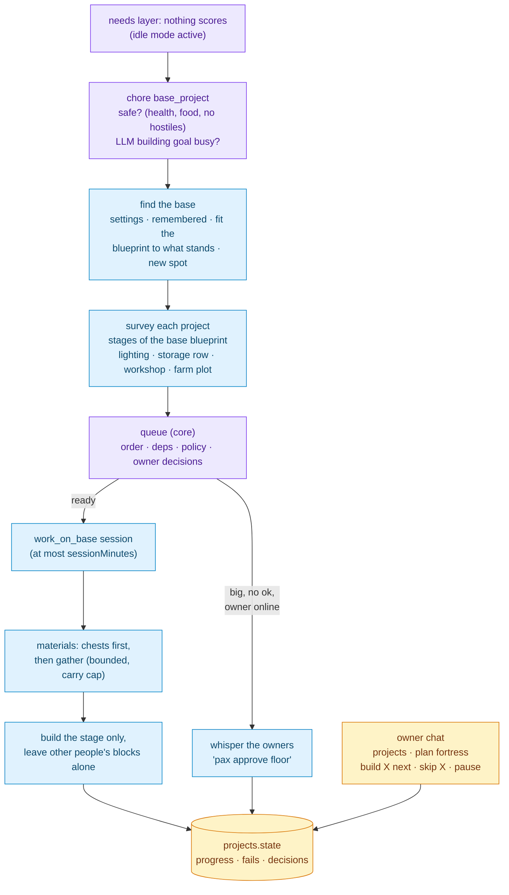

# Base projects

Pax lives in a small fortress at 560 67 -43 that its owner asked it to upgrade: a stone floor,
corner towers, a walkway, torches at the gate. The LLM goal for that stopped at 130 of 648
blocks and stayed paused for days, and with nothing else to do Pax stood around. Base projects
give the bot a long-term job of its own: a queue of improvements to its base that it works
through when nothing else needs doing, by day (or at night, inside finished and lit walls), in
bounded sessions that survive interruptions, deaths and restarts. The owner can look at the
queue, approve, veto, skip and reorder it from chat; big projects wait for an ok.



## What it builds

The base is a blueprint (`settings.projects.template`, default `fortress`) whose `meta.stages`
split it into projects; the rest come after:

| project | what | needs first |
|---|---|---|
| `walls` | foundation, walls, gate door and the gate torches | |
| `integrity` | [base safety](./base-safety): caves and holes under the floor, tunnels under the walls and mine entrances next to them sealed, filled, capped or lit. Once the base is settled; off with `baseSafety.enabled` | |
| `farm_plot` | keeps a 3x3 to 5x5 plot inside the walls free for a farm (place `farm_plot`); the floor goes around it. Bots without `start_farm` don't get it | walls |
| `floor` | stone floor inside; columns under another build (a hut, a torch) are left alone | walls, farm_plot |
| `lighting` | `light_up` over the whole base until no spot inside can spawn a mob; re-checked once a day | walls, floor |
| `storage` | four chests against an inside wall (`storage_row`), when there is no chest at the base or every one there is nearly full | floor |
| `workshop` | crafting table and two furnaces (`workshop_row`), when there is no table or no furnace inside | floor |
| `walkway` | walkway behind the walls and the ladder up | walls |
| `towers` | the four corner towers with torches on top | |

`blueprints/outpost.yaml` is a small 9x9 base with the same stages (walls, floor, corner posts),
for a bot with no fortress yet. Any blueprint can be a base: give it `meta.stages`
(`{ name, title, roles, glyphs, after, skipCovered }`; a glyph puts a cell in the stage that names
it, the rest go by role); without stages it is one project, `build`.

## Finding the base, extending it

The bot never rebuilds what stands. It finds the base in this order: `settings.projects.base`
(origin and gate side), the spot it remembered once work started, then it fits the blueprint to
the world at a build in progress (`build.active`), a finished placement, a place named like the
template (or `fortress`, `base`) and home, one block up or down and each gate side, and takes the
fit where the largest share of the walls already stands (at least 30%). For Pax that is the place
`fortress` (560 68 -43) one block down: its old plank walls are v2's walls one block up, and the
walls role accepts planks, so they count as done. With nothing found and the bot at home, a new
base goes on a flat spot near home, picked like `build` picks one, and is remembered once work starts.

Each project is surveyed against the world with the build's own cell check: blocks the role
accepts are done, natural blocks and the bot's own may be dug and replaced, anything else is
somebody's build and is left alone (the build skips those spots instead of failing; see
`autonomous` builds). With `skipCovered` (the floor) a cell with a block on top that isn't part of
the plan (the hut on the old floor, a torch, a chest) is left alone too. Protected areas and the
spawn keep-out are respected as for every build.

## Sessions and materials

A session (`work_on_base`, at most `sessionMinutes`) works the first ready project:

1. the bill of materials for what is still missing, against what it carries and what its chests
   hold (container memory);
2. gets it from the [material sources](#where-materials-come-from) in order (its chests first)
   for at most `gatherMinutes`, at most `carry` items a session (the rest is for the next session);
3. builds only the stage's cells, then surveys again and records progress.

Once the base is settled, its blocks (walls, floor, towers, the rows) cost the pathfinder a lot to
dig through, so it takes any other way first: in the first live run the bot tunnelled out through
its new wall on every trip and rebuilt it the next session. They aren't forbidden outright, because
mineflayer-pathfinder can't walk through a door: with the gate shut and digging forbidden, the bot
stood locked out for seven minutes. For work inside (the floor, the rows,
lighting) the session walks in through the gate itself: to the spot in front of it, opens the
door, steps through and shuts it. Leaving, a closed base still costs a block when there is no
other way out; the next survey puts it back. The chore is sticky, so picking up a few drops doesn't cut a session short.

Progress is the world itself plus `projects.state` in agent storage, so a session cut short by a
reflex, a death, a disconnect or a restart picks up where it was. A project that got nothing done
three sessions in a row rests for two hours. When one finishes, the owners online are told.

When sessions get nothing done, the queue says why on the project's line (`stuck: 2 sessions
without progress: ...`), and so does the status view (`golem status`, `status.json` `notes`), with
what waits for an owner's ok. The walkway at Pax's fortress sat at 42 of 44 for ten sessions with
a bare "stopped": two ladders had no wall block to hang on, so the builder deferred them and then
gave up without a word. Now the builder says "nothing to place ladder against at ...", and the
survey leaves such an attachment alone when the block it hangs on holds something the bot may not
change (the line says which and where), so the stage can finish. A big project (more than
`askAbove` blocks) waits for an owner's ok; with no owner online the reason says "no owner online
to ask", which is why the towers never started there. Set `askAbove` higher, `onTimeout: build`, or
say "pax approve towers".

The gate door stays in for repairs that can be done from outside (a wall block, a gate torch).
The builder used to take the door out whenever anything was still to place, so every wall repair
dug the door (Pax's journal shows its spruce door broken some thirty times). It now takes it out
only when something still to build is closed in behind it (`enclosedColumns` in blueprint.ts).

## Where materials come from

A build (`build gather=true`, the LLM's way), a base project session and `gather_materials` all
get what is short from the same short list of sources, tried in the order of
`materials.sources`, one at a time, each planned again from what it carries and what its chests
hold after the last one (`src/skills/materialSourcePlan.ts`, pure; `materialSources.ts` runs it):

| source | what | skipped when |
|---|---|---|
| `chests` | the items themselves, out of its own and configured chests (container memory; chests it never looked into are tried too) | none of it in its chests |
| `substitutes` | other blocks every blueprint role that wants the item accepts: andesite or cobbled deepslate for a cobblestone floor, any planks for planks | the roles allow nothing else, or none of it in its chests; substitutes it carries already count |
| `craft` | ladders, doors, torches, stairs, the stone family... from what it has, its chests' wood first, then trees | nothing short that it can make |
| `nearby` | digging and chopping close by (`gather_materials`, which mines stone out past the [keep-out](./base-safety#keep-out-for-digging)) | nothing short that is dug, digging off |
| `mine` | a trip down its own [staircase mine](./progression#the-staircase-mine) for cobblestone: the stairs and tunnel are stone, the cobblestone is kept, the trip ends when it has enough or after `mineMinutes` | not cobblestone, mine settings off, no stone pickaxe, not ready to go down (food, health) |
| `far` | stone dug `farDistance` blocks past the base and its keep-out, on the dry side nearest the bot (water and ice spots are passed over), at most `farTries` spots | not cobblestone, no base or home to dig away from |

A source that gave nothing of an item (the strip mine by home turned at water four times) is
skipped for that item for `retryMinutes`, so the next session goes straight to the next source.
Leave a source out of the list to turn it off.

Each run says which sources it used, what each gave, and why the others were skipped, in the
session's result (`stuck:` lines quote it), in `golem status` (`materials:` note) and in
`pax projects` / `pax plan fortress`, which also show the plan for the next project:

```
  floor: materials: using chests (my chests hold 9 cobblestone); skipped substitutes: none in my chests ...
last materials: chests gave 9 cobblestone; skipped nearby (gave no cobblestone 4 min ago: every way on is unsafe ...) (2 min ago)
```

Why: Pax's fortress at the edge of a frozen lake stood at 629 of 648 with a hole in its floor. The
build asked for 9 cobblestone, gathered by strip-mining next to home, which the base keep-out sends
out past the walls, where every way on was water; it gave up after 21 s with 0 cobblestone,
while two of its chests held 666 cobblestone and its own mine was 16 blocks away. The LLM's
`build gather=true` never looked in the chests at all; only base project sessions did.

The floor hole itself was not on the floor stage's list either: a floor cell with a block on top
that isn't part of the plan is left alone (`skipCovered`, for the old hut on the floor), and that
covered an empty cell under something as well. Now only a cell that holds a block is left alone;
an empty one is always counted. Holes in the floor surface the stages don't cover (a farm plot
that lost its dirt, a cell under a planned block) are found by [base safety](./base-safety#holes-in-the-floor).

## Owner in the loop

| say | does |
|---|---|
| `pax projects` | the queue: done, ready, needs ok, asked, waiting, skipped, blocked |
| `pax plan fortress` | the dry run: base, every project with its materials and notes, what comes next. Builds nothing |
| `pax approve floor` / `pax go ahead with the towers` | ok to build |
| `pax build towers next` | to the front of the queue, with an ok |
| `pax skip walkway` / `pax unskip walkway` | not now / back in |
| `pax do not build the towers` / `pax veto towers` | never (until `project op=reset`) |
| `pax pause building` / `pax resume building` | all base work off and on |

These go through the [intents brain](./intents) (patterns only, never a guess) to the `projects`,
`plan_base` and `project` actions; only owners can change anything. The LLM gets the same
actions as tools.

The policy decides what needs an ok:

- `auto` (default): small projects go ahead; projects with more than `askAbove` blocks (default 150)
  are proposed first, by whisper to the owners online ("base project: stone floor at the fortress,
  140 blocks (I still need 100 cobblestone). Say "pax approve floor" ...");
- `ask`: every building project is proposed;
- `off`: planning only.

An unanswered proposal waits `askTimeoutMinutes` (30), then `onTimeout` decides: `wait` (default,
ask again after `reaskHours`), `build` or `skip`. Nobody online: nothing is asked and big projects
wait. Pax uses `auto` with `askAbove: 150`: the walkway, lighting, a chest row or a workshop are
under one session's work and change little, a floor or towers cost hundreds of cobblestone and
change how the base looks, so those wait for an owner (or were asked for already, see below).

## The LLM goal

An LLM goal about building that is being worked on holds the projects back: they don't fight it.
A goal that is paused (waiting for an owner, a guardrail tripped) or nobody touched for 30 min
doesn't, and the projects it names count as asked for by its owner. Pax's goal "Upgrade our
fortress to fortress v2: stone floor, corner towers, walkway and gate torches (pe4ka asked to fix
the floor)" names `floor`, `towers`, `walkway`, `walls` and `lighting`, so those need no new ok.
When a project the goal asked for is done, a note goes on the goal so the model can wrap up when it
is back.

Why that goal sat paused: the model itself called `update_goal wait=true` ("waiting for the
owner") while pe4ka was offline. `resumeIfOwnerSilent` lifts that pause for an offline owner, at
most three times (`selfResumes`) so a model that keeps asking doesn't spin tokens; after the fourth
wait it stays paused until the owner talks. Its turn and time limits (80 turns, 120 min) were used
up as well. The guardrails are right for an LLM, but they left a half-built fortress; the projects
pick that work up without the model.

## Settings

Profile key `projects:` (or `settings.projects`), live toggles `projects.*`:

| key | default | |
|---|---|---|
| `enabled` | on | `false` (or `projects: false`) turns it off |
| `policy` | `auto` | `auto` / `ask` / `off` |
| `askAbove` | 150 | auto: blocks above which a project needs an ok |
| `askTimeoutMinutes` | 30 | wait for an answer this long |
| `onTimeout` | `wait` | `wait` / `build` / `skip` |
| `reaskHours` | 6 | ask again about an unanswered proposal |
| `paused` | off | no work, planning still works |
| `sessionMinutes` | 10 | one session at most |
| `gatherMinutes` | 6 | gathering per session at most |
| `carry` | 192 | items gathered per session at most |
| `minHealth`, `minFood` | 14, 12 | the safe-needs gate |
| `night` | on | at night only projects inside finished, lit walls |
| `template` | `fortress` | the base blueprint |
| `base` | found | `{ x, y, z, facing }` origin (layer 0, centre) and gate side |
| `order`, `skip` | | preferred order; projects never to do |

Where the materials come from is its own profile key, `materials:` (live toggles `materials.*`):

| key | default | |
|---|---|---|
| `sources` | `[chests, substitutes, craft, nearby, mine, far]` | the sources, in this order; leave one out to turn it off |
| `retryMinutes` | 30 | a source that gave nothing of an item is skipped for it this long (0 = always try) |
| `mineMinutes` | 6 | longest mine trip for build blocks |
| `farDistance` | 32 | far: blocks past the base and its keep-out to start digging |
| `farTries` | 3 | far: spots tried, nearest first |

The chore is `base_project` in idle mode `active` (`idle.chores.base_project: false` turns just
the chore off); it runs when nothing else scores, like the other chores. See
[Needs and idle modes](./needs-and-idle).

## Testing

`node scripts/projects-test.ts [--start x,z] [--minutes 40]` puts a fresh test bot (BuildTest, no
LLM) with a small kit in an empty spot far from everything and lets the chore build an outpost
from scratch; BuildBoss, its owner for the run, approves the walls when asked, reads `projects` and
`plan fortress`, pauses and resumes once. Every block that changed near the bot is put back
afterwards.

What the live runs showed (2026-11-26, NeoForge server, outpost, `askAbove: 60`): the walls were
proposed, approved by whisper and built in one session (83 blocks, about 40 s with the kit),
pause and resume worked, the farm plot was kept, the floor, lighting (4 to 5 torches, 0 dark
spots inside), the chest row and the workshop were built in later sessions; in the best run six
of seven projects were done in an hour, the corner posts not reached (two nights in between, when
only finished, lit insides are worked on). Each clean-up put back every changed block. Found and
fixed on the way: collect_drops and the eat reflex ended sessions (now a sticky chore and a
long-running action), the bot tunnelled out through its new wall on every trip and was then
locked out by a hard ban (now a high dig cost), and a proposal sent before the owner listened was
never answered (re-asked after `reaskHours`; "pax projects" shows it). Still open: leaving a
closed base costs one to four wall blocks a trip, repaired by the next session; the gate walk
did not trigger reliably (the build reached the inside cells anyway); a bot that dug a mining pit
under its home got stuck in it for a whole run (gathering, not the projects); the gate door went
missing twice and was put back by the next walls session. Unit tests: `test/projects.test.ts` (queue), `test/base-plan.test.ts` (stages,
survey, fitting, materials), `test/base-projects.test.ts` (Pax's fortress on a fake world),
`test/material-source-plan.test.ts` (the material sources).
