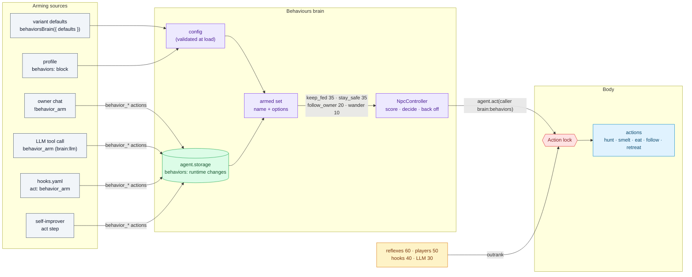
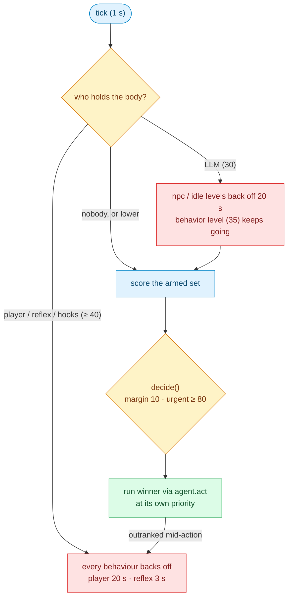

# Behaviours

Armed behaviours are things a bot keeps doing on its own until told otherwise: stay fed,
stay safe, follow its owner, guard a farm, keep wood in stock. You switch them on and tune
them per [profile](/guide/profiles), from chat, from an LLM tool call, from `hooks.yaml` or from a
[self-improver](/guide/self-improver) program. Once armed, a behaviour runs without any more LLM turns or commands.

The motivating case: an LLM bot sat at 6/20 health with no food and died twice, because
nothing made it go and get food, and nothing ran between its turns. With `keep_fed` armed
it hunts, cooks and eats by itself.

## Actions, brains and behaviours

| | what it is | who starts it | how long it runs |
|---|---|---|---|
| **action** | one thing the body does (`hunt`, `goto`, `eat`) | anyone, via `agent.act()` | until done, stopped or preempted |
| **brain** | a decision loop (commands, [reflexes](/concepts/world#reflexes), LLM, NPC) | the [variant](/concepts/variants-profiles) | the whole session |
| **behaviour** | a scored, option-validated routine run by the behaviours brain | armed from config, chat, LLM, hooks, programs | until disarmed, across restarts |

A behaviour is an [NPC-brain](npc-brain.md) behaviour (score + run) with a name, a zod
options schema, a description written for LLMs and some metadata. The behaviours brain
holds the **armed** set and runs it through the same `NpcController`, so the scoring,
hysteresis, failure back-off and back-off from other callers are exactly the [NPC brain](/guide/npc-brain)'s.

```ts
import { behaviorsBrain } from '../src/brains/index.ts'

brains: [
  commandBrain(),
  reflexes(),
  hooksBrain(),
  behaviorsBrain({ defaults: { keep_fed: true, stay_safe: true } }),
  llmBrain({ ... })
]
```

## How it fits together



Config is the base. Runtime changes (arm, disarm, configure from any action caller) are
stored in `agent.storage` under `behaviors` and win over the config, so they survive
restarts. `behavior_reset` drops them again.

## Arming

### From a profile

```yaml
# profiles/pax.yaml
behaviors:
  keep_fed: { below: 14 }         # options map: armed with these options
  stay_safe: true                 # armed with defaults
  wander: { enabled: false }      # explicitly off (e.g. to override a variant default)
```

Names and options are checked against the registry when the profile is run: an unknown
name (`keep_food`, with a "did you mean keep_fed") or a bad option (`below: 40`, out of
range; `bellow: 10`, unknown key) stops the bot before it connects, with every problem
listed. Variants set defaults with `behaviorsBrain({ defaults })`; the profile merges over
them per behaviour (options merge, `enabled` is replaced).

### From chat (owners only)

```
!behavior_list                         names by category, * = armed
!behavior_list keep_fed                description, options and defaults
!behavior_arm keep_fed below=10 hunt=false
!behavior_arm keep_fed {"animals": ["cow", "pig"]}
!behavior_arm collect_drops items=oak_log,stick
!behavior_configure guard_area radius=20
!behavior_disarm follow_owner
!behavior_status                       armed set, what runs, last outcomes, cooldowns
!behavior_reset                        back to the profile's set
```

Options are `key=value` words (lists comma-separated) or a JSON object. Only owners
(`owners:` in the profile) get past the command brain at all, and the actions refuse
non-owners again: a player caller who is not an owner, or an LLM or hook acting for a
non-owner player, gets `only my owners can change my behaviours`.

### From an LLM

Every behaviour action is a tool. The descriptions say *when* to arm what ("arm keep_fed so
you look after your own food without being asked"), and the LLM arms as `brain:llm` (shown
in `behavior_status`). Pax's [context pack](/guide/context-pack) has one rule for it:

> For ongoing needs (staying fed, following or guarding robin, guarding a place, farming,
> keeping wood stocked) arm a behaviour with behavior_arm instead of doing it turn by turn.

`observe()` includes `behaviors: { armed, running }`, so the model sees what is already on.

### From hooks and programs

```yaml
# profiles/pax/hooks.yaml
hooks:
  - id: guard-at-night
    on: timer
    every: 5m
    when: { isDay: false }
    do:
      - act: behavior_arm
        params: { name: guard_owner }
```

Self-improver programs can call the behaviour actions too (they are not on its deny list),
so a taught rule like "guard the farm at night" can arm `guard_area` instead of
re-implementing it.

## Priorities and back-off

Each behaviour runs at a level: `idle` (10), `npc` (20) or `behavior` (35). The default
comes from the definition and every behaviour takes a `priority` option to override it.

`PRIORITY.behavior` (35) is the one core addition: above the LLM (30), below hooks (40),
players (50) and reflexes (60). Survival behaviours (`keep_fed`, `stay_safe`, `avoid_mobs`)
use it, so a bot whose LLM is busy following someone still gets fed: the LLM's long-running
action is suspended and resumes when the behaviour is done.



- The back-off is per level: while an LLM holds the body, `npc` and `idle` behaviours are
  paused, `behavior`-level ones are not. A player, hook or reflex pauses everything.
- Disarming or reconfiguring a running behaviour stops it at once.
- `follow_owner` and `guard_owner` run the long-running `follow` / `guard` actions. That is
  fine here: the controller still re-scores every tick and interrupts them when something
  scores higher, and a preempted action of ours is dropped rather than resumed behind the
  brain's back.

### Reflexes and stay_safe

`reflexes()` reacts to being hit: fight back, retreat at 8 health or less, eat when food is
carried. `stay_safe` acts earlier and on what reflexes don't cover: backing off at 10 health
before the next hit, pillaring up when surrounded (only if it can place blocks and carries
dirt/cobblestone/planks), leaving water when mobs are near, going home at night. Both use
the same `retreat`/`flee` actions and the reflex always outranks the behaviour, so they
never pull the body two ways. `keep_fed` likewise leaves "eat what you carry" to the reflex
(food < 15) and steps in below 14, or when health is low and food is under 18 (no regen).

## Capabilities

A behaviour lists the actions it `requires`; if the bot lacks one it is skipped with a
warning (and `behavior_arm` reports "armed, but it can't run: ..."). `needs: { dig }` checks
`canDig`, `needs: { place }` checks `settings.canPlace` (default true; set it to false in a
profile's `settings` to keep a bot from placing blocks). Chores never act in [protected areas](/concepts/world#protected-areas)
(spawn): `chop_tree` skips them, `chop_wood_loop` keeps `spawnClearance` from the world
spawn, `hunt` skips animals inside protected areas and, by default, animals inside fences.

## Library

The table below is generated from the registry (`node scripts/gen-docs.ts`). Every
behaviour also accepts `priority: idle | npc | behavior`.

<!-- behaviors:start -->
<!-- generated by scripts/gen-docs.ts from the behaviour registry, do not edit by hand -->

### `stay_safe`

*safety · priority behavior (35) · uses `retreat`, `flee`, `pillar`, `goto`, `go_home` when present*

Keeps the bot alive: backs away from mobs at low health, pillars up when surrounded (if it can place blocks), gets out of water when mobs are around, and heads home at night if a home is set. Arm it on any bot that roams.

| option | type | default | description |
|---|---|---|---|
| `retreatBelow` | number (0..20) | `10` | back off from nearby mobs at or below this health; 0 = never (reflexes retreat at 8 when hit) |
| `mobRadius` | number (4..24) | `10` | mobs this close count as a threat |
| `surroundedBy` | integer (2..10) | `3` | this many hostiles within 6 blocks means surrounded |
| `pillar` | boolean | `true` | when surrounded, pillar up out of reach (needs blocks and block placing) |
| `avoidWater` | boolean | `true` | get out of water when hostiles are near and health is below 16 |
| `homeAtNight` | boolean | `true` | go home at night if a home is set |
| `homeRange` | number (2..64) | `8` | how close to home counts as home at night |

### `avoid_mobs`

*safety · priority behavior (35) · needs `flee`*

Keeps its distance from dangerous mobs (creepers, wardens by default) instead of fighting them. Arm it on bots that work outdoors.

| option | type | default | description |
|---|---|---|---|
| `mobs` | list | `["creeper","warden"]` | mob names to keep away from |
| `distance` | number (3..16) | `7` | start moving away when one is this close |

### `keep_fed`

*survival · priority behavior (35) · needs `eat` · uses `withdraw`, `harvest`, `hunt`, `smelt`, `craft`, `goto`, `goto_place`, `list_container` when present*

Looks after food on its own: when hungry (or hurt and too hungry to heal) it eats, and when it has nothing to eat it takes food from known chests, harvests ripe crops, hunts passive animals and cooks the meat. Arm it so you never starve between turns.

| option | type | default | description |
|---|---|---|---|
| `below` | number (1..20) | `14` | look for food when the food bar is below this (reflexes eat at 15 when food is carried) |
| `healBelow` | number (0..20) | `14` | also look for food when health is below this and food is too low to heal (<18) |
| `until` | number (1..20) | `18` | keep eating until the food bar reaches this |
| `chests` | boolean | `true` | withdraw food from chests the bot has looked into |
| `chestPlace` | string |  | a remembered place with a food chest to check first |
| `harvest` | boolean | `true` | harvest ripe crops nearby |
| `hunt` | boolean | `true` | hunt passive animals (never pets, named, tamed or leashed animals) |
| `animals` | list of cow, pig, sheep, chicken, rabbit, mooshroom | `["cow","pig","sheep","chicken","rabbit","mooshroom"]` | animals it may hunt |
| `cook` | boolean | `true` | cook raw meat/potatoes when a furnace and fuel are available or craftable |
| `eatRaw` | boolean | `true` | eat raw meat when cooking is not possible (never raw chicken) |
| `radius` | number (4..64) | `32` | how far to look for crops and animals |

### `guard_owner`

*combat · priority npc (20) · needs `guard`*

Stays near its owner (or a given player) and kills hostile mobs that come close to them, like the guard action but persistent: it picks up again after interruptions and restarts. Arm it as a bodyguard.

| option | type | default | description |
|---|---|---|---|
| `player` | string |  | who to protect; default the first owner online |
| `radius` | number (4..32) | `12` | fight mobs this close to them |

### `guard_area`

*combat · priority npc (20) · needs `attack` · uses `goto`, `wander` when present*

Defends an area (a remembered place, coordinates, or where it stands when armed): kills hostile mobs that enter it and patrols when quiet. Never attacks players or animals. Arm it to protect a base or farm.

| option | type | default | description |
|---|---|---|---|
| `place` | string |  | remembered place to guard (remember_place); default x/z, else home, else where it was armed |
| `x` | number |  | centre x |
| `y` | number |  | centre y |
| `z` | number |  | centre z |
| `radius` | number (4..48) | `12` | guard this far around the centre |
| `patrol` | boolean | `true` | walk around the area when it is quiet |

### `follow_owner`

*social · priority npc (20) · needs `follow` · uses `goto` when present*

Follows its owner (or a given player) at a distance whenever they are online and in sight, and walks to catch up (no teleporting) when they are far. Arm it when your owner wants you to come along.

| option | type | default | description |
|---|---|---|---|
| `player` | string |  | who to follow; default the first owner online |
| `distance` | number (1..16) | `3` | how close to stay, in blocks |
| `catchUp` | number (8..128) | `32` | beyond this, walk over with goto before following |

### `sleep_at_night`

*routine · priority npc (20) · needs `sleep` · uses `go_home` when present*

At night walks home (if a home is set) and sleeps in a bed there until morning. Needs a bed within 16 blocks of home.

| option | type | default | description |
|---|---|---|---|
| `homeRange` | number (1..64) | `8` | walk home first when farther than this |

### `return_home`

*routine · priority npc (20) · needs `go_home`*

Walks back home when it strays too far by day, and stays close to home at night. Needs a home (set_home).

| option | type | default | description |
|---|---|---|---|
| `maxDistance` | number (4..512) | `32` | head home when farther than this by day |
| `nightDistance` | number (2..128) | `6` | at night, head home when farther than this |

### `deposit_when_full`

*work · priority npc (20) · needs `deposit` · uses `goto_place`, `goto` when present*

When the inventory is nearly full, walks to a chest (a remembered place, coordinates, or the nearest one), stores everything except tools, armour, food and kept items, then walks back. Arm it for long gathering jobs.

| option | type | default | description |
|---|---|---|---|
| `threshold` | number (0.3..1) | `0.85` | share of inventory slots used that counts as full |
| `place` | string |  | remembered place where the chest is |
| `x` | number |  | chest x (with y and z) |
| `y` | number |  |  |
| `z` | number |  |  |
| `keep` | list | `[]` | items never to store |
| `returnBack` | boolean | `true` | walk back to where it was afterwards |

### `farm_loop`

*work · priority npc (20) · needs `harvest`*

Tends fields: every few minutes, when enough crops are ripe within the radius, harvests them, picks up the drops and replants. Arm it near a farm.

| option | type | default | description |
|---|---|---|---|
| `radius` | number (2..32) | `16` | field radius around the bot |
| `minRipe` | integer (1..64) | `4` | wait until at least this many crops are ripe |
| `everyMinutes` | number (0.5..240) | `5` | pause between rounds |
| `replant` | boolean | `true` | replant from the inventory |

### `chop_wood_loop`

*work · priority npc (20) · needs `chop_tree`, digging*

Keeps a stock of wood: by day, while it has fewer than `keep` logs (4 planks count as one), it fells trees nearby, away from spawn and protected areas, and replants. Needs digging enabled.

| option | type | default | description |
|---|---|---|---|
| `keep` | integer (1..512) | `16` | logs to keep in stock |
| `radius` | number (4..64) | `32` | how far to look for trees |
| `spawnClearance` | number (0..256) | `48` | never chop within this distance of the world spawn |
| `replant` | boolean | `true` | plant saplings afterwards |

### `collect_drops`

*work · priority npc (20) · needs `pickup_items`*

Picks up dropped items lying nearby every so often (all items, or only the listed ones). Arm it while working so loot and drops don't despawn.

| option | type | default | description |
|---|---|---|---|
| `radius` | number (2..32) | `12` | pick up drops this close |
| `items` | list | `[]` | only these items, e.g. oak_log,wheat; empty = everything |
| `everySeconds` | number (2..600) | `15` | pause after a pickup run |

### `light_area`

*work · priority npc (20) · needs `place_block`, block placing · uses `craft` when present*

Places torches on dark ground around home (or a remembered place) so mobs do not spawn there, crafting torches from coal and sticks if needed. Only inside the given radius; never in protected areas.

| option | type | default | description |
|---|---|---|---|
| `place` | string |  | remembered place to light up; default home |
| `radius` | number (4..64) | `20` | only light within this distance of the centre |
| `darkBelow` | integer (1..15) | `8` | place a torch where block light is below this |
| `spacing` | integer (3..16) | `7` | no torch closer than this to another light |
| `craft` | boolean | `true` | craft torches from coal/charcoal and sticks when out |

### `greet_players`

*social · priority idle (10)*

Says hello in chat, now and then, to players who come close (rate limited per player and overall). Flavour for NPCs.

| option | type | default | description |
|---|---|---|---|
| `radius` | number (2..32) | `8` | greet players this close |
| `perPlayerMinutes` | number (1..1440) | `30` | do not greet the same player again for this long |
| `globalMinutes` | number (0..1440) | `5` | pause after any greeting |
| `chance` | number (0..1) | `0.5` | chance to greet per encounter |
| `lines` | list |  | greetings; {name} is the player |

### `wander`

*idle · priority idle (10) · needs `wander`*

Takes short walks near home (or where it is) with pauses in between, when nothing else is going on.

| option | type | default | description |
|---|---|---|---|
| `radius` | number (1..64) | `12` | how far to wander by day |
| `nightRadius` | number (1..64) | `4` | how far to wander at night |

### `idle_look`

*idle · priority idle (10) · needs `look_around`*

Fidgets when there is nothing else to do: glances at nearby players or looks around, so it looks alive.

| option | type | default | description |
|---|---|---|---|
| `everySeconds` | number (2..120) | `8` | pause between glances |
| `radius` | number (2..32) | `10` | look at players this close |

<!-- behaviors:end -->

## Writing your own

```ts
import { defineBehavior, BehaviorRegistry, defaultBehaviors, behaviorsBrain } from '../src/brains/behaviors/index.ts'
import { z } from '../src/core/index.ts'

const fishAtDawn = defineBehavior({
  name: 'fish_at_dawn',
  category: 'work',
  description: 'Goes fishing at the pond around sunrise. Arm it on a fisherman NPC.',
  options: z.object({
    place: z.string().default('pond').describe('remembered place to fish at'),
    minutes: z.number().min(1).max(10).default(2).describe('how long to fish')
  }),
  requires: ['fish', 'goto_place'],
  priority: 'npc',
  create: (o) => ({
    cooldownMs: 10 * 60_000,
    score: ({ bb }) => bb.facts.timeOfDay > 23000 || bb.facts.timeOfDay < 1500 ? 35 : 0,
    async run (ctx) {
      const there = await ctx.act('goto_place', { name: o.place })
      if (!there.ok) return there
      return ctx.act('fish', { minutes: o.minutes })
    }
  })
})

behaviorsBrain({ registry: new BehaviorRegistry([...defaultBehaviors(), fishAtDawn]) })
```

- `options` is a zod object with defaults and `.describe()` texts; unknown keys are
  rejected. `behavior_list` and the generated docs read it.
- `create(options, { agent })` returns the NPC behaviour body (`score`, `run`, cooldowns).
  Act only through `ctx.act()` (caller `brain:behaviors`, the behaviour's priority); read
  the world freely. See [NPC brain](npc-brain.md#writing-a-behaviour) for scoring bands.
- `hook(options)` returns a per-tick hook instead (that's how `greet_players` works).
- `prepare(options, { agent, player })` fills context-dependent options when armed from an
  action, e.g. `guard_area` takes the bot's position as the centre.
- Keep decisions pure where you can (`nextFoodStep`, `assessDanger`) and unit-test them
  with a fake world; see `test/behaviors.test.ts`.
- With a custom registry, the CLI still validates a profile's `behaviors:` against the
  built-in library, so extend it rather than replacing it.

## Debugging

- `!behavior_status`: armed set with non-default options, what runs, last outcome per
  behaviour, cooldowns and back-off. The result `data` has the full JSON.
- `-l info,<bot>/behaviors=debug` logs every start, switch, stop, back-off and cooldown.
