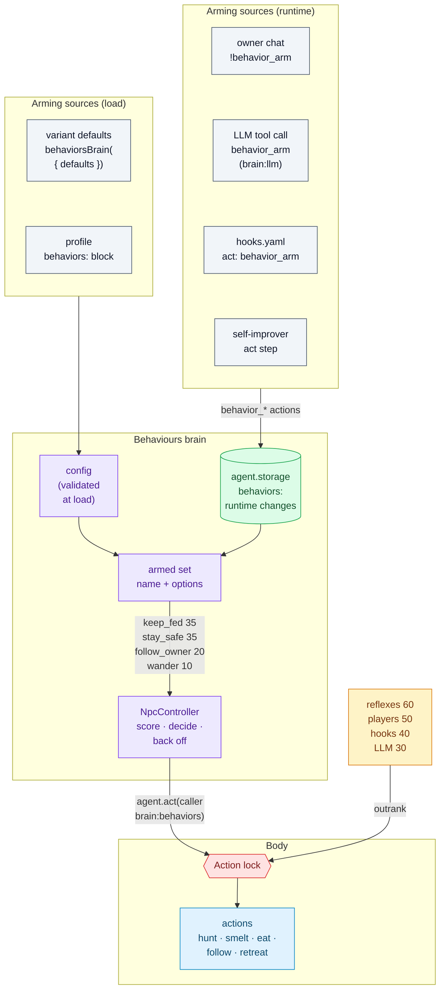
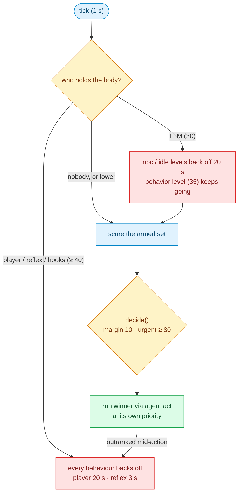
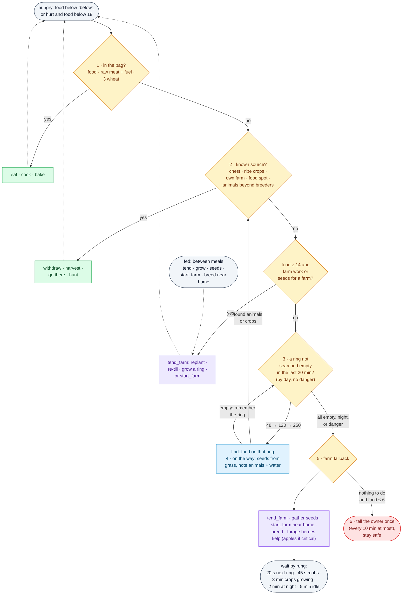

# Behaviours

Armed behaviours are things a bot keeps doing on its own until told otherwise: stay fed,
stay safe, follow its owner, guard a farm, keep wood in stock. You switch them on and tune
them per [profile](/guide/profiles), from chat, from an LLM tool call, from `hooks.yaml` or from a
[self-improver](/guide/self-improver) program. Once armed, a behaviour runs without any more LLM turns or commands.

The motivating case: an LLM bot sat at 6/20 health with no food and died twice, because
nothing made it go and get food, and nothing ran between its turns. With `keep_fed` armed
it hunts, cooks and eats by itself, searches wider and wider when there is nothing near, and
with no food source around it starts a farm ([details](#food-keep-fed-the-food-ladder-and-farm-setup)).

## Actions, brains and behaviours

| | what it is | who starts it | how long it runs |
|---|---|---|---|
| **action** | one thing the body does (`hunt`, `goto`, `eat`) | anyone, via `agent.act()` | until done, stopped or preempted |
| **brain** | a decision loop (commands, [reflexes](/concepts/world#reflexes), LLM, NPC) | the [variant](/concepts/variants-profiles) | the whole session |
| **behaviour** | a scored, option-validated routine run by the behaviours brain | armed from config, chat, LLM, hooks, programs | until disarmed, across restarts |

A behaviour is an [NPC-brain](npc-brain.md) behaviour (score + run) with a name, a zod
options schema, a description written for LLMs and some metadata. The behaviours brain
holds the **armed** set and runs it through the same `NpcController`, so the scoring,
hysteresis, failure back-off and back-off from other callers are exactly the [NPC brain](/guide/npc-brain)'s.

```ts
import { behaviorsBrain } from '../src/brains/index.ts'

brains: [
  commandBrain(),
  reflexes(),
  hooksBrain(),
  behaviorsBrain({ defaults: { keep_fed: true, stay_safe: true } }),
  llmBrain({ ... })
]
```

## How it fits together



Config is the base. Runtime changes (arm, disarm, configure from any action caller) are
stored in `agent.storage` under `behaviors` and win over the config, so they survive
restarts. `behavior_reset` drops them again.

## Arming

### From a profile

```yaml
# profiles/pax.yaml
behaviors:
  keep_fed: { below: 14 }         # options map: armed with these options
  stay_safe: true                 # armed with defaults
  wander: { enabled: false }      # explicitly off (e.g. to override a variant default)
```

Names and options are checked against the registry when the profile is run: an unknown
name (`keep_food`, with a "did you mean keep_fed") or a bad option (`below: 40`, out of
range; `bellow: 10`, unknown key) stops the bot before it connects, with every problem
listed. Variants set defaults with `behaviorsBrain({ defaults })`; the profile merges over
them per behaviour (options merge, `enabled` is replaced).

### From chat (owners only)

```
!behavior_list                         names by category, * = armed
!behavior_list keep_fed                description, options and defaults
!behavior_arm keep_fed below=10 hunt=false
!behavior_arm keep_fed {"animals": ["cow", "pig"]}
!behavior_arm collect_drops items=oak_log,stick
!behavior_configure guard_area radius=20
!behavior_disarm follow_owner
!behavior_status                       armed set, what runs, last outcomes, cooldowns
!behavior_reset                        back to the profile's set
```

Options are `key=value` words (lists comma-separated) or a JSON object. Only owners
(`owners:` in the profile) get past the command brain at all, and the actions refuse
non-owners again: a player caller who is not an owner, or an LLM or hook acting for a
non-owner player, gets `only my owners can change my behaviours`.

### From an LLM

Every behaviour action is a tool. The descriptions say *when* to arm what ("arm keep_fed so
you look after your own food without being asked"), and the LLM arms as `brain:llm` (shown
in `behavior_status`). Pax's [context pack](/guide/context-pack) has one rule for it:

> For ongoing needs (staying fed, following or guarding Robin, guarding a place, farming,
> keeping wood stocked) arm a behaviour with behavior_arm instead of doing it turn by turn.

`observe()` includes `behaviors: { armed, running }`, so the model sees what is already on.

### From hooks and programs

```yaml
# profiles/pax/hooks.yaml
hooks:
  - id: guard-at-night
    on: timer
    every: 5m
    when: { isDay: false }
    do:
      - act: behavior_arm
        params: { name: guard_owner }
```

Self-improver programs can call the behaviour actions too (they are not on its deny list),
so a taught rule like "guard the farm at night" can arm `guard_area` instead of
re-implementing it.

## Priorities and back-off

Each behaviour runs at a level: `idle` (10), `npc` (20) or `behavior` (35). The default
comes from the definition and every behaviour takes a `priority` option to override it.

`PRIORITY.behavior` (35) is the one core addition: above the LLM (30), below hooks (40),
players (50) and reflexes (60). Survival behaviours (`keep_fed`, `stay_safe`, `avoid_mobs`)
use it, so a bot whose LLM is busy following someone still gets fed: the LLM's long-running
action is suspended and resumes when the behaviour is done.



- The back-off is per level: while an LLM holds the body, `npc` and `idle` behaviours are
  paused, `behavior`-level ones are not. A player, hook or reflex pauses everything.
- Disarming or reconfiguring a running behaviour stops it at once.
- `follow_owner` and `guard_owner` run the long-running `follow` / `guard` actions. That is
  fine here: the controller still re-scores every tick and interrupts them when something
  scores higher, and a preempted action of ours is dropped rather than resumed behind the
  brain's back.

### Reflexes and stay_safe

`reflexes()` reacts to being hit: fight back, retreat at 8 health or less, eat when food is
carried. `stay_safe` acts earlier and on what reflexes don't cover: backing off at 10 health
before the next hit, pillaring up when surrounded (only if it can place blocks and carries
dirt/cobblestone/planks), leaving water when mobs are near, going home at night. Both use
the same `retreat`/`flee` actions and the reflex always outranks the behaviour, so they
never pull the body two ways. `keep_fed` likewise leaves "eat what you carry" to the reflex
(food < 15) and steps in below 14, or when health is low and food is under 18 (no regen).

### Ranged safety

Every bot, bodyguard or not, deals with mobs that shoot at it (skeletons, strays, bogged,
pillagers, witches, blazes, ghasts, drowned with tridents); the details are under
[Ranged threats](/concepts/world#ranged-threats). In short:

- The reflexes start `ranged_defense` on an arrow or bolt on course for the bot, on a hit from
  range (also a health drop at food 0 when a shooter has a line to it), or when a shooter in
  range with a line to the bot looks at it. That preempts `find_food`, `find_target`,
  `chop_wood_loop` or whatever job runs, so the bot no longer walks on through crossbow fire.
- It answers by health and gear: shoot back with a bow or crossbow and arrows, raise a shield
  and close in, charge a lone shooter when healthy with a weapon, or hide. At 8 health or less, or
  against 3+ shooters or a pillager patrol of 3+ when its gear score is too low for that many, it
  hides instead of fighting.
- **Gear** is a score from 0 to 100: armour points, a shield, the best weapon's damage, a bow with
  arrows, and health. 3 shooters need 65 and each one more 5 more, so iron armour, a shield and an
  iron sword at full health (72.5) take on 4 pillagers but hide from 5, and hide from 4 once down to
  14 health; with a bow and arrows they take on more.
- **Hiding** means walking behind a block within 8 blocks; with none there, **building cover**: a
  1x2 wall of dirt, cobblestone, planks or whatever filler block it carries between itself and the
  shooters (or a 1-2 block pillar with a wall on it, when that is quicker), if it may place blocks
  and the cells aren't protected. It says so in the log (`ranged: building cover at ...`). Only
  then cover up to 14 blocks out, and only then backing off, at most 24 blocks from where the
  shooting started. At that cap it stands its ground with a bow, shield or weapon.
- Behind cover it eats; it never stands in the open eating while something shoots at it. It leaves
  cover as soon as the shooters are gone or, at 16+ health, nothing shoots at it, and stays at most
  4 s when healthy, 8 s at 12+ and 15 s below. After a fight that went badly it hides 3 s at full
  health and up to 15 s at 8 or less, and gets back to work early when healthy and out of sight.
- **Danger zones**: each shooter (range + 8 around it, 5 minutes) and patrol (32 blocks, 10
  minutes) it dealt with is remembered, and `find_target` scouting and `chop_wood_loop`'s
  `chop_tree` keep out of those zones, so the bot doesn't walk back into the patrol once it's quiet.
  `dangerMemory(agent).isInDanger(pos)` (from `core`) is there for other jobs.
- `stay_safe` takes cover itself (score 91, above a starving `keep_fed`) when a shooter has a
  line to the bot and it is at 12 health or less, or outnumbered for its gear score. Turn it off
  with `ranged: false` (stay_safe) or `rangedDefense: false` (reflexes).

Going home at night has some slack so it doesn't flap at the edge of `homeRange`:

- "Home" is measured horizontally from the home block, and a height difference only counts
  beyond 3 blocks, so a floor up, a cellar or the inside of the walls is home. `go_home`
  returns at once ("already home") when the bot is within its range by that measure.
- It starts when the bot is farther than `homeRange` and, once on its way, keeps going until
  it is within go_home's range (4) instead of stopping at `homeRange`. For 3 minutes after
  getting home it allows `homeRange + 4` before heading back, so a chore at the edge of the
  base doesn't send it home every few seconds.
- When `go_home` fails, stay_safe doesn't try again for 60 s (doubling per failure in a row,
  up to 5 min). Meanwhile an unprepared bot (no armour, weapon or food) stays put: it digs in
  with `bunker` when it may, otherwise stands guard where it is. A more urgent danger
  (surrounded, low health, water) still takes over.
- A path stopped right at the start (the previous action's stop landing on the new path) is
  retried once; if it is stopped again, go_home says so instead of the pathfinder's text.

## Bodyguard

`bodyguard` protects a player (default: the first owner online) without any LLM turns. Pax has
it in its profile switched off; an owner turns it on with `!behavior_arm bodyguard` (or "guard
me"), off with `!behavior_disarm bodyguard`, and tunes it with `!behavior_configure bodyguard
range=20 warn=false`.


- **Threats** are judged from the player: anything that hurt them (damage events name the source,
  arrows the shooter), a creeper within 6 of them (always first), an archer with a clear line to
  them inside `range`, a phantom diving at them, a mob inside `range` walking towards them or
  looking at them, anything within 5 of them, and whatever attacks the bot. Neutral mobs
  (endermen, piglins, wolves) only when they attack; players, pets, villagers, golems and named
  mobs never. A melee mob hitting the player from within 3 blocks goes before archers (a creeper
  by them still goes first). The fight itself is the [fight loop](/concepts/world#fighting) with
  `maxChase` set to `range`, stopped early when a creeper comes up to the player, the target leads
  the bot away, or a re-rank (every 0.6 s) finds a threat that scores clearly higher, such as a
  zombie reaching the player while the bot chases an archer. With a bow (skeletons drop them)
  it never shoots while the player is near the line of fire, up to 4 blocks past the target; it
  closes in instead.
- **Intercept** (`intercept`, default on): a ground mob walking at the player 6 to 12 blocks out
  is met on its predicted path (velocity from position samples) instead of at the player, and of
  similar mobs the one that reaches the player first goes first. Off, it fights them where they
  are, ranked without the time-to-player.
- **Pulling aggro** (`pullAggro`, default on): with two or more melee mobs on the player (within
  4 blocks, hitting or closing in), it hits each one it hasn't hit in the last 6 s once, so they
  turn on it, then steps 6 blocks off the player on its own side so they follow. One mob on the
  player is just fought.
- **Creepers**: shot from 5+ blocks with a bow and arrows when the player isn't in the line,
  otherwise hit once and stepped back from; a lit fuse within 5 blocks sends the bot 7 away
  (never within 3 of it).
- **Gear**: `protect` puts on the best armour, shield or totem it carries when it starts (armed,
  or after a respawn) and checks again every few seconds while it is quiet, so gear handed over
  after a death goes on before the next fight.
- **Position**: with a mob around but nothing to fight, the bot stands on the line between the
  player and the mob at the follow distance (at most halfway). Flyers are fought from next to
  the player.
- **Archers** it can't get to (on a ridge, across water) are blocked instead for 20 s: it stands
  where it covers the arrow's line to the player and raises a shield (archers high up shoot
  steeply, so the spot moves right next to the player; when no spot covers the line it closes in).
- **Warnings** (`warn`): "creeper behind you", "2 zombies to your left", "skeleton on the ridge
  east", "phantoms incoming". Melee mobs and creepers are relative to where the player looks,
  archers by compass. At most one every 5 s, the same one (kind and direction) every 30 s. Public
  chat, or whispers with `whisper: true`.
- **Feeding** (`feed`): the server sends other players' health in entity metadata but never their
  hunger, so it feeds by health only: at 10 or less, within 5 blocks, nothing close, at most
  every 30 s, 1-2 of its best food, never below `keepFood` items for itself. It whispers what it
  tossed. Where the server hides player health it doesn't feed at all.
- **Night**: while it is armed and the player is online, `stay_safe` doesn't go home or dig in;
  the reflexes don't [bunker](/concepts/world#phantoms-bunker) away from phantoms unless health is 6 or less. Low health
  (retreat) and the back-off to eat at 4 health still apply; surrounded (pillar, or back off)
  only at 12 health or less, because every wave that reaches the player surrounds the bot too.
- **Reflexes**: while `protect` holds the body the reflexes don't start `defend` over it (it fights
  what attacks the bot too, ranked after threats to the player); when it isn't running they defend
  the bot as usual. Priority level `behavior` (35) beats `follow_owner`/`guard_owner` and the LLM's
  actions, so an armed bodyguard keeps the body while the player is in sight; arm it with
  `priority: npc` to let the LLM work in between.
- **Gone**: player out of sight but online: walk to where they were last seen (up to `catchUp`).
  Offline: wait there (`whenGone: stay`) or go home (`whenGone: home`).

The actions behind it are usable on their own: `protect` (the loop) and `feed_player`.
`scripts/guard-test.ts` is the older smoke test (natural night spawns, too few mobs to mean much).

### Benchmark: `just guard-bench`

`scripts/guard-bench.ts` is the controlled version. ClaudeTest (an op) directs; GuardTest is
the bot and GuardTester the owner, who stands still (no self-defence, eats bread). Before every
phase the director sets the time to morning, kills leftover tagged mobs, fills creeper holes in
the arena floor, resets both players to full health and hunger, gives the same gear (bot: iron
sword, shield, 16 bread, iron armour with `--armour`; tester: 8 bread) and teleports both to the
spot, the bot 3 blocks east. Then it summons a seeded wave schedule 8 to 14 blocks around the
tester every 30 s while fewer than 8 are alive: 2 zombies and a skeleton (leather helmets so
they don't burn, the skeleton with a bow), a spider, and a creeper every other wave. Phases:
`guard` (bodyguard armed for the tester), `follow` (`follow_owner` only), `none` (bot offline).
The order flips on every repeat. A tester death is counted, the mobs alive are killed and the
tester is reset on the spot. `--waves ranged` summons archers only (2 skeletons and 2 pillagers
with crossbows, a third pillager every other wave) to measure how the bot keeps itself alive
under fire; `--bow` also gives the bot a bow and 32 arrows, `--blocks 16` 16 cobblestone (to
build cover with). `--no-intercept` and `--no-pull` arm the bodyguard with that tactic off, so
each can be compared with the default (results carry `variant`). The bot's own hits taken and deaths
are counted in every phase. In the guard phase the bodyguard whispers its warnings to the
tester, so nobody else on the server sees them.

```sh
just guard-bench --scout                      # check the spot (flat, dry) and Robin's distance
just guard-bench                              # 1250 445, 2 repeats x 3 phases x 4 min
just guard-bench 1250 445 --minutes 4 --repeats 3 --armour --tag mytest
just guard-bench --phases follow --waves ranged --minutes 3   # the bot's own survival under fire
just guard-bench --phases guard --no-pull --minutes 3         # the bodyguard without pulling aggro
just guard-bench --cleanup                    # kill tagged mobs, clear both players
```

Results append to `data/guard-bench/results.jsonl` and a table prints at the end. Daytime keeps
natural spawns out, but spiders don't pick targets in daylight, so in practice the waves are
zombies, skeletons and creepers.

**Results** (mc02, 22 Nov 2026, spot 1250 70 445, seed 1, iron sword and shield, no armour,
4 minutes per phase, 2 repeats, order flipped). "Before" is the bodyguard as first shipped,
"after" is with the three fixes described under Threats and Night above. Each phase summons
36 mobs (8 waves) unless the cap held waves back.

| set | phase | tester hits (each run) | mean hits | mean damage | tester deaths | bot deaths | bot kills (mean) | creeper blasts within 6 | warnings (mean) |
|---|---|---|---|---|---|---|---|---|---|
| before | guard | 55, 60 | 57.5 | 189 | 5, 6 | 2, 3 | 12.5 | 0, 2 | 22 |
| before | follow | 67, 54 | 60.5 | 200 | 5, 5 | 2, 2 | 11 | 1, 2 | 0 |
| before | none | 69, 58 | 63.5 | 202 | 6, 6 | - | - | 1, 2 | 0 |
| after | guard | 43, 34 | 38.5 | 138 | 4, 3 | 4, 2 | 16 | 2, 2 | 22 |
| after | follow | 67, 53 | 60 | 181 | 6, 4 | 2, 1 | 10 | 2, 1 | 0 |
| after | none | 60, 61 | 60.5 | 213 | 6, 6 | - | - | 3, 1 | 0 |

The median time from a wave's spawn to its first hit on the tester was 4 to 5 s in every phase:
the bot doesn't stop the first hit, it shortens the fight after it. Feeding happened 3 times in
all (the tester ate its own bread too).

How to read it:

- Before the fixes the bodyguard was no better than `follow_owner`, and neither was much better
  than no bot (57 / 60 / 63 hits). The logs showed why: it chased skeletons while a zombie hit
  the player, stay_safe pulled it out every time three mobs reached the player, and once it shot
  the player with a bow it had picked up (2 hits). After the fixes the guard phases took about a
  third fewer hits and deaths than follow or none in the same session, with no friendly fire.
- Two runs per cell is little. An earlier session with the "before" code (4 phases before it
  was stopped) had guard 36, follow 40 and none 77 and 81 hits, so whole sessions shift by 15 to
  20 hits; compare phases within a set, not across sets.
- The bot dies more after the fixes (6 deaths in 8 minutes against 5), because it no longer runs
  from crowds. Most bot deaths are creepers it fights point blank without armour: a creeper by
  the player still goes first, and a sword at melee range lets it go off. `--armour` would
  change that picture; it hasn't been measured yet.
- Fairness: in the first "after" follow phase the 8-alive cap held back 2 waves (27 mobs instead
  of 36), so that phase is if anything easier than the others. Spiders don't attack in daylight,
  so the waves are effectively zombies, skeletons and creepers. Zombies did 75-90% of all hits.

**Guard intercept and ranged safety** (mc02, 22-23 Nov 2026, same spot, seed and gear: iron
sword, shield, 16 bread, no armour, no bow). "Before" is the code above, "after" adds intercept,
pulling aggro, creeper shooting, gear on arm/respawn and the [ranged reflex](#ranged-safety).
Guard phases ran 4 minutes with the mixed waves (36 mobs each); the ranged rows are the `follow`
phase (no bodyguard, so the bot looks after itself) with `--waves ranged` for 3 minutes
(27 skeletons and pillagers each).

| set | waves, phase | tester hits (each run) | mean tester damage | tester deaths | bot deaths | bot hits taken | bot kills |
|---|---|---|---|---|---|---|---|
| before | mixed, guard | 52, 28 | 147 | 5, 3 | 4, 3 | 60, 45 | 4, 14 |
| after | mixed, guard | 35, 36 | 124 | 3, 3 | 3, 4 | 35, 44 | 18, 15 |
| before | ranged, follow | 40, 48 | 159 | 4, 4 | 1, 1 | 19, 19 | 5, 6 |
| after | ranged, follow | 50, 49 | 176 | 5, 5 | 0, 1 | 7, 14 | 4, 2 |

How to read it:

- Bodyguard: the tester took about a tenth fewer hits on average (35.5 against 40) and the
  spread shrank, with more kills. The "before" pair is 52 and 28 in one session, so the change in
  the mean is inside the noise; the steadier numbers and the kills are the clearer signal. Bot
  deaths didn't change (3.5 per 4 minutes): it still dies to crowds and creepers point blank
  without armour, and the time to the first hit after a wave stays at 4 to 5 s.
- Ranged: the bot took about half the hits from archers and pillagers (10.5 against 19 per run,
  41 against 68 damage) and died once in two runs instead of twice. It does that by hiding: every
  wave is 4 or 5 shooters against a bot without armour, which counts as outnumbered, and the
  arena is flat with no cover, so it mostly backs out of range. It kills fewer of them and the
  tester, who stands still in the open, takes more hits. That is the intended trade for a bot's
  own safety; a bot with iron armour and a shield, or a bow, stands and fights.
- An earlier "after" guard run (42 tester hits, 3 bot deaths) is left out: it exposed a bug in
  the first version of `ranged_defense` that spun without yielding and froze the process for
  45 s twice, so all three accounts timed out. The fix (yield every pass, drop cover spots that
  turn out to be in sight) is in the code the "after" guard rows ran; the ranged rows ran just
  before it and had no freeze.


## Food: keep_fed, the food ladder and farm_setup

`keep_fed` climbs a ladder when the bot is hungry: what it carries, then sources it knows,
then searches that widen ring by ring, then a farm of its own. Between meals it looks after
that farm (replant, re-till, grow it) and breeds animals near home, so the farm is there long
before the searches run dry. The choice is the pure
`planFood(world, options, tried)` in `src/skills/foodPlan.ts`, which returns the rung, the
step and the reason; a step that fails goes into `tried` and the next one is picked. Every
decision is logged at debug level, so the climb is visible in the bot's log:

```
keep_fed ladder: rung=search step=scout (nothing within 48 blocks, widening to 120)
keep_fed ladder: rung=farm step=seeds (no proper food source (every ring out to 250 came up empty in the last 20 min); 2 seeds, breaking grass for more)
keep_fed ladder: still hungry, next try in 180s (nothing to do, 14 crops growing)
keep_fed chore: tend_farm (5 cells to plant, re-till or grow (3x3 of 9x9))
```



- **1 · inventory:** eat ready food, cook raw meat or potatoes when it has fuel and a furnace
  (nearby, carried or craftable from 8 cobblestone), bake bread from 3 wheat, and eat safe raw
  meat when cooking isn't possible (never raw chicken).
- **2 · known sources:** a chest it has looked into, ripe crops in `radius` (its own farm or a
  village's), its own farm further out when ripe or due a visit, a remembered `food:animals` /
  `food:village_farm` spot, and animals in range. A known spot further than `radius` only wins
  over hunting when there is nothing to hunt where the bot stands, and a spot in a remembered
  danger zone doesn't count. Village carrots and potatoes are harvested like wheat and each
  cell gets its own crop back.
- **2b · parallel farming** (`growFarm`, on by default): when food is not urgent (at least
  `farmAbove`, default 14, which happens while it eats back up to `until`) and nothing in
  rung 2 applies, it tends its farm when there is work it can do, or starts one when it has
  `minSeeds`, before setting off on a long search. Hungrier than that, food comes first.
- **3 · search:** `find_food` on the smallest ring in `rings` (default 48, 120, 250 blocks around
  home) that no recent empty search covered. An empty 120 search also covers the 48 ring, a
  wider search skips the rings a smaller one walked (`minRadius`), and an empty ring is
  remembered for `ringMemoryMinutes` (default 20) in `agent.storage` key `foodLadder`, so a
  restart doesn't rescan it. A search cut short by night or mobs is not remembered as empty.
  Within one run it moves on to the next ring right away.
- **4 · while searching:** it stops walking as soon as animals or a village farm come into
  view (keep_fed then goes there and hunts), notes water for a farm, and when the farm fallback
  is on and it carries fewer than `minSeeds` seeds, breaks grass right next to its path for
  wheat seeds (no detours, 20 s per stop). A waypoint over water or lava is moved to dry ground
  closer in or a little round the ring; only when everything near it is wet is it skipped.
- **5 · farm fallback** (`startFarm`, on by default), once every ring came up empty, or the
  search is off or too dangerous: tend its farm (`tend_farm`), get more seeds by breaking
  grass (`gather_seeds`), start a farm near home once it has `minSeeds` (`start_farm`), breed
  animals it has food for (`breed`), and forage as a stopgap (`forage`): ripe sweet berries,
  kelp cut from the shore when it can smelt it (a furnace near, carried or craftable, and
  fuel; rung 1 then cooks it into dried kelp), and only when critical, oak and dark oak leaves
  broken for apples (about 1 in 200 leaves) plus apples lying around. When the wheat is ripe,
  rung 2 harvests it and rung 1 bakes the bread. Fishing is not done: there is no fishing
  action yet.
- **Farm upkeep and growth:** `tend_farm` reads the farm's square and the pure
  `planFarmWork` (`src/skills/farmPlan.ts`) decides the cells: bare farmland is planted first
  (it dries back to dirt), then trampled dirt inside the farmland's current square is tilled
  and planted again, then the plot grows a ring at a time towards `farmSize` (default 9x9,
  all one water block keeps wet), nearest the water first. It only tills cells it has seeds
  for, and growth never uses the last `seedReserve` (default 4) seeds, which stay for
  replanting. Cells out of the water's reach, fences, stone and protected ground are never
  tilled. If the water in the middle is gone and it has a bucket (filled from a source within
  48 blocks if empty), it pours it back. Seeds come from harvests and from breaking grass.
  `start_farm` now only tills as many cells as it has seeds for; the farm grows from there.
- **Between meals:** when not hungry, the pure `farmChore` picks one chore at a time (score 21
  to 22, about the level of `farm_setup`, by day, never in danger): tend and grow its farm
  (within 128 blocks), break grass when the farm is smaller than `farmSize` and short of
  seeds, start a farm once it has `minSeeds` (even with animals around: a farm is long-term
  food), and breed animals near home (within 64 blocks of it) when it has their food: wheat
  for cows and sheep, seeds for chickens (keeping `minSeeds`), carrots for pigs. Breeding
  keeps the herd up so hunting with `keepBreeders` doesn't wipe it out. Each chore then
  rests a few minutes (longer after a failure).
- **Danger:** far trips stop on the same signals `stay_safe` acts on: shooters calling for
  cover (`stay_safe`'s `ranged` danger), 3 or more hostiles within 6 blocks, mobs near while
  at 8 health or less, or standing in a remembered danger zone. `find_food` drops waypoints
  in a danger zone or whose way out from home passes through one. The zones come from the
  safety code's `isInDanger(pos)` helper through a small adapter (`src/skills/food-danger.ts`,
  `useDangerZones`); until that helper is registered nothing counts as a zone.
- **6 · critical:** at food 6 or less with nothing left to try it tells its owner once (a
  whisper, at most every 10 minutes) and does nothing risky; `stay_safe` keeps it out of
  trouble.
- **Waits:** after a run that leaves it hungry, the wait depends on what is left: 20 s when
  another ring or step is open, 45 s while in danger, 3 minutes while its crops grow,
  2 minutes at night (or in a storm) or when critical, 5 minutes when nothing at all is possible. A change in the food-related inventory
  (meat, wheat, seeds, fuel) cuts the wait short. Steps that failed are paused on their own
  (a farm it couldn't reach for 10 minutes, start_farm for 15).
- **Breeders:** with `keepBreeders` (default on) `keepAtLeast` (default 2) adults of each kind
  are spared, by hunting and when counting what a search found; they are only hunted when
  starving (health or food 6 or less). Only adults are hunted.
- **Never from other players:** crops count only on the bot's own farms (`farm:<n>`) or on a
  village farm (villagers within 24 blocks); `anyCrops: true` lifts that (e.g. for its owner's
  field). Animals go through the hunt filter (no pets, named, tamed, leashed or baby animals,
  never villagers, never in protected areas, nothing inside fences except on its own farm).
- **Night and reflexes:** far trips (searching, known spots, its farm out of range, starting a
  farm, seed walks) only happen by day unless `scoutAtNight`; planting and picking in range is
  fine at night. `stay_safe` (night score 48, below keep_fed's 55+) takes the bot home. Eating
  what it carries stays with the reflexes, which always outrank behaviours.
- **Memory of spots:** sightings are stored with a timestamp (`agent.storage` key `foodSpots`)
  and as places `food:animals`, `food:village_farm` and `food:water`, plus a `food_spot`
  [journal](/guide/journal) event. Animal spots go stale after 6 hours, an empty visit pauses a
  spot for 30 minutes, and two empty visits in a row forget it.
- **Reports** say what happened: `still hungry (food 6/20): did seeds, no more food to get;
  scouted 120 blocks east and north-east of home, no animals or village crops; stopped: covered
  every direction out to 120 blocks; picked up 3 seeds; started a 9x9 wheat farm at 812 63 -40
  (farm:1): tilled 64, planted 9`.

```
!behavior_configure keep_fed rings=40,100,200 ringMemoryMinutes=30
!behavior_configure keep_fed startFarm=false keepBreeders=false
```

### farm_setup

`farm_setup` keeps the bot fed long term. With no farm it runs `start_farm`:

1. a site near home (or `place`), checked first so it doesn't collect seeds for nothing: shore
   water (a source with land next to it) within `radius`, then out to 96 blocks, each scored on
   a 9x9 square at the water's height. Protected areas, the world spawn (`spawnClearance`),
   placed blocks (planks, cobblestone, glass, fences, torches, beds, chests...) and existing
   farmland within 3 blocks rule a site out. At least 8 cells must be grass/dirt with air or a
   plant on top, or a one-block grass bank it can dig off (farmland only stays wet with water
   at its own height or one above); more such cells, closer and fewer extra water holes is
   better. Without natural water it tries a water spot it saw while scouting, then a water
   bucket (filling an empty bucket first);
2. seeds: breaks grass until it has `seeds` (wheat seeds drop 1 in 8), or uses carrots,
   potatoes or beetroot seeds it carries;
3. a hoe: from the inventory, crafted, or crafted after chopping a few logs;
4. till every usable cell around the water (one source hydrates 4 blocks out, so 9x9 is
   the most), plant, fence the ring outside with a gap on the south side and torch the corners
   when it has (or can craft) the fences and torches;
5. save it as `farm:<n>` (place and `farms` storage), journal `farm_started`.

After that it tends the farm when `minRipe` crops are ripe (or every `tendMinutes` when it is
out of sight and within `tendRange`): harvest, then `tend_farm` for the upkeep (replant,
re-till, a ring more when it has seeds to spare), bakes bread keeping `keepWheat` for breeding, and breeds
animals it has food for (`breed`: cows/sheep wheat, pigs carrots/potatoes/beetroot, chickens
seeds, leading them to the farm first, never past `maxHerd`). It works by day, never while
hungry (keep_fed's job), and only in survival. `farm_loop` can tend the same field with
`place: farm:1`.

## Capabilities

A behaviour lists the actions it `requires`; if the bot lacks one it is skipped with a
warning (and `behavior_arm` reports "armed, but it can't run: ..."). `needs: { dig }` checks
`canDig`, `needs: { place }` checks `settings.canPlace` (default true; set it to false in a
profile's `settings` to keep a bot from placing blocks). Chores never act in [protected areas](/concepts/world#protected-areas)
(spawn): `chop_tree` skips them, `chop_wood_loop` keeps `spawnClearance` from the world
spawn, `hunt` skips animals inside protected areas and, by default, animals inside fences.

## Library

The table below is generated from the registry (`node scripts/gen-docs.ts`). Every
behaviour also accepts `priority: idle | npc | behavior`.

<!-- behaviors:start -->
<!-- generated by scripts/gen-docs.ts from the behaviour registry, do not edit by hand -->

### `stay_safe`

*safety · priority behavior (35) · uses `retreat`, `flee`, `pillar`, `goto`, `go_home`, `bunker`, `ranged_defense` when present*

Keeps the bot alive: backs away from mobs at low health, pillars up when surrounded (if it can place blocks), takes cover from skeletons, pillagers and other shooters when hurt or outnumbered (and eats behind cover), gets out of water when mobs are around, heads home at night if a home is set (sooner when it has no armour, weapon or food), and without a home digs in for the night when it is unprepared. Arm it on any bot that roams.

| option | type | default | description |
|---|---|---|---|
| `retreatBelow` | number (0..20) | `10` | back off from nearby mobs at or below this health; 0 = never (reflexes retreat at 8 when hit) |
| `mobRadius` | number (4..24) | `10` | mobs this close count as a threat |
| `surroundedBy` | integer (2..10) | `3` | this many hostiles within 6 blocks means surrounded |
| `pillar` | boolean | `true` | when surrounded, pillar up out of reach (needs blocks and block placing) |
| `avoidWater` | boolean | `true` | get out of water when hostiles are near and health is below 16 |
| `homeAtNight` | boolean | `true` | go home at night if a home is set |
| `homeRange` | number (2..64) | `8` | how close to home counts as home at night |
| `shelterUnprepared` | boolean | `true` | at night without armour, a weapon or food and no home: dig in (bunker) until morning |
| `ranged` | boolean | `true` | take cover (or back out of range) from skeletons, pillagers and other shooters when hurt or outnumbered, and eat behind cover |

### `avoid_mobs`

*safety · priority behavior (35) · needs `flee`*

Keeps its distance from dangerous mobs (creepers, wardens by default) instead of fighting them. Arm it on bots that work outdoors.

| option | type | default | description |
|---|---|---|---|
| `mobs` | list | `["creeper","warden"]` | mob names to keep away from |
| `distance` | number (3..16) | `7` | start moving away when one is this close |

### `keep_fed`

*survival · priority behavior (35) · needs `eat` · uses `withdraw`, `harvest`, `hunt`, `smelt`, `craft`, `goto`, `goto_place`, `list_container`, `find_food`, `start_farm`, `tend_farm`, `plant`, `gather_seeds`, `forage`, `breed` when present*

Looks after food on its own, climbing a ladder when hungry (or hurt and too hungry to heal): eat, cook or bake what it carries; take food from known chests, its own or a village farm, remembered spots, animals in range (sparing breeders); search close, then wider, then wide (picking up seeds on the way); with no proper source start a farm near home, plant it and use it, foraging berries, kelp (dried in a furnace) and, when desperate, apples meanwhile; when starving and nothing works, tell the owner and stay safe. Between meals it starts, replants, re-tills and grows its farm and breeds animals near home. Arm it so you never starve between turns.

| option | type | default | description |
|---|---|---|---|
| `below` | number (1..20) | `14` | look for food when the food bar is below this (reflexes eat at 15 when food is carried) |
| `healBelow` | number (0..20) | `14` | also look for food when health is below this and food is too low to heal (<18) |
| `until` | number (1..20) | `18` | keep eating until the food bar reaches this |
| `chests` | boolean | `true` | withdraw food from chests the bot has looked into |
| `chestPlace` | string |  | a remembered place with a food chest to check first |
| `harvest` | boolean | `true` | harvest ripe crops on its own farms and village farms |
| `anyCrops` | boolean | `false` | also harvest crops that are not its own or a village's (e.g. its owner's field); off = never touch other players' farms |
| `hunt` | boolean | `true` | hunt passive animals (adults only; never pets, named, tamed or leashed animals) |
| `keepBreeders` | boolean | `true` | spare keepAtLeast adults of each kind for breeding (only hunted when starving); off = hunt them all |
| `keepAtLeast` | integer (0..32) | `2` | breeders to spare per kind when keepBreeders is on |
| `animals` | list of cow, pig, sheep, chicken, rabbit, mooshroom | `["cow","pig","sheep","chicken","rabbit","mooshroom"]` | animals it may hunt |
| `cook` | boolean | `true` | cook raw meat/potatoes when a furnace and fuel are available or craftable |
| `eatRaw` | boolean | `true` | eat raw meat when cooking is not possible (never raw chicken) |
| `radius` | number (4..64) | `32` | how far to look for crops and animals |
| `places` | boolean | `true` | go back to remembered food spots (food:animals, food:village_farm) |
| `scout` | boolean | `true` | when nothing is in range, search further out (find_food), one ring wider each time a ring comes up empty |
| `rings` | list | `[48,120,250]` | search rings around home, smallest first: close, wider, wide |
| `ringMemoryMinutes` | number (1..240) | `20` | remember an empty ring this long before searching it again |
| `scoutRadius` | number (32..512) |  | old single search radius; when set it caps the rings |
| `scoutAtNight` | boolean | `false` | also make far trips (searching, known spots, its farm) at night |
| `startFarm` | boolean | `true` | farm fallback: with no proper food source (all rings empty), gather seeds, start a farm near home, plant and use it |
| `minSeeds` | integer (1..64) | `8` | seeds to have before starting a farm (picked up while searching, or by breaking grass) |
| `growFarm` | boolean | `true` | between meals (and when food is not urgent) start, tend and grow its farm alongside the other sources: replant, re-till, add cells, breed near home |
| `farmSize` | integer (3..9) | `9` | side of the square its farm grows towards around the water block |
| `seedReserve` | integer (0..32) | `4` | seeds kept for replanting: the farm only grows with seeds beyond these |
| `farmAbove` | number (1..20) | `14` | food at or above this is not urgent: farm work may come before a long search |
| `breed` | boolean | `true` | breed animals near home between meals when it has their food (wheat: cows, sheep; seeds: chickens; carrots: pigs) |
| `report` | boolean | `true` | when food is critical (6 or less) and nothing works, tell the owner (at most every 10 minutes) |

### `bodyguard`

*combat · priority behavior (35) · needs `protect` · uses `goto`, `go_home` when present*

A real bodyguard for its owner (or a given player), no LLM needed: stays close and between them and danger, kills mobs that threaten them (creepers near them first, archers with a shot at them, diving phantoms, mobs coming for them or that hurt them), blocks arrows with a shield, warns them in chat, tosses them food when they look hurt, and stays with them at night instead of going home. Never attacks players, pets, villagers, golems or named mobs. Arm it when your owner says "guard me".

| option | type | default | description |
|---|---|---|---|
| `player` | string |  | who to protect; default the first owner online |
| `distance` | number (1..8) | `3` | follow distance, blocks |
| `range` | number (6..32) | `16` | protect radius around the player, blocks |
| `feed` | boolean | `true` | toss food to the player when their health is low (only if the server sends player health) |
| `keepFood` | integer (0..64) | `4` | food items to keep for itself when feeding |
| `warn` | boolean | `true` | warn the player in chat: "creeper behind you", "skeleton on the ridge east", "phantoms incoming" |
| `chat` | boolean | `true` | short callouts (fed you, ...) |
| `whisper` | boolean | `false` | send warnings as whispers instead of public chat |
| `intercept` | boolean | `true` | meet a mob walking at the player 6-12 blocks out on its path instead of at the player |
| `pullAggro` | boolean | `true` | with two or more mobs on the player, hit each once and step off so they follow the bot |
| `whenGone` | `stay` \| `home` | `"stay"` | player offline: wait where they were last seen (stay) or go home |
| `catchUp` | number (16..256) | `48` | player online but out of sight: walk to where they were last seen, up to this far |

### `guard_owner`

*combat · priority npc (20) · needs `guard`*

Stays near its owner (or a given player) and kills hostile mobs that come close to them, like the guard action but persistent: it picks up again after interruptions and restarts. Arm it as a bodyguard.

| option | type | default | description |
|---|---|---|---|
| `player` | string |  | who to protect; default the first owner online |
| `radius` | number (4..32) | `12` | fight mobs this close to them |

### `guard_area`

*combat · priority npc (20) · needs `attack` · uses `goto`, `wander` when present*

Defends an area (a remembered place, coordinates, or where it stands when armed): kills hostile mobs that enter it and patrols when quiet. Never attacks players or animals. Arm it to protect a base or farm.

| option | type | default | description |
|---|---|---|---|
| `place` | string |  | remembered place to guard (remember_place); default x/z, else home, else where it was armed |
| `x` | number |  | centre x |
| `y` | number |  | centre y |
| `z` | number |  | centre z |
| `radius` | number (4..48) | `12` | guard this far around the centre |
| `patrol` | boolean | `true` | walk around the area when it is quiet |

### `follow_owner`

*social · priority npc (20) · needs `follow` · uses `goto` when present*

Follows its owner (or a given player) at a distance whenever they are online and in sight, and walks to catch up (no teleporting) when they are far. Arm it when your owner wants you to come along.

| option | type | default | description |
|---|---|---|---|
| `player` | string |  | who to follow; default the first owner online |
| `distance` | number (1..16) | `3` | how close to stay, in blocks |
| `catchUp` | number (8..128) | `32` | beyond this, walk over with goto before following |

### `sleep_at_night`

*routine · priority npc (20) · needs `sleep` · uses `go_home` when present*

At night walks home (if a home is set) and sleeps in a bed there until morning. Needs a bed within 16 blocks of home.

| option | type | default | description |
|---|---|---|---|
| `homeRange` | number (1..64) | `8` | walk home first when farther than this |

### `return_home`

*routine · priority npc (20) · needs `go_home`*

Walks back home when it strays too far by day, and stays close to home at night. Needs a home (set_home).

| option | type | default | description |
|---|---|---|---|
| `maxDistance` | number (4..512) | `32` | head home when farther than this by day |
| `nightDistance` | number (2..128) | `6` | at night, head home when farther than this |

### `deposit_when_full`

*work · priority npc (20) · needs `deposit` · uses `goto_place`, `goto` when present*

When the inventory is nearly full, walks to a chest (a remembered place, coordinates, or the nearest one), stores everything except tools, armour, food and kept items, then walks back. Arm it for long gathering jobs.

| option | type | default | description |
|---|---|---|---|
| `threshold` | number (0.3..1) | `0.85` | share of inventory slots used that counts as full |
| `place` | string |  | remembered place where the chest is |
| `x` | number |  | chest x (with y and z) |
| `y` | number |  |  |
| `z` | number |  |  |
| `keep` | list | `[]` | items never to store |
| `returnBack` | boolean | `true` | walk back to where it was afterwards |

### `farm_setup`

*work · priority npc (20) · needs `start_farm`, `harvest`, digging · uses `craft`, `goto`, `breed`, `tend_farm` when present*

Makes the bot self-sufficient for food: when it has no farm it starts one (seeds from grass, a hoe, flat grass by water near home, outside protected areas and away from builds), then harvests and replants it when ripe, bakes bread from the wheat and breeds animals it has food for. By day only. Arm it on any bot that should feed itself long term.

| option | type | default | description |
|---|---|---|---|
| `place` | string |  | remembered place to farm near; default home, else where it is |
| `size` | integer (3..9) | `9` | plot side around one water block |
| `radius` | number (8..96) | `48` | how far from the centre to look for water |
| `fence` | boolean | `true` | fence the plot when it has the materials |
| `light` | boolean | `true` | put torches on the corners when it has torches or coal |
| `tend` | boolean | `true` | harvest and replant its farm when it is ripe |
| `tendRange` | number (16..512) | `128` | only walk to the farm from this close |
| `tendMinutes` | number (5..240) | `20` | check a farm that is out of sight this often |
| `minRipe` | integer (1..80) | `8` | harvest when at least this many crops are ripe |
| `bake` | boolean | `true` | bake bread from wheat |
| `breed` | boolean | `true` | breed animals it has food for (cows/sheep: wheat, pigs: carrots, chickens: seeds) |
| `keepWheat` | integer (0..64) | `4` | wheat to keep for breeding instead of baking |
| `maxHerd` | integer (2..64) | `12` | stop breeding a kind at this many adults |
| `spawnClearance` | number (0..256) | `48` | never farm within this distance of the world spawn |

### `farm_loop`

*work · priority npc (20) · needs `harvest` · uses `goto` when present*

Tends fields: every few minutes, when enough crops are ripe within the radius, harvests them, picks up the drops and replants. Arm it near a farm, or give it a remembered place (e.g. farm:1 from start_farm) to walk to.

| option | type | default | description |
|---|---|---|---|
| `radius` | number (2..32) | `16` | field radius around the bot (or the place) |
| `minRipe` | integer (1..64) | `4` | wait until at least this many crops are ripe |
| `everyMinutes` | number (0.5..240) | `5` | pause between rounds |
| `replant` | boolean | `true` | replant from the inventory |
| `place` | string |  | remembered place of the field (e.g. farm:1); default around the bot |

### `chop_wood_loop`

*work · priority npc (20) · needs `chop_tree`, digging*

Keeps a stock of wood: by day, while it has fewer than `keep` logs (4 planks count as one), it fells trees nearby, away from spawn and protected areas, and replants. Needs digging enabled.

| option | type | default | description |
|---|---|---|---|
| `keep` | integer (1..512) | `16` | logs to keep in stock |
| `radius` | number (4..64) | `32` | how far to look for trees |
| `spawnClearance` | number (0..256) | `48` | never chop within this distance of the world spawn |
| `replant` | boolean | `true` | plant saplings afterwards |

### `collect_drops`

*work · priority npc (20) · needs `pickup_items`*

Picks up dropped items lying nearby every so often (all items, or only the listed ones). Arm it while working so loot and drops don't despawn.

| option | type | default | description |
|---|---|---|---|
| `radius` | number (2..32) | `12` | pick up drops this close |
| `items` | list | `[]` | only these items, e.g. oak_log,wheat; empty = everything |
| `everySeconds` | number (2..600) | `15` | pause after a pickup run |

### `light_area`

*work · priority npc (20) · needs `place_block`, block placing · uses `craft` when present*

Places torches on dark ground around home (or a remembered place) so mobs do not spawn there, crafting torches from coal and sticks if needed. Only inside the given radius; never in protected areas.

| option | type | default | description |
|---|---|---|---|
| `place` | string |  | remembered place to light up; default home |
| `radius` | number (4..64) | `20` | only light within this distance of the centre |
| `darkBelow` | integer (1..15) | `8` | place a torch where block light is below this |
| `spacing` | integer (3..16) | `7` | no torch closer than this to another light |
| `craft` | boolean | `true` | craft torches from coal/charcoal and sticks when out |

### `keep_tools_upgraded`

*work · priority npc (20) · needs `upgrade_tools` · uses `craft` when present*

Keeps tools usable and moving up the tiers when the bot is idle: re-crafts a worn or broken pickaxe/axe/shovel/sword, makes stone tools as soon as it can mine 3 cobblestone, then a furnace, iron (smelted with coal or charcoal) and diamond tools, up to `upTo`. Gathering steps need digging enabled.

| option | type | default | description |
|---|---|---|---|
| `upTo` | `stone` \| `iron` \| `diamond` | `"iron"` | highest tier to work towards |
| `minDurability` | number (0..0.9) | `0.1` | replace a tool when less than this share of its durability is left |
| `armour` | boolean | `false` | also make iron armour once iron tools are done |
| `senseSeconds` | number (5..600) | `30` | how often to look around for stone and ore (the scan costs CPU) |

### `greet_players`

*social · priority idle (10)*

Says hello in chat, now and then, to players who come close (rate limited per player and overall). Flavour for NPCs.

| option | type | default | description |
|---|---|---|---|
| `radius` | number (2..32) | `8` | greet players this close |
| `perPlayerMinutes` | number (1..1440) | `30` | do not greet the same player again for this long |
| `globalMinutes` | number (0..1440) | `5` | pause after any greeting |
| `chance` | number (0..1) | `0.5` | chance to greet per encounter |
| `lines` | list |  | greetings; {name} is the player |

### `wander`

*idle · priority idle (10) · needs `wander`*

Takes short walks near home (or where it is) with pauses in between, when nothing else is going on.

| option | type | default | description |
|---|---|---|---|
| `radius` | number (1..64) | `12` | how far to wander by day |
| `nightRadius` | number (1..64) | `4` | how far to wander at night |

### `idle_look`

*idle · priority idle (10) · needs `look_around`*

Fidgets when there is nothing else to do: glances at nearby players or looks around, so it looks alive.

| option | type | default | description |
|---|---|---|---|
| `everySeconds` | number (2..120) | `8` | pause between glances |
| `radius` | number (2..32) | `10` | look at players this close |

### `idle_antics`

*idle · priority idle (10)*

When idle (standing around, nothing to do), now and then does something funny or strange: spins, crouch-dances, stares at the sky, hops, moonwalks, or mutters a line. Pure flavour; runs even while follow_owner is armed.

| option | type | default | description |
|---|---|---|---|
| `everySeconds` | list | `[40,120]` | random pause between antics [min, max] |
| `chat` | number (0..1) | `0.15` | chance an antic comes with a quip in chat (0 = never) |
| `antics` | list of spin, crouch_dance, sky_stare, bob, victory_hop, head_shake, moonwalk, stare_contest |  | which antics to use; default all |
| `quips` | list |  | custom chat lines |

### `anti_afk`

*idle · priority idle (10)*

Avoids idle (AFK) kicks: after some seconds without moving, looks around, swings an arm, sneaks or hops in place. Never walks.

| option | type | default | description |
|---|---|---|---|
| `afterSeconds` | number (5..600) | `45` | seconds without movement before a small action |
| `moves` | list of look, swing, sneak, hop |  | which moves to use; default all |

<!-- behaviors:end -->

## Writing your own

```ts
import { defineBehavior, BehaviorRegistry, defaultBehaviors, behaviorsBrain } from '../src/brains/behaviors/index.ts'
import { z } from '../src/core/index.ts'

const fishAtDawn = defineBehavior({
  name: 'fish_at_dawn',
  category: 'work',
  description: 'Goes fishing at the pond around sunrise. Arm it on a fisherman NPC.',
  options: z.object({
    place: z.string().default('pond').describe('remembered place to fish at'),
    minutes: z.number().min(1).max(10).default(2).describe('how long to fish')
  }),
  requires: ['fish', 'goto_place'],
  priority: 'npc',
  create: (o) => ({
    cooldownMs: 10 * 60_000,
    score: ({ bb }) => bb.facts.timeOfDay > 23000 || bb.facts.timeOfDay < 1500 ? 35 : 0,
    async run (ctx) {
      const there = await ctx.act('goto_place', { name: o.place })
      if (!there.ok) return there
      return ctx.act('fish', { minutes: o.minutes })
    }
  })
})

behaviorsBrain({ registry: new BehaviorRegistry([...defaultBehaviors(), fishAtDawn]) })
```

- `options` is a zod object with defaults and `.describe()` texts; unknown keys are
  rejected. `behavior_list` and the generated docs read it.
- `create(options, { agent })` returns the NPC behaviour body (`score`, `run`, cooldowns).
  Act only through `ctx.act()` (caller `brain:behaviors`, the behaviour's priority); read
  the world freely. See [NPC brain](npc-brain.md#writing-a-behaviour) for scoring bands.
- `hook(options)` returns a per-tick hook instead (that's how `greet_players` works).
- `prepare(options, { agent, player })` fills context-dependent options when armed from an
  action, e.g. `guard_area` takes the bot's position as the centre.
- Keep decisions pure where you can (`nextFoodStep`, `assessDanger`) and unit-test them
  with a fake world; see `test/behaviors.test.ts`.
- With a custom registry, the CLI still validates a profile's `behaviors:` against the
  built-in library, so extend it rather than replacing it.

## Debugging

- `!behavior_status`: armed set with non-default options, what runs, last outcome per
  behaviour, cooldowns and back-off. The result `data` has the full JSON.
- `-l info,<bot>/behaviors=debug` logs every start, switch, stop, back-off and cooldown.

## NPC mode (when the LLM can't think)

An LLM + NPC bot keeps playing when its LLM is paused: the provider's quota is used up ("weekly
limit · resets 12pm"), or its own token budget ran out. While paused it arms extra behaviours
and disarms exactly those again when the LLM is back (at the reset time, or when the budget
frees up). The default set is `chop_wood_loop` and `deposit_when_full` (going home at night is
`stay_safe`'s job); behaviours that were already armed are left alone.

```yaml
npcMode:                 # profile key; false turns it off
  arm:
    farm_loop: {}
    guard_area: { radius: 24 }
```

A quota pause is kept in storage, so reconnects and restarts don't start failing turns, and the
bot's `observe()` (`self.mode`) says it's in NPC mode. `!` commands work the whole time.

In NPC mode owners can still steer the bot in plain chat ("pax guard me", "pax start farming"):
the [intents brain](/guide/intents) arms and disarms behaviours without the LLM. See [plain-language commands](./intents).
