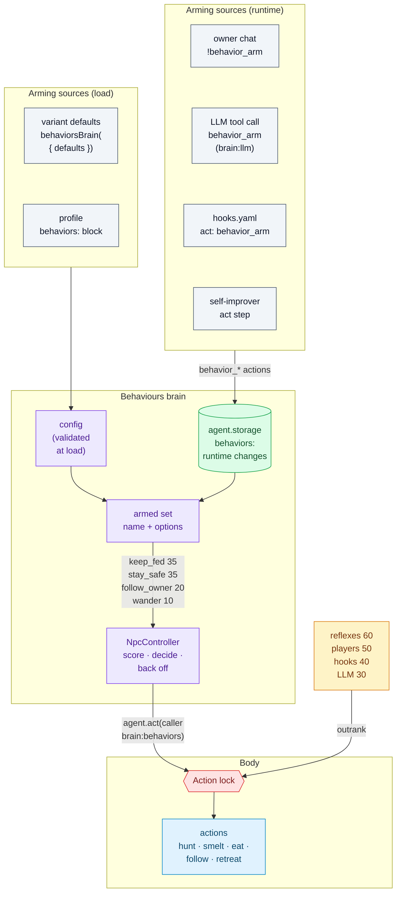
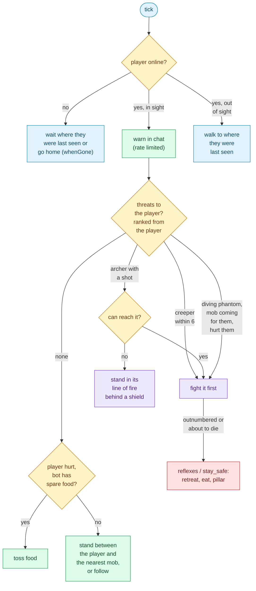
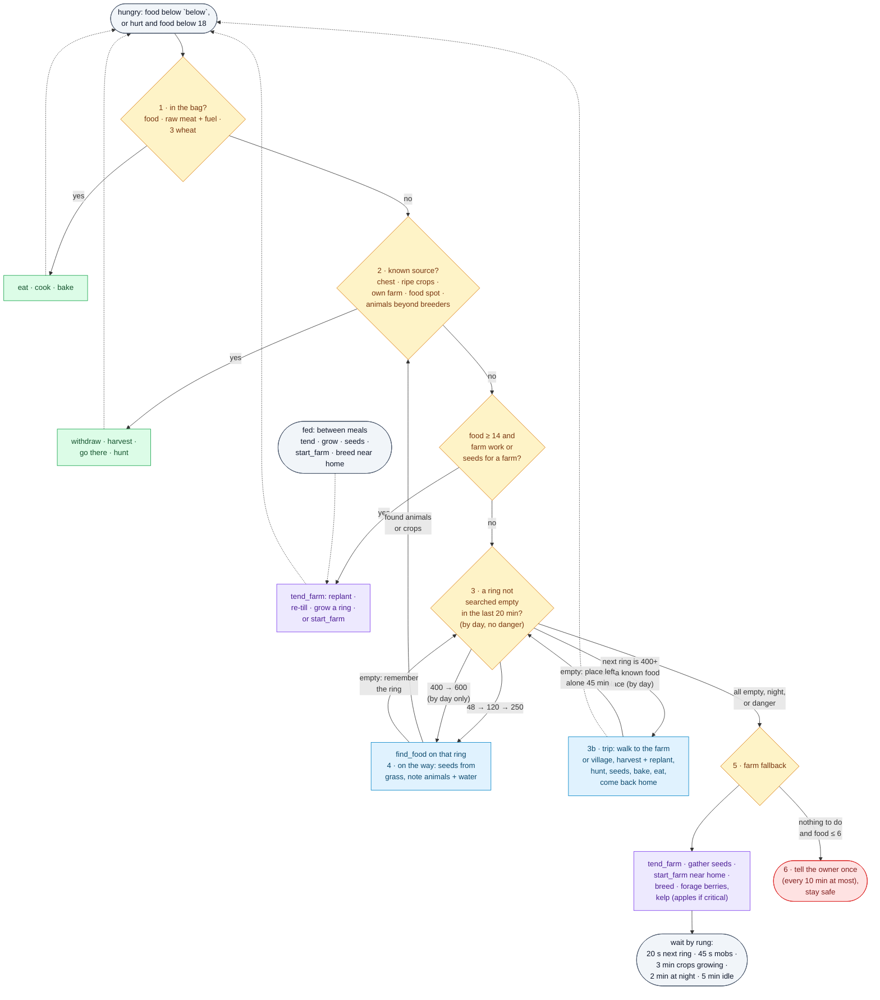

# Behaviours

Armed behaviours are things a bot keeps doing on its own until told otherwise: stay fed,
stay safe, follow its owner, guard a farm, keep wood in stock. You switch them on and tune
them per [profile](/guide/profiles), from chat, from an LLM tool call, from `hooks.yaml` or from a
[self-improver](/guide/self-improver) program. Once armed, a behaviour runs without any more LLM turns or commands.

The motivating case: an LLM bot sat at 6/20 health with no food and died twice, because
nothing made it go and get food, and nothing ran between its turns. With `keep_fed` armed
it hunts, cooks and eats by itself, searches wider and wider when there is nothing near, and
with no food source around it starts a farm ([details](#food-keep-fed-the-food-ladder-and-farm-setup)).

## Actions, brains and behaviours

| | what it is | who starts it | how long it runs |
|---|---|---|---|
| **action** | one thing the body does (`hunt`, `goto`, `eat`) | anyone, via `agent.act()` | until done, stopped or preempted |
| **brain** | a decision loop (commands, [reflexes](/concepts/world#reflexes), LLM, NPC) | the [variant](/concepts/variants-profiles) | the whole session |
| **behaviour** | a scored, option-validated routine run by the behaviours brain | armed from config, chat, LLM, hooks, programs | until disarmed, across restarts |

A behaviour is an [NPC-brain](npc-brain.md) behaviour (score + run) with a name, a zod
options schema, a description written for LLMs and some metadata. The behaviours brain
holds the **armed** set and runs it through the same `NpcController`, so the scoring,
hysteresis, failure back-off and back-off from other callers are exactly the [NPC brain](/guide/npc-brain)'s.

```ts
import { behaviorsBrain } from '../src/brains/index.ts'

brains: [
  commandBrain(),
  reflexes(),
  hooksBrain(),
  behaviorsBrain({ defaults: { keep_fed: true, stay_safe: true } }),
  llmBrain({ ... })
]
```

## How it fits together



Config is the base. Runtime changes (arm, disarm, configure from any action caller) are
stored in `agent.storage` under `behaviors` and win over the config, so they survive
restarts. `behavior_reset` drops them again.

## Arming

### From a profile

```yaml
# profiles/pax.yaml
behaviors:
  keep_fed: { below: 14 }         # options map: armed with these options
  stay_safe: true                 # armed with defaults
  wander: { enabled: false }      # explicitly off (e.g. to override a variant default)
```

Names and options are checked against the registry when the profile is run: an unknown
name (`keep_food`, with a "did you mean keep_fed") or a bad option (`below: 40`, out of
range; `bellow: 10`, unknown key) stops the bot before it connects, with every problem
listed. Variants set defaults with `behaviorsBrain({ defaults })`; the profile merges over
them per behaviour (options merge, `enabled` is replaced).

### From chat (owners only)

```
!behavior_list                         names by category, * = armed
!behavior_list keep_fed                description, options and defaults
!behavior_arm keep_fed below=10 hunt=false
!behavior_arm keep_fed {"animals": ["cow", "pig"]}
!behavior_arm collect_drops items=oak_log,stick
!behavior_configure guard_area radius=20
!behavior_disarm follow_owner
!behavior_status                       armed set, what runs, last outcomes, cooldowns
!behavior_reset                        back to the profile's set
```

Options are `key=value` words (lists comma-separated) or a JSON object. Only owners
(`owners:` in the profile) get past the command brain at all, and the actions refuse
non-owners again: a player caller who is not an owner, or an LLM or hook acting for a
non-owner player, gets `only my owners can change my behaviours`.

### From an LLM

Every behaviour action is a tool. The descriptions say *when* to arm what ("arm keep_fed so
you look after your own food without being asked"), and the LLM arms as `brain:llm` (shown
in `behavior_status`). Pax's [context pack](/guide/context-pack) has one rule for it:

> For ongoing needs (staying fed, following or guarding Robin, guarding a place, farming,
> keeping wood stocked) arm a behaviour with behavior_arm instead of doing it turn by turn.

`observe()` includes `behaviors: { armed, running }`, so the model sees what is already on.

### From hooks and programs

```yaml
# profiles/pax/hooks.yaml
hooks:
  - id: guard-at-night
    on: timer
    every: 5m
    when: { isDay: false }
    do:
      - act: behavior_arm
        params: { name: guard_owner }
```

Self-improver programs can call the behaviour actions too (they are not on its deny list),
so a taught rule like "guard the farm at night" can arm `guard_area` instead of
re-implementing it.

## Priorities and back-off

Each behaviour runs at a level: `idle` (10), `npc` (20) or `behavior` (35). The default
comes from the definition and every behaviour takes a `priority` option to override it.

`PRIORITY.behavior` (35) is the one core addition: above the LLM (30), below hooks (40),
players (50) and reflexes (60). Survival behaviours (`keep_fed`, `stay_safe`, `avoid_mobs`)
use it, so a bot whose LLM is busy following someone still gets fed: the LLM's long-running
action is suspended and resumes when the behaviour is done.


- The back-off is per level: while an LLM holds the body, `npc` and `idle` behaviours are
  paused, `behavior`-level ones are not. A player, hook or reflex pauses everything.
- Disarming or reconfiguring a running behaviour stops it at once.
- A behaviour that keeps dropping out ("no longer applies") within 10 s of starting is held
  back after the second flip in a row: for 5 s (doubling per flip, up to 60 s) it only starts
  with a score of at least `flipBypassScore` (75), so real dangers still get through. See the
  [NPC brain](/guide/npc-brain) for the knobs.
- `follow_owner` and `guard_owner` run the long-running `follow` / `guard` actions. That is
  fine here: the controller still re-scores every tick and interrupts them when something
  scores higher, and a preempted action of ours is dropped rather than resumed behind the
  brain's back.

### Reflexes and stay_safe

`reflexes()` reacts to being hit: fight back, retreat at 8 health or less (not from mobs that
outrun the bot, see `combat.fightFastMobs`; always from a warden), eat when food is carried. `stay_safe` acts earlier and on what reflexes don't cover: backing off at 10 health
before the next hit, pillaring up when surrounded (only if it can place blocks and carries
dirt/cobblestone/planks), leaving water when mobs are near, going home at night. Both use
the same `retreat`/`flee` actions and the reflex always outranks the behaviour, so they
never pull the body two ways. `keep_fed` likewise leaves "eat what you carry" to the reflex
(food < 15) and steps in below 14, or when health is low and food is under 18 (no regen).

### Ranged safety

Every bot, bodyguard or not, deals with mobs that shoot at it (skeletons, strays, bogged,
pillagers, witches, blazes, ghasts, drowned with tridents); the details are under
[Ranged threats](/concepts/world#ranged-threats). In short:

- The reflexes start `ranged_defense` on an arrow or bolt on course for the bot, on a hit from
  range (also a health drop at food 0 when a shooter has a line to it), or when a shooter in
  range with a line to the bot looks at it. That preempts `find_food`, `find_target`,
  `chop_wood_loop` or whatever job runs, so the bot no longer walks on through crossbow fire.
- It answers by health and gear: shoot back with a bow or crossbow and arrows, raise a shield
  and close in, charge a lone shooter when healthy with a weapon, or hide. At 8 health or less, or
  against 3+ shooters or a pillager patrol of 3+ when its gear score is too low for that many, it
  hides instead of fighting.
- **Gear** is a score from 0 to 100: armour points, a shield, the best weapon's damage, a bow with
  arrows, and health. 3 shooters need 65 and each one more 5 more, so iron armour, a shield and an
  iron sword at full health (72.5) take on 4 pillagers but hide from 5, and hide from 4 once down to
  14 health; with a bow and arrows they take on more.
- **Hiding** means walking behind a block within 8 blocks; with none there, **building cover**: a
  1x2 wall of dirt, cobblestone, planks or whatever filler block it carries between itself and the
  shooters (or a 1-2 block pillar with a wall on it, when that is quicker), if it may place blocks
  and the cells aren't protected. It says so in the log (`ranged: building cover at ...`). Only
  then cover up to 14 blocks out, and only then backing off, at most 24 blocks from where the
  shooting started. At that cap it stands its ground with a bow, shield or weapon (at 8 health or less it keeps
  going, up to 16 blocks more).
- **Heavy fire** (outnumbered with too little gear, or 8 health or less) changes the order:
  every second in sight is a hit from each shooter, so walking far to a cover spot or building a
  wall in the open loses. Cover counts only when it can be reached before about one hit lands (5
  blocks against 3 shooters, 8 against 2, at 0.3 hits per shooter per second and 5 blocks a
  second), and a wall only when it can be finished as fast (2 blocks against 3 shooters). Failing
  both it gets out of sight: it sprints away, up to 48 blocks from where the shooting started
  instead of 24, towards home when home lies roughly away from the shooters, and with a shield it
  blocks an arrow on the way when hurt or when at most 2 shoot. The log says so (`retreat (3
  shooting at me, gear 24 of 65 needed; heavy fire, getting out of sight (cover 9 blocks off is
  too slow))`). A slow cover or wall is only the fallback when it can't back off any further. A
  cover spot where it gets hit anyway (a flank, arrows over the top) is left at once and not used
  again. Pax died this way on 23 Nov 2026: food 12, stone sword, no armour, three skeletons, it
  walked to cover and held it for 12 s while being shot.
- Behind cover it eats; it never stands in the open eating while something shoots at it. It leaves
  cover as soon as the shooters are gone or, at 16+ health, nothing shoots at it, and stays at most
  4 s when healthy, 8 s at 12+ and 15 s below. After a fight that went badly it hides 3 s at full
  health and up to 15 s at 8 or less, and gets back to work early when healthy and out of sight.
- **Danger zones**: each shooter (range + 8 around it, 5 minutes) and patrol (32 blocks, 10
  minutes) it dealt with is remembered (`src/core/danger.ts`), and `find_target` scouting,
  `chop_wood_loop`'s `chop_tree`, `find_food` waypoints, keep_fed's food spots and trips and
  `hunt`'s extra reach effort keep out of those zones, so the bot doesn't walk back into the
  patrol once it's quiet. `dangerMemory(agent).isInDanger(pos)` (from `core`) is there for other jobs.
- `stay_safe` takes cover itself (score 91, above a starving `keep_fed`) when a shooter has a
  line to the bot and it is at 12 health or less, or outnumbered for its gear score. Turn it off
  with `ranged: false` (stay_safe) or `rangedDefense: false` (reflexes).

Going home at night has some slack so it doesn't flap at the edge of `homeRange`:

- "Home" is measured horizontally from the home block, and a height difference only counts
  beyond 3 blocks, so a floor up, a cellar or the inside of the walls is home. `go_home`
  returns at once ("already home") when the bot is within its range by that measure.
- It starts when the bot is farther than `homeRange` and, once on its way, keeps going until
  it is within go_home's range (4) instead of stopping at `homeRange`. For 3 minutes after
  getting home it allows `homeRange + 4` before heading back, so a chore at the edge of the
  base doesn't send it home every few seconds.
- When `go_home` fails, stay_safe doesn't try again for 60 s (doubling per failure in a row,
  up to 5 min). Meanwhile an unprepared bot (no armour, weapon or food) stays put: it digs in
  with `bunker` when it may, otherwise stands guard where it is. A more urgent danger
  (surrounded, low health, water) still takes over.
- A path stopped right at the start (the previous action's stop landing on the new path) is
  retried once; if it is stopped again, go_home says so instead of the pathfinder's text.

## Bodyguard

`bodyguard` protects a player (default: the first owner online) without any LLM turns. Pax has
it in its profile switched off; an owner turns it on with `!behavior_arm bodyguard` (or "guard
me"), off with `!behavior_disarm bodyguard`, and tunes it with `!behavior_configure bodyguard
range=20 warn=false`.



- **Threats** are judged from the player: anything that hurt them (damage events name the source,
  arrows the shooter), a creeper within 6 of them (always first), an archer with a clear line to
  them inside `range`, a phantom diving at them, a mob inside `range` walking towards them or
  looking at them, anything within 5 of them, and whatever attacks the bot. Neutral mobs
  (endermen, piglins, wolves) only when they attack; players, pets, villagers, golems and named
  mobs never. A melee mob hitting the player from within 3 blocks goes before archers (a creeper
  by them still goes first). The fight itself is the [fight loop](/concepts/world#fighting) with
  `maxChase` set to `range`, stopped early when a creeper comes up to the player, the target leads
  the bot away, or a re-rank (every 0.6 s) finds a threat that scores clearly higher, such as a
  zombie reaching the player while the bot chases an archer. With a bow (skeletons drop them)
  it never shoots while the player is near the line of fire, up to 4 blocks past the target; it
  closes in instead.
- **Intercept** (`intercept`, default on): a ground mob walking at the player 6 to 12 blocks out
  is met on its predicted path (velocity from position samples) instead of at the player, and of
  similar mobs the one that reaches the player first goes first. Off, it fights them where they
  are, ranked without the time-to-player.
- **Pulling aggro** (`pullAggro`, default on): with two or more melee mobs on the player (within
  4 blocks, hitting or closing in), it hits each one it hasn't hit in the last 6 s once, so they
  turn on it, then steps 6 blocks off the player on its own side so they follow. One mob on the
  player is just fought.
- **Creepers**: shot from 5+ blocks with a bow and arrows when the player isn't in the line,
  otherwise hit once and stepped back from; a lit fuse within 5 blocks sends the bot 7 away
  (never within 3 of it).
- **Gear**: `protect` puts on the best armour, shield or totem it carries when it starts (armed,
  or after a respawn) and checks again every few seconds while it is quiet, so gear handed over
  after a death goes on before the next fight.
- **Position**: with a mob around but nothing to fight, the bot stands on the line between the
  player and the mob at the follow distance (at most halfway). Flyers are fought from next to
  the player.
- **Archers** it can't get to (on a ridge, across water) are blocked instead for 20 s: it stands
  where it covers the arrow's line to the player and raises a shield (archers high up shoot
  steeply, so the spot moves right next to the player; when no spot covers the line it closes in).
- **Warnings** (`warn`): "creeper behind you", "2 zombies to your left", "skeleton on the ridge
  east", "phantoms incoming". Melee mobs and creepers are relative to where the player looks,
  archers by compass. At most one every 5 s, the same one (kind and direction) every 30 s. Public
  chat, or whispers with `whisper: true`.
- **Feeding** (`feed`): the server sends other players' health in entity metadata but never their
  hunger, so it feeds by health only: at 10 or less, within 5 blocks, nothing close, at most
  every 30 s, 1-2 of its best food, never below `keepFood` items for itself. It whispers what it
  tossed. Where the server hides player health it doesn't feed at all.
- **Night**: while it is armed and the player is online, `stay_safe` doesn't go home or dig in;
  the reflexes don't [bunker](/concepts/world#phantoms-bunker) away from phantoms unless health is 6 or less. Low health
  (retreat) and the back-off to eat at 4 health still apply; surrounded (pillar, or back off)
  only at 12 health or less, because every wave that reaches the player surrounds the bot too.
- **Reflexes**: while `protect` holds the body the reflexes don't start `defend` over it (it fights
  what attacks the bot too, ranked after threats to the player); when it isn't running they defend
  the bot as usual. Priority level `behavior` (35) beats `follow_owner`/`guard_owner` and the LLM's
  actions, so an armed bodyguard keeps the body while the player is in sight; arm it with
  `priority: npc` to let the LLM work in between.
- **Gone**: player out of sight but online: walk to where they were last seen (up to `catchUp`).
  Offline: wait there (`whenGone: stay`) or go home (`whenGone: home`).

The actions behind it are usable on their own: `protect` (the loop) and `feed_player`.
`scripts/guard-test.ts` is the older smoke test (natural night spawns, too few mobs to mean much).

### Benchmark: `just guard-bench`

`scripts/guard-bench.ts` is the controlled version. ClaudeTest (an op) directs; GuardTest is
the bot and GuardTester the owner, who stands still (no self-defence, eats bread). Before every
phase the director sets the time to morning, kills leftover tagged mobs, fills creeper holes in
the arena floor, resets both players to full health and hunger, gives the same gear (bot: iron
sword, shield, 16 bread, iron armour with `--armour`; tester: 8 bread) and teleports both to the
spot, the bot 3 blocks east. Then it summons a seeded wave schedule 8 to 14 blocks around the
tester every 30 s while fewer than 8 are alive: 2 zombies and a skeleton (leather helmets so
they don't burn, the skeleton with a bow), a spider, and a creeper every other wave. Phases:
`guard` (bodyguard armed for the tester), `follow` (`follow_owner` only), `none` (bot offline).
The order flips on every repeat. A tester death is counted, the mobs alive are killed and the
tester is reset on the spot. During a run both accounts' spawnpoint is set next to the arena (put
back to the world spawn at the end), so a death never leaves them standing at spawn, and they are
teleported back before anything else. `--waves ranged` summons archers only (2 skeletons and 2 pillagers
with crossbows, a third pillager every other wave) to measure how the bot keeps itself alive
under fire; `--bow` also gives the bot a bow and 32 arrows, `--blocks 16` 16 cobblestone (to
build cover with). `--no-intercept` and `--no-pull` arm the bodyguard with that tactic off, so
each can be compared with the default (results carry `variant`); `--variants all,no-intercept,no-pull`
runs a guard phase for each in one session. The bot's own hits taken and deaths
are counted in every phase. In the guard phase the bodyguard whispers its warnings to the
tester, so nobody else on the server sees them.

Two more modes test the bot on its own (no tester, reflexes and stay_safe only). `--duel
zombie,skeleton,creeper,vindicator` keeps `--duel-count` (2) of one kind alive 8 to 12 blocks
around the spot, refilled 3 s after each kill, for `--minutes` per kind, and counts kills, deaths
and health lost per kill. `--clutch N` does N drops from `--clutch-height` (22) blocks with a water
bucket, then N stands on a fire block, and removes the water and fire afterwards.

Other options: `--seed` (1), `--sword stone|iron` (iron), `--tester-food` (8), `--interval` (30 s
between waves), `--cap` (8 alive), `--time day|night`, `--phantoms` (a phantom every third wave),
`--force` (run on a spot that isn't flat and dry). The accounts come from `GUARD_BOT`,
`GUARD_TESTER` and `DIRECTOR` in `.env`, results go to `GUARD_BENCH_DIR`, and the player the
bots keep away from is `MC_OWNER` (default Robin).

```sh
just guard-bench --scout                      # check the spot (flat, dry) and Robin's distance
just guard-bench                              # 1250 445, 2 repeats x 3 phases x 4 min
just guard-bench 1250 445 --minutes 4 --repeats 3 --armour --tag mytest
just guard-bench --phases follow --waves ranged --minutes 3   # the bot's own survival under fire
just guard-bench --phases guard --no-pull --minutes 3         # the bodyguard without pulling aggro
just guard-bench --duel zombie,creeper --minutes 2 --repeats 3   # the bot alone, two of a kind
just guard-bench --clutch 5                   # water bucket: 5 drops, 5 fires
just guard-bench --cleanup                    # kill tagged mobs, clear both players
```

Results append to `data/guard-bench/results.jsonl` and a table prints at the end. Daytime keeps
natural spawns out, but spiders don't pick targets in daylight, so in practice the waves are
zombies, skeletons and creepers.

**Results** (mc02, 22 Nov 2026, spot 1250 70 445, seed 1, iron sword and shield, no armour,
4 minutes per phase, 2 repeats, order flipped). "Before" is the bodyguard as first shipped,
"after" is with the three fixes described under Threats and Night above. Each phase summons
36 mobs (8 waves) unless the cap held waves back.

| set | phase | tester hits (each run) | mean hits | mean damage | tester deaths | bot deaths | bot kills (mean) | creeper blasts within 6 | warnings (mean) |
|---|---|---|---|---|---|---|---|---|---|
| before | guard | 55, 60 | 57.5 | 189 | 5, 6 | 2, 3 | 12.5 | 0, 2 | 22 |
| before | follow | 67, 54 | 60.5 | 200 | 5, 5 | 2, 2 | 11 | 1, 2 | 0 |
| before | none | 69, 58 | 63.5 | 202 | 6, 6 | - | - | 1, 2 | 0 |
| after | guard | 43, 34 | 38.5 | 138 | 4, 3 | 4, 2 | 16 | 2, 2 | 22 |
| after | follow | 67, 53 | 60 | 181 | 6, 4 | 2, 1 | 10 | 2, 1 | 0 |
| after | none | 60, 61 | 60.5 | 213 | 6, 6 | - | - | 3, 1 | 0 |

The median time from a wave's spawn to its first hit on the tester was 4 to 5 s in every phase:
the bot doesn't stop the first hit, it shortens the fight after it. Feeding happened 3 times in
all (the tester ate its own bread too).

How to read it:

- Before the fixes the bodyguard was no better than `follow_owner`, and neither was much better
  than no bot (57 / 60 / 63 hits). The logs showed why: it chased skeletons while a zombie hit
  the player, stay_safe pulled it out every time three mobs reached the player, and once it shot
  the player with a bow it had picked up (2 hits). After the fixes the guard phases took about a
  third fewer hits and deaths than follow or none in the same session, with no friendly fire.
- Two runs per cell is little. An earlier session with the "before" code (4 phases before it
  was stopped) had guard 36, follow 40 and none 77 and 81 hits, so whole sessions shift by 15 to
  20 hits; compare phases within a set, not across sets.
- The bot dies more after the fixes (6 deaths in 8 minutes against 5), because it no longer runs
  from crowds. Most bot deaths are creepers it fights point blank without armour: a creeper by
  the player still goes first, and a sword at melee range lets it go off. `--armour` would
  change that picture; it hasn't been measured yet.
- Fairness: in the first "after" follow phase the 8-alive cap held back 2 waves (27 mobs instead
  of 36), so that phase is if anything easier than the others. Spiders don't attack in daylight,
  so the waves are effectively zombies, skeletons and creepers. Zombies did 75-90% of all hits.

**Guard intercept and ranged safety** (mc02, 22-23 Nov 2026, same spot, seed and gear: iron
sword, shield, 16 bread, no armour, no bow). "Before" is the code above, "after" adds intercept,
pulling aggro, creeper shooting, gear on arm/respawn and the [ranged reflex](#ranged-safety).
Guard phases ran 4 minutes with the mixed waves (36 mobs each); the ranged rows are the `follow`
phase (no bodyguard, so the bot looks after itself) with `--waves ranged` for 3 minutes
(27 skeletons and pillagers each).

| set | waves, phase | tester hits (each run) | mean tester damage | tester deaths | bot deaths | bot hits taken | bot kills |
|---|---|---|---|---|---|---|---|
| before | mixed, guard | 52, 28 | 147 | 5, 3 | 4, 3 | 60, 45 | 4, 14 |
| after | mixed, guard | 35, 36 | 124 | 3, 3 | 3, 4 | 35, 44 | 18, 15 |
| before | ranged, follow | 40, 48 | 159 | 4, 4 | 1, 1 | 19, 19 | 5, 6 |
| after | ranged, follow | 50, 49 | 176 | 5, 5 | 0, 1 | 7, 14 | 4, 2 |

How to read it:

- Bodyguard: the tester took about a tenth fewer hits on average (35.5 against 40) and the
  spread shrank, with more kills. The "before" pair is 52 and 28 in one session, so the change in
  the mean is inside the noise; the steadier numbers and the kills are the clearer signal. Bot
  deaths didn't change (3.5 per 4 minutes): it still dies to crowds and creepers point blank
  without armour, and the time to the first hit after a wave stays at 4 to 5 s.
- Ranged: the bot took about half the hits from archers and pillagers (10.5 against 19 per run,
  41 against 68 damage) and died once in two runs instead of twice. It does that by hiding: every
  wave is 4 or 5 shooters against a bot without armour, which counts as outnumbered, and the
  arena is flat with no cover, so it mostly backs out of range. It kills fewer of them and the
  tester, who stands still in the open, takes more hits. That is the intended trade for a bot's
  own safety; a bot with iron armour and a shield, or a bow, stands and fights.
- An earlier "after" guard run (42 tester hits, 3 bot deaths) is left out: it exposed a bug in
  the first version of `ranged_defense` that spun without yielding and froze the process for
  45 s twice, so all three accounts timed out. The fix (yield every pass, drop cover spots that
  turn out to be in sight) is in the code the "after" guard rows ran; the ranged rows ran just
  before it and had no freeze.


**Heavy fire** (mc02, 23 Nov 2026, same spot and seed). `just guard-bench --duel skeleton
--duel-count 3 --minutes 2 --repeats 3 --sword stone --no-shield --blocks 16 --bread 4`: three
skeletons kept alive around a bot geared like Pax when it died (stone sword, no armour or shield,
gear score about 24 of the 65 needed), on the flat arena. "Before" is the code before the
[heavy fire](#ranged-safety) rule, "after" with it. Each row is one 2-minute run.

| set | run | summoned | kills | bot deaths | hits taken | damage taken |
|---|---|---|---|---|---|---|
| before | 1 | 17 | 5 | 3 | 33 | 119 |
| before | 2 | 12 | 3 | 3 | 26 | 99 |
| before | 3 | 12 | 6 | 1 | 17 | 65 |
| after | 1 | 6 | 3 | 0 | 10 | 37 |
| after | 2 | 4 | 0 | 0 | 1 | 4 |
| after | 3 | 13 | 4 | 2 | 24 | 92 |

Deaths went from 7 to 2 and damage from 283 to 133 over the three runs, kills from 14 to 7.
Before, it mostly built 2-5 block walls in the open (12 times) and walked to cover (28) while
all three shot it; after, it backed out of sight (9 times) and built only once a wall was 1-2
blocks. Most of the gain is that it leaves: in run 2 it got out of the skeletons' range early
and they never found it again (4 summoned, 1 hit), which is what the rule is for but makes that
run easy. Run 3 shows what is left: it still charged a skeleton at full health when only one
had a line to it (the charge rule counts shooters in sight, not the ones around), and one death
came 2 s after `ranged_defense` ended at 5 health with skeletons still nearby. Three runs a side
is little; the spread inside each set is as large as some of the differences.

**Combat techniques** (mc02, 23 Nov 2026, same spot and seed, iron sword, shield and 16 bread, no
armour). "Before" is the code above, "after" adds the [skilled-player
techniques](/concepts/world#skilled-player-techniques) (W-tap and sweep hit styles, shield
timing against melee and creepers, totem and golden-apple reflexes, water bucket, enderman gaze,
chokepoints, no running from fast mobs), all with their defaults. 3 runs per row, 3 minutes each
for the guard and ranged rows (27 mobs per run), 2 minutes each for the duels.

| waves, phase | set | tester hits (each run) | tester deaths | bot deaths | bot damage taken (mean) | bot kills (mean) |
|---|---|---|---|---|---|---|
| mixed, guard | before | 31, 18, 32 | 3, 3, 3 | 1, 3, 1 | 98 | 12.0 |
| mixed, guard | after | 13, 26, 16 | 1, 2, 1 | 1, 2, 1 | 79 | 16.0 |
| ranged, follow | before | 33, 32, 43 | 3, 3, 4 | 0, 1, 1 | 61 | 8.7 |
| ranged, follow | after | 35, 36, 41 | 3, 3, 4 | 0, 0, 0 | 58 | 11.7 |

Duels: `just guard-bench --duel zombie,skeleton,creeper,vindicator --minutes 2 --repeats 3`, the
bot alone on its reflexes against two of one kind at a time, refilled 3 s after each kill. Totals
over the three runs (6 minutes per kind):

| mob | set | kills | kills/min | bot deaths | damage taken | damage per kill | blasts within 6 |
|---|---|---|---|---|---|---|---|
| zombie | before | 57 | 9.5 | 1 | 139 | 2.4 | - |
| zombie | after | 41 | 6.8 | 2 | 117 | 2.9 | - |
| skeleton | before | 13 | 2.2 | 1 | 108 | 8.3 | - |
| skeleton | after | 20 | 3.3 | 1 | 150 | 7.5 | - |
| creeper | before | 8 | 1.3 | 4 | 156 | 19.5 | 20 |
| creeper | after | 9 | 1.5 | 0 | 6 | 0.7 | 9 |
| vindicator | before | 3 | 0.5 | 16 | 452 | 151 | - |
| vindicator | after | 13 | 2.2 | 18 | 429 | 33 | - |

`--clutch 5`: five drops from 22 blocks (19 damage without water) with a water bucket, and five
stands on a fire block: every drop landed in placed water with no damage and the bucket back,
every fire went out (the first three left the water behind; scooping by looking at the water
block fixed that for the last two).

How to read it:

- Creepers are the clear win: the shield goes up when backing off can't clear the blast, so the
  bot went from 4 deaths and 156 damage to none and 6 (11 blasts blocked). The creeper row comes
  from a second run after that rule was tuned; the first "after" run, with a narrower shield rule,
  was no better than before (4 deaths, 166 damage).
- Guarding mixed waves, the tester took a third fewer hits (18 against 27) and died 4 times in
  three runs instead of 9; the bot killed more and took a fifth less damage. The run-to-run spread
  (13 to 26) overlaps the "before" runs, so read it as better, not as an exact third.
- Under archer fire the bot didn't die once in three runs (2 before) and killed more; damage taken
  is the same within noise. The tester's hits don't change: it stands in the open and the bot
  fights for itself in the follow phase.
- Vindicators: four times the kills, the same deaths. Two axe vindicators kill an unarmoured bot
  in two or three hits whatever it does; the shield absorbs one hit per 5 s and it no longer
  turns its back to run at low health (that was how most of the "before" deaths happened). The
  vindicator row is from a rerun with `combat.fightFastMobs`; the run before it (shield only) had
  2 kills and 15 deaths.
- Zombies: fewer kills per minute, about the same damage per kill. In the "after" runs the two
  zombies died one at a time, so they came back one at a time (the refill is per kill) and the bot
  waited for each to walk up, which caps kills per minute; the first run, where they still came in
  pairs, matched "before" (18 against 17). Damage per kill (2.4 against 2.9) is within noise. The
  shield goes up between nearly every swing against zombies; blocking slows walking, which may
  cost a little speed. `combat.shieldMelee off` turns it off.
- Skeletons: more kills for less damage each. Kill counts here depend on the ranged reflex hiding
  rather than fighting, so they swing a lot between runs (2 to 9 per run).

## Food: keep_fed, the food ladder and farm_setup

`keep_fed` climbs a ladder when the bot is hungry: what it carries, then sources it knows,
then searches that widen ring by ring, then a trip to a known farm or village far away, then
the far rings, then a farm of its own. Between meals it looks after
that farm (replant, re-till, grow it) and breeds animals near home, so the farm is there long
before the searches run dry. The choice is the pure
`planFood(world, options, tried)` in `src/skills/foodPlan.ts`, which returns the rung, the
step and the reason; a step that fails goes into `tried` and the next one is picked. Every
decision is logged at debug level, so the climb is visible in the bot's log:

```
keep_fed ladder: rung=search step=scout (nothing within 48 blocks, widening to 120)
keep_fed ladder: rung=farm step=seeds (no proper food source (every ring out to 250 came up empty in the last 20 min); 2 seeds, breaking grass for more)
keep_fed ladder: still hungry, next try in 180s (nothing to do, 14 crops growing)
keep_fed chore: tend_farm (5 cells to plant, re-till or grow (3x3 of 9x9))
```



- **1 · inventory:** eat ready food, cook raw meat or potatoes when it has fuel and a furnace
  (nearby, carried or craftable from 8 cobblestone), bake bread from 3 wheat, and eat safe raw
  meat when cooking isn't possible (never raw chicken).
- **2 · known sources:** a chest it has looked into, ripe crops in `radius` (its own farm or a
  village's), its own farm further out when ripe or due a visit, a remembered `food:animals` /
  `food:village_farm` spot, and animals in range. A known spot further than `radius` only wins
  over hunting when there is nothing to hunt where the bot stands, and a spot in a remembered
  danger zone doesn't count. Village carrots and potatoes are harvested like wheat and each
  cell gets its own crop back.
- **2b · parallel farming** (`growFarm`, on by default): when food is not urgent (at least
  `farmAbove`, default 14, which happens while it eats back up to `until`) and nothing in
  rung 2 applies, it tends its farm when there is work it can do, or starts one when it has
  `minSeeds`, before setting off on a long search. Hungrier than that, food comes first.
- **3 · search:** `find_food` on the smallest ring in `rings` (default 48, 120, 250, 400, 600
  blocks around home) that no recent empty search covered. Rings wider than `farRingsFrom`
  (default 250) are far ones: they are only searched by day (even with `scoutAtNight`), and
  only after a trip to a known food place (3b), when there is one. An empty 120 search also covers the 48 ring, a
  wider search skips the rings a smaller one walked (`minRadius`), and an empty ring is
  remembered for `ringMemoryMinutes` (default 180: every scout costs food, and a snowy forest with no animals stays that way for hours) in `agent.storage` key `foodLadder`, so a
  restart doesn't rescan it. A search cut short by night or mobs is not remembered as empty.
  Within one run it moves on to the next ring right away.
  **Gear and hunger:** rings wider than `riskyRingsFrom` (default 48) are trips far from home.
  With a gear score (the [ranged safety](#ranged-safety) score: armour, shield, weapon, bow,
  health) under `scoutGear` (default 40; stone tools and no armour score about 25, iron armour and
  a sword about 50, a shield adds 20) it takes them only once food is at or below `scoutHungerAt`
  (default 8) or it is starving. Until then it bakes, tends or starts its farm, forages and waits
  for crops (the next try is 3 minutes later), and the log says why (`food 12/20 is not urgent and
  gear 25 is under 40: not scouting 120 blocks out yet`). `scoutGear: 0` turns the rule off.
  At or below `scoutFoodFloor` (default 6) no such ring is started at all, whatever the gear: on
  23 Nov 2026 Pax went from food 12 to 0 in six minutes of scouting, then was shot at 1 health,
  and on the next run (food 0, a 250 ring) drowned. `find_food` walks instead of sprinting
  (sprinting burns food about ten times faster) and paths around water where it can; when it
  still runs out of air it swims up before heading for dry land. Berry bushes (and kelp, with a
  furnace) count as food up to 64 blocks out.
  **Starving at night** (food 6 or less): its own farm, a food chest, a remembered spot within
  twice `riskyRingsFrom` (96 blocks) and the near ring are worth the dark; wider rings are not
  started at all at that food level (the floor above). Between ladder runs a starving bot holds the body (score 45: above `chop_wood_loop` and
  stay_safe's hold after a failed trip, below stay_safe's night trip home), walks home by day when
  it is more than 16 blocks out, and otherwise waits there, so chores and stay_safe don't take
  turns while it starves.
- **3b · trip to a known food place** (`trips`, on by default): before the far rings, and when
  every ring came up empty, it walks to the best known food place by day, any distance (it
  travels on the surface, so 3000+ blocks is fine, up to `tripRange`, default 4000). Known
  places are the profile's `foodPlaces` list (coordinates, or a remembered place name such as
  `farm:1`, with optional `crops`), its own farms, and remembered places: `found:wheat` /
  `found:carrot` / `found:potato` / `found:village`, `food:village_farm`, `food:animals`.
  The pure `rankFoodPlaces` orders them by distance divided by a trust weight (the profile's
  places and its own farms 1.5, crop fields 1.2, villages 1, animals 0.6), and leaves out
  places in another dimension, in a remembered danger zone, closer than 48 blocks or `radius`,
  whichever is more (rung 2 sees those), or visited lately. Places within 48 blocks of each other
  count as one. There it harvests ripe crops and replants (the whole field for a
  listed place or its own farm, otherwise only crops by a village), hunts animals beyond the
  breeders, breaks a little grass when short of seeds, bakes bread, eats, and walks back home.
  A place is then left alone for 20 minutes (45 when it had nothing or couldn't be reached).
  ```
  keep_fed ladder: rung=trip step=trip (before searching 400 blocks out: known food place village 3518 blocks away)
  ```
- **4 · while searching:** it stops walking as soon as animals or a village farm come into
  view (keep_fed then goes there and hunts), notes water for a farm, and when the farm fallback
  is on and it carries fewer than `minSeeds` seeds, breaks grass right next to its path for
  wheat seeds (no detours, 20 s per stop). When it finds an animal it then can't walk to (in a
  cave, across a gap, up a ledge), `hunt` tries harder once, see "Reaching animals" below. A waypoint over water or lava is moved to dry ground
  closer in or a little round the ring; only when everything near it is wet is it skipped.
- **5 · farm fallback** (`startFarm`, on by default), once every ring came up empty, or the
  search is off or too dangerous: tend its farm (`tend_farm`), get more seeds by breaking
  grass (`gather_seeds`), start a farm near home once it has `minSeeds` (`start_farm`), breed
  animals it has food for (`breed`), and forage as a stopgap (`forage`): ripe sweet berries,
  kelp cut from the shore when it can smelt it (a furnace near, carried or craftable, and
  fuel; rung 1 then cooks it into dried kelp), and only when critical, oak and dark oak leaves
  broken for apples (about 1 in 200 leaves) plus apples lying around. When the wheat is ripe,
  rung 2 harvests it and rung 1 bakes the bread. Fishing is not done: there is no fishing
  action yet.
- **Seed gathering:** `gather_seeds` keeps breaking grass until it has the seeds it wants, its
  time is up (`seedMinutes`, default 4), the grass it may break within `seedRange` of where it
  started runs out, or a break budget (about 24 blocks per seed wanted, 48 to 400) is used. It
  takes the nearest breakable grass each time, so it works outwards patch by patch, and it
  looks past grass inside protected areas and near the world spawn instead of giving up on the
  nearest few dozen blocks. After each break it walks over the drops next to the block (seeds
  only pop out a block or so and are not picked up from 2 blocks away), and once more at the
  end. The result has the real numbers: `broke 64 grass in 150s for 7 of 10 seeds (have 7);
  stopped: time is up (4 min)`. A run that comes back short while breakable grass is still
  around is paused only 3 minutes (a 1 in 8 drop makes that mostly luck), not 20.
- **Reaching animals:** when `hunt` can't get to an animal on foot, it tries once more with a
  budget from the pure `reachEffort` (`src/skills/reachPlan.ts`): up to 16 scaffolding blocks
  (dirt, cobblestone, other stone, planks; never more than it carries) for bridges and, when
  the animal is above, a pillar, plus digging through or down when digging is allowed, all
  within 45 seconds. It refuses for animals in protected areas or remembered danger zones, by
  lava, more than 48 blocks away or more than 24 blocks above or below, and when it may
  neither dig nor place. While trying, the pathfinder may not break or place in a
  protected area or danger zone, may not walk through a danger zone, and may not break a block
  with water or lava under it. If it
  still can't get there, the animal is left alone for 5 minutes as before and the result says
  why (`the chicken at 586 13 -64: it is 51 blocks below me (more than 24)`). `hunt
  reach=false` turns this off.
- **Farm upkeep and growth:** `tend_farm` reads the farm's square and the pure
  `planFarmWork` (`src/skills/farmPlan.ts`) decides the cells: bare farmland is planted first
  (it dries back to dirt), then trampled dirt inside the farmland's current square is tilled
  and planted again, then the plot grows a ring at a time towards `farmSize` (default 9x9,
  all one water block keeps wet), nearest the water first. It only tills cells it has seeds
  for, and growth never uses the last `seedReserve` (default 4) seeds, which stay for
  replanting. Cells out of the water's reach, fences, stone and protected ground are never
  tilled. If the water in the middle is gone and it has a bucket (filled from a source within
  48 blocks if empty), it pours it back. Seeds come from harvests and from breaking grass.
  `start_farm` now only tills as many cells as it has seeds for; the farm grows from there.
- **Between meals:** when not hungry, the pure `farmChore` picks one chore at a time (score 21
  to 22, about the level of `farm_setup`, by day, never in danger): tend and grow its farm
  (within 128 blocks), break grass when the farm is smaller than `farmSize` and short of
  seeds, start a farm once it has `minSeeds` (even with animals around: a farm is long-term
  food), and breed animals near home (within 64 blocks of it) when it has their food: wheat
  for cows and sheep, seeds for chickens (keeping `minSeeds`), carrots, potatoes or beetroot
  for pigs. Breeding
  keeps the herd up so hunting with `keepBreeders` doesn't wipe it out. Each chore then
  rests a few minutes (longer after a failure).
- **Danger:** far trips stop on the same signals `stay_safe` acts on: shooters calling for
  cover (`stay_safe`'s `ranged` danger), 3 or more hostiles within 6 blocks, mobs near while
  at 8 health or less, or standing in a remembered danger zone. `find_food` drops waypoints
  in a danger zone or whose way out from home passes through one. The zones are the ones the
  [ranged reflex](#ranged-safety) remembers, read from the agent's core danger memory
  (`src/core/danger.ts`) through `src/skills/food-danger.ts`, whichever skills are loaded.
  `hunt`'s reach check reads them the same way.
- **6 · report:** at food 6 or less, or once every ring came up empty, with nothing left to try
  (and no farm just started or growing) it whispers its owner how far it looked and what would
  help (`I'm starving (food 3/20) and nothing to eat within 250 blocks of home (...). Staying
  safe near home; food, seeds for my farm, or a pair of animals to breed would help.`), at most
  once an hour, and does nothing risky; `stay_safe` keeps it out of trouble.
- **Waits:** after a run that leaves it hungry, the wait depends on what is left: 20 s when
  another ring or step is open, 45 s while in danger, 3 minutes while its crops grow,
  2 minutes at night (or in a storm) or when critical, 5 minutes when nothing at all is possible. A change in the food-related inventory
  (meat, wheat, seeds, fuel) cuts the wait short. Steps that failed are paused on their own
  (a farm it couldn't reach for 10 minutes, start_farm for 15).
- **Breeders:** with `keepBreeders` (default on) `keepAtLeast` (default 2) adults of each kind
  are spared, by hunting and when counting what a search found; they are only hunted when
  starving (health or food 6 or less). Only adults are hunted.
- **Never from other players:** crops count only on the bot's own farms (`farm:<n>`) or on a
  village farm (villagers within 24 blocks); `anyCrops: true` lifts that (e.g. for its owner's
  field). Animals go through the hunt filter (no pets, named, tamed, leashed or baby animals,
  never villagers, never in protected areas, nothing inside fences except on its own farm).
- **Night and reflexes:** far trips (searching, known spots, its farm out of range, starting a
  farm, seed walks) only happen by day unless `scoutAtNight`; planting and picking in range is
  fine at night. `stay_safe` (night score 48, below keep_fed's 55+) takes the bot home. Eating
  what it carries stays with the reflexes, which always outrank behaviours.
- **Memory of spots:** sightings are stored with a timestamp (`agent.storage` key `foodSpots`)
  and as places `food:animals`, `food:village_farm` and `food:water`, plus a `food_spot`
  [journal](/guide/journal) event. Animal spots go stale after 6 hours, an empty visit pauses a
  spot for 30 minutes, and two empty visits in a row forget it.
- **Reports** say what happened: `still hungry (food 6/20): did seeds, no more food to get;
  scouted 120 blocks east and north-east of home, no animals or village crops; stopped: covered
  every direction out to 120 blocks; picked up 3 seeds; started a 9x9 wheat farm at 812 63 -40
  (farm:1): tilled 64, planted 9`.

```
!behavior_configure keep_fed rings=40,100,200 ringMemoryMinutes=30
!behavior_configure keep_fed startFarm=false keepBreeders=false
```

`scripts/food-test.ts` checks the ladder on a live server. The bot is `FOOD_BOT` (FoodTest),
owned by `FOOD_TESTER` (FoodTester); it can't be made hungry without ops, so `run` arms keep_fed
with `below: 20`, and rings from `FOOD_RINGS` (default 48,120,250). Run with `MC_LOG_LEVEL=debug`
and `MC_LOG_DIR=logs` to get the ladder lines in `logs/FoodTest.log`.

```sh
node scripts/food-test.ts run 760 45 30     # walk there, empty the inventory, set home, arm stay_safe + keep_fed, watch 30 min
node scripts/food-test.ts farm 800 -40      # start_farm there, no behaviours
node scripts/food-test.ts tend 12           # back to the last farm: gather 12 seeds, tend_farm
node scripts/food-test.ts seeds 900 300 10  # gather_seeds at a grassy spot away from bases
node scripts/food-test.ts report            # farms and food spots it remembered
node scripts/food-test.ts remove            # break the crops, fences and torches of its farms
```

`FOOD_FARM_SETUP=true` also arms `farm_setup` in `run`; `FOOD_EMPTY=true` empties the inventory
before `farm`.

### farm_setup

`farm_setup` keeps the bot fed long term. With no farm it runs `start_farm`:

1. a site near home (or `place`), checked first so it doesn't collect seeds for nothing: shore
   water (a source with land next to it) within `radius`, then out to 96 blocks, each scored on
   a 9x9 square at the water's height. Protected areas, the world spawn (`spawnClearance`),
   placed blocks (planks, cobblestone, glass, fences, torches, beds, chests...) and existing
   farmland within 3 blocks rule a site out. At least 8 cells must be grass/dirt with air or a
   plant on top, or a one-block grass bank it can dig off (farmland only stays wet with water
   at its own height or one above); more such cells, closer and fewer extra water holes is
   better. Without natural water it tries a water spot it saw while scouting, then a water
   bucket (filling an empty bucket first);
2. seeds: breaks grass until it has `seeds` (wheat seeds drop 1 in 8), or uses carrots,
   potatoes or beetroot seeds it carries;
3. a hoe: from the inventory, crafted, or crafted after chopping a few logs;
4. till every usable cell around the water (one source hydrates 4 blocks out, so 9x9 is
   the most), plant, fence the ring outside with a gap on the south side and torch the corners
   when it has (or can craft) the fences and torches;
5. save it as `farm:<n>` (place and `farms` storage), journal `farm_started`.

After that it tends the farm when `minRipe` crops are ripe (or every `tendMinutes` when it is
out of sight and within `tendRange`): harvest, then `tend_farm` for the upkeep (replant,
re-till, a ring more when it has seeds to spare), bakes bread keeping `keepWheat` for breeding, and breeds
animals it has food for (`breed`: cows/sheep wheat, pigs carrots/potatoes/beetroot, chickens
seeds, leading them to the farm first, never past `maxHerd`). It works by day, never while
hungry (keep_fed's job), and only in survival. `farm_loop` can tend the same field with
`place: farm:1`.

## Wood: chop_wood_loop and keep_tools_upgraded

`chop_wood_loop` fells trees through the wood ladder (`chop_tree` with `rings`, default 32, 64,
128 and 250 blocks): remembered tree spots first, then rings that widen, with a scouting trip out
and back for the rings past 64, skipping protected areas and remembered danger zones. Details in
[tool progression](/guide/progression#the-wood-ladder).

`keep_tools_upgraded` takes wood from the bot's own chests when the next tool needs some. When
there is none there and no tree within 32 blocks, it sets the `wood` need on the blackboard:
`chop_wood_loop` then scores 38 instead of 30 (and runs even with `keep` logs in stock) until it
brings wood back, which clears the need. A behaviour can give the NPC controller a `retryKey`; a
failed behaviour whose key changes ends its failure back-off early (at least 10 s after the
failure). `keep_tools_upgraded` uses the usable wood it holds, so it retries as soon as the wood
is there.

## Trips

A trip is a walk away from home that a behaviour starts: `keep_fed` scouting rings and food
trips (known food places, food spots, its farm), `farm_setup` walking to a far farm,
`keep_spawn_bed` looking for sheep, `chop_wood_loop`'s `chop_tree` rings past 64 blocks and
`keep_tools_upgraded`'s `upgrade_tools` going for ore. Walks shorter than `trips.minDistance`
(64 blocks) are not trips. Actions an owner orders are left alone unless `trips.ownerOrders` is on.
The planner is pure and game-agnostic (`src/core/trip.ts`); the Minecraft side is
`src/skills/trip.ts` and `behaviors/trip.ts`.

**Before leaving** (`prepare_trip`, also an action an LLM can call): it takes food out of its
pantry and own chests (`settings.storage.chests` and chests it placed, within 160 blocks, best
food first) until it carries `trips.food` items (8), puts its best sword or axe in hand, and
checks it. With no weapon, fewer than `trips.minFood` items (4) or under `trips.minHealth`
health (12) it stays and the behaviour backs off with the reason, e.g. `not ready for a trip
(looking for sheep 120 blocks out): no weapon, food 1 of 4 items`. Food trips don't need food
along (getting some is the point), and a food trip while starving (food bar 6 or less) goes
whatever is missing. A wood trip with no weapon and no wood waives the weapon: the wood is what
makes one.

**On the way** a timer checks every 2 seconds and turns the trip back when

- the food left (food bar plus the food points it carries, so eating on the way costs nothing)
  is down to `trips.turnBackAt` (half) of what it left with,
- the food bar is at `trips.foodFloor` (6) with nothing left to eat, or
- the daylight left is about the walk home (distance / `trips.speed`, 3 blocks a second) plus
  `trips.daylightMarginS` (60 s), or a thunderstorm starts.

The walk stops mid-leg (`travel` throws `TripTurnBackError`), the bot walks home and whispers its
owner, e.g. `turned back: food down to 6 of the 12 I left with (scouting 250 blocks out for
food), back home` (with no owner online it is only logged). A ring cut short this way is not remembered as empty, and `keep_fed` starts no
other trip in that run. A starving food trip has no food rule (home has nothing either); a trip
that started at night (`scoutAtNight`) or whose way back alone takes longer than a day (the
village 3500 blocks away) has no daylight rule.

The settings live under `settings: trips:` and as live toggles (`!config_set trips.food 12`,
see [live config](./live-config)). Pax sets:

```yaml
settings:
  trips: { food: 8, minFood: 4, minHealth: 12, turnBackAt: 0.5, foodFloor: 6, daylightMarginS: 60 }
```

## Respawn point: keep_spawn_bed

`keep_spawn_bed` keeps a bed at home and the respawn point on it, so a death ends at home
instead of at the world spawn. It runs at the npc level with score 24: below safety, food and
`keep_tools_upgraded` (28), above idle chores. The steps come from the pure planner
`nextBedStep` (`src/skills/bedPlan.ts`); the `spawn_bed` skill does the work with three actions:
`place_bed`, `set_spawn` and `shear`.

The skill tracks where the respawn point is and keeps it in storage (`spawnBed`):

| what the bot sees | respawn point |
|---|---|
| "Respawn point set", or lying down in a bed | set, at that bed |
| a bed click answered with "You can sleep only at night..." or "...monsters nearby" | set (1.21.1 sets the point before it checks the time and monsters) |
| "...too far away", "This bed is obstructed", "This bed is occupied" | not set (`set_spawn` walks closer once for "too far") |
| a respawn within 4 blocks of the bed | set, confirmed |
| a respawn anywhere else, "You have no home bed...", or the server resetting the spawn | lost, with the reason |
| the bed's block loaded and no longer a bed | lost |

While the point isn't a bed within `homeRange` of home, the behaviour works down this list and
backs off (60 s, doubling up to 30 min) when a step fails:

1. click its own bed near home (`set_spawn`); after a long trip it walks home first
2. place a bed from the inventory (`place_bed`), then click it
3. take a bed out of its own chests near home
4. craft one: 3 wool of one colour and 3 planks of one kind (planks from a log first); no wood
   raises the `wood` need for `chop_wood_loop`
5. take wool from its chests when that makes 3 of one colour
6. shear sheep (`shear`); with 2 iron ingots and no shears it makes shears first
7. hunt woolly sheep (`hunt animal=sheep`), sparing `spareSheep` adults
8. by day, search the `rings` around home for sheep (`find_food` with sheep only); a ring searched
   all the way round without sheep is skipped for `ringMemoryMinutes` (one cut short by nightfall
   is searched again). With every ring empty it stops with "no sheep found
   within 250" and tries again when the oldest empty ring is forgotten.

The back-off ends early when the wool, planks, logs, shears, iron or beds it carries change.

`place_bed` picks the spot with `planBedSpot`: both bed cells free (not liquid) with a full
block under them and room above, nothing in a protected area or danger zone, not in front of a
door, gate or trapdoor, not on or beside a chest, barrel, furnace, crafting table, ladder or
another bed, not plugging a one-wide passage, and a free cell next to it to click from. The home
spot itself stays free; the nearest spot to it wins, same floor first, headboard against a wall
when there is a choice. Beds it places are remembered as its own (`spawnBed.own`). It never
breaks a bed, its own or anyone else's, and it never places or clicks one in the Nether or the End.

### At night

By day a click only sets the point. At night the click puts the bot to bed, which sets the
point too. Then it waits up to `graceSeconds` (12) for the night to skip. While it waits it asks
the players who are still up to go to bed: once at the start (`askText`), then a reminder every
`askEverySeconds` (5), at most `maxAsks` (3) messages in all, through the rate-limited chat
queue. It asks players it can see awake. Players it can't see might be in the Nether or the End,
where they don't count, so it only asks them when the server's "N/M players sleeping" says more
sleepers are needed than it can see. Until the server reports a count it assumes
`sleepingPercentage` (100, the vanilla gamerule). Spectators and names in `ignore` are never
asked. When the server says "Sleeping through this night", it stays in bed until the morning.
When the grace runs out, or the server says no amount of rest will pass the night, it gets up
and carries on. The respawn point counts as set either way.

```yaml
behaviors:
  keep_spawn_bed: { homeRange: 6, graceSeconds: 12, ask: true, maxAsks: 3,
                    askText: "{players}, could you hop into bed so we can skip the night?",
                    ignore: [Pip] }   # other bots
```

`!behavior_configure keep_spawn_bed graceSeconds=20 ask=false` changes it live. The
`set_spawn` action takes the same settings (`grace_seconds`, `ask`, `ask_text`, ...) when an
LLM or a player uses it directly; `stay=true` keeps the bot in bed until the morning.
`observe()` shows `respawnPoint` once it is known.

## Death drops: recover_drops

Pax used to lose its whole kit on every death. `recover_drops` goes back for it. In vanilla
everything the bot carried drops where it died and despawns 6000 ticks (5 minutes) later;
lava and the void destroy it at once. The `recovery` skill keeps a snapshot of what the bot
carries (armour and offhand included: the server empties the inventory just before the death
event) and records each death: position, dimension, the hostiles within 8 blocks by type and
count, day or night, and whether the spot had open sky. The cause, killer and recent damage
come from the [death report](/guide/journal) (`deathCause`).

Right after the respawn (once the report is in), the pure `recoverDecision`
(`src/skills/recoverPlan.ts`) answers go, wait or skip, checking in this order:

| check | result |
|---|---|
| nothing carried, or the inventory came back (keepInventory) | skip |
| died in lava (or lava was the last damage), in the void or below the world | skip, the drops are gone |
| died in another dimension than the respawn (Nether, End) | skip |
| more than `maxWaterDepth` water above the spot (when the chunk is loaded) | skip |
| farther than `maxDistance`, or the walk (distance x 1.3 at 4.3 blocks/s) plus `marginSeconds` is longer than the time left | skip |
| killed by a player who is online (`avoidPlayerKillers`) | skip |
| the mobs at the spot need more gear than it has | wait, or skip when there is no time left to wait |
| night, gear under `nightGear` and farther than `nightMaxDistance` | wait, or skip |

The mobs to expect are what the bot sees at the spot now when it is within 48 blocks, else the
report's hostiles plus the killer (a creeper that blew it up is gone). They count as threat
points: zombie 1, skeleton and creeper 1.5, witch and enderman 2, vindicator 2.5, piglin brute
4; a warden, ravager, evoker or wither is never worth it. Undead under open sky count a quarter
by day (they burn); night adds a point for fresh spawns. Up to `freeThreat` (1) is fine with any
gear; above that it needs a gear score (`gearScore` from ranged safety: 15 naked at full health,
about 72 in iron with a shield and a sword) of 15 + `gearPerThreat` (12) per point. So a bot
killed by 3 skeletons in a cave (4.5 points, 69 needed) waits while it is naked and goes in
iron.

On go it runs `prepare_trip` first when it has 90 seconds or more to spare (food from the
pantry, a weapon; every check waived, so it never stops the trip), then `recover_items` at score 72: above chores, food and stay_safe's night trip home
(70), below water (78), mobs (80) and low health (88+), so it starts right after the respawn.
The trip sprints there in legs (`travel`) and gives up when the drops would despawn before it
arrives, at `giveUpHealth` or less, or when the mobs around the spot (within 24 blocks of it)
need more gear than it has. It picks up its own things within `radius` (tools and armour first,
then the rest, then anything else lying there; a second round 8 blocks further out for drops
that scattered or drifted; 90 seconds at most), wears the best armour, takes the best weapon in hand, goes home and tells the owner:
"got back 23 of 31 items: stone sword, 20 cobblestone, ...; still missing iron pickaxe". A
skip is told too ("lost 31 items where I died: my things burned in lava"). One recovery per
death: a trip cut short by a fight or a danger can start again (three trips at most) while the
decision still says go.

Without the behaviour, `!recover_items` (or the LLM) does the same trip on request;
`force=true` goes even when it looks too dangerous or too far, never for drops that are gone.
observe shows `myDrops` (items, where, seconds left) until the trip is done.

Live test: `node scripts/recover-test.ts <x> <z> [basic,far,danger]` (a separate bot, an op
director for /give, /kill and /summon in short bursts). On mc02 (2026-11-23): killed 60 blocks
from home by day with iron armour and 31 items, it walked back right after the respawn, got all
31 back, put the armour on and went home (about 55 s for the trip); with `maxDistance 40` it said
"lost 31 items where I died: I died 59 blocks away (more than 40)"; killed next to 3 skeletons it
waited ("3 skeleton by my things and my gear scores 16.9 (69 needed)") until the director
removed them, then went and got the armour and tools back; drops that had drifted out of the pit
it died in were partly missed and reported as missing.

Item ages only advance while a player keeps the chunk loaded, so the 5 minutes are the worst
case; the decision assumes them.

## Asking for help

A behaviour that keeps failing only backs off longer (60 s doubling to 15 min for the chores)
and would loop for hours: Pax ran `keep_tools_upgraded` about 80 times on "could not make
sticks", `chop_wood_loop` said "no natural tree within 32 blocks" all afternoon and `stay_safe`'s
`go_home` kept hitting "No path to the goal". With `askHelp` on, the bot tells its owners once
instead:

```
[Pax -> Robin] Stuck trying to upgrade my tools: could not make sticks for a stone pickaxe (5 tries over 23 min). A few logs or planks in my chest would help.
```

How it works (`src/brains/npc/help.ts`, game-agnostic, one help desk per bot shared by every
NPC controller):

- Every failed run goes to the desk with its message. Failures are grouped per behaviour and
  per normalized reason: numbers, coordinates, anything in brackets and everything after the
  first `;` are dropped, so "no natural tree within 32 blocks" and "... within 64 blocks" are
  one kind. Yields and aborts don't count; a success clears the behaviour's failures. A kind
  with no new failure for `forgetMinutes` starts over.
- After `failures` failures of one kind spread over at least `minutes` minutes, it asks once:
  what it was trying (the behaviour's `goal`), the last failure, how often and how long, and
  what would help (the behaviour's `help` hook), or "Any idea?" without a hint.
- `tell: owners` whispers every owner who is online; nobody online means no message yet, the
  next failure tries again. `tell: say` uses public chat.
- Rate limits: one ask per behaviour and reason per `perReasonMinutes` (60), no second reason
  for a behaviour whose ask is still open, `maxPerHour` (3) in total, nothing during
  `quietHours`. What was sent is kept in storage, so a restart doesn't ask again.
- When the behaviour succeeds again the ask is marked sorted (journal); with `thanks: true` the
  same people get "sorted: upgrade my tools works again, thanks".
- Every ask is a `help` [journal](/guide/journal) event (`!events type=help`), `observe` shows
  `askedForHelp` for `observeMinutes` (60), and `!npc_status` / `!behavior_status` list it.
- The agent emits `askHelp` and `helpSorted`. The [LLM brain](/guide/llm-brain) puts them in its
  memory (no model call); `triggers.events.stuck: true` starts a turn for it.

```yaml
askHelp: true                                   # defaults below
askHelp:
  enabled: true
  failures: 3          # failures of one kind...
  minutes: 10          # ...spread over at least this long
  forgetMinutes: 120   # a kind quiet this long starts over
  perReasonMinutes: 60 # one ask per behaviour and reason this often
  maxPerHour: 3        # over all behaviours
  tell: owners         # owners (whisper those online) | say (public chat)
  llm: true            # emit askHelp / helpSorted for the LLM brain
  thanks: false        # "sorted, thanks" once when it works again
  quietHours: [23, 7]  # local hours without asks (default none)
  observeMinutes: 60   # how long observe shows an ask
```

Off by default; an options map turns it on unless it says `enabled: false`. Pax's profile turns
it on. `!config_set askHelp.enabled false` (and `failures`, `minutes`, `maxPerHour`, `tell`,
`thanks`, `llm`) change it live.

### Help hooks

A behaviour (or its definition) can say what it is trying and what would help:

```ts
{
  goal: 'keep a stock of wood',
  help: (ctx, failure) => /tree/.test(failure.reason) ? 'a few logs in my chest' : undefined,
  // or return { help, goal, tried }; null = "I report this myself", no ask
}
```

`failure` has `behavior`, `key` (the normalized reason), `reason` (the last message), `messages`
(up to 3 distinct ones), `count`, `firstAt`, `lastAt`. The stock behaviours get their goals and
hints from one table (`src/adapters/minecraft-java/behaviors/help.ts`): logs or planks for sticks,
coal, cobblestone, iron or a kit to mine deeper for `keep_tools_upgraded`; logs or a forest for
`chop_wood_loop`; a path or door into home for `stay_safe`, `return_home` and `sleep_at_night`;
a bed, a chest, seeds or 2 animals, water, torches for the others; and "a clear path (or a door)"
for path failures of any behaviour.

`keep_fed` has its own starving report (`report: true`, about how far it searched). It goes
through the same desk: shared limits and journal, so the owner never gets both, and it still
works with `askHelp` off (then it is limited to once an hour, falling back to public chat when no
owner is online).

## Spawn-proofing: light_home

`light_home` keeps mobs from spawning around home, the bot's own farms (`farm:1`, ...) and any
places you list. In 1.21.1 overworld monsters spawn only at block light 0. A torch gives 14 at
its block and one less per block of distance (Manhattan, through air), so on flat ground a
torch about every 12 blocks is enough for light 1. The default `target` is 8: the estimate
ignores walls, and the margin covers corners it gets wrong.

By day, once per `everyMinutes` (20, one Minecraft day) for each area, and sooner when a
hostile shows up inside an area (each mob counts once), it walks over and runs `light_up`:

1. **Survey.** Every standable cell within `radius` (24 around home and places, `farmRadius`
   12 around a farm) and `yRange` (6) up and down: a free cell with head room and a block
   under it. A cell needs light when a monster could spawn there: a full, opaque floor (not
   glass, leaves, slabs, ice, farmland or paths). The light at a cell is the real block light
   from the chunk's light data (Mineflayer keeps it per block in loaded chunks, `Block.light`),
   raised by what the light sources it can see would give (torches, lanterns, glowstone, sea
   lanterns, lit campfires and furnaces, lava ...). When the chunks carry no light data at all
   it uses the sources alone.
2. **Plan.** Greedy cover (`planTorches` in `src/skills/lightPlan.ts`): it keeps picking the
   torch spot that brings the most cells below `target` up to it, floor torches before wall
   torches, until none are dark, `maxTorches` (16) is reached or no allowed spot reaches the
   rest. A torch only goes into air (never replacing grass, crops or anything else) on a
   block that is already there: on the floor when it takes one, on a wall next to the cell
   when it doesn't. Never on farmland or crops, on a path, within a block of a door, gate or
   trapdoor, in water, in a protected area, within `spawnClearance` (24) of the world spawn,
   or where the server refused one before.
3. **Torches.** With too few torches it crafts them from coal or charcoal and sticks (sticks
   from planks, planks from logs). With no coal it smelts charcoal from logs, planks as fuel,
   in a furnace within 32 blocks or one it carries or makes from 8 cobblestone. With neither
   coal nor logs it fails with the reason ("out of coal and charcoal, and no logs to make
   charcoal") and backs off (2 minutes, doubling up to an hour); the back-off ends when the
   torches, coal, charcoal, logs, planks, sticks or cobblestone it carries change.
4. **Place.** Nearest first. Each torch it puts down is remembered as its own
   (`lighting.torches` in storage), so it can tell its torches from the owner's. When one of
   its torches is gone on a later check, someone took it away: it forgets it and never puts
   one in that spot again (`lighting.removed`).

An area counts as checked when nothing is left dark, or when a run placed nothing (no spot
reaches the rest); with more dark spots than `maxTorches` it carries on with the next run. It
scores 18 at the npc level, below food, safety, `keep_tools_upgraded` (28) and
`follow_owner` (26), so with the owner in sight it follows them and lights up later. Only
areas within `maxTrip` (96) of the bot count, so a long food trip doesn't turn into a walk
home for torches.

```yaml
behaviors:
  light_home: { radius: 24, target: 8, maxTorches: 12, places: [storage, { name: gate, x: 540, y: 66, z: -60, radius: 10 }] }
```

The `light_up` action does one area on demand ("light up around farm:1"): `place`, or `x y z`,
`radius`, `target`, `max_torches`; `dry_run=true` only reports the dark spots and where the
torches would go. `light_area` is the older, simpler behaviour: a torch next to the bot
when it stands somewhere dark.

## Survival benchmark: `just survival-bench`

`scripts/survival-bench.ts` measures how well a bot gets by on its own. A fresh test bot
(SurviveTest) gets a real profile's behaviours and settings (Pax's by default) without the LLM
brain and is left alone far from everything for a number of in-game days; the numbers say how
often it died and of what, whether it stayed fed, how far it got with tools and gathering, and
where its behaviours got stuck. Run it before and after a change to a behaviour and compare.

How a run goes. ClaudeTest (an op) is the director, but only for the setup and the clean-up; it
logs out in between, and waits while another script has the account online. It checks that the
start is 300+ blocks from the world spawn, the fortress, the village and every online player
(`--force` skips the player check), finds a dry open surface block near `--start`, and, with the
bot online but brainless: survival mode, clears its inventory, full health and food, teleports
it there, sets its spawnpoint there (a death respawns it at the start, not at world spawn) and
gives the `--kit`. Then the bot starts with a fresh data directory (no remembered places, trees
or chests) and its home at the start, and runs for `--days` x 20 real minutes. The time of day
and the gamerules are never touched: the in-game time at start and end is recorded instead, so
a run that starts at dusk is a harder run.

The profile is adapted for a test bot: its owner is SurviveOwner, a second test account parked
in spectator mode 40 blocks above the start for the run (help asks and whispers go there, not to
you or to public chat; asks are only sent when an owner is online), `follow_owner` and `bodyguard` are off, `keep_fed` has no `foodPlaces` and there is
no `settings.storage` (no trips to the village or to Pax's pantry), `keep_spawn_bed` doesn't ask
players to sleep and `idle_antics` doesn't chat, and no context pack is loaded (it would share
Pax's MEMORY.md and hooks). `--llm` keeps the profile's LLM brain (its own variant and login).

```sh
just survival-bench                                   # 1 day at 1600 800, Pax's behaviours, no kit
just survival-bench --days 2 --kit stone --tag stone-kit
just survival-bench --start 1700,900 --repeats 3 --spread 200 --tag fix-a
just survival-bench --profile apprentice --terrain-note "dense forest"
just survival-bench --compare baseline-2026-11-23 fix-a   # before/after table from results.jsonl
just survival-bench --summary fix-a                   # the runs of one tag
just survival-bench --cleanup                         # finish the clean-up of a run that broke
```

Options: `--days N` (1), `--minutes M` (overrides the length, for a quick check), `--start x,z`
(1600,800), `--kit none|stone|iron` (none; stone: stone pickaxe, axe, sword, shovel and 8
bread; iron: iron tools, shield, iron armour and 16 bread), `--repeats N` (1), `--spread R`
(0: every repeat starts at the same spot; R > 0: repeats after the first start at a point R
blocks away picked by `--seed`), `--seed` (1), `--profile name` (pax), `--llm`, `--tag`,
`--terrain-note "text"` (free text stored with the run), `--stuck N` (5: a failure seen more
than N times is a stuck loop). Accounts come from `SURVIVAL_BOT`, `SURVIVAL_OWNER` and `DIRECTOR`, the data
directory from `SURVIVAL_BENCH_DIR` (`data/survival-bench`). Ctrl-C ends the run early and
still cleans up.

Clean-up, after every run and also after a failed one: the bench notes the exact position of
every block the bot places (a block that appears within 6 blocks of it right after it placed
or used something), and the director removes those, only where the same block is still there.
It kills dropped items and experience at the start, the death spots and those blocks, clears
the bot's inventory and effects, puts its spawnpoint back to world spawn and disconnects it.
What it can't undo is printed: blocks the bot broke (felled trees, dug ground, from its
journal), placed blocks that changed since (a sapling that grew, a crop eaten), and the
difference when the journal counted more placed blocks than the bench noted. A run that broke
before its clean-up leaves `pending-cleanup.json`; `--cleanup` or the next run finish it.

One JSON line per run goes to `data/survival-bench/results.jsonl` (the bot's own journal and
store stay in `data/survival-bench/runs/<time>-<tag>-<n>/`). What the columns mean:

| metric | what it is |
|---|---|
| deaths, deathCauses | deaths during the run, each with the death report's cause (else the journal's), the action it was doing and where |
| aliveS, firstDeathS | seconds alive (dead time between death and respawn left out); seconds to the first death, none when it lived |
| foodMin, foodMean, foodZeroS | lowest food bar, its time-weighted mean while alive, seconds spent at 0 (starving) |
| healthMin | lowest health seen while alive |
| toolTierMax | best tool it carried at any point: 0 none, 1 wood (or gold), 2 stone, 3 iron, 4 diamond, 5 netherite |
| gathered | logs, cobblestone and food items picked up or crafted (journal item_gained; picking up its own drops after a death counts again) |
| spawnSet | a "Respawn point set" message, or a spawnpoint other than the start at the end (a bed) |
| failures, failuresBy | failed actions, by caller and action (`behaviors:find_food`) |
| stuckLoops | the same failure, numbers folded, more than `--stuck` times: a behaviour retrying something that won't work |
| distance, maxFromStart, minY | blocks walked (sampled every 2 s, teleports left out), farthest from the start, lowest y |
| helpAsks, helpReasons, ownerHeard | [help asks](#asking-for-help) it sent (journal `help` events) and why; lines the owner account received |
| whispers, chatLines, said | whispers and public lines it sent, the first 20 of them |
| disconnects, maxLagS | sessions lost during the run (kicks, timeouts), and the longest event-loop stall |
| playersNear | other players it saw within 200 blocks (a run with company isn't a clean run) |
| placed, removed, notRemoved, broken | the clean-up: positions noted, removed, changed since; blocks it broke |
| series | food, health and tool tier once a minute |

How to read the noise. One run is one story: where the trees and animals are, whether it
started at noon or dusk, which mobs spawned. A single death or a dozen logs either way means
little. Run 3 or more per side (`--repeats 3`), same `--start`, `--days`, `--kit` and time of
day as far as you can, and look at `--compare`: it calls a difference better or worse only
when it is larger than the noise (the larger of the two standard deviations, or with one run a
side 25% of the larger mean, at least 1), else `~`. Repeats on the same spot deplete it (the
second run finds fewer trees); `--spread 200` moves them to fresh ground at the cost of
different terrain, so keep the same `--seed` on both sides. Stuck loops and failure counts are
the most useful signal for fixing things: they point at the behaviour and the message.

**Baseline** (mc02, 23 Nov 2026, start 1607 62 782, kit none, Pax's behaviours without the LLM,
1 in-game day = 20 real minutes, one run each). The start has no tree within 32 blocks and water
and ice nearby. "Pre-merge" ran before trips, asking for help and `light_home` were merged;
"baseline" with them, on the code this page describes.

| tag | started at | deaths (causes) | food min | health min | tool tier | logs / cobble / food | distance | failures | help asks |
|---|---|---|---|---|---|---|---|---|---|
| pre-merge-2026-11-23 | 7695 (noon) | 3 (drowned, shot by Skeleton, drowned) | 12 | 0.3 | none | 0 / 0 / 0 | 899 | 29 | - |
| baseline-2026-11-23 | 15295 (night) | 0 | 20 | 20 | none | 0 / 0 / 0 | 3 | 12 | 1 |

How to read it:

- Neither run got a single log: with no tree within 32 blocks, `upgrade_tools` fails ("no natural
  tree within 32 blocks") and nothing else fetches wood while `chop_wood_loop` is off, so the bot
  ends the day with no tools, no food and no bed. That was a gap in the bench, not in Pax: the
  real bot gets `chop_wood_loop` from NPC mode while its owner is away, the bench kept a test owner
  online. The bench now arms what NPC mode arms (`npcMode.arm`, by default `chop_wood_loop` and
  `deposit_when_full`), so runs from then on are not comparable with these two.
- Pre-merge it walked 900 blocks looking for food (sheep, crops) with nothing in hand and died
  three times: drowned twice while scouting by water, shot once by a skeleton at dusk. A 52 s
  event-loop stall in the first minutes cost it one disconnect.
- With trips it never left: `prepare_trip` refused every food trip ("no weapon, no food to take
  along"), so it stood at home all day. Safe, but stuck: it can't get a weapon or food without
  wood, and can't get wood without a trip. After 15 minutes it asked its owner for logs, the one
  help ask. The two runs also started at different times of day (noon against night), which
  alone changes a lot; read them as two stories, not as a measured change.
- Next steps these point at: let a bot with nothing go out for wood by day (a short, close trip
  without the weapon and food requirement), or let `upgrade_tools` search further than 32 blocks.

## Capabilities

A behaviour lists the actions it `requires`; if the bot lacks one it is skipped with a
warning (and `behavior_arm` reports "armed, but it can't run: ..."). `needs: { dig }` checks
`canDig`, `needs: { place }` checks `settings.canPlace` (default true; set it to false in a
profile's `settings` to keep a bot from placing blocks). Chores never act in [protected areas](/concepts/world#protected-areas)
(spawn): `chop_tree` skips them, `chop_wood_loop` keeps `spawnClearance` from the world
spawn, `hunt` skips animals inside protected areas and, by default, animals inside fences.

## Library

The table below is generated from the registry (`node scripts/gen-docs.ts`). Every
behaviour also accepts `priority: idle | npc | behavior`.

<!-- behaviors:start -->
<!-- generated by scripts/gen-docs.ts from the behaviour registry, do not edit by hand -->

### `stay_safe`

*safety · priority behavior (35) · uses `retreat`, `flee`, `pillar`, `goto`, `go_home`, `bunker`, `ranged_defense` when present*

Keeps the bot alive: backs away from mobs at low health, pillars up when surrounded (if it can place blocks), takes cover from skeletons, pillagers and other shooters when hurt or outnumbered (and eats behind cover), gets out of water when mobs are around, heads home at night if a home is set (sooner when it has no armour, weapon or food), and without a home digs in for the night when it is unprepared. Arm it on any bot that roams.

| option | type | default | description |
|---|---|---|---|
| `retreatBelow` | number (0..20) | `10` | back off from nearby mobs at or below this health; 0 = never (reflexes retreat at 8 when hit) |
| `mobRadius` | number (4..24) | `10` | mobs this close count as a threat |
| `surroundedBy` | integer (2..10) | `3` | this many hostiles within 6 blocks means surrounded |
| `pillar` | boolean | `true` | when surrounded, pillar up out of reach (needs blocks and block placing) |
| `avoidWater` | boolean | `true` | get out of water when hostiles are near and health is below 16 |
| `homeAtNight` | boolean | `true` | go home at night if a home is set |
| `homeRange` | number (2..64) | `8` | how close to home counts as home at night |
| `shelterUnprepared` | boolean | `true` | at night without armour, a weapon or food and no home: dig in (bunker) until morning |
| `ranged` | boolean | `true` | take cover (or back out of range) from skeletons, pillagers and other shooters when hurt or outnumbered, and eat behind cover |

### `avoid_mobs`

*safety · priority behavior (35) · needs `flee`*

Keeps its distance from dangerous mobs (creepers, wardens by default) instead of fighting them. Arm it on bots that work outdoors.

| option | type | default | description |
|---|---|---|---|
| `mobs` | list | `["creeper","warden"]` | mob names to keep away from |
| `distance` | number (3..16) | `7` | start moving away when one is this close |

### `keep_fed`

*survival · priority behavior (35) · needs `eat` · uses `withdraw`, `harvest`, `hunt`, `smelt`, `craft`, `goto`, `goto_place`, `list_container`, `find_food`, `start_farm`, `tend_farm`, `plant`, `gather_seeds`, `forage`, `breed` when present*

Looks after food on its own, climbing a ladder when hungry (or hurt and too hungry to heal): eat, cook or bake what it carries; take food from known chests, its own or a village farm, remembered spots, animals in range (sparing breeders); search close, then wider, then wide (picking up seeds on the way); before the far rings (by day only) walk to a known farm or village, harvest, bake, eat and come back; with no proper source start a farm near home, plant it and use it, foraging berries, kelp (dried in a furnace) and, when desperate, apples meanwhile; when starving and nothing works, tell the owner and stay safe. Between meals it starts, replants, re-tills and grows its farm and breeds animals near home. Arm it so you never starve between turns.

| option | type | default | description |
|---|---|---|---|
| `below` | number (1..20) | `14` | look for food when the food bar is below this (reflexes eat at 15 when food is carried) |
| `healBelow` | number (0..20) | `14` | also look for food when health is below this and food is too low to heal (<18) |
| `until` | number (1..20) | `18` | keep eating until the food bar reaches this |
| `chests` | boolean | `true` | withdraw food from chests the bot has looked into |
| `chestPlace` | string |  | a remembered place with a food chest to check first |
| `harvest` | boolean | `true` | harvest ripe crops on its own farms and village farms |
| `anyCrops` | boolean | `false` | also harvest crops that are not its own or a village's (e.g. its owner's field); off = never touch other players' farms |
| `hunt` | boolean | `true` | hunt passive animals (adults only; never pets, named, tamed or leashed animals) |
| `keepBreeders` | boolean | `true` | spare keepAtLeast adults of each kind for breeding (only hunted when starving); off = hunt them all |
| `keepAtLeast` | integer (0..32) | `2` | breeders to spare per kind when keepBreeders is on |
| `animals` | list of cow, pig, sheep, chicken, rabbit, mooshroom | `["cow","pig","sheep","chicken","rabbit","mooshroom"]` | animals it may hunt |
| `cook` | boolean | `true` | cook raw meat/potatoes when a furnace and fuel are available or craftable |
| `eatRaw` | boolean | `true` | eat raw meat when cooking is not possible (never raw chicken) |
| `radius` | number (4..64) | `32` | how far to look for crops and animals |
| `places` | boolean | `true` | go back to remembered food spots (food:animals, food:village_farm) |
| `scout` | boolean | `true` | when nothing is in range, search further out (find_food), one ring wider each time a ring comes up empty |
| `rings` | list | `[48,120,250,400,600]` | search rings around home, smallest first: close, wider, wide, then far ones (by day only, after known food places) |
| `farRingsFrom` | number (32..1024) | `250` | rings wider than this are far: searched by day only, and only after a trip to a known food place |
| `scoutGear` | number (0..100) | `40` | gear score (armour, shield, weapon, bow, health; stone tools and no armour score about 25) from which searching rings wider than riskyRingsFrom is fine at any food level; 0 = no gear rule |
| `scoutFoodFloor` | number (0..20) | `6` | at or below this food no ring wider than riskyRingsFrom is started, whatever the gear: the walk would eat the rest |
| `scoutHungerAt` | number (0..20) | `8` | with gear under scoutGear, rings wider than riskyRingsFrom are searched only when food is at or below this; until then it uses its farm, bakes, waits for crops |
| `riskyRingsFrom` | number (16..1024) | `48` | rings wider than this count as risky trips for the gear rule |
| `ringMemoryMinutes` | number (1..1440) | `180` | remember an empty ring this long before searching it again (every scout costs food) |
| `scoutRadius` | number (32..1024) |  | old single search radius; when set it caps the rings |
| `scoutAtNight` | boolean | `false` | also make far trips (searching, known spots, its farm) at night |
| `startFarm` | boolean | `true` | farm fallback: with no proper food source (all rings empty), gather seeds, start a farm near home, plant and use it |
| `minSeeds` | integer (1..64) | `8` | seeds to have before starting a farm (picked up while searching, or by breaking grass) |
| `growFarm` | boolean | `true` | between meals (and when food is not urgent) start, tend and grow its farm alongside the other sources: replant, re-till, add cells, breed near home |
| `farmSize` | integer (3..9) | `9` | side of the square its farm grows towards around the water block |
| `seedReserve` | integer (0..32) | `4` | seeds kept for replanting: the farm only grows with seeds beyond these |
| `farmAbove` | number (1..20) | `14` | food at or above this is not urgent: farm work may come before a long search |
| `seedRange` | number (8..128) | `96` | how far to look for grass to break for seeds (it works outwards patch by patch) |
| `seedMinutes` | number (1..10) | `4` | how long one seed-gathering run may break grass before it stops |
| `trips` | boolean | `true` | go to known food places far away (foodPlaces, its farms, found:/food: places): walk there by day, harvest and replant, bake, eat, come back |
| `tripRange` | number (64..10000) | `4000` | known food places further away than this are not worth a trip |
| `foodPlaces` | list | `[]` | known farms and villages to go to for food (preferred over the far search rings) |
| `breed` | boolean | `true` | breed animals near home between meals when it has their food (wheat: cows, sheep; seeds: chickens; carrots: pigs) |
| `report` | boolean | `true` | when food is critical (6 or less) or every ring came up empty and nothing works, whisper the owner how far it looked and what would help (at most once an hour) |

### `recover_drops`

*survival · priority behavior (35) · needs `recover_items` · uses `go_home`, `prepare_trip` when present*

After a death, goes back for the dropped things before they despawn (5 minutes): only when they can still be had (not lava, void, deep water or another dimension, close enough for the time left at walking speed) and the spot is safe enough for its gear (the killer and the hostiles reported there; night counts). Waits while it isn't, gives up when the despawn gets close, it gets hurt badly or the spot is a danger zone; picks the items up, puts armour and weapon back on, goes home and says what came back ("got back 23 of 31 items: stone sword, ..."). Once per death, right after the respawn, below immediate safety.

| option | type | default | description |
|---|---|---|---|
| `maxDistance` | number (16..2000) | `400` | farthest death spot worth a trip, in blocks |
| `marginSeconds` | number (5..120) | `30` | seconds to have left on arrival for picking up (walking speed estimate) |
| `giveUpHealth` | number (0..19) | `8` | turn back at or below this health |
| `nightMaxDistance` | number (0..2000) | `48` | at night with poor gear, only spots this close |
| `nightGear` | number (0..100) | `40` | gear score (15 naked, about 72 in iron with shield and sword) from which night trips are fine |
| `freeThreat` | number (0..10) | `1` | threat points (zombie 1, skeleton 1.5, witch 2) fine with any gear |
| `gearPerThreat` | number (0..50) | `12` | gear score needed per threat point above that |
| `avoidPlayerKillers` | boolean | `true` | don't go back where a player killed it |
| `maxWaterDepth` | number (0..64) | `8` | more water than this above the spot: give up |
| `radius` | number (2..24) | `10` | pick up drops this close to the spot |
| `goHome` | boolean | `true` | go home afterwards |
| `announce` | boolean | `true` | tell the owner what came back (or why not) |

### `bodyguard`

*combat · priority behavior (35) · needs `protect` · uses `goto`, `go_home` when present*

A real bodyguard for its owner (or a given player), no LLM needed: stays close and between them and danger, kills mobs that threaten them (creepers near them first, archers with a shot at them, diving phantoms, mobs coming for them or that hurt them), blocks arrows with a shield, warns them in chat, tosses them food when they look hurt, and stays with them at night instead of going home. Never attacks players, pets, villagers, golems or named mobs. Arm it when your owner says "guard me".

| option | type | default | description |
|---|---|---|---|
| `player` | string |  | who to protect; default the first owner online |
| `distance` | number (1..8) | `3` | follow distance, blocks |
| `range` | number (6..32) | `16` | protect radius around the player, blocks |
| `feed` | boolean | `true` | toss food to the player when their health is low (only if the server sends player health) |
| `keepFood` | integer (0..64) | `4` | food items to keep for itself when feeding |
| `warn` | boolean | `true` | warn the player in chat: "creeper behind you", "skeleton on the ridge east", "phantoms incoming" |
| `chat` | boolean | `true` | short callouts (fed you, ...) |
| `whisper` | boolean | `false` | send warnings as whispers instead of public chat |
| `intercept` | boolean | `true` | meet a mob walking at the player 6-12 blocks out on its path instead of at the player |
| `pullAggro` | boolean | `true` | with two or more mobs on the player, hit each once and step off so they follow the bot |
| `whenGone` | `stay` \| `home` | `"stay"` | player offline: wait where they were last seen (stay) or go home |
| `catchUp` | number (16..256) | `48` | player online but out of sight: walk to where they were last seen, up to this far |

### `guard_owner`

*combat · priority npc (20) · needs `guard`*

Stays near its owner (or a given player) and kills hostile mobs that come close to them, like the guard action but persistent: it picks up again after interruptions and restarts. Arm it as a bodyguard.

| option | type | default | description |
|---|---|---|---|
| `player` | string |  | who to protect; default the first owner online |
| `radius` | number (4..32) | `12` | fight mobs this close to them |

### `guard_area`

*combat · priority npc (20) · needs `attack` · uses `goto`, `wander` when present*

Defends an area (a remembered place, coordinates, or where it stands when armed): kills hostile mobs that enter it and patrols when quiet. Never attacks players or animals. Arm it to protect a base or farm.

| option | type | default | description |
|---|---|---|---|
| `place` | string |  | remembered place to guard (remember_place); default x/z, else home, else where it was armed |
| `x` | number |  | centre x |
| `y` | number |  | centre y |
| `z` | number |  | centre z |
| `radius` | number (4..48) | `12` | guard this far around the centre |
| `patrol` | boolean | `true` | walk around the area when it is quiet |

### `follow_owner`

*social · priority npc (20) · needs `follow` · uses `goto` when present*

Follows its owner (or a given player) at a distance whenever they are online and in sight, and walks to catch up (no teleporting) when they are far. Arm it when your owner wants you to come along.

| option | type | default | description |
|---|---|---|---|
| `player` | string |  | who to follow; default the first owner online |
| `distance` | number (1..16) | `3` | how close to stay, in blocks |
| `catchUp` | number (8..128) | `32` | beyond this, walk over with goto before following |

### `sleep_at_night`

*routine · priority npc (20) · needs `sleep` · uses `go_home` when present*

At night walks home (if a home is set) and sleeps in a bed there until morning. Needs a bed within 16 blocks of home.

| option | type | default | description |
|---|---|---|---|
| `homeRange` | number (1..64) | `8` | walk home first when farther than this |

### `return_home`

*routine · priority npc (20) · needs `go_home`*

Walks back home when it strays too far by day, and stays close to home at night. Needs a home (set_home).

| option | type | default | description |
|---|---|---|---|
| `maxDistance` | number (4..512) | `32` | head home when farther than this by day |
| `nightDistance` | number (2..128) | `6` | at night, head home when farther than this |

### `keep_spawn_bed`

*routine · priority npc (20) · needs `place_bed`, `set_spawn`, block placing · uses `go_home`, `withdraw`, `craft`, `shear`, `hunt`, `find_food` when present*

Keeps a bed at home and the respawn point on it, so after a death it comes back at home. Knows whether the point is set (server messages, where it respawns); if not: uses its own bed near home, else places one from the inventory or its chests, else crafts one (3 wool of one colour + 3 planks; wool by shearing, shears from 2 iron, or hunting sheep, searching rings for sheep by day), then right-clicks it. At night that is a short sleep: it waits a few seconds and asks players still up to go to bed. Never breaks a bed; below safety and food, above idle; backs off with a reason ("no sheep found within 250").

| option | type | default | description |
|---|---|---|---|
| `homeRange` | number (2..16) | `6` | the bed goes within this many blocks of home |
| `radius` | number (8..64) | `32` | how far to look for sheep before searching further out |
| `rings` | list | `[64,128,250]` | search rings for sheep around home, smallest first (by day) |
| `ringMemoryMinutes` | number (1..240) | `30` | remember an empty ring this long before searching it again |
| `spareSheep` | integer (0..16) | `2` | adult sheep to leave alive when hunting for wool (shearing spares them all) |
| `graceSeconds` | number (0..120) | `12` | at night: how long to stay in bed waiting for the others before getting up |
| `ask` | boolean | `true` | at night: ask the players still up to go to bed |
| `askText` | string | `"{players}, could you hop into bed so we can skip the night?"` | first ask; {players} is replaced by the names |
| `remindText` | string | `"Still in bed, {players}: {sleeping}/{needed} asleep."` | reminders; {players}, {sleeping}, {needed} |
| `askEverySeconds` | number (3..60) | `5` | between asks |
| `maxAsks` | integer (0..5) | `3` | asks per night, the first one included |
| `sleepingPercentage` | integer (0..101) | `100` | the server's playersSleepingPercentage, until the server reports a count |
| `ignore` | list | `[]` | players never asked to sleep (other bots) |

### `deposit_when_full`

*work · priority npc (20) · needs `deposit` · uses `goto_place`, `goto` when present*

When the inventory is nearly full, walks to a chest (a remembered place, coordinates, or the nearest one), stores everything except tools, armour, food and kept items, then walks back. Arm it for long gathering jobs.

| option | type | default | description |
|---|---|---|---|
| `threshold` | number (0.3..1) | `0.85` | share of inventory slots used that counts as full |
| `place` | string |  | remembered place where the chest is |
| `x` | number |  | chest x (with y and z) |
| `y` | number |  |  |
| `z` | number |  |  |
| `keep` | list | `[]` | items never to store |
| `returnBack` | boolean | `true` | walk back to where it was afterwards |

### `farm_setup`

*work · priority npc (20) · needs `start_farm`, `harvest`, digging · uses `craft`, `goto`, `breed`, `tend_farm` when present*

Makes the bot self-sufficient for food: when it has no farm it starts one (seeds from grass, a hoe, flat grass by water near home, outside protected areas and away from builds), then harvests and replants it when ripe, bakes bread from the wheat and breeds animals it has food for. By day only. Arm it on any bot that should feed itself long term.

| option | type | default | description |
|---|---|---|---|
| `place` | string |  | remembered place to farm near; default home, else where it is |
| `size` | integer (3..9) | `9` | plot side around one water block |
| `radius` | number (8..96) | `48` | how far from the centre to look for water |
| `fence` | boolean | `true` | fence the plot when it has the materials |
| `light` | boolean | `true` | put torches on the corners when it has torches or coal |
| `tend` | boolean | `true` | harvest and replant its farm when it is ripe |
| `tendRange` | number (16..512) | `128` | only walk to the farm from this close |
| `tendMinutes` | number (5..240) | `20` | check a farm that is out of sight this often |
| `minRipe` | integer (1..80) | `8` | harvest when at least this many crops are ripe |
| `bake` | boolean | `true` | bake bread from wheat |
| `breed` | boolean | `true` | breed animals it has food for (cows/sheep: wheat, pigs: carrots, chickens: seeds) |
| `keepWheat` | integer (0..64) | `4` | wheat to keep for breeding instead of baking |
| `maxHerd` | integer (2..64) | `12` | stop breeding a kind at this many adults |
| `spawnClearance` | number (0..256) | `48` | never farm within this distance of the world spawn |

### `farm_loop`

*work · priority npc (20) · needs `harvest` · uses `goto` when present*

Tends fields: every few minutes, when enough crops are ripe within the radius, harvests them, picks up the drops and replants. Arm it near a farm, or give it a remembered place (e.g. farm:1 from start_farm) to walk to.

| option | type | default | description |
|---|---|---|---|
| `radius` | number (2..32) | `16` | field radius around the bot (or the place) |
| `minRipe` | integer (1..64) | `4` | wait until at least this many crops are ripe |
| `everyMinutes` | number (0.5..240) | `5` | pause between rounds |
| `replant` | boolean | `true` | replant from the inventory |
| `place` | string |  | remembered place of the field (e.g. farm:1); default around the bot |

### `chop_wood_loop`

*work · priority npc (20) · needs `chop_tree`, digging*

Keeps a stock of wood: by day, while it has fewer than `keep` logs (4 planks count as one), it fells trees, away from spawn, protected areas and remembered danger zones, and replants. With no tree close it goes to trees it remembers, then searches wider rings (a trip out and back). It also runs, at a higher score, when keep_tools_upgraded is stuck for wood. Needs digging enabled.

| option | type | default | description |
|---|---|---|---|
| `keep` | integer (1..512) | `16` | logs to keep in stock |
| `radius` | number (4..64) | `32` | how far to look for trees when rings is empty |
| `rings` | list | `[32,64,128,250]` | search rings when no tree is close, smallest first; rings past 64 blocks are scouting trips; [] = only radius |
| `spawnClearance` | number (0..256) | `48` | leave trees within this distance of the world spawn alone (it still chops further out after respawning there) |
| `replant` | boolean | `true` | plant saplings afterwards |

### `collect_drops`

*work · priority npc (20) · needs `pickup_items`*

Picks up dropped items lying nearby every so often (all items, or only the listed ones). Arm it while working so loot and drops don't despawn.

| option | type | default | description |
|---|---|---|---|
| `radius` | number (2..32) | `12` | pick up drops this close |
| `items` | list | `[]` | only these items, e.g. oak_log,wheat; empty = everything |
| `everySeconds` | number (2..600) | `15` | pause after a pickup run |

### `light_area`

*work · priority npc (20) · needs `place_block`, block placing · uses `craft` when present*

Places torches on dark ground around home (or a remembered place) so mobs do not spawn there, crafting torches from coal and sticks if needed. Only inside the given radius; never in protected areas.

| option | type | default | description |
|---|---|---|---|
| `place` | string |  | remembered place to light up; default home |
| `radius` | number (4..64) | `20` | only light within this distance of the centre |
| `darkBelow` | integer (1..15) | `8` | place a torch where block light is below this |
| `spacing` | integer (3..16) | `7` | no torch closer than this to another light |
| `craft` | boolean | `true` | craft torches from coal/charcoal and sticks when out |

### `light_home`

*work · priority npc (20) · needs `light_up`, block placing · uses `go_home`, `goto`, `craft`, `smelt` when present*

Spawn-proofs home, its own farms and listed places: by day, every so often (sooner after a hostile was seen there) it walks over, finds the spots where mobs could spawn and puts torches down so every one has light (light_up: floor torches, walls where there is no floor, never on farmland, paths, in front of doors, in water or protected areas, never breaking anything). Crafts torches from coal or charcoal (smelts charcoal from logs); backs off with a reason when out of both. Low priority: after food, safety and tools.

| option | type | default | description |
|---|---|---|---|
| `radius` | integer (4..48) | `24` | flat radius around home (and listed places) to light |
| `farmRadius` | integer (4..48) | `12` | radius around each of its own farms |
| `home` | boolean | `true` | light around home |
| `farms` | boolean | `true` | light around its own farms (farm:1, ...) |
| `places` | list | `[]` | more areas: remembered place names, or {name, x, y, z, radius} |
| `target` | integer (1..15) | `8` | light every spawnable spot to at least this (1 stops 1.21.1 spawns; 8 leaves a margin) |
| `maxTorches` | integer (1..64) | `16` | torches per run |
| `yRange` | integer (1..16) | `6` | blocks above and below the centre to look at |
| `everyMinutes` | number (5..1440) | `20` | check each area this often (20 = one Minecraft day) |
| `onMobs` | boolean | `true` | re-check an area sooner when a hostile shows up in it |
| `maxTrip` | integer (16..512) | `96` | only areas within this distance of the bot |
| `spawnClearance` | number (0..256) | `24` | never place within this distance of the world spawn |

### `keep_tools_upgraded`

*work · priority npc (20) · needs `upgrade_tools` · uses `craft` when present*

Keeps tools usable and moving up the tiers when the bot is idle: re-crafts a worn or broken pickaxe/axe/shovel/sword, makes stone tools as soon as it can mine 3 cobblestone, then a furnace, iron (smelted with coal or charcoal) and diamond tools, up to `upTo`. A sword comes right after the pickaxe (wooden while there is no cobblestone). Short of wood it takes logs or planks from its own chests nearby, otherwise it raises a wood need that chop_wood_loop picks up, and retries as soon as the wood is there. Gathering steps need digging enabled. Safe mining: not ready to go underground (no weapon, food, or the shield/armour mining.gear asks for) it only takes ore near the surface and leaves deep ore alone until the kit changes.

| option | type | default | description |
|---|---|---|---|
| `upTo` | `stone` \| `iron` \| `diamond` | `"iron"` | highest tier to work towards |
| `minDurability` | number (0..0.9) | `0.1` | replace a tool when less than this share of its durability is left |
| `armour` | boolean | `false` | also make iron armour once iron tools are done |
| `senseSeconds` | number (5..600) | `30` | how often to look around for stone and ore (the scan costs CPU) |
| `safeMining` | boolean | `true` | safe mining (settings.mining): ore deeper than mining.safeDepth only with a weapon, food and the gear mining.gear asks for; no caves, torches, climb out when losing underground |

### `greet_players`

*social · priority idle (10)*

Says hello in chat, now and then, to players who come close (rate limited per player and overall). Flavour for NPCs.

| option | type | default | description |
|---|---|---|---|
| `radius` | number (2..32) | `8` | greet players this close |
| `perPlayerMinutes` | number (1..1440) | `30` | do not greet the same player again for this long |
| `globalMinutes` | number (0..1440) | `5` | pause after any greeting |
| `chance` | number (0..1) | `0.5` | chance to greet per encounter |
| `lines` | list |  | greetings; {name} is the player |

### `wander`

*idle · priority idle (10) · needs `wander`*

Takes short walks near home (or where it is) with pauses in between, when nothing else is going on.

| option | type | default | description |
|---|---|---|---|
| `radius` | number (1..64) | `12` | how far to wander by day |
| `nightRadius` | number (1..64) | `4` | how far to wander at night |

### `idle_look`

*idle · priority idle (10) · needs `look_around`*

Fidgets when there is nothing else to do: glances at nearby players or looks around, so it looks alive.

| option | type | default | description |
|---|---|---|---|
| `everySeconds` | number (2..120) | `8` | pause between glances |
| `radius` | number (2..32) | `10` | look at players this close |

### `idle_antics`

*idle · priority idle (10)*

When idle (standing around, nothing to do), now and then does something funny or strange: spins, crouch-dances, stares at the sky, hops, moonwalks, or mutters a line. Pure flavour; runs even while follow_owner is armed.

| option | type | default | description |
|---|---|---|---|
| `everySeconds` | list | `[40,120]` | random pause between antics [min, max] |
| `chat` | number (0..1) | `0.15` | chance an antic comes with a quip in chat (0 = never) |
| `antics` | list of spin, crouch_dance, sky_stare, bob, victory_hop, head_shake, moonwalk, stare_contest |  | which antics to use; default all |
| `quips` | list |  | custom chat lines |

### `anti_afk`

*idle · priority idle (10)*

Avoids idle (AFK) kicks: after some seconds without moving, looks around, swings an arm, sneaks or hops in place. Never walks.

| option | type | default | description |
|---|---|---|---|
| `afterSeconds` | number (5..600) | `45` | seconds without movement before a small action |
| `moves` | list of look, swing, sneak, hop |  | which moves to use; default all |

<!-- behaviors:end -->

## Writing your own

```ts
import { defineBehavior, BehaviorRegistry, defaultBehaviors, behaviorsBrain } from '../src/brains/behaviors/index.ts'
import { z } from '../src/core/index.ts'

const fishAtDawn = defineBehavior({
  name: 'fish_at_dawn',
  category: 'work',
  description: 'Goes fishing at the pond around sunrise. Arm it on a fisherman NPC.',
  options: z.object({
    place: z.string().default('pond').describe('remembered place to fish at'),
    minutes: z.number().min(1).max(10).default(2).describe('how long to fish')
  }),
  requires: ['fish', 'goto_place'],
  priority: 'npc',
  create: (o) => ({
    cooldownMs: 10 * 60_000,
    score: ({ bb }) => bb.facts.timeOfDay > 23000 || bb.facts.timeOfDay < 1500 ? 35 : 0,
    async run (ctx) {
      const there = await ctx.act('goto_place', { name: o.place })
      if (!there.ok) return there
      return ctx.act('fish', { minutes: o.minutes })
    }
  })
})

behaviorsBrain({ registry: new BehaviorRegistry([...defaultBehaviors(), fishAtDawn]) })
```

- `options` is a zod object with defaults and `.describe()` texts; unknown keys are
  rejected. `behavior_list` and the generated docs read it.
- `create(options, { agent })` returns the NPC behaviour body (`score`, `run`, cooldowns).
  Act only through `ctx.act()` (caller `brain:behaviors`, the behaviour's priority); read
  the world freely. See [NPC brain](npc-brain.md#writing-a-behaviour) for scoring bands.
- `hook(options)` returns a per-tick hook instead (that's how `greet_players` works).
- `prepare(options, { agent, player })` fills context-dependent options when armed from an
  action, e.g. `guard_area` takes the bot's position as the centre.
- Keep decisions pure where you can (`nextFoodStep`, `assessDanger`) and unit-test them
  with a fake world; see `test/behaviors.test.ts`.
- With a custom registry, the CLI still validates a profile's `behaviors:` against the
  built-in library, so extend it rather than replacing it.

## Debugging

- `!behavior_status`: armed set with non-default options, what runs, last outcome per
  behaviour, cooldowns and back-off. The result `data` has the full JSON.
- `-l info,<bot>/behaviors=debug` logs every start, switch, stop, back-off and cooldown.

## NPC mode (when the LLM can't think)

An LLM + NPC bot keeps playing when its LLM is paused: the provider's quota is used up ("weekly
limit · resets 12pm"), or its own token budget ran out. While paused it arms extra behaviours
and disarms exactly those again when the LLM is back (at the reset time, or when the budget
frees up). The default set is `chop_wood_loop` and `deposit_when_full` (going home at night is
`stay_safe`'s job); behaviours that were already armed are left alone.

```yaml
npcMode:                 # profile key; false turns it off
  arm:
    farm_loop: {}
    guard_area: { radius: 24 }
```

A quota pause is kept in storage, so reconnects and restarts don't start failing turns, and the
bot's `observe()` (`self.mode`) says it's in NPC mode. `!` commands work the whole time.

In NPC mode owners can still steer the bot in plain chat ("pax guard me", "pax start farming"):
the [intents brain](/guide/intents) arms and disarms behaviours without the LLM. See [plain-language commands](./intents).
