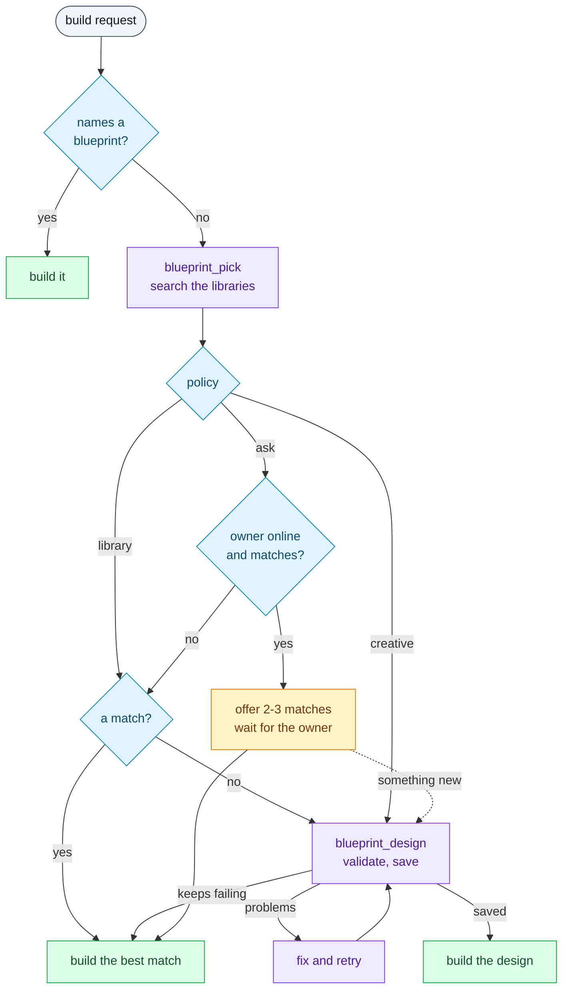

# Blueprint libraries

`build` turns a [blueprint](/guide/goals-and-building#blueprint-format) into blocks (see [Goals and building](./goals-and-building.md)). This
page is about where blueprints come from: the libraries a bot reads, importing schematics,
capturing something a player built, letting the LLM design its own, and the policy that decides
which of those it does for "build me a house".

Code: `src/skills/blueprint-library.ts` (libraries, index, search, checks, policy, files),
`src/skills/schematic.ts` (file formats, capture), `src/skills/library.ts` (the actions).

## Libraries

| library | where | written by |
|---|---|---|
| shipped | `blueprints/*.yaml` | the code |
| user | `settings.build.blueprintDirs`, or the [profile](/guide/profiles)'s `blueprints:` key | you |
| learned | `data/bots/<name>/blueprints/` | the bot: captures, imports, designs |

They load in that order and a later one wins by name, with one exception: a learned blueprint
never takes the name of a shipped or user one (the writers refuse such names, and a file that
does it anyway is ignored with a note), so a capture can't replace the default house. Only
regular `*.yaml` files at the top of each folder are read; symlinks and subfolders are skipped.
`build` and `build_plan` see every library, and new files work without a restart.

```yaml
# profiles/pax.yaml
building: library                # policy, see below
blueprints: [my-blueprints]      # relative to the profile, added to settings.build.blueprintDirs
settings:
  build:
    importDir: blueprints/import # the only folder blueprint_import reads (default)
    importMaxBlocks: 4000
    designMaxBlocks: 1500
    captureMaxSize: 32
    captureMaxBlocks: 4000
```

### Metadata and the index

Each blueprint can carry a `meta` block. The bot fills it in for everything it writes, and the
shipped ones have tags:

```yaml
meta:
  tags: [house, stone]           # house, defence, farm, decoration, or your own
  author: LibTester
  source: imported from well.schem (sponge v2)   # or "designed", "captured at x y z to x y z"
  created: 2026-11-21
  rating: 4                      # 0-5, optional
  notes: the owner's favourite
  size: [5, 5, 4]                # width, depth, height (written for convenience)
  blocks: 45
  materials: { cobblestone: 24, oak_slab: 8 }
```

The index (name, library, description, tags, size, block count, materials and the meta fields)
is computed from the cells, so it is right even when `meta` is missing, and cached until a file
changes. That keeps `blueprint_search` cheap enough for the LLM to call freely.

| action | |
|---|---|
| `blueprint_list [library]` | every blueprint, one line each: size, blocks, tags, main materials |
| `blueprint_search text? tags? material? max_size? max_height? max_blocks? size? library?` | ranked matches with the reason |
| `blueprint_show name [layers] [facing]` | library info, a text drawing and materials against the inventory |
| `build_plan template=<name> preview=true` | where it would go, what's missing, and the drawing |

**Ranking.** Footprint, height, block count and library are hard filters. Tags score most, then
a word in the name, a word that maps to a tag (home, cottage, fort, castle, wall, tower...), the
description, and the materials; `material=cobblestone` favours blueprints that use it.
Blueprints that match nothing are left out. Ties go to the higher rating, then the bot's own
library.

## Import

```sh
just blueprint-import blueprints/import/well.schem                 # print the YAML and a preview
just blueprint-import castle.litematic --bot Pax --tags defence    # into Pax's learned library
just blueprint-import gate.nbt --out my-blueprints --crop "0 0 0 15 6 15"
```

In game an owner puts the file into the import folder and says `!blueprint_import well.schem`
(or asks the LLM). The action only takes a bare file name in that folder: no paths, no `..`, no
symlinks.

| format | |
|---|---|
| Sponge `.schem` | v1 and v2 (`Palette`, `BlockData`) and v3 (`Blocks.Palette`, `Blocks.Data`) |
| Litematica `.litematic` | every region, negative sizes, tightly packed block states |
| structure `.nbt` | what a structure block saves (`size`, `palette` or `palettes`, `blocks`) |

Gzipped or not, all three come out the same:

- Blocks become plain palette entries, `"S": { "block": "oak_stairs", "state": { "facing": "east", "half": "bottom" } }`,
  with a mnemonic character where one is free. Only states the builder can place or check are
  kept (facing, half, slab type, axis, hinge, open, hanging, part, stair shape...); waterlogged,
  fence sides, chest type and rail shape follow from the neighbours anyway.
- Wooden blocks (planks, stairs, slabs, logs, fences, doors, trapdoors...) get one role per kind
  that takes any overworld wood and follows the build's wood theme, so a captured spruce hut can
  be rebuilt in oak by a survival bot that only finds oak. A structure that mixes woods for the
  same kind keeps them exact, and `exact=true` (`--exact`) keeps every block as it is.
- A plain block knows when it goes in (doors last, torches and ladders after the walls, beds and
  chests with the furniture) and which item places it (a wall torch comes from a torch).
- Air stays "must be clear" (`.`); `air=false` (`--no-air`) makes it "don't care". The empty margin
  around the blocks is trimmed.
- Water, lava, fire, portals, barriers, command and structure blocks are left out, with a
  warning. Modded blocks (`create:shaft`) and names the 1.21.1 registry doesn't know are kept as
  plain blocks, with a warning: the bot can only place them if it carries them.
- Block entities (chest contents, sign text) and entities are not imported.
- The entrance (`facing`) is the side of the first door, or what you pass.

**Large schematics.** More blocks than the limit (4000 by default) is refused with the size, the
count and a crop that fits, e.g. `crop="0 0 0 20 5 20" keeps the bottom 6 of 14 layers`. Crop
coordinates are the file's own, `0 0 0` being its lowest north-west corner. `max_blocks` raises
the limit for one import.

## Capture

"Save this as gatehouse": `blueprint_capture name=gatehouse` takes the region around where the
asking player stands (11 wide, 10 high from their feet down one, `size` and `height` change it),
or two corners `x1 y1 z1 x2 y2 z2`. Owners only, at most 32 per side and 4000 blocks.

- Only player-made blocks are kept: ground, plants, leaves and snow are "don't care"
  (`all=true` keeps them). The result is trimmed to the blocks.
- Air enclosed by the build along its row and its column (a room, a doorway) stays "must be
  clear", so a copy gets an empty inside; air outside the walls is "don't care".
- States are read from the world as they are, and the drawing is north-up as the build lies.
  The blueprint's `facing` is the side its first door is on (or `facing=`), so building the copy
  facing another way turns every stair, door and log with it.

```
!blueprint_capture gatehouse 812 69 40 820 75 46
!build gatehouse                       (somewhere else, door towards you)
```

## Designs from the LLM

The model writes a blueprint in the same YAML format (or JSON, or as an object) and calls
`blueprint_design`. Nothing in it runs; it is data, checked in this order:

1. the zod schema and the format rules (palette characters, roles, rows of equal count);
2. at most 24 blocks on each side and 1500 blocks (`settings.build.designMaxBlocks`);
3. every role's block is a real 1.21.1 block or item (`oak_plank` gets "did you mean
   oak_planks?"; modded names pass with a warning);
4. every block has something to click for its state in build order (the same simulation the
   shipped blueprints are tested with);
5. nothing floats: every block connects through touching blocks to the bottom layer.

Problems come back worded for a retry:

```
design tiny_tower has problems: 1 block floats with nothing under or beside it connecting to
the ground: layer 4 row 1 col 1 "#" (cobblestone). Fix them and call blueprint_design again
```

A design that passes is saved to the learned library with author, `source: designed`, the date,
size, block count and materials, and the reply carries a top-view preview. `save=false` only
checks. Any player can have a design checked; saving it is for owners.

## Rename and delete

`blueprint_rename from to` and `blueprint_delete name` work on learned blueprints only, for
owners. Shipped and user blueprints are never touched.

## Building policy

`building` decides what "build me a house" means when the request names no blueprint:

| policy | |
|---|---|
| `library` (default) | build the best saved match by tags and size; design one only when nothing fits |
| `creative` | design a new blueprint for the request with `blueprint_design`, then build it; the best match is the fallback when the design keeps failing |
| `ask` | while an owner is online, offer 2-3 matches (or a new design) and wait for the answer; offline, the same as `library` |

Set it in the profile (`building: creative`) or live with `!config_set building ask` (a
[feature toggle](./live-config.md)). `blueprint_pick text="a small house by the river"` applies
it and answers with what to do next; the LLM prompt tells the model to call it when a request
doesn't name a blueprint, so a policy change takes effect on the next request without touching
the cached system prompt. Pax runs on `library`.



## Testing

`test/blueprint-library.test.ts` writes one small structure as a Sponge v2 and v3 `.schem`, a
`.litematic` (negative size, entries spanning longs) and a structure `.nbt` with prismarine-nbt
and checks that all four import to the same YAML; it also covers the block limit and crop
suggestion, capture from a fake world, design checks (good, floating, oversized, unknown block,
unplaceable state), search ranking, the policy, path safety with symlinks, the learned library
and the actions with a fake agent.

On a live server, `scripts/library-test.ts` designs a kiosk, builds it, captures it, builds the
copy elsewhere, imports `blueprints/import/well.schem` and builds it, and checks the policy with
the owner online; `clean` breaks what it built:

```sh
node scripts/library-test.ts run 700 120
node scripts/library-test.ts clean
```

## Limitations

- Apart from wood, captured and imported blueprints name exact blocks, so a survival bot needs
  those very items; `gather_materials` knows wood, stone, glass and the common crafted pieces, not
  every block (it can't make a cobblestone wall, for one).
- `rotation=0..15` (signs, banners, skulls) isn't turned when a blueprint is rotated.
- Imports keep blocks, not block entities: chests come empty, signs blank.
- A design is checked for placeability and support, not for looks; the preview is there for the
  owner to judge.
