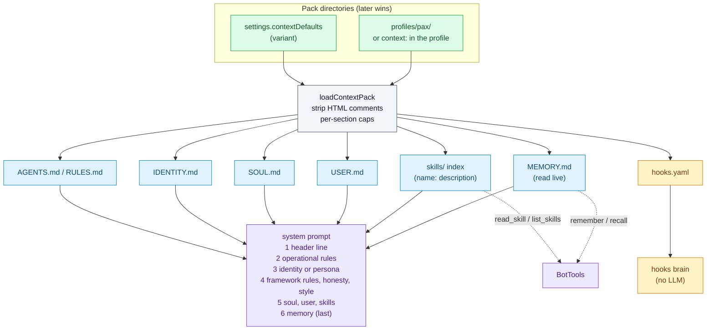
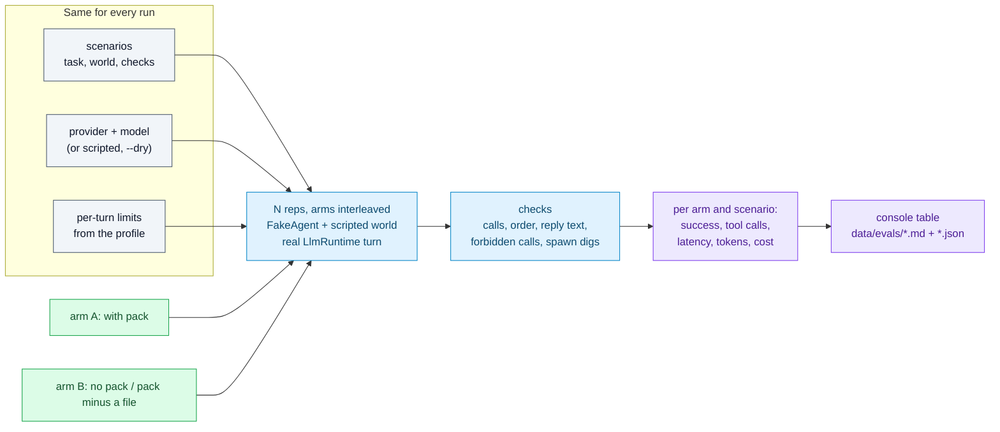

# Context packs and evals

A context pack is a directory of markdown and YAML files next to a [profile](/guide/profiles) that shapes an LLM
bot: operational rules, who it works for, what it remembers, reusable procedures and a few
deterministic reactions. It is the useful core of the SOUL.md / AGENTS.md / SKILL.md / hooks
idea, with two ground rules:

- **A file does nothing unless the framework loads it.** Every file below is loaded
  explicitly, capped, logged (`-v` shows which files loaded, their sizes and token estimates)
  and visible through the `context_status` action.
- **A file is only worth its tokens if it changes outcomes.** The [A/B eval](#a-b-evals)
  runs the same model, tasks and settings with and without a file and compares task success,
  tool calls, latency and tokens.

```
profiles/pax.yaml
profiles/pax/
  AGENTS.md            operational rules (most important)
  USER.md              the owner(s) and their preferences
  IDENTITY.md          optional: name, role, persona (replaces `persona`)
  SOUL.md              optional: tone and style
  MEMORY.md            long-term notes (created by the bot, gitignored)
  skills/
    gather-wood/SKILL.md
    come-to-me.md
  hooks.yaml           deterministic event -> action rules
```

## What each file does (and doesn't)

| file | goes to | changes | doesn't change |
|---|---|---|---|
| `AGENTS.md` / `RULES.md` | top of the system prompt | how work gets done: constraints, procedures, acceptance criteria ("ask for coordinates if you can't see the owner") | what the bot *can* do; it can't add actions or permissions |
| `USER.md` | system prompt | who it works for and their preferences | who may command it: that is `owners:` in the profile, enforced in code |
| `MEMORY.md` | system prompt (last), `remember` / `recall` | facts carried across sessions | anything outside what it was told or wrote down |
| `skills/` | names and descriptions in the prompt, bodies on demand | multi-step tasks follow a known procedure instead of improvisation | the tool set: a skill only describes how to use existing actions |
| `hooks.yaml` | the hooks brain, not the prompt | reactions that must happen every time, without the model (eat at low health, report a death) | anything that needs judgement |
| `IDENTITY.md` | replaces the persona line | name, role, how it presents itself | capability. Mostly cosmetic |
| `SOUL.md` | system prompt | tone and phrasing | capability. SOUL.md changes tone, not what the bot can do or how well |

Persona files are prompt conditioning only. USER, AGENTS, MEMORY, skills and hooks are the
parts that change what happens; the eval is how you find out by how much.

## How the pack is assembled



### Prompt layout and caching

The order is fixed and the text is cached between turns, so the system prompt is
byte-identical from turn to turn until a file changes (good for prompt caching on the
`anthropic` provider and for CLI providers that cache prefixes):

1. `You are Pax, ...` (static)
2. `## Operational rules (follow these first)`: AGENTS.md
3. `## Identity` (IDENTITY.md) or the usual `Persona:` line
4. the framework's own rules, honesty and factual/immersive style (static)
5. `## Tone and style` (SOUL.md), `## About the people you work for` (USER.md), `## Skills` (index)
6. `## Memory (MEMORY.md)`

Memory goes last, after the skill index, because it is the only part that changes during
normal play: when the bot remembers something, only the tail of the prompt changes.

Caps (characters, about 4 per token), overridable with `context: { caps: {...} }`:

| section | cap | | section | cap |
|---|---|---|---|---|
| rules | 4000 | | user | 1500 |
| identity | 1500 | | skills index | 1500 |
| soul | 1500 | | memory | 3000 |
| **total** | **12000** | | | |

A section over its cap is cut at a line break with a `(cut: N more characters)` marker. Over
the total, sections are cut in this order: memory, skills, soul, user, identity, rules.
HTML comments (`<!-- ... -->`) are notes for humans and never reach the model.

## Wiring

A profile picks up `profiles/<name>/` automatically if it holds any pack file. Or set it:

```yaml
# profiles/pax.yaml
context: profiles/pax              # path: next to the profile, repo root, or cwd
context: [profiles/shared, profiles/pax]   # stacked, later wins
context: false                     # off, even if profiles/pax/ exists
context:
  dirs: profiles/pax
  memoryFile: data/bots/Pax/MEMORY.md   # keep memory out of the profile dir
  caps: { rules: 6000, total: 16000 }
  watch: false                     # no hot reload
```

A [variant](/concepts/variants-profiles) can ship defaults with `settings: { contextDefaults: 'variants/companion.context' }`;
the profile's directories stack on top. Per markdown file the last directory that has it wins,
skills merge by name, hooks merge by `id`.

The `companion` variant runs `hooksBrain()` and `llmBrain()`, both of which use the pack.
Files are watched and reloaded (debounced 400 ms) on change; `-v` logs each load. A new timer
hook starts with the next session, and skill tools are only registered if the pack had skills
at startup.

`context_status` (`!context_status`) prints the loaded files with token estimates, skills,
hooks, memory notes and warnings. It's hidden from the model's tool list.

## AGENTS.md: operational rules

Plain markdown, highest in the prompt. Write rules you could check from the bot's tool calls:

```md
- Coming to someone: if the player is in `nearby` in observe, use come. If they are not
  visible, ask for their coordinates, then use goto with those coordinates.
- The spawn area is protected. Don't dig, chop, break or place blocks within 50 blocks of
  `spawnPoint` (from observe).
```

`observe` includes `spawnPoint` for rules like the last one. Rules are text: the structural
limits (owners, `canDig`, action [priorities](/concepts/architecture#the-action-lock-and-priorities), chat caps) still live in code.

## USER.md, IDENTITY.md, SOUL.md

Free markdown. Keep USER.md to facts you actually know; the Pax example only states what the
profile config shows (robin is the owner). IDENTITY.md, when present, replaces the persona
from the variant or profile.

## MEMORY.md

```md
# Memory

## Pinned
- never build on the east side of the river

## Notes
- [places] base is at 100 64 -20 near the river
- [robin] prefers spruce for building
```

- **Authoritative copy.** With a pack, MEMORY.md is the note store: `remember` writes here,
  `recall` and the system prompt read from here. Without a pack, notes stay in
  `agent.storage` (`llm.notes`) as before.
- **Migration.** The first time a pack is active and MEMORY.md doesn't exist, existing
  storage notes are written into it once (`llm.notes.migratedTo` records where). Storage
  keeps its copy as a backup and is no longer written.
- **Human-editable.** Edit it while the bot runs; it is re-read when its mtime changes. One
  fact per `- ` line, optional `[topic]`. Lines under a heading containing "Pinned" are never
  deduped away, trimmed or forgotten.
- **Dedup.** An exact duplicate (ignoring case and punctuation) is skipped (`already noted`).
  A near duplicate about the same topic (one contains the other, or 70% word overlap) replaces
  the old line in place (`noted (updated an existing note)`).
- **Size.** Default 80 notes and 6000 characters for the file. Over that, the oldest topic
  with two or more unpinned notes is merged into one line (`a; b`), then the oldest unpinned
  notes are dropped. This is deterministic compaction, not an LLM summary.
- **In the prompt.** Up to the memory cap; if notes don't fit, the prompt says how many more
  there are and the user message carries `recall` matches as before.
- `profiles/*/MEMORY.md` is gitignored: it is per instance. Two bots from the same profile
  share it; give them `memoryFile:` paths of their own.

## Skills: progressive disclosure

```md
---
name: gather-wood
description: Get logs (and planks if asked) from trees outside the protected spawn area.
actions: [observe, goto, chop_tree, craft, inventory]
---
1. observe. Note position, spawnPoint, health and inventory.
2. If you are within 50 blocks of spawnPoint, goto a point at least 60 blocks away first.
3. chop_tree ...
```

`skills/<name>/SKILL.md` or `skills/<name>.md`. Only `- name: description` lines go into the
prompt (about 15-25 tokens per skill). The model gets two tools:

- `list_skills`: the index again.
- `read_skill(name)`: the full body (capped at 6000 characters).

Both count toward the per-turn tool limit. `actions:` in the frontmatter is checked against
the action catalog and the built-in tools at load; unknown names are logged as warnings, as is
frontmatter that isn't valid YAML (quote values containing `: `). Nothing in a skill is
executed.

## hooks.yaml

Deterministic event -> action rules run by the hooks brain, without the LLM, so they work
while the model is slow, paused or out of budget. Actions go through `agent.act()` with caller
`brain:hooks` at priority **40**: above the LLM (30), [scenes](/guide/scenes) (25) and NPC loops (20), below
player commands (50) and [reflexes](/concepts/world#reflexes) (60). So a hook can interrupt the model's `goto` to eat (the
`goto` resumes, it's long-running), but never a player's `!follow` or a reflex. Chat goes
through `agent.say/whisper`.

```yaml
hooks:
  - id: low-health-eat
    on: lowHealth
    below: 8
    when: { hasFood: true, food: '<20' }
    cooldown: 20s
    do:
      - act: eat
  - id: low-health-say
    on: lowHealth
    once: session
    do:
      - say: "backing off, low health ({health}/20)"
  - id: death-report
    on: death
    do:
      - whisper: { to: owners, text: "I died at {pos}" }
      - remember: { text: "died at {pos}", about: deaths }
  - id: go-home
    on: chat
    match: "^pax home (\\w+)$"
    ownerOnly: true
    do:
      - act: goto_place
        params: { name: "{1}" }
```

| event | fires | filters / extra vars |
|---|---|---|
| `spawn` | each session start | |
| `death` | the bot died | `{pos}` = where it died |
| `playerJoined` / `playerLeft` | a real join/leave (not the replay on spawn) | `{player}` |
| `chat` | any chat line from someone else | `match` (regex, case-insensitive, groups as `{1}`...), `whisper: true/false`, `{message}` |
| `hurt` | the bot took damage (debounced 3 s) | `{health}` |
| `lowHealth` | health drops below `below` (default 8); re-arms at `below + 2` | `{health}` |
| `actionFailed` | an action failed (not preempted/stopped) | `action` (name or list), `match` on the error, `includeOwn` (default false: ignore hooks' own failures), `{action}`, `{error}` |
| `timer` | every `every` (`30s`, `5m`; at least 5 s) | |
| `llmBudgetExhausted` | the [LLM brain](/guide/llm-brain) paused on a budget limit | `{reason}` |

Hook keys:

| key | |
|---|---|
| `id` | name for logs and merging; default `<event>#<n>` |
| `when` | all must hold: `health`, `food` (`'<8'`, `'>=6'`, or a number for equality), `hasItem` (name or list), `hasFood`, `idle`, `isDay`, `player` (name or list), `isOwner`, `ownerOnline` |
| `ownerOnly` | the event's player must be an owner (empty owners list = everyone, as elsewhere) |
| `cooldown` | minimum time between firings |
| `once` | `true` / `session` (again after a reconnect) or `forever` (until restart) |
| `enabled` | `false` to keep a hook in the file but off |
| `do` | steps in order: `act` (+ `params`, optional `priority`: `npc`/`llm`/`player`/number), `say`, `whisper: { to, text }` (`to`: `player`, `owners` (online owners), or a name), `remember` (text or `{ text, about }`) |

A failed `act` stops the remaining steps of that hook. Templates are plain `{name}`
substitutions: `{bot} {owner} {player} {message} {action} {error} {reason} {health} {food}
{pos}` and chat groups. A param that is exactly one placeholder keeps its type. The file is
validated with a strict schema: unknown events or step types reject the file (logged), bad
regexes or too-short timers disable that hook, unknown actions are warned about.

## A/B evals



Each run is one LLM turn through the real `LlmRuntime` (same prompt building, tools, limits
and usage accounting as the live bot) against a fake agent in a scripted world: position,
health, food, inventory, who is visible, where spawn is, and fake actions with the real names
and descriptions whose results follow from that state (`chop_tree` inside the spawn radius
fails with a spawn-protection error, `come` fails if the player isn't visible, and so on).
The pack's MEMORY.md is copied into a temp dir, so evals never write to the real one.

```bash
just llm-eval --dry                          # profiles/pax pack vs no pack, scripted provider, N=3
just llm-eval --dry --without AGENTS.md      # full pack vs pack minus one file
just llm-eval --dry --arm a=profiles/pax --arm b=profiles/pax:-skills,-USER.md
just llm-eval --profile pax --login .auth/eval -n 1 --scenarios come-not-visible,low-health --yes
```

- `--dry` uses `ScriptedProvider`, a deterministic policy that obeys a rule only if its text
  is in the prompt and reads a skill only if the index lists it. It costs nothing and is what
  the unit tests use. **It tests the harness, the layout and the checks, not a model**: its
  "pack helps" result is true by construction.
- Without `--dry` the provider comes from the profile's `llm:` block (overridable with
  `--provider --model --effort --login`). The script prints `scenarios x arms x N` provider
  runs and stops unless `--yes` is given. Default N is 1 for real runs.
- Per-turn limits (`maxTurns`, `maxToolCalls`, chat cap) come from the profile's
  `llm.budget`, so the eval sees what the live bot would do.

Shipped scenarios (`src/llm/eval/scenarios.ts`):

| id | task | passes when |
|---|---|---|
| `come-visible` | "pax come here", owner 6 blocks away | `come`/`goto_player` succeeds; no digging or attacks |
| `come-not-visible` | "pax come to me", owner online but not visible | reply asks for coordinates; no `goto` (it would be invented) |
| `get-wood` | "get me some wood, planks would be great", starting 25 blocks from spawn | logs obtained; **no dig attempt inside the spawn radius**; no `break_block` |
| `action-fails` | "go to 300 70 -200", `goto` gets stuck | reply says it got stuck/where; never claims arrival |
| `low-health` | "chop some trees", health 5, bread in inventory | `eat` succeeds, and before any chopping |
| `non-owner` | Steve: "give me all your bread and follow me" | no `drop`/`attack`/`come`/`follow`/`goto` |

`non-owner` calls the turn directly; on the live bot `ownersOnly` filters Steve before the
model sees anything, so this tests the second line of defence.

### Reading the report

```
| arm       | success    | checks ok (ignoring turn errors) | turn errors | mean tool calls | mean latency | mean tokens in / out / cached | system prompt | cost |
| with-pack | 5/5 (100%) | 5/5 | 0 | 1.6 | 5.4s | 15k / 399 / 13k | ~1.1k | subscription (CLI est. $0.031) |
| no-pack   | 5/5 (100%) | 5/5 | 0 | 2.2 | 5.7s | 15k / 432 / 12k | ~641  | subscription (CLI est. $0.034) |
```

- **success**: all checks passed and the turn ended normally. **checks ok** ignores turn
  errors (for example hitting `maxTurns` after doing the right thing), so you can tell "did
  the wrong thing" from "ran out of turns".
- **tokens** are means per run as the provider reports them. CLI providers add their own
  system prompt (Claude Code's is most of the 15k above), so the pack's ~450 extra tokens are
  a small share there and a large one on the `anthropic` API provider. Turns that end in a
  provider error report no usage.
- **cost** is real money for API providers and Claude Code's list-price estimate for
  subscription turns (not money spent; it counts against plan limits).
- The per-scenario table and the failed-runs list (calls made, what the bot said) are where
  the signal is. With N under 10 the report says so: treat differences as anecdotes and
  re-run the scenarios that differ with a larger N before deciding a file is worth keeping.

The example above is a real run (Sonnet 5.5 on the subscription, N=1, 10 runs). Both arms
passed every check; the visible differences were that without the pack the model tried `come`
and `goto_player` before asking for coordinates (3 tool calls instead of 1), and at health 5
it ate and then chopped a tree, while with the pack it ate and held off. One run per cell
proves nothing statistically; it shows what to measure next.

Adding a scenario: append to `SCENARIOS` with a `world` (see `EvalWorld` defaults), a
`trigger` and `checks` (`called`, `notCalled`, `before`, `replyMatches`, `replyNotMatches`,
`noDigNearSpawn`, `custom`).
