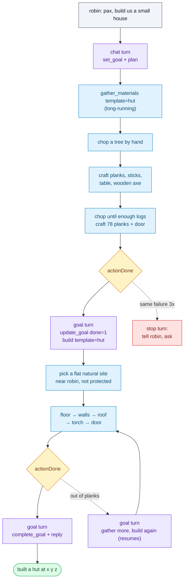

# Goals and building

Ask an LLM bot to "make an axe, chop some trees and build us a small house" and three things
have to work together: the bot has to remember the job between turns, keep working on it
without being nudged, and have actions big enough that a house is a handful of tool calls,
not a hundred. This page covers all three:

- **Goals** (`src/llm/goals.ts`): a persistent goal with a plan, shown in every prompt.
- **Continuation**: follow-up turns while a goal is active, with guardrails.
- **Building and materials** (`src/skills/construction.ts`, `materials.ts`, `toolkit.ts`):
  `build` from YAML blueprints, `gather_materials`, and tools made on demand.

## Build a house, start to finish



The model makes four or five decisions; the actions do the walking, chopping, crafting and
placing.

## Goals

The model gets five built-in tools (next to `observe`, `reply`, `remember`...):

| tool | |
|---|---|
| `set_goal(goal, steps?)` | Start a goal with an optional ordered plan. One per bot; a new goal replaces the old. The turn's player becomes the goal's owner. |
| `update_goal(done?, add?, insert_at?, reorder?, note?, wait_for_owner?)` | Mark steps done, edit the plan, keep a note, or pause until the owner answers a question. |
| `complete_goal(result)` | Finish it, with the real result. |
| `abandon_goal(reason)` | Drop it. |
| `goal_status()` | The goal, plan and the last finished goals. |

Goals live in `agent.storage` (`llm.goal`, history in `llm.goals.history`), so they survive
restarts and reconnects. Every prompt shows the active goal right after the trigger:

```
## Your active goal
Goal (for robin): build us a small house
1. [x] gather_materials template=hut
2. [ ] build template=hut   <- next
Started 4 min ago, 3/30 turns on your own since robin last spoke.
```

`observe()` carries a compact form under `llm.goal`. Players can check and cancel with
`!goal` and `!goal_cancel`; both are hidden from the model's tool list.

## Continuation

While a goal is active the runtime starts **goal turns** by itself (trigger kind `goal`):

| when | reason |
|---|---|
| an action the brain started ends (short or long-running) and wasn't interrupted | `actionDone`, with the result |
| a turn ends with nothing holding the body and it made progress | `continue`, after `continueDelayMs` |
| nothing has happened for a while | `idle`, after 20 s, doubling per stalled turn up to 5 min |
| the bot reconnected or restarted | `resume` |

A turn "made progress" when it ran an action that succeeded or updated the plan; looking
around and chatting don't count. While a goal is active the plain `actionDone` report is
replaced by the goal turn, so a finished action costs one turn, not two. Nothing starts while
a turn runs, while any action holds the body (yours, a player's `!command`, a reflex), or
while the bot is disconnected.

### Guardrails

| setting (`llm.goals`) | default | |
|---|---|---|
| `maxTurns` | 40 | goal turns allowed without hearing from the owner |
| `timeoutMin` | 45 | minutes on its own without hearing from the owner |
| `maxSameFailures` | 3 | the same failure (action + message, numbers blanked) this often stops the loop |
| `budgetReserve` | 0.15 | share of the hourly turn/token budget kept for chat |
| `continueDelayMs` | 1500 | gap before the next turn after progress |
| `idleBaseMs` / `idleMaxMs` | 20000 / 300000 | idle backoff |
| `enabled` | true | false: goals are kept and shown, but no follow-up turns |

When a limit trips, the goal is **paused** and one `stop` turn runs: the model tells the owner
where things stand and asks whether to go on. When the owner talks to the bot again, the turn
counter, the deadline and the failure counts start over and the pause is lifted. The model can
also pause itself with `update_goal wait_for_owner=true` after asking something.

The owner's `!stop` (a player-run `stop` action) abandons the goal; the model stopping its own
action doesn't. `!goal_cancel` abandons the goal and cancels the brain's running actions.
Budget limits apply as usual: while the hourly or daily budget is used up, no goal turns run.

```yaml
# profiles/pax.yaml
llm:
  goals:
    maxTurns: 30
    timeoutMin: 30
    maxSameFailures: 3
```

### What the model is told

The system prompt gets a short block of rules: use `set_goal` for anything that takes more
than one action, prefer `gather_materials` and `build` over chains of `chop_tree`/`craft`/
`place_block`, end the turn after starting a long action, mark steps only when a tool result
confirms them, report at milestones only, and stop and ask when stuck. The honesty rules
still apply: "started" isn't "done".

## Building

```
build({ template, x?, y?, z?, facing?, material?, gather? })
build_plan({ template?, material?, x?, y?, z?, facing? })
```

`build` places a whole structure:

1. **Site.** With x/z it builds there (centre of the footprint; y defaults to the ground + 1).
   Otherwise it scans the ground within 10 blocks of whoever asked and picks the closest spot
   that is natural ground (grass, dirt, stone, sand...), varies by at most one block (two if
   it may dig the bumps away), has no water, trees or player-made blocks, is not on the
   player's own spot, and is outside [protected areas](/concepts/world#protected-areas) and a 24-block keep-out around world
   spawn (`settings.build.spawnKeepOut`). The entrance faces the player. `shelter` is built
   around the bot's feet instead.
2. **Refusal.** If anything in the footprint looks player-made (planks, chests, glass, modded
   blocks...), it refuses and names the block and position.
3. **Materials.** It counts what's still to place against the inventory. With `gather=true`
   it runs `gather_materials` for the missing part first and walks back.
4. **Placing.** Clear `air` cells (plants, snow), then blocks layer by layer, each layer
   starting from cells with support below (a flat roof goes in from the walls inwards), then
   attachments (torch), the door last, placed from outside so the bot doesn't lock itself in.
   Natural bumps and plants are dug when digging is on. While it works, the pathfinder may not
   dig or scaffold inside the structure's box.
5. **Result.** "built a hut at 812 70 41 facing west: 82/82 blocks (placed 80, 2 already
   there)" or, truthfully, "built 52/80 blocks of the hut ..., out of planks. Calling build
   again resumes it". The site is kept in `agent.storage` (`build.active`), so a re-run, or
   the automatic resume after a reflex preempted the build, continues on the same spot and
   skips blocks that are already right.

`build_plan` lists the blueprints (no template), or says where a structure would go and what
it needs versus the inventory.

### Blueprint format

Blueprints are YAML files in `blueprints/`, validated with zod when loaded (on every call, so
new files work without a restart). A broken file is reported by name; the others still load.

```yaml
name: hut                  # lowercase, digits, _
description: Small 5x5 one-room house with a door, a flat roof and a torch inside
facing: south              # the side the entrance is on, as drawn
site: near                 # near: find a spot near the player; here: around the bot
roles:                     # what each kind of block is made of
  wall: { default: oak_planks, accept: "_planks$", material: true }
  door: { default: oak_door, accept: "_door$", kind: door }
  window: { default: glass_pane, accept: "glass", optional: true }
  light: { default: torch, accept: "^(wall_)?torch$", kind: attachment, optional: true }
palette:                   # one character each; " " means "don't care"
  "#": wall
  D: door
  W: window
  T: light
  ".": air                 # must be empty (plants get cleared)
layers:                    # bottom (y=0, sits on the ground) to top
  - ["#####", "#####", "#####", "#####", "#####"]   # rows north to south, columns west to east
  - ["#####", "#T..#", "#...#", "#...#", "##D##"]
  - ["#####", "#...#", "W...W", "#...#", "## ##"]
  - ["#####", "#####", "#####", "#####", "#####"]
```

| role field | | |
|---|---|---|
| `default` | required | block placed when the inventory has nothing better |
| `accept` | regex | item and block names that count as this role, for picking from the inventory and for "already right" checks. Default: only `default`. |
| `kind` | `block` \| `door` \| `attachment` | doors and attachments go in after all blocks |
| `optional` | bool | skipped with a note when the bot has none (torches, glass) |
| `material` | bool | the build's `material` parameter replaces this role, strictly |

A role's item is the `material` the player named, else the accepted item the bot has most of,
else the default; when that runs out, any other accepted item is used. Names go through
`itemName`, so modded blocks match `accept` too (`"_planks$"` matches
`biomesoplenty:fir_planks`). Layers can also be one multi-line string.

### Shipped blueprints

| name | size | blocks | |
|---|---|---|---|
| `hut` | 5x5x4 | 78 planks, 1 door, optional 2 glass panes and a torch | one room, door, two windows, flat roof |
| `shelter` | 3x3x3 | 25 dirt/cobblestone/planks | emergency box around the bot, no door |
| `wall_segment` | 7x1x3 | 21 | straight wall |
| `platform` | 5x5x1 | 25 | flat pad |
| `tower` | 3x3x7 | 51 + torch | hollow lookout with a doorway and corner posts |

## Materials and tools

### gather_materials

```
gather_materials({ items?: { "planks": 80, "door": 1 }, template?: "hut", material?, radius? })
```

One action for "get what the job needs". Generic names `planks`, `log`, `door`, `trapdoor`,
`slab`, `stairs`, `fence` mean any wood; exact names (`oak_planks`) mean that one. With
`template` it gathers what the blueprint still needs at the site `build` would use (a
half-built hut needs less), with torches and glass as optional extras.

It plans first (`planWood`, pure): planks for doors (6 per 3), tables (4), chests (8),
sticks (2 per 4), tools, slabs, stairs, fences and ladders, turns that into logs, and adds a
wooden axe when there are five or more logs to chop and no axe. Then it:

1. fells trees until the plan has its logs (the axe is crafted as soon as there's wood for
   it, so only the first tree is cut by hand);
2. crafts planks from whatever logs it has, then sticks;
3. crafts the items (a table is put down through the normal `craft` logic);
4. mines simple blocks: cobblestone (from stone, with a pickaxe it makes first), dirt, sand,
   gravel.

The result lists what it has against what was asked, and what's still missing and why
("torches need coal or charcoal", "no natural tree within 32 blocks"). It is ok only when
every required item is there.

### ensureTool

`ensureTool(bot, signal, kind, { minTier?, cheapOnly? })` in `src/skills/toolkit.ts` makes
sure the inventory has an axe, pickaxe, shovel, sword or hoe, crafting the best tier the
materials allow (diamond, iron, stone, wooden) with planks from logs, sticks from planks and a
crafting table when needed. It never gathers. It's wired into:

- `chop_tree`: makes a wooden axe first when there's wood for one (`make_axe`, default true);
- `collect`, `break_block`: make a pickaxe of the needed tier for stone and ores (a stone
  pickaxe for iron ore), and equip the best tool for every block.

## Testing

Unit tests cover blueprint parsing and validation, rotation, material accounting, placement
order, resume and refusal, site choice, the wood plan and tool helpers
(`test/building.test.ts`), and the goal store, continuation and guardrails with the fake agent
and a scripted provider (`test/goals.test.ts`).

On a live server, `scripts/build-test.ts` runs the whole chain:

```sh
node scripts/build-test.ts direct 760 45     # empty inventory -> gather_materials -> build hut
node scripts/build-test.ts llm 760 45        # a tester asks the LLM bot "build a small house here"
node scripts/build-test.ts remove 760 45     # break what the last direct run built
```

Build well away from spawn and from anyone's base. Give the y of the target when you know it:
`goto` without y lets a digging bot tunnel, and it can end up deep underground.

## Limitations

- Only wood products and a few mined blocks are planned; no smelting (torches need coal or
  charcoal you already have), no glass.
- Structures stay low: no scaffolding or ladders, so blueprints taller than the bot can reach
  from the ground or the floor inside won't finish.
- Non-square blueprints search for a site with a square footprint (conservative).
- The site scan treats unknown and modded blocks as player-made, so modded terrain can leave
  no valid site nearby; pass x y z then.
- Long trips with digging on (`canDig`) may tunnel instead of walking over hills; that's the
  pathfinder's choice, not the build's.
