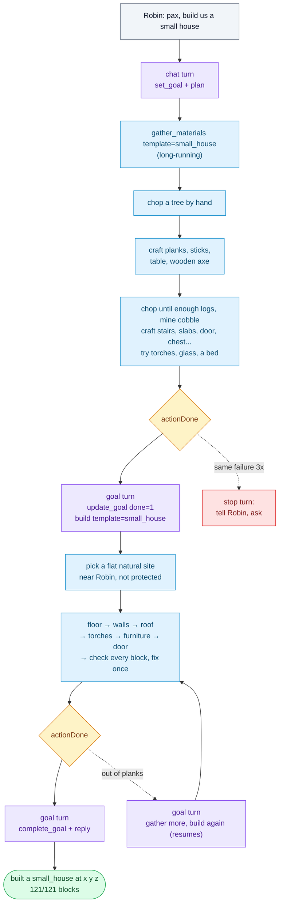
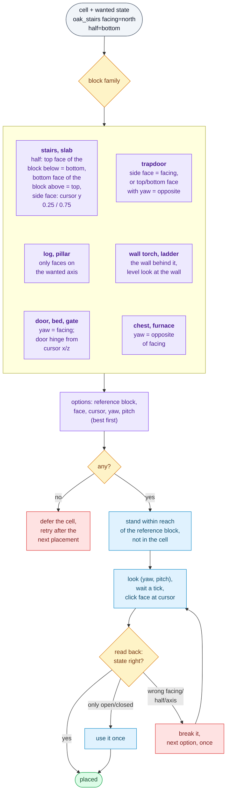
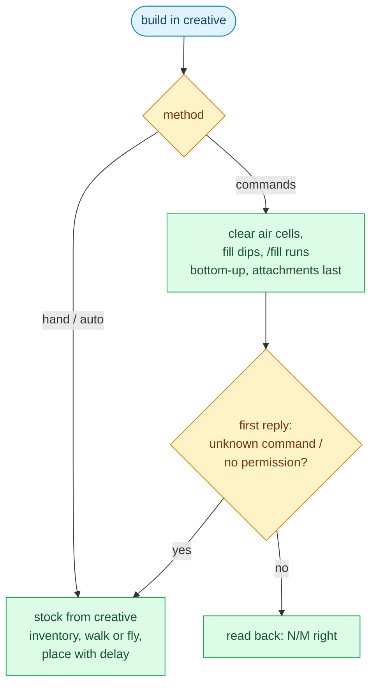

# Goals and building

Ask an LLM bot to "make an axe, chop some trees and build us a small house" and three things
have to work together: the bot has to remember the job between turns, keep working on it
without being nudged, and have actions big enough that a house is a handful of tool calls,
not a hundred. This page covers all three:

- **Goals** (`src/llm/goals.ts`): a persistent goal with a plan, shown in every prompt.
- **Continuation**: follow-up turns while a goal is active, with guardrails.
- **Building and materials** (`src/skills/construction.ts`, `materials.ts`, `toolkit.ts`):
  `build` from YAML blueprints, `gather_materials`, and tools made on demand.

## Build a house, start to finish



The model makes four or five decisions; the actions do the walking, chopping, crafting and
placing.

## Goals

The model gets five built-in tools (next to `observe`, `reply`, `remember`...):

| tool | |
|---|---|
| `set_goal(goal, steps?)` | Start a goal with an optional ordered plan. One per bot; a new goal replaces the old. The turn's player becomes the goal's owner. |
| `update_goal(done?, add?, insert_at?, reorder?, note?, wait_for_owner?)` | Mark steps done, edit the plan, keep a note, or pause until the owner answers a question. |
| `complete_goal(result)` | Finish it, with the real result. |
| `abandon_goal(reason)` | Drop it. |
| `goal_status()` | The goal, plan and the last finished goals. |

Goals live in `agent.storage` (`llm.goal`, history in `llm.goals.history`), so they survive
restarts and reconnects. Every prompt shows the active goal right after the trigger:

```
## Your active goal
Goal (for Robin): build us a small house
1. [x] gather_materials template=small_house
2. [ ] build template=small_house   <- next
Started 4 min ago, 3/30 turns on your own since Robin last spoke.
```

`observe()` carries a compact form under `llm.goal`. Players can check and cancel with
`!goal` and `!goal_cancel`; both are hidden from the model's tool list.

## Continuation

While a goal is active the runtime starts **goal turns** by itself (trigger kind `goal`):

| when | reason |
|---|---|
| an action the brain started ends (short or long-running) and wasn't interrupted | `actionDone`, with the result |
| a turn ends with nothing holding the body and it made progress | `continue`, after `continueDelayMs` |
| nothing has happened for a while | `idle`, after 20 s, doubling per stalled turn up to 5 min |
| the bot reconnected or restarted | `resume` |

A turn "made progress" when it ran an action that succeeded or updated the plan; looking
around and chatting don't count. While a goal is active the plain `actionDone` report is
replaced by the goal turn, so a finished action costs one turn, not two. Nothing starts while
a turn runs, while its own action, a player's `!command` or a reflex holds the body, or while
the bot is disconnected.

### Goals and behaviours

[Armed behaviours](/guide/behaviors) (hunting, scouting, tools, farm) keep a bot busy most of the time, so a goal
that waited for a fully idle body would never get a turn. The rule:

| situation | who wins |
|---|---|
| not in danger | the owner's goal: goal turns run while a behaviour holds the body, and goal actions run above behaviours (priority 40 vs 35) |
| in danger: health or food 6 or less, night or thunder, a hostile within 12 blocks | behaviours (eat, go home, stay safe) and [reflexes](/concepts/world#reflexes); the goal waits |
| the owner is talking right now | the owner's request, always (above behaviours, below reflexes and `!commands`) |

### Owner away, things that keep failing

- **The owner is offline.** The goal block in the prompt says so: the model doesn't address
  them or wait for them. A wait for an offline owner resumes after a minute (at most 3 times
  until they're back).
- **No answer.** After `update_goal wait_for_owner=true`, the goal goes on alone after
  `llm.goals.ownerWaitMin` minutes (default 15, 0 = wait forever), at most 3 times per owner reply.
- **The same failure 3 times** (e.g. `hunt` with no animals around) puts **that action on hold
  for 10 minutes** (calls are refused with the reason) and the goal carries on with other steps;
  it doesn't stop the whole goal any more.
- **Only the owner can cancel** a goal they gave: `abandon_goal` works only in a turn where the
  owner is talking. Dying, failures or the owner being away aren't reasons to drop it.
- **What it already did:** the last finished goals (2 days) and saved places with coordinates are
  in every prompt, so "did you build the fortress?" gets a true answer.

### Goals and base projects

A bot with the `base_projects` skill improves its base on its own when nothing else needs doing
([base projects](./base-projects)). An active LLM goal about building holds that work back; a
paused or stale one doesn't, and the projects it names (floor, towers, walkway...) count as asked
for by its owner, so a half-built fortress gets finished without the model.

### Guardrails

| setting (`llm.goals`) | default | |
|---|---|---|
| `maxTurns` | 40 | goal turns allowed without hearing from the owner |
| `timeoutMin` | 45 | minutes on its own without hearing from the owner |
| `ownerWaitMin` | 15 | minutes to wait for an owner answer before going on alone (0 = forever) |
| `maxSameFailures` | 3 | the same failure (action + message, numbers blanked) this often puts that action on hold for 10 min |
| `budgetReserve` | 0.15 | share of the hourly turn/token budget kept for chat |
| `continueDelayMs` | 1500 | gap before the next turn after progress |
| `idleBaseMs` / `idleMaxMs` | 20000 / 300000 | idle backoff |
| `enabled` | true | false: goals are kept and shown, but no follow-up turns |

When a limit trips (turns, time; repeated failures put the action on hold instead, see above), the goal is **paused** and one `stop` turn runs: the model tells the owner
where things stand and asks whether to go on. When the owner talks to the bot again, the turn
counter, the deadline and the failure counts start over and the pause is lifted. The model can
also pause itself with `update_goal wait_for_owner=true` after asking something.

The owner's `!stop` (a player-run `stop` action) abandons the goal; the model stopping its own
action doesn't. `!goal_cancel` abandons the goal and cancels the brain's running actions.
Budget limits apply as usual: while the hourly or daily budget is used up, no goal turns run.

```yaml
# profiles/pax.yaml
llm:
  goals:
    maxTurns: 30
    timeoutMin: 30
    maxSameFailures: 3
```

### What the model is told

The system prompt gets a short block of rules: use `set_goal` for anything that takes more
than one action, prefer `gather_materials` and `build` over chains of `chop_tree`/`craft`/
`place_block`, end the turn after starting a long action, mark steps only when a tool result
confirms them, report at milestones only, and stop and ask when stuck. The honesty rules
still apply: "started" isn't "done".

## Building

```
build({ template, x?, y?, z?, facing?, material?, theme?, gather?, path?, method?, replace? })
build_plan({ template?, material?, theme?, x?, y?, z?, facing?, preview? })
```

`build` places a whole structure:

1. **Site.** With x/z it builds there (centre of the footprint; y defaults to the ground + 1).
   Otherwise it scans the ground near whoever asked (10 blocks plus half the footprint, twice
   that when nothing fits) and picks the closest spot that is natural
   ground (grass, dirt, stone, sand...), has no water, trees or player-made blocks, is not on
   the player's own spot, and is outside [protected areas](/concepts/world#protected-areas) and a 24-block keep-out around world
   spawn (`settings.build.spawnKeepOut`). Without digging the ground may vary by one block; with
   digging (`canDig`) by up to three: bumps one above the floor are dug away and dips up to two
   deep are filled. `shelter` is built around the bot's feet instead.
2. **Door side.** The entrance faces the player. If the ground in front of the door on that side
   is blocked (a drop, water, a build), it takes the next best open side.
3. **Refusal.** If anything in the footprint looks player-made (planks, chests, glass, modded
   blocks...), it refuses and names the block and position. Blocks that already fit their cell
   count as placed, whatever the material (oak planks from an earlier run in a wall now built
   from spruce), and blocks the bot placed itself (remembered by position in `build.own`) are
   never taken for someone else's: a misplaced one of its own is dug out. With `replace=true` (owners
   only, for fixing or upgrading something already there) it digs up and replaces player-made
   blocks in the footprint instead of refusing.
4. **Materials.** It counts what's still to place against the inventory. With `gather=true`
   it runs `gather_materials` for the missing part first and walks back.
5. **Site preparation.** Dips under the floor are filled with dirt or cobblestone the bot
   carries (dug bumps give dirt); grass, flowers and snow in the footprint are cleared as their
   cells come up.
6. **Placing.** Foundation and floor first, then walls and roof layer by layer (each layer from
   cells with support below, spreading to neighbours, so a roof goes in from the walls inwards
   and an overhang from the wall it hangs on), then torches and ladders, furniture, and the door
   last of all (after the [retries](/guide/profiles#retries) and the quality check, since a closed door is a wall to the
   pathfinder), placed from outside so the bot doesn't lock itself in. The door's top half is
   cleared first. Resuming a build whose door is already in takes the door out until the end. Every block goes in with the
   state the blueprint asks for (see the [placement planner](#the-placement-planner)). While it
   works, the pathfinder may not dig or scaffold inside the structure's box.
7. **Quality check.** Every planned block is read back: missing blocks are placed, a wrong
   facing, half or axis is broken and placed again, a trapdoor that should be open is used, once
   each. Stair corner shapes and door hinges follow their neighbours, so a difference there is
   reported, not fixed.
8. **Path.** With `path` (default on) and a shovel it can make cheaply, it turns up to three
   grass blocks in front of the door into a dirt path.
9. **Getting there and standing.** Placing starts at the site: a bot more than 6 blocks from
   the footprint travels there first, and if it stops more than 12 blocks away (a cave on the
   way back from gathering) the build fails right away with where it got stuck, instead of
   timing out block by block. While building, the bot places everything it can reach from where
   it stands before walking anywhere: within a layer the next block is the nearest one that has
   something to click and is in reach (a floor spreads from the part already laid). Each walk to
   a stand spot has a budget of 4 to 8 s (the pathfinder still gets a 15 s think timeout and a
   search limit of 32 blocks around the bot, since a busy machine thinks slowly), at most three
   spots are tried per clicked block and two clicked blocks per cell, and a spot that couldn't
   be reached isn't tried again in that build.
10. **Unreachable blocks.** A block that failed for reach is tried once more at the end, but not
   in the quality pass. If after that only a handful of required blocks are left (at most 3, or 3% of the
   structure) and every one of them failed because nothing could get there, the build finishes
   ok with an honest note, "built 194/197 ...; 3 blocks unreachable at x y z, ..., skipped",
   instead of failing and being retried forever.
11. **Result.** "built a small_house at 812 70 41 facing west: 120/121 blocks (placed 118, 2
   already there, fixed 1); skipped: bed (no wool); used window: oak_fence instead of
   glass_pane" or, truthfully, "built 52/121 blocks of the small_house ..., 69 required still
   missing: out of stairs. Calling build again resumes it". The site is kept in `agent.storage`
   (`build.active`), so a re-run, or the automatic resume after a reflex preempted the build,
   continues on the same spot and skips blocks that are already right.

`build_plan` lists the blueprints (no template), or says where a structure would go, which wood
it would use and what it needs versus the inventory. `preview=true` adds a text drawing.

### The placement planner

Mineflayer places a block by clicking a face of a neighbour; the server decides the new block's
state from the clicked face, where on the face the click lands (the cursor) and which way the
player looks when the click arrives. The planner (`planPlacement` in `src/skills/blockstate.ts`,
pure and unit tested) works backwards from the state a blueprint wants:



| block | what decides the state | how the planner gets it |
|---|---|---|
| stairs | facing = horizontal look; half = clicked face / cursor height | yaw along `facing`; top face below for bottom, bottom face above for top, else a side face at y 0.25 / 0.75. Inner and outer corners follow the neighbours. |
| slabs | type from clicked face / cursor height | as stairs; never the top of a same bottom slab (it would merge into a double slab) |
| logs, pillars | axis of the clicked face | only neighbours on that axis; waits for one |
| doors | facing = look; hinge from the neighbours, or the cursor when they're even (in a wall) | the floor block's top face, yaw along `facing`, cursor x/z 0.25 / 0.75 for the hinge |
| trapdoors | side face: facing = face, half from cursor y; top/bottom face: facing = opposite of the look | either; `open: true` uses it once after placing |
| wall torches, ladders | facing = opposite of the first horizontal look direction whose wall holds it | the wall behind it, looking straight at it (pitch 0) |
| torches, lanterns | standing when looking down, a lantern hangs when looking up | pitch straight down / up |
| beds | facing = look; the head goes one block that way | yaw along `facing`, head cell must be free |
| chests, furnaces, barrels | they face the player | yaw opposite to `facing` |
| fences, panes, walls | connect to neighbours by themselves | plain placement |

The bot side (`placeBlockState` in `src/skills/placement.ts`) clicks from where it stands when it
can (options whose clicked block is in reach go first). Otherwise it picks a spot to stand
(`standCandidatesIn` and `rankStands` in `blockstate.ts`, pure): solid below and two passable
blocks, its eyes within 4.4 blocks of the clicked block's nearest point (the server measures
reach that way), not in the cells the block will fill, not a spot that already failed, and not
inside another structure in the footprint (under a roof that isn't natural and isn't part of
the blueprint, like a hut inside a fort). The cheapest spot wins (`standCost`): near the bot,
with penalties for standing below the target's level, in a sealed pocket (no open side, e.g.
under a floor) and in a cell still to be built. It walks there, sends the look,
waits a physics tick so the look reaches the server before the click, clicks, and reads the
block back (`checkCell`). The quality pass afterwards uses the same check (`fixFor`).

### Blueprint format

Blueprints are YAML files in `blueprints/`, the owner's folders (`settings.build.blueprintDirs`)
and the bot's learned library (`data/bots/<name>/blueprints/`), later ones win by name. They are
validated with zod when loaded (cached until a file changes, so new files work without a
restart). A broken file is reported by name; the others still load. Importing [schematics](/guide/blueprints#import),
capturing builds, LLM designs and the [building policy](/guide/blueprints#building-policy) are on [Blueprint libraries](./blueprints.md).

```yaml
name: small_house          # lowercase, digits, _
description: Cozy 5x5 wooden house ...
facing: south              # the side the entrance is on, as drawn
site: near                 # near: find a spot near the player; here: around the bot
meta: { tags: [house, starter], style: rustic, author: golemkit }   # free-form, optional
stairs: roof               # role for the ^ v < > shorthand (default: a role named roof)
roles:                     # what each kind of block is made of
  wall: { default: oak_planks, accept: "_planks$", material: true, wood: true }
  frame: { default: oak_log, accept: "_log$", wood: true, state: { axis: y } }
  roof: { default: oak_stairs, accept: "_stairs$", wood: true }
  ridge: { default: oak_slab, accept: "_slab$", wood: true, state: { type: bottom } }
  door: { default: oak_door, accept: "_door$", kind: door, wood: true }
  window: { default: glass_pane, accept: "^(glass|glass_pane)$", optional: true, wood: true, fallback: [oak_fence] }
  light: { default: torch, accept: "^(wall_)?torch$|^lantern$", kind: attachment, optional: true }
  bed: { default: white_bed, accept: "_bed$", kind: furnish, optional: true }
palette:                   # one character each; " " means "don't care"
  "#": wall
  "|": frame
  s: ridge
  D: "door[facing=north,hinge=left]"          # role[key=value,...]
  t: { role: light, state: { facing: south } } # or an object
  B: "bed[facing=north,part=foot]"
  b: "bed[facing=north,part=head]"            # passive: comes with the foot
  g: "minecraft:glass"                         # a plain block, no role needed
  ".": air                 # must be empty (plants get cleared)
layers:                    # bottom (y=0, sits on the ground) to top
  - ["#####", "#####", ...]   # rows north to south, columns west to east
  - ["|###|", "#b..#", ...]
  - ["vvvvv", "|###|", ...]   # ^ v < > : roof stairs climbing north, south, west, east
```

| role field | | |
|---|---|---|
| `default` | required | block placed when the inventory has nothing better |
| `accept` | regex | item and block names that count as this role, for picking from the inventory and for "already right" checks. Default: only `default`. |
| `kind` | `block` \| `attachment` \| `furnish` \| `door` | the order after the blocks: attachments (torches, ladders, shutters), furniture, door last |
| `optional` | bool | skipped with a note when the bot has none (torches, glass, bed) |
| `material` | bool | the build's `material` parameter replaces this role, strictly |
| `wood` | bool | the default's wood follows the theme (`oak_stairs` becomes `spruce_stairs`) |
| `state` | map | block state for every cell of the role; palette entries add to it |
| `fallback` | list | items used instead when the bot has none (`[oak_fence]`, or `{ item, state }`) |
| `gather` | bool | false: only used if carried, never gathered (carpets) |

**States** use Minecraft's property names and values: `facing` (north/east/south/west), `half`
(top/bottom for stairs and trapdoors), `type` (top/bottom for slabs), `axis` (x/y/z), `hinge`,
`open`, `hanging`, `part` (head/foot), `shape` (checked only). Only the properties a cell names
are checked, and only those the placed block has. A cell with `part: head` or `half: upper` is
**passive**: it's filled by placing the other half and only has to be clear.

**Rotation.** Blueprints are drawn with the entrance on `facing`; built facing another way, the
cells turn a quarter clockwise per step, every `facing` state turns with them and `axis: x`/`z`
swap on odd turns, so a roof drawn for a south door still climbs towards the ridge.

**Themes.** `theme=spruce` (or birch, dark_oak, cherry...) on `build`, `build_plan` and
`gather_materials` swaps the wood of every `wood: true` role. Without it the bot builds in the
wood it carries most of (logs count four), so a bot that chopped spruce builds a spruce house.

**Fallbacks.** A window role with `fallback: [oak_fence]` takes fences when there's no glass:
`gather_materials` tries glass first and gathers fences instead when it can't, and the build
uses whatever the bot has. The result names the substitution.

A role's item is the `material` the player named, else the theme's item if carried, else the
accepted item the bot has most of, else the default in the theme's wood; when that runs out, any
other accepted item is used, then the fallbacks. Names go through `itemName`, so modded blocks
match `accept` too (`"_planks$"` matches `biomesoplenty:fir_planks`). Layers can also be one
multi-line string. `node scripts/blueprint-preview.ts <name> [facing] [--top]` prints any
blueprint as text.

### Shipped blueprints

| name | size | blocks | logs from scratch | |
|---|---|---|---|---|
| `small_house` | 5x7x7 | 121 | ~45 | **the default house**: log corners, plank walls, pitched stair roof with eaves and slab ridge, windows, door with a step, two torches, crafting table, chest, bed |
| `cottage` | 9x9x8 | 239 | ~85 + 40 cobblestone | cobblestone foundation and porch with fence posts, log frame and beams, glass windows on every side, gabled stair roof overhanging all round, four torches, bed, chest, crafting table, furnace |
| `cabin` | 7x7x7 | 160 | ~95 | log cabin: logs laid along each wall, upright corners, log gables, stair roof, windows with open trapdoor shutters, torch, bed, chest, crafting table |
| `watchtower` | 5x5x8 | 89 | ~40 + 9 cobblestone | 3x3 shaft with a ladder inside, side windows, fenced 5x5 platform six up, torches on the corner posts |
| `fortress` | 17x17x7 | 648 | stone | fortress v2: stone foundation and floor, walls with battlements, a walkway with a ladder, four 3x3 corner towers with torches, a gate with a door and torches; built in stages by [base projects](./base-projects) |
| `outpost` | 9x9x5 | 152 | stone | small walled base: stone floor, walls 2 high, a door, torch-topped corner posts (a starter base for [base projects](./base-projects)) |
| `storage_row` | 4x1x1 | 4 | ~8 | four chests against a wall (base projects' storage) |
| `workshop_row` | 3x1x1 | 3 | ~1 + 16 cobblestone | crafting table and two furnaces against a wall (base projects' workshop) |
| `hut` | 5x5x4 | 82 | ~25 | plain plank box with a flat roof (quick) |
| `shelter` | 3x3x3 | 25 | | emergency box around the bot, no door |
| `wall_segment` | 7x1x3 | 21 | | straight wall |
| `platform` | 5x5x1 | 25 | | flat pad |
| `tower` | 3x3x7 | 52 | | hollow lookout with a doorway and corner posts |

Previews (`node scripts/blueprint-preview.ts`; north is up, the door is at the bottom; stairs
show the way they climb):

**small_house**

```
small_house: 5x7, 7 high, 121 blocks, entrance south (north is up)
top view:
  vvvvv
  vvvvv
  vvvvv
  sssss
  ^^^^^
  ^^^^^
  ^^^^^
layer 0:

  #####
  #####
  #####
  #####
  #####
    ^
layer 1:

  |###|
  #b.C#
  #B.K#
  #...#
  |#D#|

layer 2:

  |###|
  #.t.#
  W...W
  #...#
  |# #|
   t
layer 3:
  vvvvv
  |###|
  #...#
  #...#
  #...#
  |###|
  ^^^^^
layer 4:

  vvvvv
  #...#
  #...#
  #...#
  ^^^^^

layer 5:


  vvvvv
  #...#
  ^^^^^


layer 6:


  sssss
```

Legend: `#` planks, `|` log, `^ v` roof stairs, `s` slab ridge, `D` door, `W` window, `t` wall
torch, `b B` bed head and foot, `C` chest, `K` crafting table, `.` must be empty.

**cottage**

```
cottage: 9x9, 8 high, 239 blocks, entrance south (north is up)
layer 0:
   ccccccc
   c=====c
   c=====c
   c=====c
   c=====c
   c=====c
   ccccccc
   ccc^ccc
layer 1:
   |#####|
   #bC..K#
   #B...U#
   #..r..#
   #.....#
   #.....#
   |##D##|
   f     f
layer 2:
   |##W##|
   #.....#
   W.....W
   #e...w#
   W.....W
   #.....#
   |W# #W|
   f t t f
layer 3:
  vvvvvvvvv
   |LLLLL|
   #.....#
   #.....#
   #.....#
   #.....#
   #.....#
   |LLLLL|
  ^^^^^^^^^
layer 4:
  vvvvvvvvv
   #.....#
   #.....#
   #.....#
   #.....#
   #.....#
  ^^^^^^^^^
layer 7:
  sssssssss
```

`c` cobblestone, `=` plank floor, `L` log beam (along x), `f` fence post, `e w t` wall torches
facing east, west, south, `U` furnace, `r` carpet (if carried); layers 5 and 6 continue the roof.

**cabin**

```
cabin: 7x7, 7 high, 160 blocks, entrance south (north is up)
layer 1:
  |XXXXX|
  ZbC..KZ
  ZB....Z
  Z.....Z
  |XXDXX|
layer 2:
  |XXWXX|
  Z....TZ
  W.....W
  Z.....Z
  |WX XW|
  S S S S
layer 3:
  vvvvvvv
  |XXXXX|
  Z.....Z
  Z.....Z
  Z.....Z
  |XXXXX|
  ^^^^^^^
layer 6:
  sssssss
```

`X Z` logs along x and z, `S` open trapdoor shutters, `T` wall torch.

**watchtower**

```
watchtower: 5x5, 8 high, 89 blocks, entrance south (north is up)
top view:
  tffft
  f###f
  f#H#f
  f###f
  tffft
layer 1:
   |#|
   #H#
   |D|
layer 3:
   |#|
   WHW
   |#|
layer 5:
  #####
  #####
  ##H##
  #####
  #####
layer 6:
  fffff
  f...f
  f...f
  f...f
  fffff
```

`H` ladder on the wall to its north, `c` cobblestone base, `t` torches on the fence posts.

## Materials and tools

### gather_materials

```
gather_materials({ items?: { "planks": 80, "door": 1 }, template?: "small_house", material?, theme?, radius? })
```

One action for "get what the job needs". Generic names `planks`, `log`, `door`, `trapdoor`,
`slab`, `stairs`, `fence`, `fence_gate` mean any wood, `bed` and `carpet` any colour; exact names
(`oak_planks`) mean that one. With `template` it gathers what the blueprint still needs at the
site `build` would use (a half-built house needs less), with torches, glass, furniture and the
bed as optional extras.

It plans first (`planWood`, pure): planks for stairs (6 per 4), slabs (3 per 6), fences (4 and
2 sticks per 3), doors (6 per 3), trapdoors (6 per 2), ladders (7 sticks per 3), tables (4),
chests (8), beds (3 and 3 wool), sticks, tools and fuel; cobblestone for a furnace (8); glass for
panes (6 per 16); coal for torches (1 per 4), or a log each for charcoal; a wooden axe when there
are five or more logs to chop, a pickaxe when there is cobblestone to mine. Then it:

1. fells trees until the plan has its logs (the axe is crafted as soon as there's wood for it,
   so only the first tree is cut by hand);
2. crafts planks from whatever logs it has (keeping the logs the build places as blocks), then
   sticks;
3. mines what the plan needs: cobblestone (from stone, with a pickaxe made first), dirt, sand,
   gravel (through `collect`, so the [safe mining](/guide/progression#safe-mining) rules apply);
4. goes for the extras: **torches** from coal ore in sight, else charcoal smelted from a log
   (`smelt`); **glass** from sand within the radius, smelted; **wool** from sheep nearby (never
   pets, named, penned or protected ones) for a bed. Stone for a furnace, coal ore and sand are
   only fetched when they lie open to the sky nearby, so optional things never send the bot
   tunnelling;
5. crafts the items, stations last (crafting may put the table down); a furnace put down for
   smelting is picked up again when the build wants one;
6. gathers fallbacks for optional items it couldn't get (fences for windows without glass).

The result lists what it has against what was asked, what was skipped and why ("no sand within
32 blocks for glass", "no sheep within 32 blocks for a bed", "torches need coal or charcoal").
It is ok only when every required item is there.

### Creative mode

When the bot is in creative (`bot.game.gameMode === 'creative'`), `gather_materials` doesn't
chop, mine or craft: it works out the same shopping list, turns generic names into concrete
items (`creativeStock`, pure: `planks` becomes the theme's planks, oak by default, `bed` a white
bed) and puts what's missing straight into empty inventory slots from the creative inventory
(`bot.creative.setInventorySlot`). The result says "creative: took 151 items from the creative
inventory". `build` does that by itself for whatever it's missing, without `gather=true`, and
when no spot to stand is in reach it flies there (`flyNear`: up, across, down, never into a
block, with a time limit; mineflayer's `creative.flyTo` flies through terrain and can wait
forever for a move event), so tall parts need no scaffolding. A slot the server doesn't confirm
within 6 s stops the stocking with a note, and what was taken is counted from the inventory. No tools are made; a shovel for the path comes from the creative inventory too.
Survival is unchanged.

A creative build has two methods (the `build` action's `method`, else `build.creativeMethod`;
`auto` means `hand`; survival ignores both and always builds by hand):

- **hand** (default): like a player. It stocks up from the creative inventory, walks (or flies
  to high spots), places what's in reach before moving, in build order with the placement
  planner, and pauses `build.handDelayMs` (default 150 ms, jittered) after each block.
- **commands**: fast, for an op. The plan's air cells that hold something are cleared (only
  those: a hut inside a fort's footprint stays), dips under the floor are filled with
  cobblestone, then the structure goes in bottom-up with `/fill` for identical blocks merged
  into runs, rectangles and boxes, and `/setblock` for single blocks, with the blueprint's block
  states. A facing torch becomes a `wall_torch`, doors get both halves (`half=lower/upper`), beds
  both parts (`part=foot/head`, the head one step along the facing), and attachments, doors and
  furniture go last. Every block is read back and the result says "N/M blocks right". The first
  command's reply tells whether the bot may use commands: "Unknown or incomplete command" or a
  permission message means no op rights, and the build carries on by hand with a note. Every op
  command shows up to other ops as a grey admin message (gamerule `logAdminCommands`), which is
  why runs are merged; the result says how many were sent.



### ensureTool

`ensureTool(bot, signal, kind, { minTier?, cheapOnly? })` in `src/skills/toolkit.ts` makes
sure the inventory has an axe, pickaxe, shovel, sword or hoe, crafting the best tier the
materials allow (diamond, iron, stone, wooden) with planks from logs, sticks from planks and a
crafting table when needed. It never gathers. It's wired into:

- `chop_tree`: makes a wooden axe first when there's wood for one (`make_axe`, default true);
- `collect`, `break_block`: make a pickaxe of the needed tier for stone and ores (a stone
  pickaxe for iron ore), and equip the best tool for every block;
- `build`: a shovel for the path, only if it costs nothing but crafting.

## Testing

Unit tests cover blueprint parsing and validation, states, rotation, themes and fallbacks,
material accounting, placement order, resume and refusal, site choice and preparation, the
placement planner (state to reference block, face, cursor and look, for every family), the
quality check and fix plan, the preview, the materials plan and tool helpers
(`test/building.test.ts`, `test/blockstate.test.ts`), and the goal store, continuation and
guardrails with the fake agent and a scripted provider (`test/goals.test.ts`). One test walks
every shipped house in build order and checks each block has something to click for its state.

On a live server, `scripts/build-test.ts` runs the whole chain:

```sh
BUILD_TEMPLATE=cottage BUILD_CLEAR_INV=true node scripts/build-test.ts direct 760 200   # gather_materials -> build
node scripts/build-test.ts llm 760 140        # a tester asks the LLM bot "build a small house here"
node scripts/build-test.ts inspect 760 200    # print the last build layer by layer, read back from the world
node scripts/build-test.ts remove 760 200     # break what the last direct run built
node scripts/build-test.ts clear 727 69 -90 727 69 -87   # break leftover player-made blocks in a box
```

Build well away from spawn and from anyone's base. Give the y of the target when you know it:
`goto` without y lets a digging bot tunnel, and it can end up deep underground.

## Limitations

- Structures stay within reach: no scaffolding, so roofs are designed to be reachable from the
  floor inside (the bot stands inside to place the ridge). Taller blueprints won't finish their
  top; the watchtower's corner torches need the bot to climb its own ladder.
- Door hinges and stair corner shapes follow their neighbours; the planner sets them where the
  rules allow and the quality check only reports a difference.
- Double slabs, buttons, levers, signs, banners and redstone orientation are not planned.
- Glass needs sand within the radius, torches need coal ore or a log and a furnace, a bed needs
  three sheep of one colour nearby; each is skipped with a note otherwise. Window trapdoor
  shutters are only used where a blueprint draws them (the cabin); missing glass falls back to
  fences.
- Big houses need a lot of wood (small_house ~45 logs, cottage ~85); in a sparse area the bot
  may run out of trees within the radius.
- The look direction is sent freely before each click; vanilla and NeoForge accept that, a
  strict anticheat plugin might not.
- Non-square blueprints search for a site with a square footprint (conservative).
- The site scan treats unknown and modded blocks as player-made, so modded terrain can leave
  no valid site nearby; pass x y z then.
- Long trips with digging on (`canDig`) may tunnel instead of walking over hills; that's the
  pathfinder's choice, not the build's.
