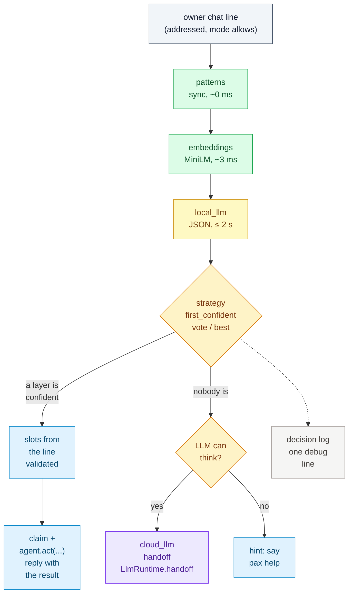
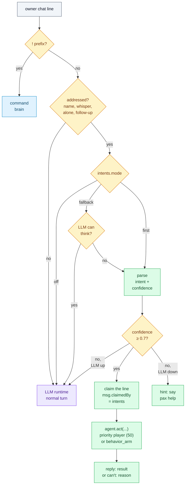

# Plain-language commands (intents)

The intents brain lets owners talk to a bot in normal chat without the cloud LLM: "pax guard me",
"follow me", "chop some wood", "get 64 cobblestone", "bring me bread", "stop". It understands the
line with a [pipeline of layers](#layer-pipeline) (a fixed table of patterns by default; optionally
a local embedding model and a local LLM, never eval), runs the matching action through
`agent.act()` at player priority or arms a behaviour, and replies briefly with the real result.

Use it so a bot stays useful when its LLM can't think (provider quota used up, budget out, no
LLM brain at all), and to save tokens on simple requests.

```ts
brains: [commandBrain(), reflexes(), behaviorsBrain(), intentsBrain(), llmBrain()]
```

The `companion` and `buddy` [variants](/concepts/variants-profiles) include it. Source: `src/brains/intents/`
(`parse.ts` is the pure parser, `brain.ts` the brain).

## Modes

| `intents.mode` | What happens |
| --- | --- |
| `fallback` (default) | Only while the LLM is unavailable: no LLM brain, provider check failed, provider quota paused, or its own budget blocked. Otherwise the LLM answers as usual. |
| `first` | Confident simple requests are handled here; everything else (and anything unclear) goes to the LLM. Saves a turn per "follow me". While the LLM is down it behaves like `fallback`. |
| `off` | Never handles chat. |

```yaml
# profiles/pax.yaml
intents:
  mode: first          # fallback | first | off
  threshold: 0.7       # optional: confidence needed to act
  aliases: [p]         # optional: extra names (llm.aliases count too)
```

`intents.mode` is a [feature toggle](/guide/live-config): `!config_set intents.mode off` switches it live. So are
`intents.strategy`, `intents.log_decisions` and each layer's `intents.layers.<name>.enabled` /
`.threshold` (patterns, embeddings, local_llm; `cloud_llm.enabled`), e.g.
`!config_set intents.layers.embeddings.enabled on` adds the embeddings layer to a bot that has no
layer config, and `!config_set intents.layers.embeddings.threshold 0.55` retunes it without
reloading the model.

## Layer pipeline

Understanding a line is a pipeline of layers. Each one is optional, has its own threshold, and can
be reordered, switched off live and [benchmarked](#benchmark):

| layer | what it is | speed | default |
| --- | --- | --- | --- |
| `patterns` | the anchored pattern table below (`parse.ts`); synchronous | ~0 ms | on, threshold 0.7 |
| `embeddings` | a local sentence-embedding model (transformers.js, ONNX on the CPU, `Xenova/all-MiniLM-L6-v2` q8, 23 MB) that picks the intent by the nearest labelled example phrasings (`examples.ts`) | 2-4 ms per line, ~0.2 s load from disk, ~8 s first download | off (Pax: on) |
| `local_llm` | a small model behind any OpenAI-compatible endpoint (Ollama, llama.cpp server, LM Studio), asked for strict JSON | ~0.8 s median for a 1.5B model on this CPU | off |
| `cloud_llm` | not a classifier: hands the line to the [LLM brain](/guide/llm-brain), the existing handoff, always last | a turn | on |



```yaml
# profiles/pax.yaml
intents:
  mode: first                         # fallback | first | off (as before)
  strategy: first_confident           # first_confident | vote | best
  log_decisions: true                 # one debug line per message: each layer's guess, confidence, ms, the winner
  layers:                             # order matters; each optional
    - { use: patterns, threshold: 0.7 }
    - { use: embeddings, threshold: 0.58, margin: 0.03, model: Xenova/all-MiniLM-L6-v2, method: knn, k: 3 }
    - { use: local_llm, url: http://127.0.0.1:11434/v1, model: qwen2.5:1.5b, timeout_ms: 2000, threshold: 0.7, enabled: false }
    - { use: cloud_llm }              # enabled: false = unclear lines are dropped instead of costing a turn
  examples:                           # optional: more phrasings for the embeddings layer (added to the built-in ones)
    guard: ["keep the phantoms off me"]
    none: ["pax is my favourite bot"]  # chat that must not trigger
```

Without `layers` the pipeline is today's: patterns at `intents.threshold` (0.7), then the cloud
handoff. Layer keys: `threshold` (all), `enabled` (all), `name` (to run two of a kind, e.g. two
local models); embeddings: `model` (any Hugging Face id with ONNX weights), `dtype` (q8, fp32,
fp16, q4), `method` (`knn`: mean of the `k` most similar examples per intent; `centroid`:
similarity to each intent's mean vector), `k`, `margin`, `preload` (load at start instead of on
the first line); local_llm: `url`, `model`, `timeout_ms` (default 2000), `api_key_var` (an env var
holding a key).

### Strategies

| `strategy` | winner | runs |
| --- | --- | --- |
| `first_confident` (default) | the first layer, in order, at or above its threshold | layers in order until one is confident; a confident pattern is acted on without waiting for anything |
| `vote` | the intent most confident layers agree on (ties: higher summed confidence; `min_votes` to require more than one), args from its most confident voter | every layer, in parallel |
| `best` | the highest confidence of any confident layer | every layer, in parallel |

Confidences are on each layer's own scale (pattern confidence, cosine similarity, the model's
own number), so `best` favours the layer with the more generous scale; `first_confident` with
patterns first is the predictable choice.

### What the loose layers may and may not do

- **Never PvP.** The PvP intents (pvp mode, attack, hunt, spare) and hunting animals come from
  the anchored patterns only: they are not in the label set the embeddings and the local LLM choose from, so a loose
  guess can't start a fight.
- **They only pick the intent.** Counts, items, places, players and templates come from the line
  through the parser's own helpers (`slots.ts`): "dig up twenty sand" is collect, sand, 20 because
  "twenty" and "sand" are in the line. A guess whose required slot is missing (bring without an
  item, go to without a place) is rejected. The words also settle direction ("stop chopping" is
  behavior_off even when the embedding is closer to "keep chopping") and give vs bring ("your bread").
- **A local LLM's arguments are checked against the line.** An item must be a real 1.21.1 item
  and be in the line ("bring me bread" answered with `diamond_sword` is rejected), a count or a
  coordinate must be said, a place or player must appear. Its JSON is parsed, never evaluated, and
  the intent must be one of the known names.
- **Same sentence rules as the patterns**: negations ("don't mine that") and questions don't act
  (the patterns let "don't follow me", "don't attack bob" and "no pvp" / "no more pvp" through),
  statements ("I'm going to get some wood", "can anyone trade me iron") and lines that start by
  naming someone else ("steve, give me your sword") are rejected. The embeddings layer also has a
  `none` class of chat examples; a line closest to those is left alone.
- **The margin** is the gap between the best intent and the best one outside its family
  (follow/unfollow, guard/unguard, behavior_on/off, bring/give).

### Claiming with slow layers

Patterns decide inside the chat listener, as before. When a slower layer has to run (embeddings,
a local LLM), the brain claims the line at once (so the LLM runtime and the command brain skip
it), classifies it in the background and, if no layer is confident and the LLM can think, gives
it back with `LlmRuntime.handoff(msg)`: the LLM then handles it as if it had just arrived. One
message, one handler either way. If the owner says something newer that is acted on first ("stop"
right after a slow "follow me"), the late guess is dropped.

If `@huggingface/transformers` or the model can't load, the embeddings layer reports
"unavailable" once in the log and the pipeline skips it; an unreachable local LLM endpoint is
skipped for a minute at a time. The model is downloaded on first use into `data/models/`
(gitignored) and loaded from there afterwards.

### Decision log

With `log_decisions: true` each message gets one debug line under `<bot>/intents` (run with
`-v` or `MC_LOG_LEVEL=info,*/intents=debug`):

```
decide "keep me safe" | patterns: guard 0.90 3ms => patterns guard {"target":"player","player":"IntentTester"} (3ms)
decide "get over to me" | patterns: - 0.3ms | embeddings: come 0.67 [next guard 0.531] 2.7ms => embeddings come {"player":"IntentTester"} (3.1ms)
decide "what is in your bag" | patterns: - 0.1ms | embeddings: inventory 0.69 [next bring 0.378] 2.8ms => embeddings inventory {} (2.9ms)
decide "keep the creepers away from me" | patterns: - 0.8ms | embeddings: guard 0.55 rejected (margin 0.008 < 0.03 (none)) [next none 0.541] 4.6ms => none (5.5ms)
decide "tell me a joke" | patterns: - 0.1ms | embeddings: help 0.38 rejected (closest to chat 0.55) [next none 0.55] 2.8ms => none (2.9ms)
```

### Benchmark

```bash
just intents-bench                                    # patterns, embeddings, patterns+embeddings on both sets
just intents-bench --config patterns+embeddings:threshold=0.58,margin=0.03 --set heldout --errors
just intents-bench --config patterns+embeddings@vote  # strategy after @
just intents-bench --config local_llm --url http://127.0.0.1:11434/v1 --model qwen2.5:1.5b --timeout 5000
just intents-bench --config embeddings --grid         # threshold x margin sweep (vectors cached)
just intents-bench --json data/bench/run.json         # full results, per-line errors included
```

A config is layer kinds joined by `+`, each with `key=value` settings after `:` (the [profile](/guide/profiles)
keys), and an optional `@strategy`. Sets: `seen` (the parser's 137 test phrasings, most of them
also embeddings examples), `heldout` (107 paraphrases that are in neither, 22 of them
must-not-trigger; `test/fixtures/intents-heldout.ts`), `all`, or a JSON file of
`[text, intent | null, args?]`. It reports accuracy, macro-F1, false triggers on must-not-trigger
lines, slot accuracy (right intent and every expected arg right), latency p50/p95 and load time.

Results on this machine (8 cores, heavily loaded; `all-MiniLM-L6-v2` q8):

| config | set | acc | macro-F1 | false triggers | misses | slots | p50 / p95 ms |
| --- | --- | --- | --- | --- | --- | --- | --- |
| patterns | seen (137) | 1.000 | 1.000 | 0/19 | 0 | 1.000 | 0 / 0.7 |
| patterns | held-out (107) | 0.495 | 0.381 | 0/22 | 46 | 0.962 | 0 / 0 |
| embeddings (0.62 / 0.05) | seen | 0.905 | 0.907 | 0/19 | 9 | 1.000 | 2.4 / 3.8 |
| embeddings (0.62 / 0.05) | held-out | 0.729 | 0.780 | 0/22 | 27 | 1.000 | 2.5 / 3.0 |
| patterns+embeddings (0.62 / 0.05) | seen | 1.000 | 1.000 | 0/19 | 0 | 1.000 | 0 / 3.1 |
| patterns+embeddings (0.62 / 0.05) | held-out | 0.766 | 0.779 | 0/22 | 16 | 0.974 | 2.3 / 3.4 |
| embeddings (0.58 / 0.03) | held-out | 0.832 | 0.875 | 0/22 | 16 | 1.000 | 2.4 / 3.7 |
| **patterns+embeddings (0.58 / 0.03), Pax** | seen | 1.000 | 1.000 | 0/19 | 0 | 1.000 | 0 / 2.3 |
| **patterns+embeddings (0.58 / 0.03), Pax** | held-out | 0.822 | 0.826 | 0/22 | 10 | 0.975 | 2.2 / 2.8 |
| patterns+embeddings (0.58 / 0.03) `@vote` / `@best` | held-out | 0.841 | 0.863 | 0/22 | 10 | 0.976 | 2.3 / 3.3 |
| embeddings centroid (0.58 / 0.03) | held-out | 0.757 | 0.812 | 1/22 | 22 | 1.000 | 1.2 / 1.6 |
| local_llm (qwen2.5 1.5B Q4_K_M) | seen | 0.599 | 0.585 | 0/19 | 31 | 1.000 | 818 / 5050 |
| local_llm (qwen2.5 1.5B Q4_K_M) | held-out | 0.458 | 0.393 | 6/22 | 31 | 1.000 | 767 / 973 |
| patterns+embeddings (0.58 / 0.03)+local_llm | held-out | 0.813 | 0.822 | 6/22 | 3 | 0.977 | 3.2 / 889 |

- **Patterns alone** are perfect on the phrasings they were written for and catch half of the
  paraphrases, with no false triggers.
- **Embeddings** add 23 to 34 points on paraphrases at 2-4 ms per line. At the default 0.62 /
  0.05 they never fired on chat in these sets; Pax uses 0.58 / 0.03 from the grid (still no false
  triggers here, 6 more paraphrases caught).
- **patterns+embeddings** loses a little to embeddings alone on the held-out set because a few
  paraphrases get a confident but wrong pattern ("come to my side" as go to a place called side);
  `vote`/`best` let the embedding outvote those.
- The held-out set was also used for the grid and to spot generic gaps (polarity, statements,
  tool words), so treat its numbers as optimistic; add your own lines with `--set file.json`.
- Model load: about 8 s for the first download (23 MB), ~0.2 s from `data/models/`, plus ~0.25 s
  to embed the ~450 examples. Memory: about 100 MB for the model and runtime.

**Local LLM.** Tried with Qwen2.5-1.5B-Instruct (Q4_K_M) on a llama.cpp server in a throwaway
podman container, CPU only, 4 threads, 5 s timeout. It is slow (0.8 s median, timeouts at the
tail) and, at this size, a poor classifier: below the patterns on known phrasings, worse than
the embeddings on paraphrases, and it triggered on 6 of 22 chat lines in the held-out set ("i
just got home", "can anyone trade me some iron"). As the last classifier after patterns and
embeddings it catches most of the remaining paraphrases (3 misses) but those false triggers come
with it. Keep it off unless you have a bigger model and the hardware for it; a raised threshold
or `strategy: vote` (it then needs another layer to agree) are the ways to tame it. Its prompt
carries a few examples from the seen set, so its seen numbers are slightly flattering.

## Who it listens to

- **Owners only** (`--owners` / `MC_OWNERS`; an empty list means everyone). Other players get
  only the peaceful PvP lines ("pvp off", "pvp defend" from a higher mode, "stop attacking",
  "leave bob alone"), from the patterns; everything else they say is left alone.
- **Addressed lines only**: the bot's name or an alias at the start ("pax, follow me",
  "@pax stop", "hey pax come here") or at the end ("follow me pax"). A name in the middle ("I
  think pax is lost") doesn't count. Whispers always count. When the owner is the only other
  player online, every line counts (as for the LLM brain, unless `llm.listen` is `mention`), and
  so do follow-ups shortly after an intents reply (`llm.conversationMs`, default 90 s).
- Lines starting with `!` stay with the [command brain](/guide/writing-brains).
- Questions don't trigger actions: "did you follow him?", "are you going home?" and "how do I
  build a house?" get no intent. Polite requests do: "can you follow me?".

When the LLM is down and an owner names the bot with something it doesn't understand, it
answers once every 20 s: `didn't get that (LLM off: ...); say "Pax help"`.

## One message, one handler



The intents brain registers its chat listener first (`prependListener`), whatever the brain
order in the variant, decides synchronously (or claims first and hands back later when a [slow
layer](#claiming-with-slow-layers) runs) and marks lines it takes with
`msg.claimedBy = 'intents'`. The [LLM brain](/guide/llm-brain) still records a claimed line in its memory (so a
later turn knows the owner asked to follow) but starts no turn and sends no "thinking break"
notice; the command brain skips it too. Whether the LLM can think comes from
`LlmRuntime.blockedReason()`, read at the moment the line arrives.

## Phrases

Synonyms, filler words ("please", "can you", "now", "for me") and punctuation are ignored. A
rule has to match the whole line, so longer requests ("follow me and then build a house") go to
the LLM in `first` mode.

| Intent | Examples | Does |
| --- | --- | --- |
| follow | follow me, come with me, tag along, follow steve, follow me at 5 blocks | `follow` (checks it can see the player first) |
| stop following | stop following me, don't follow me, leave me alone | cancels `follow`, disarms `follow_owner` |
| come | come here, get over here, come back, over here | `come` to the speaker |
| go home / places | go home, return to base, go to the farm, go to farm:1, go to 100 64 -20, go there, go to steve | `go_home`, `goto_place`, `goto` (speaker's position for "there"), `come` for a player |
| guard | guard me, protect me, be my bodyguard, watch my back | arms `bodyguard {player}`, else `guard_owner {player}`, else the `guard` action |
| guard an area | guard here, defend this area, guard the farm | arms `guard_area` at the speaker's position or a remembered place |
| stop guarding | stop guarding, stand down | disarms `bodyguard`, `guard_owner`, `guard_area`; cancels `guard` |
| stop / stay | stop, cancel that, never mind, wait; stay here | `stop` (and says which moving behaviours are still armed); "stay" also disarms `follow_owner` / guards |
| farm | farm the wheat, harvest the crops, farm at farm:1; make a farm (here) | `harvest` (after `goto_place`), or `start_farm` |
| wood | chop some wood, get wood, chop a tree, chop down three trees, get 20 logs, gather a stack of wood, get 16 oak logs | `chop_tree` (up to 5 trees), or `gather_materials` for counts |
| collect / mine | get 64 cobblestone, get a stack of cobble, mine ten iron, dig some dirt, collect a few sand | `collect` (64 at a time; default 8), `gather_materials` for wood and bigger counts |
| find | find iron, find a village, look for water, where is the nearest village?, find diamonds and bring them back, locate X within 500 blocks | `find_target {target, radius, bring}` when the bot has it |
| where is my X | where's my iron, where are my diamonds | `where_stored {item}`: answered from [container memory](/guide/search#container-memory), adding that "bring me X" fetches it when the chest is its own; without `where_stored` it searches like find |
| bring | bring me bread, bring me bread 5, bring me some iron, get me some bread | `bring_item {item, count, player}` when present; otherwise walks over and drops it if it carries the item |
| give | give me your bread, give me 3 of your apples, gimme your logs | walks over and `drop`s it from the inventory (generic names match: logs, food) |
| drop | drop your dirt, drop 5 cobble, drop everything | `drop` |
| eat / sleep | eat, eat something, go to sleep, go to bed | `eat`, `sleep` |
| status | status, what are you doing?, what's up | one line from `observe()`: action, position, health, food, armed behaviours, LLM pause |
| where | where are you?, coords | position and dimension |
| inventory | inventory, what do you have? | `inventory` |
| set home | set home, set home here, this is your home | `set_home` (bot's or speaker's position) |
| remember | remember this place as the mine, save this spot as wheat field | `remember_place` at the speaker's position |
| build | build a house (here), build me a log cabin, put up a shelter | `build` with the [blueprint](/guide/goals-and-building#blueprint-format) (house = small_house, big house = cottage, log cabin = cabin); "here" = the speaker's position |
| PvP mode | pvp off, pvp defend, set pvp to revenge, switch pvp to targets, pvp mode all; stop attacking, stop fighting, stop pvp, no pvp, no more pvp, ceasefire, peace (= off; with a name it is "spare") | `pvp {mode}`; off is the kill switch (ends every fight and hunt). Owners only, except that anyone may turn it off or lower it (see [PvP](/concepts/world#pvp)) |
| attack a player | attack bob, fight bob, go after bob, take out bob, kill bob on sight | `attack_player {player}`: only a player online by that name (never "attack zombies", "kill everything", "attack me"); a name nobody online has gets "no player called bob online" |
| hunt a player | hunt bob, hunt bob down, track down bob, find and kill bob, hunt player bob | `hunt_player {player}`: goes where they were last seen and fights them. Only when bob is online ("hunt player bob" says it outright); otherwise "track down iron" is a search and "hunt eve" with no eve online is nothing |
| hunt animals | hunt rabbits, kill 3 cows, go hunt some animals, go hunting for food | `hunt {animal, count}` (cow, pig, sheep, chicken, rabbit, mooshroom; none named = the nearest) |
| spare a player | stop attacking bob, stop hunting bob, leave bob alone, don't attack bob, never attack bob, spare bob, forgive bob | `spare_player {player}`: off the list, grudge forgiven, fight ended. Anyone may say it |
| behaviours | start farming, keep chopping, go exploring, stop chopping, turn on keep_fed, disarm farm_loop | `behavior_arm` / `behavior_disarm` (farming = farm_loop, chopping = chop_wood_loop, following = follow_owner, exploring = wander, ...) |
| help | help, what can you do? | lists the phrases |

**Amounts**: digits, number words up to the nineties ("sixty four"), "N stacks" (64 each), "a
stack" = 64, "half a stack" = 32, "a couple" = 2, "a few" = 3, "a dozen" = 12, "some" = the
default. "bread x5" and "bread 5" work too.

**Items**: plurals are made singular (potatoes, torches), "cobble" is cobblestone, "logs" and
"wood" mean any log, "planks" any planks, "oak logs" is `oak_log`. Mining and collecting prefer
the block ("iron" = `iron_ore`); bring, give and drop prefer the item ("iron" = `iron_ingot`,
falling back to raw iron in the inventory).

**me, here, there**: "me" and "us" are the speaker; "here" and "there" are where the speaker
stands (the bot needs to see them; otherwise it says so).

## Replies

Replies are short and only claim what happened. Quick actions report their result ("reached
IntentTester", "can't: no oak logs within 32 blocks"); slow ones answer "chopping a tree" after
1.5 s and the outcome when they end. Interrupted actions (stopped, preempted) aren't reported.
Missing pieces say so: `find_target isn't available here yet`,
`can't guard: no bodyguard behaviour or guard action here`, `can't: I don't have the chop_tree action`.

Actions run as `caller: { kind: 'player', name }` at `PRIORITY.player`, like `!commands`: they
outrank the LLM and [armed behaviours](/guide/behaviors), and "stop" from an owner also drops the LLM's active goal.

## Live check

`node scripts/intents-test.ts` starts a bot (`IntentTest`, owner `IntentTester`, no LLM),
walks both well away from spawn and says "follow me", "what are you doing", "stop", "come
here", "chop some wood" in chat, printing the replies. `INTENTS_EMBEDDINGS=1` adds the
embeddings layer with the decision log (`MC_LOG_LEVEL='info,*/intents=debug'`); the lines above
come from such a run on mc02.
