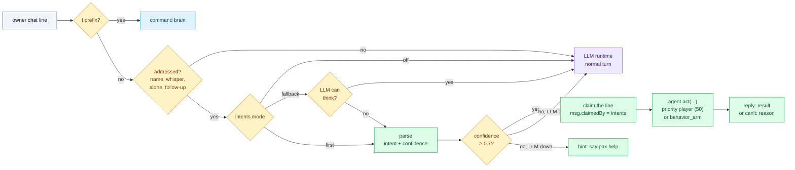

# Plain-language commands (intents)

The intents brain lets owners talk to a bot in normal chat without an LLM: "pax guard me",
"follow me", "chop some wood", "get 64 cobblestone", "bring me bread", "stop". It parses the
line with a fixed table of patterns (no model, no eval), runs the matching action through
`agent.act()` at player priority or arms a behaviour, and replies briefly with the real result.

Use it so a bot stays useful when its LLM can't think (provider quota used up, budget out, no
LLM brain at all), and to save tokens on simple requests.

```ts
brains: [commandBrain(), reflexes(), behaviorsBrain(), intentsBrain(), llmBrain()]
```

The `companion` and `buddy` [variants](/concepts/variants-profiles) include it. Source: `src/brains/intents/`
(`parse.ts` is the pure parser, `brain.ts` the brain).

## Modes

| `intents.mode` | What happens |
| --- | --- |
| `fallback` (default) | Only while the LLM is unavailable: no LLM brain, provider check failed, provider quota paused, or its own budget blocked. Otherwise the LLM answers as usual. |
| `first` | Confident simple requests are handled here; everything else (and anything unclear) goes to the LLM. Saves a turn per "follow me". While the LLM is down it behaves like `fallback`. |
| `off` | Never handles chat. |

```yaml
# profiles/pax.yaml
intents:
  mode: first          # fallback | first | off
  threshold: 0.7       # optional: confidence needed to act
  aliases: [p]         # optional: extra names (llm.aliases count too)
```

`intents.mode` is a [feature toggle](/guide/live-config): `!config_set intents.mode off` switches it live.

## Who it listens to

- **Owners only** (`--owners` / `MC_OWNERS`; an empty list means everyone).
- **Addressed lines only**: the bot's name or an alias at the start ("pax, follow me",
  "@pax stop", "hey pax come here") or at the end ("follow me pax"). A name in the middle ("I
  think pax is lost") doesn't count. Whispers always count. When the owner is the only other
  player online, every line counts (as for the LLM brain, unless `llm.listen` is `mention`), and
  so do follow-ups shortly after an intents reply (`llm.conversationMs`, default 90 s).
- Lines starting with `!` stay with the [command brain](/guide/writing-brains).
- Questions don't trigger actions: "did you follow him?", "are you going home?" and "how do I
  build a house?" get no intent. Polite requests do: "can you follow me?".

When the LLM is down and an owner names the bot with something it doesn't understand, it
answers once every 20 s: `didn't get that (LLM off: ...); say "Pax help"`.

## One message, one handler



The intents brain registers its chat listener first (`prependListener`), whatever the brain
order in the variant, decides synchronously and marks lines it takes with
`msg.claimedBy = 'intents'`. The [LLM brain](/guide/llm-brain) still records a claimed line in its memory (so a
later turn knows the owner asked to follow) but starts no turn and sends no "thinking break"
notice; the command brain skips it too. Whether the LLM can think comes from
`LlmRuntime.blockedReason()`, read at the moment the line arrives.

## Phrases

Synonyms, filler words ("please", "can you", "now", "for me") and punctuation are ignored. A
rule has to match the whole line, so longer requests ("follow me and then build a house") go to
the LLM in `first` mode.

| Intent | Examples | Does |
| --- | --- | --- |
| follow | follow me, come with me, tag along, follow steve, follow me at 5 blocks | `follow` (checks it can see the player first) |
| stop following | stop following me, don't follow me, leave me alone | cancels `follow`, disarms `follow_owner` |
| come | come here, get over here, come back, over here | `come` to the speaker |
| go home / places | go home, return to base, go to the farm, go to farm:1, go to 100 64 -20, go there, go to steve | `go_home`, `goto_place`, `goto` (speaker's position for "there"), `come` for a player |
| guard | guard me, protect me, be my bodyguard, watch my back | arms `bodyguard {player}`, else `guard_owner {player}`, else the `guard` action |
| guard an area | guard here, defend this area, guard the farm | arms `guard_area` at the speaker's position or a remembered place |
| stop guarding | stop guarding, stand down | disarms `bodyguard`, `guard_owner`, `guard_area`; cancels `guard` |
| stop / stay | stop, cancel that, never mind, wait; stay here | `stop` (and says which moving behaviours are still armed); "stay" also disarms `follow_owner` / guards |
| farm | farm the wheat, harvest the crops, farm at farm:1; make a farm (here) | `harvest` (after `goto_place`), or `start_farm` |
| wood | chop some wood, get wood, chop a tree, chop down three trees, get 20 logs, gather a stack of wood, get 16 oak logs | `chop_tree` (up to 5 trees), or `gather_materials` for counts |
| collect / mine | get 64 cobblestone, get a stack of cobble, mine ten iron, dig some dirt, collect a few sand | `collect` (64 at a time; default 8), `gather_materials` for wood and bigger counts |
| find | find iron, find a village, look for water, where is the nearest village?, find diamonds and bring them back, locate X within 500 blocks | `find_target {target, radius, bring}` when the bot has it |
| bring | bring me bread, bring me bread 5, bring me some iron, get me some bread | `bring_item {item, count, player}` when present; otherwise walks over and drops it if it carries the item |
| give | give me your bread, give me 3 of your apples, gimme your logs | walks over and `drop`s it from the inventory (generic names match: logs, food) |
| drop | drop your dirt, drop 5 cobble, drop everything | `drop` |
| eat / sleep | eat, eat something, go to sleep, go to bed | `eat`, `sleep` |
| status | status, what are you doing?, what's up | one line from `observe()`: action, position, health, food, armed behaviours, LLM pause |
| where | where are you?, coords | position and dimension |
| inventory | inventory, what do you have? | `inventory` |
| set home | set home, set home here, this is your home | `set_home` (bot's or speaker's position) |
| remember | remember this place as the mine, save this spot as wheat field | `remember_place` at the speaker's position |
| build | build a house (here), build me a log cabin, put up a shelter | `build` with the [blueprint](/guide/goals-and-building#blueprint-format) (house = small_house, big house = cottage, log cabin = cabin); "here" = the speaker's position |
| behaviours | start farming, keep chopping, go exploring, stop chopping, turn on keep_fed, disarm farm_loop | `behavior_arm` / `behavior_disarm` (farming = farm_loop, chopping = chop_wood_loop, following = follow_owner, exploring = wander, ...) |
| help | help, what can you do? | lists the phrases |

**Amounts**: digits, number words up to the nineties ("sixty four"), "N stacks" (64 each), "a
stack" = 64, "half a stack" = 32, "a couple" = 2, "a few" = 3, "a dozen" = 12, "some" = the
default. "bread x5" and "bread 5" work too.

**Items**: plurals are made singular (potatoes, torches), "cobble" is cobblestone, "logs" and
"wood" mean any log, "planks" any planks, "oak logs" is `oak_log`. Mining and collecting prefer
the block ("iron" = `iron_ore`); bring, give and drop prefer the item ("iron" = `iron_ingot`,
falling back to raw iron in the inventory).

**me, here, there**: "me" and "us" are the speaker; "here" and "there" are where the speaker
stands (the bot needs to see them; otherwise it says so).

## Replies

Replies are short and only claim what happened. Quick actions report their result ("reached
IntentTester", "can't: no oak logs within 32 blocks"); slow ones answer "chopping a tree" after
1.5 s and the outcome when they end. Interrupted actions (stopped, preempted) aren't reported.
Missing pieces say so: `find_target isn't available here yet`,
`can't guard: no bodyguard behaviour or guard action here`, `can't: I don't have the chop_tree action`.

Actions run as `caller: { kind: 'player', name }` at `PRIORITY.player`, like `!commands`: they
outrank the LLM and [armed behaviours](/guide/behaviors), and "stop" from an owner also drops the LLM's active goal.

## Live check

`node scripts/intents-test.ts` starts a bot (`IntentTest`, owner `IntentTester`, no LLM),
walks both well away from spawn and says "follow me", "what are you doing", "stop", "come
here", "chop some wood" in chat, printing the replies.
