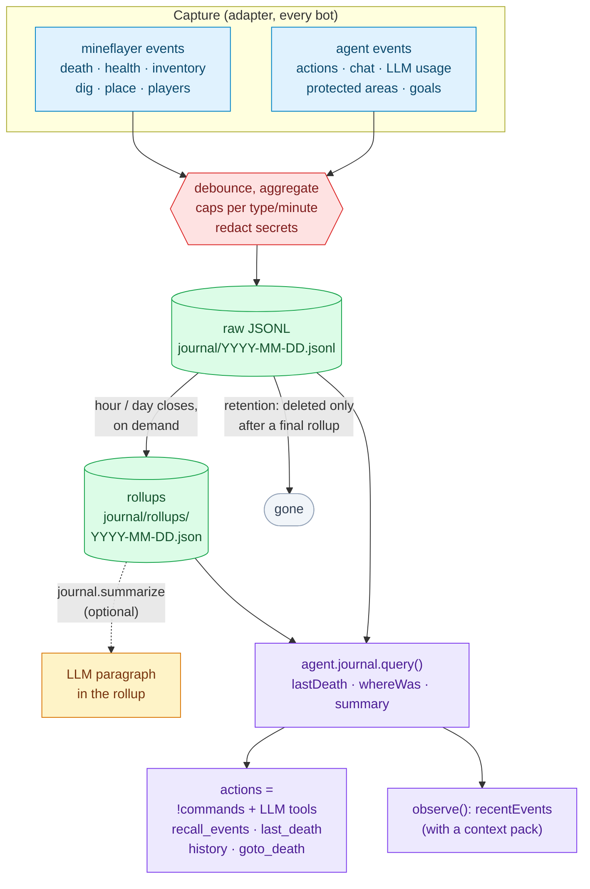

# Event journal

Every bot keeps a journal of what happens to it: deaths, damage, kills, items gained and lost,
blocks, chat, actions, players, places, connections and LLM usage. Facts are written as typed
JSON lines, rolled up per hour and day, pruned after a while, and can be queried from code,
from chat (`!last_death`) and by an LLM bot (the same actions are tools).

Storage, rollups and queries are in core (`src/core/journal/`); the Minecraft adapter feeds it
from agent and Mineflayer events (`src/adapters/minecraft-java/journal-capture.ts`) as soon as
it attaches to an agent, so every bot records whatever brains it runs. The actions that read the
journal come with the `journal` skill, which is part of `standardSkills()`.



## What is recorded

One JSON object per line: `{ ts, type, pos?, dim?, data }` (`ts` in epoch ms, `pos` in block
coordinates).

| type | when | data |
|---|---|---|
| `death` | the bot died | `cause`, `killer`, `weapon`, `message` (the server's death message), `healthBefore`, `action` (what it was doing), `lost` (inventory it carried), `lostCount` |
| `respawn` | back alive | `keptInventory` |
| `damage` | health dropped; aggregated per source over 10 s | `source` (entity, `environment`, `starvation`, `unknown`), `amount`, `hits`, `healthAfter` |
| `kill` | an entity the bot hit died within 10 s, or a death message names the bot as killer | `entity` |
| `item_gained` / `item_lost` | net inventory change after 2 s of quiet (moving items between slots nets to nothing) | `items` (`{ name: count }`, modded names as the server registry has them), `action` |
| `block_broken` / `block_placed` | per 16x16 column, reported 30 s after the first | `blocks`, `count`, `area` |
| `chat_in` / `chat_out` | public chat heard / sent | `from`, `message` |
| `whisper` | whispers both ways | `dir` (`in`/`out`), `from` / `to`, `message` |
| `action` | an action finished | `name`, `caller` (`player:Robin`, `brain:llm`), `ok`, `message`, `ms`, `params` (short), `player` |
| `goal` | a goals system emits `goal` on the agent or calls `journal.record('goal', ...)` | free-form (`goal`, `status`, ...) |
| `player_seen` | a player comes into view (once per player per 10 min) | `player`, `distance` |
| `player_joined` / `player_left` | real joins and leaves (not the list replayed on spawn) | `player` |
| `place_visited` | entering a 64x64 region not visited in the last 30 min, coming within 12 blocks of a named place (`remember_place`, `set_home`), or changing dimension | `region` / `place` / `dimension`, `new` |
| `advancement` | "X has made the advancement [Y]" | `advancement`, `player`, `self` |
| `protected_area` | the server refused a block break and the area is now avoided | |
| `food_spot` | `find_food` / `keep_fed` saw huntable animals, a village farm or water to farm by (also kept as places `food:animals`, `food:village_farm`, `food:water`) | `kind`, `count`, `animals` |
| `farm_started` | `start_farm` planted a new farm (also a place `farm:<n>`) | `name`, `size`, `crop`, `tilled`, `planted` |
| `found` | a [search](/guide/search) (`find_target`, `search`) found what it was looking for (also a place `found:<target>`) | `target`, `what`, `count`, `how`, `note` |
| `connect` / `disconnect` | each session | `server`, `gameMode` / `reason` (kick text when kicked) |
| `llm_turn` | after every LLM turn | `provider`, `model`, `inputTokens`, `outputTokens`, `cacheReadTokens`, `toolCalls`, `ms`, `ok`, `trigger` if the brain reports one |
| `journal_dropped` | a type went over its per-minute cap | `type`, `count` |

Death messages are parsed from the vanilla wording ("Pax was slain by Zombie Villager", "Pax
hit the ground too hard while trying to escape Skeleton", "Pax tried to swim in lava", about
50 [variants](/concepts/variants-profiles)). If none arrives within 3 seconds, the death is still recorded with the last
damage source as the cause.

The same cause goes beyond the journal: the adapter emits a `deathCause` event with a report
(the cause in chat form such as "slain by Zombie", the server message, the damage sources of
the last 15 seconds, hostiles within 8 blocks, the action that held the body, health before
the last hit, the position). Hooks get it as `{cause}`, `{killer}`, `{deathMessage}` and
`{deathDetail}` on `death` ([context pack](/guide/context-pack)), the LLM brain's death event
carries it with an instruction to report it as it is, and `observe` shows it as `lastDeath`
for 10 minutes. Live, Pax said "died again (zombie...)" after a death the defend reflex logged as
"died fighting creeper"; the model had guessed, and only the server message said which.

What is never recorded: prompts and LLM responses (only token counts), and secrets. Every
string goes through the logger's redaction (values of `*KEY`, `*TOKEN`, `*SECRET`,
`*PASSWORD` environment variables become `***`), and `/login`, `/register` and similar
commands keep only the command name.

Successful non-exclusive actions (`pos`, `hp`, `inventory`, the journal queries themselves)
are skipped by default; failures are kept. Set `journal.actions.includeStatus: true` to keep
them all, or `journal.actions.skip` to drop specific ones.

## Files

The journal lives in the bot's data directory: `data/bots/<username>/`, or
`data/bots/<server>/<username>/` when a [fleet](./running#several-servers) runs the same
username on several servers.

```
data/bots/<username>/journal/
  2026-11-20.jsonl          raw events of that day (local time)
  2026-11-21.jsonl
  rollups/
    2026-11-20.json         day totals + hourly sections (+ summary)
    2026-11-21.json         today, rewritten every hour
```

Writes are buffered and appended every 2 s (`flushMs`); a death is written immediately. Each
type has a per-minute cap (defaults below) so a busy bot doesn't write gigabytes; what is
dropped is counted in one `journal_dropped` event per type and minute.

| type | cap/min | | type | cap/min |
|---|---|---|---|---|
| `chat_in` | 40 | | `action` | 40 |
| `chat_out`, `whisper`, `llm_turn` | 30 | | `damage`, `block_*` | 12 |
| `item_gained`, `item_lost`, `death`, `player_seen` | 20 | | `place_visited` | 10 |
| anything else (`default`) | 60 | | | |

## Rollups

A rollup is a pure function of the events, so the same day always gives the same JSON. It has
`totals` for the day and `hours` keyed `"HH:00"`, each with:

- `counts` per type, `events`
- `deaths` in full (time, position, cause, killer, message, what was lost, what it was doing)
- `kills`, `damage` (taken, by source)
- `items` gained, lost and net; `blocks` broken and placed
- `places`: positions from visits, deaths and block work, clustered within 48 blocks, with
  names where known
- `players` met, `advancements`, `chat` counts
- `actions`: total, ok, failed, per action, and the top failures (`goto "stuck at ..." x3`)
- `onlineMs` (from connect/disconnect), `llm` turns and tokens

Today's rollup is rewritten when an hour closes; past days get a final rollup when the day
closes, at startup if missing, and on demand (`agent.journal.rollup(date)`).

### LLM summary (optional)

With `journal.summarize` configured, each finished day gets a short paragraph in its rollup
(`summary`, `summaryBy`). It goes through the same provider layer as the [LLM brain](/guide/llm-brain), gets the
rollup numbers only (no chat text), no tools and one turn. Off by default.

```yaml
journal:
  summarize: { provider: anthropic, model: claude-haiku-4-5 }
  summarize: true          # reuse the profile's llm: block
```

### Retention

Raw files older than `retentionDays` (14) are deleted, but only once a final rollup for that
day exists. Rollups are kept for `rollupRetentionDays` (365). Because rollups keep deaths in
full, "where did I die last week" still works after the raw file is gone; queries over such a
day return its deaths plus one `rollup` event with the day summary.

## From chat and LLM tools

The journal skill's actions are chat commands and LLM tools like every other action:

| action | |
|---|---|
| `recall_events` (`!events`) | recent events, filtered: `type` (`death`, `chat`, `items`, `blocks`, `players`, `actions`, `places`, `combat`, `connections`, `food`, `finds` (search finds), `llm` or any type), `since` (`30m`, `1h`, `today`, `yesterday`, `2026-11-20`; default 24 h), `player`, `near` (`"x y z"` or `"x z"`, optional radius), `text`, `limit`, `fleet` |
| `last_death` (`!death`) | where, when, what killed it, what it was doing, what it lost and whether the drops may still be there (items despawn 5 minutes after death) |
| `history` (`!summary`) | a summary of `today`, `yesterday`, a date, `3h`, or hours today like `10-12` |
| `goto_death` | walk back to the last death position and pick up the drops (exclusive, long-running) |

```
<Robin> !last_death
<Pax> died 1m ago at 549 87 53: Pax was slain by Phantom, while doing goto. Lost 1x
      ars_nouveau:worn_notebook. Died 62s ago, the drops may still be there for about 238s (goto_death)
<Robin> !recall_events type=deaths since=1h
<Pax> 10:29 died at 549 87 53: Pax was slain by Phantom (lost 1 items); 10:33 died at 609 86 52:
      Pax was shot by Skeleton
<Robin> !history
<Pax> today: online 11m; 7 deaths (last 32s ago at 539 74 47: Pax hit the ground too hard while
      trying to escape Skeleton); 16 actions, 15 failed (most: collect "the server won't let me
      break dirt here…" x2); took 170.2 damage; met BuildTest, Robin, ...; chat 73 in, 28 out
```

The tool results also carry the full events (or the rollup section) as data.

### In the observation

When a [context pack](/guide/context-pack) is active (see [Context packs](./context-pack)), the bot's `observe()`
gets a `recentEvents` line, for example
`died 12m ago at 549 87 53: Pax was slain by Phantom, lost 1x ars_nouveau:worn_notebook`, so an
LLM bot knows about its last death without calling a tool. It only appears when there is
something notable (a death in the last 24 h, an unusual disconnect, a kill or an advancement in
the last hour). Turn it off with `journal.observe: false`.

## From code

```ts
const j = agent.journal
j.query({ types: ['death', 'damage'], since: '1h' })               // oldest first, newest 50
j.query({ near: { x: 100, z: -20, r: 30 }, since: 'yesterday' })
j.query({ player: 'Robin', text: 'wood', limit: 10 })
j.lastDeath()       // { ts, pos, dim, cause, killer, message, lost, lostCount, keptInventory, itemsMayRemain, ... }
j.deaths('today')
j.whereWas(Date.now() - 3_600_000)   // { pos, dim, ts, type } of the closest event with a position
j.summary('yesterday')               // { label, range, section, summary?, text }
j.record('goal', { goal: 'build a house', status: 'done' })   // custom events (caps and redaction apply)
j.onEvent(e => ...)                  // live stream of recorded events

import { fleetQuery } from '../core/index.ts'
fleetQuery(agent, { types: ['death'], since: 'today' })  // every bot on this server, each event has `bot`
```

Without `since`, `query` looks back 7 days. `limit: 0` returns everything that matches.

## Configuration

`settings.journal` in a variant, or the `journal:` key in a [profile](/guide/profiles):

```yaml
journal:
  enabled: true
  types: [death, respawn, damage, chat_in, action]   # default: all
  exclude: [player_seen]
  retentionDays: 14
  rollupRetentionDays: 365
  flushMs: 2000
  caps: { chat_in: 20, default: 60 }
  actions: { includeStatus: false, skip: [follow] }
  observe: true
  placeRegion: 64
  summarize: { provider: anthropic, model: claude-haiku-4-5, maxChars: 600 }
journal: false            # off for this bot
```

Environment: `MC_JOURNAL=false` turns it off for every bot, `MC_JOURNAL_TYPES` (comma
separated), `MC_JOURNAL_RETENTION_DAYS`, `MC_JOURNAL_SUMMARIZE=<provider>`.

## Limitations

- Death messages are matched in en_us vanilla wording; other languages or mods that change
  them fall back to the last damage source.
- Kills are attributed when the entity the bot last hit dies within 10 s; a kill by a projectile
  that wasn't the bot's last swing is missed unless the server's death message names the bot.
- Days and hour sections use the bot host's local time; on daylight saving change days the
  hour sections are approximate.

## LLM usage

Every LLM turn is an `llm_turn` event: provider, model, billing, input/output tokens, cache reads
and writes, tool calls, duration, what started the turn (`trigger`: "whisper from Robin",
"goal: actionDone", "event: death"...), the cost (API spend, or the CLI's list-price estimate for
subscription turns), and, when the brain goes through a proxy (`llm.proxy: caveman` or a gateway
URL), `proxy`: the proxy's Prometheus counters that changed during that turn (scraped from
`/metrics`; turn it off with `llm.proxyMetrics: false`).

```sh
just llm-usage Pax                 # today: by trigger, model and hour, plus proxy counters
just llm-usage Pax 2026-11-21 --days 3
```
