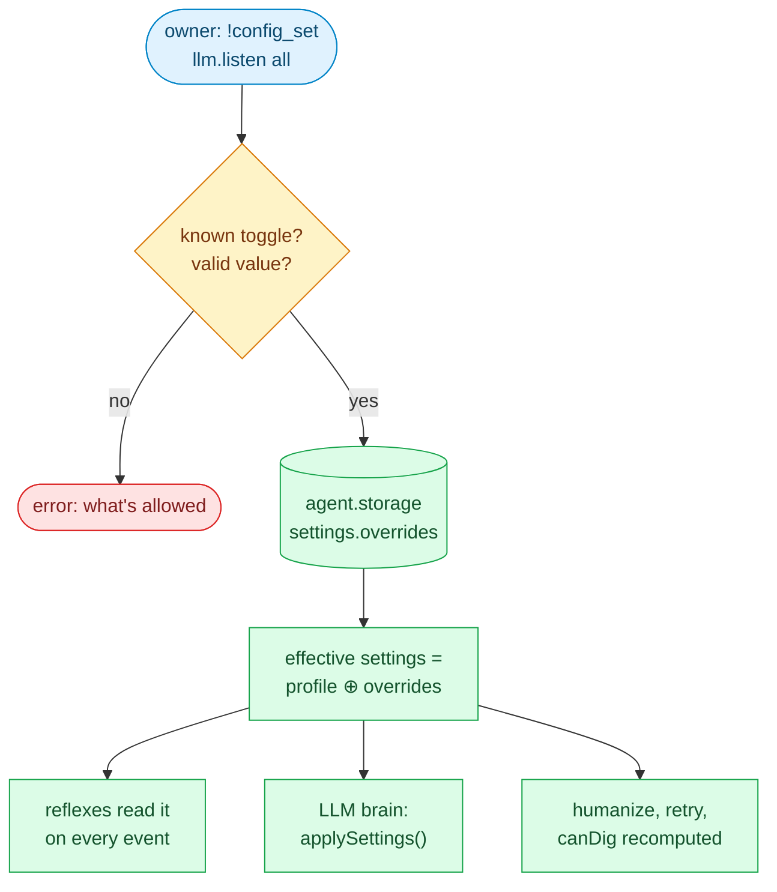

# Feature toggles (live config)

Some settings can be changed in game, while the bot runs, without a restart. Changes apply
immediately, survive restarts, and win over the [profile](/guide/profiles) until you reset them.

```
!config_list                          what can be changed, with current values (* = changed in game)
!config_get llm.listen                one setting and what it does
!config_set llm.listen all            change it (owners only)
!config_set reflexes.retreatBelow 6
!config_set retry.actions.goto 2
!config_reset llm.listen              back to the profile value
!config_reset                         undo every in-game change
```

Whispers work without the `!`. Only owners can change settings; LLM brains and other brains
can't change their own.

## What can be changed

| key | type | what |
|---|---|---|
| `canDig` | on/off | may break blocks and tunnel while pathing |
| `selfAware` | on/off | show the bot its own [variant](/concepts/variants-profiles), profile, model, brains and settings every turn (default on) |
| `respectBuilds` | on/off | leave blocks that look player-made alone when building (default off: the bot may dig and use anything it needs) |
| `reflexes.selfDefense` | on/off | fight back when hit (default on; also gates PvP `defend`) |
| `reflexes.autoEat` | on/off | eat when hungry (default on) |
| `reflexes.eatBelow` | 0–20 | eat when food drops below this (default 15) |
| `reflexes.retreatBelow` | 0–20 | back off at or below this health (0 = stand ground; default 8) |
| `reflexes.waterFightAbove` | 0–20 | don't fight mobs in water below this health (0 = always fight; default 14) |
| `reflexes.rangedDefense` | on/off | react to mobs shooting at it: shoot back, shield, cover or back off (default on) |
| `combat.adaptiveWeapon` | on/off | best weapon per target (damage × speed, enchantments, one-hit finishers, axe vs shields; default on) |
| `combat.ranged` | on/off | bow/crossbow for flyers and targets out of reach, if it has arrows (default on) |
| `combat.shield` | on/off | raise a shield against ranged mobs between swings (default on) |
| `combat.crits` | on/off | jump and hit while falling for critical hits (×1.5), sprint into the first hit for knockback (default on) |
| `combat.strafe` | on/off | keep spacing and circle melee mobs between swings, step back after a hit (default on) |
| `combat.disengageToHeal` | on/off | at 4 health or less with food, back off briefly to eat and fight on; works with `retreatBelow 0` (default on) |
| `combat.autoArmor` | on/off | wear the best armour in the inventory, shield or totem in the offhand (default on) |
| `combat.maxChase` | 2–64 | stop chasing a mob this many blocks from where the fight started (default 16) |
| `combat.sprintReset` | on/off | W-tap: sprint into ground hits for knockback when a crit isn't possible or knockback is worth more (default on) |
| `combat.sweep` | on/off | with a sword, plain ground hits when mobs bunch around the target, so the sweep hits them all (default on) |
| `combat.shieldMelee` | on/off | shield up against melee mobs between slow swings, and against a lit creeper it can't outrun; an axe hit is blocked, then the shield is down 5 s (default on) |
| `combat.totem` | on/off | totem of undying into the offhand at 8 health or less (10 while on fire), or in a fall that could kill; it stays there until health is above 14 (default on) |
| `combat.goldenApple` | on/off | eat a golden apple mid-fight at 8 health or less, 12 when surrounded (default on) |
| `combat.waterClutch` | on/off | water bucket against fall damage and to put out fire, scooped back up (default on) |
| `combat.endermanGaze` | on/off | never look an enderman in the eyes unless fighting it (default on) |
| `combat.fightFastMobs` | on/off | at low health keep fighting mobs faster than the bot (vindicators, ravagers, spiders, wolves, piglin brutes, hoglins) instead of backing off at `retreatBelow`; the water back-off (`waterFightAbove`) still applies (default on) |
| `combat.chokepoints` | on/off | against 3+ melee mobs with half health or more, fight from a 1-wide gap nearby (default on) |
| `combat.pvp` | off / defend / revenge / targets / all | [PvP mode](../concepts/world#pvp): `defend` fights back; `revenge` also goes after whoever killed or attacked the bot, an owner or the guarded player; `targets` attacks the target list; `all` every player in range. Never owners, friends or creative players; changes are whispered to the owners (default off) |
| `combat.friends` | names | players never fought in any PvP mode (comma separated; owners are always spared) |
| `combat.targets` | names | players attacked on sight in `targets` and `all` (`!attack_player`, `!spare_player` edit it) |
| `combat.revengeMinutes` | 0–1440 | how long a grudge lasts (default 30; 0 = no grudges) |
| `combat.revengeKills` | 1–100 | a grudge is forgiven after this many kills (default 1) |
| `combat.revengeIgnoresOdds` | on/off | revenge fights start even when the gear check says it would lose (default off) |
| `combat.spareProtected` | on/off | leave players in [protected areas](/concepts/world#protected-areas) alone in the attacking modes (default on) |
| `combat.taunts` | on/off | a short public line after winning a PvP fight (default off) |
| `combat.pvpEngage` | 2–64 | start PvP fights with players within this many blocks (default 16) |
| `combat.pvpChase` | 4–256 | give up a PvP chase this far from where the fight started (default 48) |
| `combat.pvpLostSec` | 1–600 | give up after this many seconds without seeing the player (default 30) |
| `combat.pvpMinOdds` | 0–10 | gear check: odds needed to start a `targets`/`all` fight (default 0.7; 1 = even) |
| `combat.pvpTactics` | on/off | the PvP fight loop (axe vs shields, shield timing, spacing, bow, totem and apples, ledges); off = the mob loop (default on) |
| `combat.huntMinutes` | 1–120 | `hunt_player` gives up after this many minutes (default 10) |
| `mining.safe` | on/off | [safe mining](./progression#safe-mining): readiness before going deeper than `mining.safeDepth`, no caves, torches, climb out when losing underground (default on) |
| `mining.safeDepth` | 0–64 | blocks below the surface it may dig or go for ore without being ready (default 8) |
| `mining.needWeapon` | on/off | a sword or axe is part of being ready (default on) |
| `mining.minFood` | 0–64 | food items needed to be ready (default 3) |
| `mining.gear` | none / shield_or_armour / armour | gear needed to be ready (default none); with shield_or_armour the first iron ingot becomes a shield |
| `mining.minArmour` | 0–20 | armour points worn that count as armour (default 1) |
| `mining.retreatBelow` | 0–20 | underground: abandon the dig and climb out at or below this health; separate from `reflexes.retreatBelow` (default 10, 0 = never) |
| `mining.retreatHostiles` | 0–20 | underground: climb out when this many hostiles are within 8 blocks (default 2, 0 = never) |
| `mining.torches` | on/off | light tunnels, crafting torches from coal or charcoal and sticks (default on) |
| `mining.torchEvery` | 1–64 | a torch every this many tunnel steps (default 8) |
| `askHelp.enabled` | on/off | when a behaviour keeps failing the same way, tell the owners once what it was trying, why it fails and what would help ([asking for help](./behaviors#asking-for-help); default off) |
| `askHelp.failures` | 1–100 | failures of the same kind before it asks (default 3) |
| `askHelp.minutes` | 0–1440 | ...spread over at least this many minutes (default 10) |
| `askHelp.maxPerHour` | 0–60 | help messages per hour at most, over all behaviours (default 3) |
| `askHelp.tell` | owners / say | whisper the owners who are online, or public chat (default owners) |
| `askHelp.thanks` | on/off | say "sorted, thanks" once when something it asked about works again (default off) |
| `askHelp.llm` | on/off | let the LLM brain know it asked (no extra turn unless `triggers.events.stuck`; default on) |
| `trips.enabled` | on/off | [trips](./behaviors#trips) that behaviours start: prepare (food from own chests, weapon, health) and turn back when food or daylight runs short (default on) |
| `trips.food` | 0–64 | food items to top up to from the pantry and own chests before a trip (default 8) |
| `trips.minFood` | 0–64 | fewest food items to leave with; food trips are exempt (default 4) |
| `trips.needWeapon` | on/off | a sword or axe is needed to leave (default on) |
| `trips.minHealth` | 0–20 | health needed to leave (default 12) |
| `trips.turnBackAt` | 0–1 | turn back when the food left (bar + carried) is down to this share of what it left with (default 0.5) |
| `trips.foodFloor` | 0–20 | turn back when the food bar is at or below this with nothing to eat (default 6, 0 = off) |
| `trips.daylightMarginS` | 0–600 | turn back when the daylight left is the walk home plus this many seconds (default 60) |
| `trips.speed` | 0.5–10 | walking speed used for the way home, blocks per second (default 3) |
| `trips.minDistance` | 0–1024 | walks shorter than this many blocks are not trips (default 64) |
| `trips.ownerOrders` | on/off | also prepare and budget actions an owner ordered (default off) |
| `inventoryMemory.enabled` | on/off | [container memory](./search#container-memory): keep what it saw in chests across restarts and keep it right ([journal](/guide/journal) changes, notice chests moved or broken); off = in memory only (default off) |
| `inventoryMemory.maxAgeHours` | 0.1–720 | sightings older than this are hints, re-checked before relying on them (default 24) |
| `inventoryMemory.indexOwn` | on/off | by day, look into its own and configured chests near home now and then ([check_storage](./behaviors#container-memory-check-storage)) and say when the pantry runs low (default off) |
| `inventoryMemory.refreshMinutes` | 1–1440 | check_storage looks into a chest not seen inside for this long (default 60) |
| `inventoryMemory.radius` | 4–256 | check_storage: chests within this many blocks of home (default 48) |
| `inventoryMemory.lowFood` | 0–1000 | tell the owners when the pantry holds fewer food items than this (default 8, 0 = never) |
| `inventoryMemory.grumble` | on/off | grumble once in chat when its own chest is raided, moved or broken (default off) |
| `inventoryMemory.grumbleTo` | owners / say | whisper the owners online, or public chat (default owners) |
| `inventoryMemory.grumbleHours` | 0–168 | at most one grumble per chest this often (default 3) |
| `humanize.enabled` | on/off | player-like reaction and typing delays |
| `humanize.typoRate` | 0–1 | chance of a typo per message |
| `humanize.lowercase` | on/off | write chat in lower case |
| `humanize.pauseWhileTyping` | on/off | stand still while typing |
| `humanize.idleFidget` | on/off | look around when idle |
| `llm.listen` | mention / conversation / all | how it follows chat |
| `llm.immersive` | on/off | stay in character (reports stay truthful) |
| `llm.conversationMs` | ms | how long follow-ups don't need its name |
| `llm.aliases` | list | other names it answers to (`pax,p`) |
| `llm.budget.turnsPerHour` / `tokensPerHour` / `tokensPerDay` | number | LLM budgets |
| `llm.budget.maxToolCalls` | number | tool calls per turn |
| `llm.goals.maxTurns` / `timeoutMin` | number | how long goals run on their own |
| `llm.goals.ownerWaitMin` | minutes | after asking the owner, go on alone if no answer (0 = wait forever; default 15) |
| `intents.mode` | fallback / first / off | [plain-language commands](/guide/intents) without the LLM: only while it's down, simple requests always, or never (see [plain-language commands](./intents)) |
| `intents.strategy` | first_confident / vote / best | how the [intent layers](./intents#layer-pipeline) pick a winner: the first one above its threshold, the intent most confident layers agree on, or the highest confidence |
| `intents.log_decisions` | on/off | one debug line per message with each layer's guess, confidence and time |
| `intents.layers.patterns.enabled` / `.threshold` | on/off, 0–1 | the pattern parser layer (default on, 0.7) |
| `intents.layers.embeddings.enabled` / `.threshold` | on/off, 0–1 | the local embedding model layer (default 0.62); switching it on adds it after patterns on a bot without layer config; a threshold change keeps the loaded model |
| `intents.layers.local_llm.enabled` / `.threshold` | on/off, 0–1 | the local LLM layer (needs `url` and `model` in the profile; default 0.7) |
| `intents.layers.cloud_llm.enabled` | on/off | hand lines no layer understood to the [LLM brain](/guide/llm-brain) (off: they're dropped in mode `first`) |
| `pathfinder.thinkTimeoutMs` | 1000–60000 | how long the pathfinder may plan one path (default 10000); raise on a loaded machine, see [tool progression](./progression#speed) |
| `building` | library / creative / ask | reuse a saved [blueprint](/guide/goals-and-building#blueprint-format), design a new one, or let the owner pick (see [Blueprint libraries](./blueprints#building-policy)) |
| `build.creativeMethod` | auto / hand / commands | how a creative bot builds: hand = block by block like a player (auto means hand), commands = `/fill` and `/setblock` when it is op (each command shows to other ops as an admin message); survival always builds by hand (see [creative builds](./goals-and-building#creative-mode)) |
| `build.handDelayMs` | 0–5000 | pause after each block in a creative hand build (default 150, jittered ±50) |
| `world.spawnProtection` | 0–256 | the server's spawn-protection radius (default 16): crafting tables and furnaces go outside it (see [tool progression](./progression#where-the-crafting-table-and-furnace-go)) |
| `road.width` | 1–5 | lanes of a new [road](./roads.md) (even widths round up; default 3) |
| `road.palette` | stone_bricks / cobblestone / stone / oak / spruce | what roads are made of (default stone_bricks: stone brick floor and stairs, cobblestone base, stone brick wall railings) |
| `road.maxCut` / `road.maxFill` | 0–16 / 0–24 | deepest cut into the ground and highest fill above it for any lane (default 6 / 6) |
| `road.lanterns` | on/off | lanterns on posts at road landings (default off) |
| `worldedit.enabled` | on/off | WorldEdit actions: on = the server has it (no detection), off = never; reset = detect (see [WorldEdit](./worldedit.md)) |
| `worldedit.maxBlocks` | number | largest region a WorldEdit action may change (default 50000) |
| `retry.actions.<action>` | 0–10 | extra attempts after a failed action |

In a profile, the `reflexes.*` values go under `reflexes:`, the `askHelp.*` values under the
top-level `askHelp:` key, and the `combat.*`, `mining.*`, `trips.*` and `inventoryMemory.*`
values under `settings:` (`settings: { combat: { pvp: defend } }`). A top-level `combat:` key
is ignored with a warning, and so is any key under `settings.combat`, `settings.mining`,
`settings.trips` or `settings.inventoryMemory` that is not in the table above (see
[Profiles](./profiles#format)). An `askHelp:` map turns asking for help on unless it says
`enabled: false`, and `inventoryMemory: true` is short for `{ enabled: true }`. See
[Reflexes](/concepts/world#reflexes). The techniques behind the `combat.*` toggles are described
in [Movement, protection and combat](/concepts/world#skilled-player-techniques).

Behaviours have their own live commands: `!behavior_arm`, `!behavior_configure`,
`!behavior_disarm` (see [Behaviours](./behaviors)), e.g. `!behavior_configure chop_wood_loop`
with `rings` to change how far it looks for trees, or `!behavior_configure keep_spawn_bed graceSeconds=20 ask=false` to
change how long it lies in bed at night and whether it asks the others to sleep
([respawn point](./behaviors#respawn-point-keep-spawn-bed)), or `!behavior_configure light_home target=4 maxTorches=24`
to change how bright it keeps home and its farms and how many torches it puts down a run
([spawn-proofing](./behaviors#spawn-proofing-light-home)).
`!behavior_configure recover_drops maxDistance=200 giveUpHealth=10` changes how far it goes
back for its things after a death and when it turns back, `!behavior_disarm recover_drops`
turns it off ([death drops](./behaviors#death-drops-recover-drops)).

## How it works



From code: `agent.setToggle(key, value)`, `agent.resetToggle(key?)`, `agent.listToggles()`, and the
`settingsChanged` event. Add new toggles in `src/core/toggles.ts` (a key, a description, a zod
schema) and make the consumer read `agent.settings` when it acts, not once at startup.
