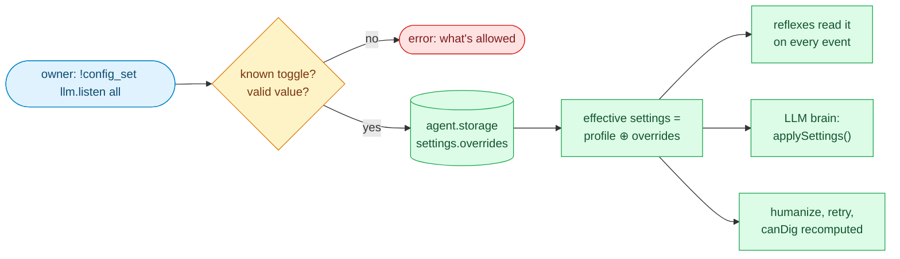

# Feature toggles (live config)

Some settings can be changed in game, while the bot runs, without a restart. Changes apply
immediately, survive restarts, and win over the [profile](/guide/profiles) until you reset them.

```
!config_list                          what can be changed, with current values (* = changed in game)
!config_get llm.listen                one setting and what it does
!config_set llm.listen all            change it (owners only)
!config_set reflexes.retreatBelow 6
!config_set retry.actions.goto 2
!config_reset llm.listen              back to the profile value
!config_reset                         undo every in-game change
```

Whispers work without the `!`. Only owners can change settings; LLM brains and other brains
can't change their own.

## What can be changed

| key | type | what |
|---|---|---|
| `canDig` | on/off | may break blocks and tunnel while pathing |
| `reflexes.selfDefense` | on/off | fight back when hit |
| `reflexes.autoEat` | on/off | eat when hungry |
| `reflexes.eatBelow` | 0–20 | eat when food drops below this |
| `reflexes.retreatBelow` | 0–20 | back off at or below this health (0 = stand ground) |
| `reflexes.waterFightAbove` | 0–20 | don't fight mobs in water below this health (0 = always fight) |
| `combat.adaptiveWeapon` | on/off | best weapon per target (damage × speed, enchantments, one-hit finishers, axe vs shields) |
| `combat.ranged` | on/off | bow/crossbow for flyers and targets out of reach, if it has arrows |
| `combat.shield` | on/off | raise a shield against ranged mobs between swings |
| `humanize.enabled` | on/off | player-like reaction and typing delays |
| `humanize.typoRate` | 0–1 | chance of a typo per message |
| `humanize.lowercase` | on/off | write chat in lower case |
| `humanize.pauseWhileTyping` | on/off | stand still while typing |
| `humanize.idleFidget` | on/off | look around when idle |
| `llm.listen` | mention / conversation / all | how it follows chat |
| `llm.immersive` | on/off | stay in character (reports stay truthful) |
| `llm.conversationMs` | ms | how long follow-ups don't need its name |
| `llm.aliases` | list | other names it answers to (`pax,p`) |
| `llm.budget.turnsPerHour` / `tokensPerHour` / `tokensPerDay` | number | LLM budgets |
| `llm.budget.maxToolCalls` | number | tool calls per turn |
| `llm.goals.maxTurns` / `timeoutMin` | number | how long goals run on their own |
| `llm.goals.ownerWaitMin` | minutes | after asking the owner, go on alone if no answer (0 = wait forever; default 15) |
| `pathfinder.thinkTimeoutMs` | 1000–60000 | how long the pathfinder may plan one path (default 10000); raise on a loaded machine, see [tool progression](./progression#speed) |
| `building` | library / creative / ask | reuse a saved [blueprint](/guide/goals-and-building#blueprint-format), design a new one, or let the owner pick (see [Blueprint libraries](./blueprints#building-policy)) |
| `retry.actions.<action>` | 0–10 | extra attempts after a failed action |

Behaviours have their own live commands: `!behavior_arm`, `!behavior_configure`,
`!behavior_disarm` (see [Behaviours](./behaviors)).

## How it works



From code: `agent.setToggle(key, value)`, `agent.resetToggle(key?)`, `agent.listToggles()`, and the
`settingsChanged` event. Add new toggles in `src/core/toggles.ts` (a key, a description, a zod
schema) and make the consumer read `agent.settings` when it acts, not once at startup.
