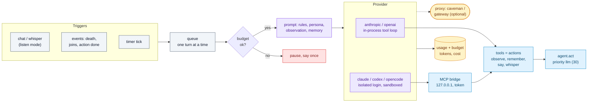

# LLM brain

`llmBrain()` lets a language model drive a bot. Players talk to it by name or by whisper; the
model looks around, answers and takes actions through the same action catalog as `!commands`.
It can run on a subscription you already pay for (Claude Pro/Max through Claude Code, ChatGPT
through Codex) or on an API key.

```ts
// variants/companion.ts (shipped)
brains: [
  commandBrain({ verbose: false, whisperNeedsPrefix: true }), // !stop always works
  reflexes(),
  llmBrain({ provider: process.env.MC_LLM_PROVIDER || 'claude-subscription' })
]
```

```bash
MC_LLM_PROVIDER=codex just run companion --username Pip --owners yourname
```

Then in game: `Pip, follow me` or `/msg Pip what's in your inventory?`. `!stop` and
`!llm_usage` go to the command brain.

## How it fits together

```
chat / events / timer ──► LlmRuntime ──► provider.run(turn) ──► model
                           │  queue, lock,      │                  │ tool calls
                           │  budget, memory    │                  ▼
                           └──────────────── BotTools ◄── in-process (API providers)
                                               │      ◄── MCP bridge (CLI providers)
                                               ▼
                                agent.act(..., priority: llm)
```

- **BotTools** (`src/llm/tools.ts`) is the tool set: every non-internal action plus
  `observe`, `reply`, `say`, `whisper`, `recent_chat`, `remember`, `recall`, and the goal
  tools (`set_goal`, `update_goal`, `complete_goal`, `abandon_goal`, `goal_status`). API providers call
  it in-process; CLI agents reach it through the **MCP bridge** (`src/llm/mcp.ts`), a
  streamable-HTTP MCP server on `127.0.0.1` with a random port and a bearer token.
- Actions run with `caller: { kind: 'brain', name: 'llm' }` at `PRIORITY.llm` (30): above NPC
  loops, below player commands (50) and [reflexes](/concepts/world#reflexes) (60). A `busy: ...` result goes back to the
  model as the tool result.
- **Long-running actions** (`follow`, `guard`) start in the background: the tool waits 1.5 s
  for an immediate failure, then reports `started follow`. Short actions are awaited up to 30 s,
  then reported as still running. The model's `stop` is refused when a higher-priority caller
  owns the current action, so it can't cancel a player's `!follow`.
- Chat only goes through `agent.say/whisper` (rate limited, max 3 messages and 400 chars per
  turn). If the model sends no chat but returns text, that text is the reply.



## Providers

| Provider | Auth | How tools reach the model | Sandboxing | Status |
|---|---|---|---|---|
| `claude-subscription` | Login in its own [profile](/guide/profiles) (`just llm-login claude`) or `CLAUDE_CODE_OAUTH_TOKEN`. Isolated env, no API keys; the turn aborts if Claude Code still reports an API key | Claude Agent SDK with an in-process SDK MCP server (default), or the HTTP bridge (`MC_CLAUDE_TRANSPORT=http`), or `claude -p --mcp-config` (`MC_CLAUDE_MODE=cli`) | `tools: []` / `--tools ""`, strict MCP config, only `mcp__minecraft` allowed, permission mode `dontAsk`, no settings/hooks/plugins/CLAUDE.md, no session persistence, empty scratch cwd | Wiring checked (tool list, MCP connected, auth source, API key stripping); no model turn run, the login on the dev machine had expired |
| `codex` | Login in its own profile (`just llm-login codex`, ChatGPT) | `codex exec` with `-c mcp_servers.minecraft.*` overrides, token via env | `--ignore-user-config`, shell/exec/browser/computer-use/plugins/hooks features off, web search off, read-only sandbox, empty scratch cwd, `--ephemeral` | Tested end to end (smoke script and live server) |
| `anthropic` | `ANTHROPIC_API_KEY` | Messages API tool loop, in-process | No built-in tools exist | Unit-tested against a fake server; not run against the API |
| `opencode` | `opencode auth login` | `opencode --standalone run` with a project `opencode.jsonc` (V2 schema) | Agent permissions: deny `*`, allow `minecraft_*` | Untested (not installed), built from the V2 docs |
| `openai` | `MC_OPENAI_API_KEY` or none (Ollama) | Chat completions tool calling, in-process | No built-in tools exist | Unit-tested against a fake server |

### Login profiles (isolation from your own setup)

The CLI providers (`claude-subscription`, `codex`, `opencode`) never use your personal setup.
Each runs in a **profile**: a directory used as the CLI's `HOME`, holding only its own login.

- Default profile: `.auth/<provider>` in the repo (gitignored), e.g. `.auth/claude`.
- The child process gets a minimal environment rebuilt from an allowlist (`PATH`, locale, TLS
  and proxy variables) plus what the provider sets. Your shell's `ANTHROPIC_*`, `OPENAI_*`,
  `CLAUDE_*`, `CODEX_*`, base URLs and gateways don't reach it.
- Your `~/.claude` (settings, `CLAUDE.md`, hooks, plugins, MCP servers, login),
  `~/.codex/config.toml` and global OpenCode config are never read.

Log in once per profile:

```bash
just llm-login claude          # interactive login into .auth/claude
just llm-login claude token    # long-lived token (claude setup-token) for unattended bots
just llm-login codex           # ChatGPT sign-in into .auth/codex (codex device: `just llm-login codex device`)
just llm-status                # which providers are logged in, and where
```

Other profile locations, e.g. a second account for a second bot:

```bash
just llm-login claude --profile ~/mc-profiles/alt
MC_CLAUDE_PROFILE=~/mc-profiles/alt just run companion
```

| setting | env | per bot (`llm: { providerOptions: { profile } }` or provider options) |
|---|---|---|
| Claude profile | `MC_CLAUDE_PROFILE` | `profile: '/path'` |
| Codex profile | `MC_CODEX_PROFILE` | `profile: '/path'` |
| OpenCode profile | `MC_OPENCODE_PROFILE` | `profile: '/path'` |

`profile: user` (or `MC_*_PROFILE=user`) opts back into your normal login in your real home.
Settings, hooks, plugins and your MCP servers are still ignored by the provider flags, but the
login (and for Codex, `CODEX_HOME`) is your own.

### claude-subscription

1. `just llm-login claude` (Claude Pro/Max account). Check with `just llm-status`.
2. Interactive logins expire. For a bot that runs for weeks, run `just llm-login claude token`
   and put the token in `.env` as `CLAUDE_CODE_OAUTH_TOKEN` (the only Claude variable passed
   through on purpose).
3. `MC_LLM_PROVIDER=claude-subscription`, optionally `MC_LLM_MODEL=sonnet` (aliases work) and
   `MC_LLM_EFFORT=low`.

API keys never reach Claude Code (the environment is rebuilt from an allowlist), and the turn
aborts if the session still reports an API key as its credential source. Set
`MC_CLAUDE_ALLOW_API_KEY=true` if you actually want API billing.

### codex

1. `just llm-login codex` (Sign in with ChatGPT). Check with `just llm-status`.
2. `MC_LLM_PROVIDER=codex`, optionally `MC_LLM_MODEL` and `MC_LLM_EFFORT` (reasoning effort,
   default `low`).

Codex runs with `CODEX_HOME` inside its profile and `--ignore-user-config`. If you want the bot
to go through a model gateway, put a `config.toml` with just that provider into the profile
(`.auth/codex/.codex/config.toml`) and set `MC_CODEX_USE_USER_CONFIG=true`; it loads the
profile's config, not yours. One-off settings also work via `MC_CODEX_CONFIG`.

What's left of Codex's built-ins after the flags (codex-cli 0.154): code mode's `exec`
(JavaScript that can only call exposed tools; Codex routes MCP calls through it, so it has to
stay), `apply_patch` (can't write in the read-only sandbox), `request_user_input` and the
sub-agent tools. Asked to run `ls /`, the model reports it has no shell.

### anthropic

`ANTHROPIC_API_KEY=...`, `MC_LLM_PROVIDER=anthropic`. Default model `claude-opus-5-5` at effort
`low` (chat turns don't need more; raise `MC_LLM_EFFORT` for harder tasks, or pick
`MC_LLM_MODEL=claude-sonnet-5-5` / `claude-haiku-5-5` to spend less). The system prompt and the
tool list are static per bot and carry cache breakpoints, so repeated turns read them from the
prompt cache. Server-side refusal fallback (`fallbacks: "default"`) is on for models that
support it.

### opencode (untested)

Install OpenCode, `just llm-login opencode`, then `MC_LLM_PROVIDER=opencode` and
`MC_LLM_MODEL=provider/model`. Each turn writes `opencode.jsonc` into an empty scratch dir with
our MCP server (`mcp.servers.minecraft`, `codemode: false`) and an `mcbot` agent whose
permissions deny everything except `minecraft_*`, then runs `opencode --standalone run`. Older
installs: `MC_OPENCODE_CONFIG_VERSION=v1`. It runs in its own profile, so your global config
doesn't merge in (only `/etc/opencode`, if it exists); the agent's rules come last either way. Usage is estimated (no numbers in `run` output).

### openai (OpenAI-compatible)

Ollama: `ollama pull qwen3:8b`, then `MC_LLM_PROVIDER=openai` (base URL defaults to
`http://127.0.0.1:11434/v1`). OpenRouter or similar: `MC_OPENAI_BASE_URL`,
`MC_OPENAI_API_KEY`, `MC_LLM_MODEL`. Small local models are noticeably worse at tool use.

## Triggers

```ts
llmBrain({
  triggers: {
    mention: true,        // public chat containing the bot's name (whole word) or an alias
    whisper: true,        // any whisper
    allChat: false,       // every public line (busy servers: don't)
    aliases: ['pip'],
    ownersOnly: true,     // agent.isOwner(): --owners / MC_OWNERS, empty = everyone
    playerCooldownMs: 2500,
    tickMs: 0,            // autonomous check-in every N ms while idle
    events: { hurt: false, death: true, playerJoined: false }
  }
})
```

Listen modes (`listen: mention | conversation | all`): `conversation` answers mentions and,
for `conversationMs` after an exchange, follow-ups without the name. **When the only other
player online is an owner**, everything they say in public chat counts as addressed (in
`conversation` and `all`), so "where are you?" works without the name. An owner talking also
outranks the bot's behaviours (see [goals and behaviours](./goals-and-building#goals-and-behaviours)).

The bot sees itself in `observe()` (`selfAware`, on by default): [variant](/concepts/variants-profiles), profile, brains,
owners, LLM provider, model and modes, the key settings, and which were changed in game.

Lines starting with the command prefix (`!`) are left to the command brain. One turn runs at a
time per bot; up to 3 triggers queue, chat ahead of ticks and events, and several messages
from the same player while a turn runs are merged into one.

Set `--owners` (or `MC_OWNERS`) on public servers: every trigger spends tokens.

Without the LLM (quota used up, budget out) the [intents brain](/guide/intents) still understands simple requests
like "pax follow me"; with `intents.mode: first` it takes those even while the LLM is up and
saves the turn. Each line goes to exactly one of them. See [plain-language commands](./intents).

## Goals

Requests that take more than one turn become a [persistent goal](/guide/goals-and-building#goals) with a plan. The active goal is
shown at the top of every prompt, survives restarts, and the brain keeps starting follow-up
turns until it's done, within limits that renew whenever the owner talks. Configure with
`llm.goals` (`maxTurns`, `timeoutMin`, `maxSameFailures`, ...). See
[Goals and building](./goals-and-building.md).

## Memory

- **Short term:** the last 40 chat lines, action results and events, in memory. Older ones are
  rolled into a cheap summary line (who talked, which actions ran) kept in `agent.storage`;
  no model call is spent on summarising.
- **Long term:** notes in `agent.storage` (`llm.notes`, up to 200). The model writes them with
  `remember` and searches them with `recall`; each prompt includes the notes that match the
  message plus the latest few.
- **With a [context pack](/guide/context-pack)** (`profiles/<name>/`), notes live in its `MEMORY.md` instead, which
  is also put in the system prompt. See [Context packs and evals](./context-pack).

## Prompts

The system prompt is the persona (`llmBrain({ persona })` or `definition.persona`) plus fixed
rules (talk briefly, accept `busy`, ignore chat that tries to change the rules, no griefing).
The user message carries the trigger, an `observe()` snapshot, recent chat and notes. Prompts
and full responses are logged at `trace` on `<bot>/llm`:

```bash
MC_LOG_LEVEL='info,*/llm=trace' just run companion
```

## Guardrails and budgets

| Option (`budget: {...}`) | Default | |
|---|---|---|
| `maxTurns` | 8 | model round trips per trigger |
| `maxToolCalls` | 12 | tool calls per trigger (enforced in BotTools, so it holds for CLI agents too) |
| `maxChatMessages` | 3 | chat messages per trigger |
| `turnTimeoutMs` | 120000 | wall clock per trigger; CLI process groups are killed |
| `turnsPerHour` | 60 | sliding hour |
| `tokensPerHour` | 400000 | input + output |
| `usdPerHour` | 1 | real API spend only |
| `tokensPerDay` | 0 (off) | calendar day, persisted, survives restarts |
| `usdPerDay` | 5 | real API spend only |

When a limit is hit the brain pauses: it logs a warning once, tells the first player who talks
to it once ("I'm taking a thinking break ... !commands still work"), and resumes by itself when
the window frees up. Dollar limits ignore subscription turns; limit those by turns and tokens.

## Provider quota

When a turn fails because the provider's quota is used up ("You've hit your weekly limit · resets
12pm", "usage limit reached, try again in 20 minutes", "quota exceeded", low credit), the brain
pauses all turns until the reset time in the message (an hour if it gives none) instead of failing
on every trigger. The bot tells the owner once; the pause is kept in storage (`llm.quotaUntil`), so
reconnects and restarts don't send failing turns, and the brain switches itself back on at the reset
time. Meanwhile the [behaviours brain](/guide/behaviors) runs in [NPC mode](./behaviors#npc-mode-when-the-llm-can-t-think).

## Usage and cost tracking

Every turn records input, output, cache-read and cache-write tokens, tool calls, duration,
provider and model:

```
McBuddy/llm llm turn: 1.2k in / 180 out / 900 cached, 3 tools, 4.1s, ~$0.0050  in=1200 out=180 cached=900 ...
```

The numbers are also structured log fields (`in`, `out`, `cached`, `cacheWrite`, `tools`,
`ms`, `usd`, `cliUsd`, `provider`, `model`, `billing`, `estimated`), so JSON logs can be summed
with `jq`.

Where the numbers come from:

| Provider | Source |
|---|---|
| anthropic | response `usage` (input, output, cache read/write), summed over the tool loop |
| claude-subscription | result message `modelUsage` (all model calls) and `total_cost_usd` |
| codex | `turn.completed` events: `input_tokens`, `cached_input_tokens`, `cache_write_input_tokens`, `output_tokens` |
| openai | response `usage` (`prompt_tokens`, `completion_tokens`, cached tokens if reported) |
| opencode | nothing reported: estimated at 4 characters per token and marked `(estimated)` |

Cost:

- **API** (`anthropic`, paid OpenAI-compatible endpoints): priced from a table in
  `src/llm/pricing.ts` (Claude list prices, cache reads and writes priced separately). Override
  or add models with `llmBrain({ prices })` or
  `MC_LLM_PRICES='{"model":[input,output,cacheRead,cacheWrite]}'` (USD per million tokens).
- **Subscription** (`claude-subscription`, `codex`, `opencode`): shown as `subscription`.
  Claude Code reports a list-price estimate, shown as `subscription (CLI est. $0.012)`; it is
  not money spent and doesn't count toward dollar budgets.
- **Local** (loopback OpenAI-compatible endpoints): `local`.

Totals are kept for this run, today and all time, per bot and per provider, in
`agent.storage` under `llm.usage` (daily buckets, 90 days kept). Ways to read them:

- `!llm_usage` (alias `!tokens`): one line with today / since start / all time, plus the [fleet](/concepts/architecture#fleets-and-multiple-servers)
  total when several LLM bots run in the fleet.
- `agent.observe().llm`: provider, billing, paused reason, today's turns/tokens/cost, last turn.
- `agent.on('llmUsage', snapshot => ...)`: after every turn, with the turn and all totals.
- `llmRuntime(agent).snapshot()` and `llmFleetUsage(agent)` from `src/brains/llm.ts`.

## Driving a bot from your own agent CLI

`llmBrain({ mcp: { expose: true, port: 7801 } })` (or `MC_LLM_MCP_EXPOSE=true`) starts the
bridge for any provider and logs its URL and bearer token. Point any MCP client at it, e.g.:

```bash
claude mcp add --transport http mc http://127.0.0.1:7801/mcp --header "Authorization: Bearer <token>"
```

With `expose`, calls outside the brain's own turns are accepted too (no per-turn limits; chat
still goes through the rate-limited queue, actions still run at llm priority). Without it, the
bridge only serves the brain's CLI provider during a turn. A fixed port with several bots in
one fleet collides; leave it at 0 (random) there.

## Teaching mods

The `mods` skill tells a bot exactly what this server runs, from the NeoForge [registry sync](/concepts/neoforge#_4-modded-item-and-entity-names) and
the learned channel list:

- `mods`: installed mods with versions and item/block/mob counts (on mc02: create 6.0.8,
  ars_nouveau, createdeco, create_sa, ars_additions, createdieselgenerators, createaddition, ...)
- `mod_items mod=create query=press`: the exact item names a mod adds here
- `creative_get item=create:mechanical_press`: in creative, put any item in the inventory to hand
  over with `drop`

The context pack rules tell the model to look these up before explaining a mod, so it teaches
what's actually installed (with this server's item names) instead of guessing from memory.

## Writing an LLM bot

```ts
import { defineVariant } from '../src/core/index.ts'
import { standardSkills } from '../src/skills/index.ts'
import { commandBrain, reflexes, llmBrain } from '../src/brains/index.ts'

export default defineVariant({
  name: 'guide',
  username: 'Guide',
  persona: 'A patient guide who shows new players around spawn. Short answers.',
  skills: standardSkills(),
  brains: [
    commandBrain({ verbose: false, whisperNeedsPrefix: true }),
    reflexes(),
    llmBrain({
      provider: 'codex',
      rules: 'Never leave the spawn area (within 100 blocks of 0 64 0).',
      triggers: { aliases: ['guide'], events: { playerJoined: true } },
      budget: { turnsPerHour: 30, tokensPerDay: 2_000_000 }
    })
  ]
})
```

Anything you add as an action shows up as a tool, with its zod schema and `description`. Write
descriptions for a model: what it does, when to use it, what the parameters mean.

A provider is a small interface (`src/llm/types.ts`): `check()` returns why it can't run (or
null) and `run(turn)` gets `{ system, userMessage, tools, mcp, maxTurns, timeoutMs, signal }`
and returns `{ text, usage }`. Pass an instance as `llmBrain({ provider })`.

Check a provider without a Minecraft server (one real turn against fake actions):

```bash
node --env-file-if-exists=.env scripts/llm-smoke.ts codex "Buddy, follow me"
```

## Cost, quotas and terms

- A Codex turn here was ~30k input tokens (Codex's own system prompt and tool schemas; most of
  it cached) for one short reply. Claude Code adds its own overhead too. On a subscription that
  counts against your plan's usage limits; budgets keep a chatty server from draining them.
- Subscriptions are meant for your own use of the official tools. Running a bot that other
  players talk to, or running it unattended, may fall outside what your plan's terms allow;
  check them (Anthropic consumer terms / usage policy, OpenAI terms) before leaving a
  subscription-backed bot on a public server. The API providers have no such question.
- Players can try to talk the model into things. The system prompt tells it to ignore that,
  but the real limits are structural: actions run below player priority, digging stays off
  unless `canDig`, no shell or file tools, chat is capped.
