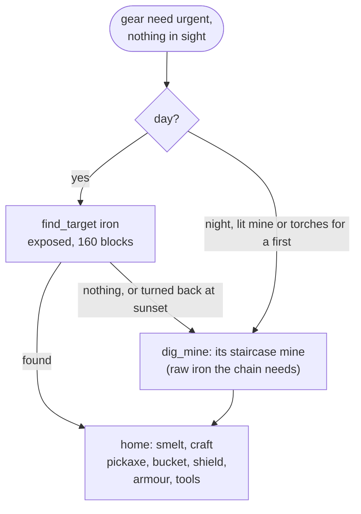

# Needs, site health and idle modes

A bot left alone used to go idle whenever its world changed. Pax's farm at 561 62 -20 became part
of a frozen lake, so the farm planner found 0 cells of work forever while 35 seeds sat in the
pantry. It never got iron armour because it only mined ore it could already see. With nothing
to do, it stood there. Every earlier fix was a Minecraft patch for one case; this page describes
the one mechanism that replaced them:

- **Needs**: standing drives (stay safe, stay fed, gear up, keep the base supplied, rest). The
  behaviours serving an urgent need score higher, and a need nothing in sight can meet starts a
  bounded **search**.
- **Site health**: the places the bot depends on (farm, bed, chests, home) are checked when it is
  near them; bad ones are marked, replaced or reported, and looked at again later.
- **Idle modes**: what it does when nothing needs doing, from standing still to chores and
  scouting trips.

It runs inside the [NPC controller](./npc-brain.md) that also runs [armed behaviours](./behaviors.md),
so it works with any [profile](/guide/profiles) that uses the [behaviours brain](/guide/behaviors). Nothing new holds the body: the
search and the chores are ordinary behaviours (`need:gear`, `idle:tidy_storage`), with the same
failure back-off, back-off from players and LLMs, [action lock](/concepts/architecture#the-action-lock-and-priorities) and [help desk](./behaviors#asking-for-help).

## How it fits the controller


The fallbacks only run when no regular behaviour scores above the idle band (wander, idle_look
and the like stay below it). As soon as real work scores (an owner to follow, ore in sight, a
hostile), the chore or search drops out and that behaviour takes over.

## Needs

| need | urgency (Minecraft) | serving behaviours | search |
|---|---|---|---|
| `safety` | the blackboard's danger, or low health (8 or less) | stay_safe, avoid_mobs, bodyguard, guard_owner | - |
| `food` | the hunger need (food bar) | keep_fed, farm_setup, farm_loop | - (keep_fed has its own food ladder) |
| `gear` | no weapon or pickaxe 0.8, a pickaxe below the target tier 0.5, other tools 0.35, armour 0.3 + 0.075 per missing slot, a bucket 0.35 (0.6 while the blackboard need `bucket` is set), a shield 0.3 | keep_tools_upgraded | iron ore with an open face, else its staircase mine |
| `supplies` | wood under half of chop_wood_loop's `keep` 0.4 (none 0.6), stored food under `inventoryMemory.lowFood` 0.5, a farm with under 4 seeds 0.3 | chop_wood_loop, deposit_when_full, check_storage, farm_setup | - |
| `rest` | night: 0.8 away from home, 0.5 at home; dusk: half the tiredness | sleep_at_night, keep_spawn_bed, return_home | - |

"Geared up" is keep_tools_upgraded's target when it is armed (Pax: iron tools, a bucket, a shield
and iron armour), otherwise iron tools. A need is **active** when one of its serving behaviours is in the set, or
when the profile switches it on (`needs: { gear: true }`); `false` switches it off.

While an active need's urgency is at or above its `threshold` (0.5), every serving behaviour that
already scores gets `boost x urgency` (15 at urgency 1), never up to the urgent band (80). Two
needs on one behaviour: the larger boost counts.

### Going looking

The gear search runs when the gear need is urgent, keep_tools_upgraded scores 0 (nothing it can
do from here: no ore in sight, or safe mining said not ready for the deep ore), nothing else
scores above 15, it is day (or night with a lit mine, below), the bot has a stone pickaxe or
better, digging is on and iron (tools, armour, a bucket, a shield) is what is missing:

1. by day, a [trip](./behaviors#trips): food from the pantry, a weapon, enough health; turned back when
   food or daylight runs short, and `find_target iron exposed=true go=true` within
   `needs.search.radius` (160) blocks and `minutes` (6): what it sees, then `found:iron` from
   memory, then a spiral scout on the surface that skips [protected areas](/concepts/world#protected-areas), danger zones and water.
   Only ore with an open face within `mining.safeDepth` (8) of the surface counts (a cliff, a
   shallow cave), so it is ore it may mine. Found: `upgrade_tools` there under the
   [safe-mining](./progression#safe-mining) rules, then home. Skipped once its mine reached depth;
2. nothing found (or skipped), and a mine trip is due (`mine.enabled`, `mine.cooldownMinutes` since the
   last one): home, `prepare_trip` (pantry food, a weapon), a tree when it holds less than 3 logs'
   worth of wood (the spare pickaxe, sticks for torches and a crafting table come from it), then
   [`dig_mine`](./progression#the-staircase-mine) for the raw iron the [iron chain](./progression#the-iron-chain)
   still needs (3 to 32): its staircase mine near home, down to y 16, branches, the ore in the walls,
   back up;
3. home, and `upgrade_tools` with keep_tools_upgraded's target: smelt (furnace by home) and craft
   pickaxe, bucket, shield, armour, tools.

A running search **holds** its slot: it keeps `needs.search.holdScore` (30) against other work, so
only a behaviour scoring 40 or more (the hold plus the switch margin of 10) takes over: a full
inventory (deposit_when_full 45), real hunger, a fight, danger, wood when there is none at all.
Passing work doesn't: drops to pick up (22), a farm or seed chore (21 to 30), lighting (18), the
storage check (14). Before, the search only ran while nothing scored above the idle band (15), so
any of those ended it. Pax's gear search started every 5 minutes for a day and a half and was cut
short after 5 to 78 seconds, dozens of times in a row, by collect_drops, the farm and seed chores and
its eat reflex; the base project then took the slot until the next try. `holdScore: 0` gives the old
rule.

From the walk home before the mine to the crafting after it the search is **committed**
(`NeedSearch.committed`): it keeps a score of 45 against ordinary work (chop_wood_loop 30 to 38,
keep_tools_upgraded 28, which also leaves a running gear search alone so the first raw iron
doesn't pull it out), while danger and real hunger still take over. Before, any tree to fell ended
the search on its walk home.

At night the search may still run when it knows a lit mine near home and `mine.atNight` is on, or
knows no mine yet and has torches for a first one (`mine.startAtNight`)
(`NeedSearch.night`); then it skips the surface leg and goes down the mine.



What it found stays remembered as `found:iron` and is checked first next time. Each need searches
at most once every `cooldownMinutes` (30) and `perDay` (6) times a day; the searches are kept in
storage (`needs.searches`). A search that other work takes over in its first minute (farm work, a
bed, a reflex), or that a restart left unfinished, is cut short: it doesn't count towards either
limit and the search may run again after `retryMinutes` (5). A search cut short because the body
was taken (a reflex eating or fighting, a player's order) is no real try however long it ran: it
starts again as soon as the controller's back-off ends, up to `resumes` (3) times per
`cooldownMinutes`, then the retry gap applies. Pax lost whole days of gear searches
before that rule: six 160-block searches were taken over after 3 to 17 seconds, used up the day's
six, and the only thing left looking for iron was the `scout_nearby` chore, which looks within
twice `idle.radius` (48 blocks).

### What took over

Whatever ends a search early is written down. The controller aborts a replaced behaviour with
"replaced by `<behaviour>` (`<why>`)" and a yield with "yield to `<caller>` (`<action>`)"; the layer
stores that on the search record (`by`, `why`, `resume` in `needs.searches`) and logs it at info:

```
need:gear taken over after 12s by pickup_items: pickup_items 45 > need:gear 30
need:gear search cut short after 12s by pickup_items (pickup_items 45 > need:gear 30), again in 5 min
need:gear search cut short after 31s by reflex:reflexes (eat) (the body was taken), may start again at once
```

`just status` shows the newest search and the last behaviour taken over under the decider:

```
  behaviors idle 20s: ...
            search: gear 4m ago, cut short after 12s by pickup_items (pickup_items 45 > need:gear 30)
            taken over: need:gear after 12s by pickup_items (pickup_items 45 > need:gear 30), 4m ago
```

## Site health

| site | checked when | bad when | then |
|---|---|---|---|
| farm (`farm:N`) | within 64 blocks and loaded | half the field is water or ice, or the water froze (flooded); no farmland and nothing to till (no work, 3 checks in a row); "couldn't get to farm:N" 3 times (unreachable) | dropped from the farm list and its place: keep_fed and farm_setup start a new farm near home |
| spawn bed | within 64 blocks | the bed is gone | keep_spawn_bed puts a new one down |
| own and configured chests | within 64 blocks | no chest, barrel or shulker box there | deposit_when_full places a new one when needed; configured ones are left to the owner |
| home | within 64 blocks | lava (unsafe), under water (flooded), buried | the owner is told; home stays where they set it |
| mine (`mine:N`) | within 48 blocks | water in the first stair steps (flooded), lava (unsafe), the stairs filled in (gone); the walk down failed 3 times (unreachable) | skipped; the next trip digs a new one |

Flooded, gone and unsafe mark a site bad at once; unreachable and no work after `sites.failures`
(3) checks in a row, each site checked at most every `sites.checkMinutes` (5). A bad site is kept
in `agent.storage` (`sites`) with the reason and time, written to the [journal](./journal) as a
`site` event (`!recall_events type=sites`), and with `sites.tell` the owners online get one
whisper: "my farm farm:1 at 561 62 -20 is no good: 60 of 80 cells are water or ice; dropped it, a
new farm goes near home". Bad sites are looked at again every `sites.recheckHours` (6) when the
bot is near; when a player fixed it, it is ok again ("looks fine again") and a dropped farm goes
back on the list.

A new farm (`start_farm`) never goes within a bad farm's plot plus 8 blocks, on cells without sky
light (under a roof), or next to lava; the protected-area and spawn-clearance rules stay. Water in a
cold biome is used only when it can be kept open ([farming on cold ground](#farming-on-cold-ground)).
Its name skips the names bad farms still have.

A farm remembers which cells of its square were land when it was made (`land` in the farm record).
The flood check counts only those cells, so a shore farm with the lake on one side is not
"flooded" from its first check, which is what happened to Pax's farm:1. A frozen centre still makes
it bad ("the water froze"). Older farms without the record are judged on the dry field left: half
the square wet counts only when fewer than 8 dry cells remain (Pax's farm:1 had 34 left and was a
false alarm). What happens to a bad farm next (repaired where it is, or a new one elsewhere) is
`farming.badFarm`, see [Food sources](./food-sources#bad-farms-repair-or-move).

## Farming on cold ground

Pax's home is on snowy ground by a frozen lake, and it had no bucket. `start_farm` found no water
that wouldn't freeze, so food never got past the bread in the pantry. Now it works with the 1.21.1
rules (`src/skills/coldFarmPlan.ts`, checked against the game code and the wiki):

| rule | 1.21.1 |
|---|---|
| ice broken without Silk Touch | becomes a water source when the block under it blocks movement or is a fluid; over air it just vanishes; in the Nether never water. A bare hand works too |
| ice melting | on a random tick when the block light next to it is above 11 (a torch 1 to 2 blocks away), in any biome; sky light doesn't count. Slow (about a minute per block), so it is not used to get water |
| water freezing | only in a cold biome, when the water is the top block under the sky, its block light is below 10 and a non-water block is next to it |
| what stops it | anything that blocks movement over the water (a block or a slab), or a torch close enough (light 14 at the torch, one less per block: on the shore cell next to the water it gets 12) |
| crops | grow in snowy biomes with light 9+ and wet farmland; snow never settles on farmland or crops |

What `start_farm` tries, in order:

1. Open shore water near home, as before. In a cold biome it is kept open (step 4).
2. A water spot it saw while scouting.
3. A frozen shore (`farming.iceWater`): surface ice with land next to it, open above (air or snow,
   no roof), water or ground under it, within the radius and then out to 96 blocks. Sites are
   scored like water sites, with the ice counted as the lake. Protected areas, spawn clearance,
   somebody's builds, bad farm sites and lava still rule a site out. Standing on the shore, it
   breaks the centre ice with a tool without Silk Touch (or a bare hand) and checks that water came.
4. Keeping the water open (`farming.protectWater`):
   - `auto` (the default): a cheap block (dirt, cobblestone, andesite...; 2 needed, from its
     chests when it carries none) goes over the water. Open water has no face to place it
     against, so it first puts a helper block on the shore cell next to it and digs that back
     afterwards.
   - Without blocks, a torch on that shore cell. That cell is then not tilled.
   - With neither, it digs two dirt from just outside the plot (when digging is allowed) and
     covers the water with one.
   - `cover` or `torch` uses only that one. `off` never uses water that would freeze.
5. With a bucket (or once one exists): a poured water hole in flat grass, kept open the same way
   in the cold.

Seeds come from its own chests first, then from grass. The farm record says where its water came
from (`water: natural | ice | bucket`) and what keeps it open (`keptOpen: cover | torch`). It is
checked by site health like any farm: if the cover is broken and the water freezes, the farm is
marked bad and a new one is made.

The farm plot its base keeps free inside the walls is a farm too now (`plot_farm`): water in reach
or carried ice, else a dry plot under torchlight, see [Food sources](./food-sources#the-base-s-farm-plot).

## Idle modes

| mode | what it does when nothing else scores |
|---|---|
| `off` | nothing (stands still, as before) |
| `passive` | looks around now and then |
| `idle` | (default) passive, plus: a short stroll near home by day, back home when further than `idle.radius`, waiting by the bed at night |
| `active` | idle, plus chores near home: tidy storage, top up wood and seeds, extend the farm, craft spares, light dark spots, scout for ore |
| `explore` | active, plus scouting trips out to `idle.exploreRadius` that come home |

Productive chores (higher modes) come first, then the one that ran least recently; each has a
cooldown and only runs when it would do something.

| chore | mode | when | cooldown | what |
|---|---|---|---|---|
| `look_around` | passive | any | 20 s | glance around, at players close by |
| `go_home` | idle | any | 1 min | back home when further than the radius |
| `stroll` | idle | day | 2 min | a short walk near home (`wander`, at most 8 blocks) |
| `rest_by_bed` | idle | night | 1 min | home, then wait by the bed |
| `tidy_storage` | active | day | 10 min | deposit_when_full's run once the inventory is half full |
| `top_up_wood` | active | day | 10 min | fell a tree near home with fewer than 16 logs |
| `top_up_seeds` | active | day | 15 min | break grass for seeds while it has fewer than 16 (carried and in its chests), farm or not |
| `extend_farm` | active | day | 10 min | tend_farm when there is work, start_farm with 8+ seeds and no farm |
| `craft_spares` | active | any | 10 min | torches up to 16, a second stone pickaxe |
| `light_dark_spots` | active | day | 30 min (quiet 4 h) | `light_up` around home, 8 torches at most |
| `scout_nearby` | active | day | 30 min | `find_target` iron, then coal, within twice the radius, while it doesn't know where they are |
| `explore` | explore | day | 20 min | a trip to `idle.exploreRadius` for iron, coal, a village, diamonds it doesn't know of yet |
| `base_project` | active | any | 1 min | one [base projects](./base-projects) session (or a proposal to the owners); sticky; at night only inside finished, lit walls |

A chore marked sticky (`base_project`) keeps the body once it runs when another behaviour climbs
just above the idle band (drops to pick up, scoring 22): only one that beats it by the switch
margin takes over. Plain chores give way as soon as anything scores.

Every chore takes `true`/`false` or `{ enabled, radius, when: day | night | any, hours: [from, to],
cooldownMinutes, quietMinutes }`. Hours are the game clock: 0 is midnight, 6 sunrise, 18 sunset;
`[22, 4]` wraps past midnight.

A run can find nothing to do: a dark-spot pass that placed no torch, a scout that found no ore, a
seed run with no grass, or tidying that stored nothing. The chore then waits `quietMinutes`, not its
cooldown. The default is three cooldowns and at least 30 minutes; light_dark_spots waits 4 hours.
That way one chore that keeps finding nothing doesn't take every slot.

Whether a chore has work is one pure function, `choreIdle` in `src/skills/needPlan.ts`
(`test/idle-chores.test.ts` runs it with Pax's conditions). When nothing runs, the status says why
each chore was passed over:

```
IDLE: idle (active): tidy_storage not needed (nothing to store yet), top_up_wood not needed (20 logs, enough),
  top_up_seeds not needed (35 seeds, enough), extend_farm again in 8m, craft_spares not needed (nothing spare
  to craft from what it carries), light_dark_spots not needed (no torches, coal or charcoal)
```

### Why Pax stood around

With `idle: active`, snowy ground, a frozen farm, full chests, 35 seeds in the pantry, stone tools
and no coal, every chore had a reason to do nothing:

| chore | why it did nothing | now |
|---|---|---|
| `extend_farm` / farm_setup | no farm; `start_farm` failed every time (no water that doesn't freeze, no bucket), so both cooled down for up to 30 min | a frozen-shore farm without a bucket (above) |
| `top_up_seeds` | waited for a farm, while the farm waited for seeds | runs with no farm; start_farm takes the pantry's seeds |
| `stroll` | `wander` took the top-most ground at each spot: the house roof and the walls, unreachable ("found nowhere to wander to") | takes the ground nearest the bot's height, then closer spots |
| `light_dark_spots` | no torches or coal; light_home said the 9 dark spots took no torch, because 283 cells had a snow layer | a single snow layer takes a torch; a pass that lights nothing waits 4 h |
| `tidy_storage`, `top_up_wood`, `craft_spares` | nothing to store, 16+ logs, nothing spare to craft (no coal) | correct; the status now says so |
| `scout_nearby` | ran every 30 min and found nothing in reach | a scout that finds nothing waits its quiet pause |

Coal (torches) and the bucket come from mining and smelting, which belong to the gear and
progression work, not to idle.

## Configuration

```yaml
# profiles/pax.yaml
idle: active                      # or { mode: active, radius: 24, chores: { ... } }

# all the options, with their defaults
settings:
  farming: { iceWater: true, protectWater: auto }   # cold ground: ice for water, keep it open (auto | cover | torch | off)
needs:
  enabled: true
  boost: 15                       # added at urgency 1
  search: { enabled: true, radius: 160, minutes: 6, cooldownMinutes: 30, retryMinutes: 5, perDay: 6, holdScore: 30, resumes: 3, atNight: false }
  gear: { threshold: 0.5 }        # enabled (unset = automatic), threshold, boost, search, radius, minutes
  rest: false                     # a need switched off
idle:
  mode: idle                      # off | passive | idle | active | explore
  radius: 24
  exploreRadius: 200
  exploreMinutes: 8
  chores:
    scout_nearby: false
    light_dark_spots: { hours: [8, 16], radius: 16 }
sites:
  enabled: true
  failures: 3
  checkMinutes: 5
  recheckHours: 6
  replace: true
  tell: true
```

Live, without a restart ([feature toggles](./live-config)):

```
!config_set idle.mode explore
!config_set idle.chores.scout_nearby off
!config_set needs.gear.threshold 0.3
!config_set needs.search.radius 96
!config_set sites.recheckHours 2
!config_set farming.protectWater torch
!config_set farming.iceWater off
```

`needs: false`, `idle: off` and `sites: false` switch each part off. A brain without the layer:
`behaviorsBrain({ needs: false })`.

## Seeing it work

- `!behavior_status` ends with `top need gear 0.6 (urgent), idle mode active, because ...`, and
  `!npc_status` / the [status view](./status) show the need, the goal, why it runs what it runs and
  the last progress (`controller.snapshot()`: `need`, `needUrgency`, `urgent`, `goal`, `reason`,
  `lastProgressAt`, `idleMode`, `chore`).
- The idle report (debug, every 2 minutes of nothing) names the top need and the idle mode.
- `!recall_events type=sites` lists sites that went bad or came back.

## For another game

The layer only talks to a `NeedsProvider` (`src/brains/npc/needs.ts`): `needs` (name, urgency,
servedBy, an optional `search`), `chores` (mode, window, cooldown, `applicable`, `run`), `sites`
(probes with `list`, `check`, `onBad`, `onRecovered`), `clock` and `siteFromFailure`. The Minecraft
one is `src/adapters/minecraft-java/needs/`; the pure parts are `planNeeds` and `pickChore`
(`test/needs.test.ts`) and `src/skills/needPlan.ts` (`test/need-plan.test.ts`).

## Benchmark

`just survival-bench --scenario ice --bad-farm --kit stone` starts the test bot (never Pax) with a
farm remembered under the start, which on the ice scenario is frozen over; the result line has the
site events (`sites`), the searches (`searches`), the chores that ran (`choresRun`) and the farms it
knows at the end (`farmsAtEnd`). See [Survival benchmark](./behaviors#survival-benchmark-just-survival-bench).

First run (2026-11-25, `--scenario ice --bad-farm --kit stone --minutes 15`, tag `needs-ice`): on
the first check farm:1 was marked flooded ("55 of 80 cells are ice") and dropped. A new farm
never got started: the snowy beach has no water that doesn't freeze and the bot had no bucket,
so after 3 tries over 15 minutes the help desk whispered the owner "Water near home would help".
The gear search started with no iron in sight and turned back on daylight (25 s left, 17 blocks
from home). Chores that ran: top_up_wood, scout_nearby. The bot then spent five minutes in the air
reflex in the frozen lake and died four times at night (creepers, zombies) with stone tools and no
shelter. That makes the ice start a hard case for the air reflex and for night safety, separate from
this layer.
