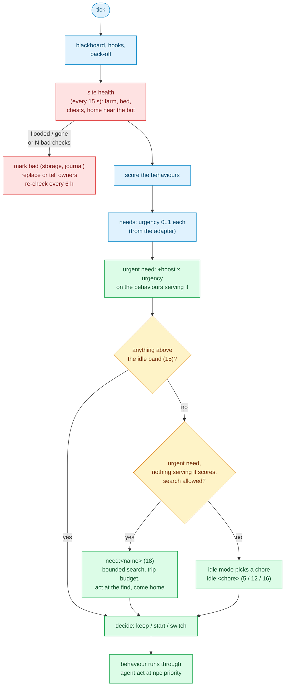

# Needs, site health and idle modes

A bot left alone used to go idle whenever its world changed. Pax's farm at 561 62 -20 became part
of a frozen lake, so the farm planner found 0 cells of work forever while 35 seeds sat in the
pantry. It never got iron armour because it only mined ore it could already see. With nothing
to do, it stood there. Every earlier fix was a Minecraft patch for one case; this page describes
the one mechanism that replaced them:

- **Needs**: standing drives (stay safe, stay fed, gear up, keep the base supplied, rest). The
  behaviours serving an urgent need score higher, and a need nothing in sight can meet starts a
  bounded **search**.
- **Site health**: the places the bot depends on (farm, bed, chests, home) are checked when it is
  near them; bad ones are marked, replaced or reported, and looked at again later.
- **Idle modes**: what it does when nothing needs doing, from standing still to chores and
  scouting trips.

It runs inside the [NPC controller](./npc-brain.md) that also runs [armed behaviours](./behaviors.md),
so it works with any profile that uses the behaviours brain. Nothing new holds the body: the
search and the chores are ordinary behaviours (`need:gear`, `idle:tidy_storage`), with the same
failure back-off, back-off from players and LLMs, action lock and [help desk](./behaviors#asking-for-help).

## How it fits the controller



The fallbacks only run when no regular behaviour scores above the idle band (wander, idle_look
and the like stay below it). As soon as real work scores (an owner to follow, ore in sight, a
hostile), the chore or search drops out and that behaviour takes over.

## Needs

| need | urgency (Minecraft) | serving behaviours | search |
|---|---|---|---|
| `safety` | the blackboard's danger, or low health (8 or less) | stay_safe, avoid_mobs, bodyguard, guard_owner | - |
| `food` | the hunger need (food bar) | keep_fed, farm_setup, farm_loop | - (keep_fed has its own food ladder) |
| `gear` | no weapon or pickaxe 0.8, a pickaxe below the target tier 0.5, other tools 0.35, armour 0.3 + 0.075 per missing slot | keep_tools_upgraded | iron ore with an open face |
| `supplies` | wood under half of chop_wood_loop's `keep` 0.4 (none 0.6), stored food under `inventoryMemory.lowFood` 0.5, a farm with under 4 seeds 0.3 | chop_wood_loop, deposit_when_full, check_storage, farm_setup | - |
| `rest` | night: 0.8 away from home, 0.5 at home; dusk: half the tiredness | sleep_at_night, keep_spawn_bed, return_home | - |

"Geared up" is keep_tools_upgraded's target when it is armed (Pax: iron tools and iron armour),
otherwise iron tools. A need is **active** when one of its serving behaviours is in the set, or
when the profile switches it on (`needs: { gear: true }`); `false` switches it off.

While an active need's urgency is at or above its `threshold` (0.5), every serving behaviour that
already scores gets `boost x urgency` (15 at urgency 1), never up to the urgent band (80). Two
needs on one behaviour: the larger boost counts.

### Going looking

The gear search runs when the gear need is urgent, keep_tools_upgraded scores 0 (nothing it can
do from here: no ore in sight, or safe mining said not ready for the deep ore), nothing else
scores above 15, it is day, the bot has a stone pickaxe or better and digging is on:

1. a [trip](./behaviors#trips): food from the pantry, a weapon, enough health; turned back when
   food or daylight runs short;
2. `find_target iron exposed=true go=true` within `needs.search.radius` (160) blocks and
   `minutes` (6): what it sees, then `found:iron` from memory, then a spiral scout on the surface
   that skips protected areas, danger zones and water. Only ore with an open face counts;
3. `upgrade_tools` at the find, under the [safe-mining](./progression#safe-mining) rules (deeper
   than `mining.safeDepth` only when ready), with the air reflex and climb-out as always;
4. `go_home`.

What it found stays remembered as `found:iron` and is checked first next time. Each need searches
at most once every `cooldownMinutes` (30) and `perDay` (6) times a day; the searches are kept in
storage (`needs.searches`).

## Site health

| site | checked when | bad when | then |
|---|---|---|---|
| farm (`farm:N`) | within 64 blocks and loaded | half the field is water or ice, or the water froze (flooded); no farmland and nothing to till (no work, 3 checks in a row); "couldn't get to farm:N" 3 times (unreachable) | dropped from the farm list and its place: keep_fed and farm_setup start a new farm near home |
| spawn bed | within 64 blocks | the bed is gone | keep_spawn_bed puts a new one down |
| own and configured chests | within 64 blocks | no chest, barrel or shulker box there | deposit_when_full places a new one when needed; configured ones are left to the owner |
| home | within 64 blocks | lava (unsafe), under water (flooded), buried | the owner is told; home stays where they set it |

Flooded, gone and unsafe mark a site bad at once; unreachable and no work after `sites.failures`
(3) checks in a row, each site checked at most every `sites.checkMinutes` (5). A bad site is kept
in `agent.storage` (`sites`) with the reason and time, written to the [journal](./journal) as a
`site` event (`!recall_events type=sites`), and with `sites.tell` the owners online get one
whisper: "my farm farm:1 at 561 62 -20 is no good: 60 of 80 cells are water or ice; dropped it, a
new farm goes near home". Bad sites are looked at again every `sites.recheckHours` (6) when the
bot is near; when a player fixed it, it is ok again ("looks fine again") and a dropped farm goes
back on the list.

A new farm (`start_farm`) never goes within a bad farm's plot plus 8 blocks, on water in a biome
cold enough to freeze, on cells without sky light (under a roof), or next to lava or ice; the
protected-area and spawn-clearance rules stay. Its name skips the names bad farms still have.

## Idle modes

| mode | what it does when nothing else scores |
|---|---|
| `off` | nothing (stands still, as before) |
| `passive` | looks around now and then |
| `idle` | (default) passive, plus: a short stroll near home by day, back home when further than `idle.radius`, waiting by the bed at night |
| `active` | idle, plus chores near home: tidy storage, top up wood and seeds, extend the farm, craft spares, light dark spots, scout for ore |
| `explore` | active, plus scouting trips out to `idle.exploreRadius` that come home |

Productive chores (higher modes) come first, then the one that ran least recently; each has a
cooldown and only runs when it would do something.

| chore | mode | when | cooldown | what |
|---|---|---|---|---|
| `look_around` | passive | any | 20 s | glance around, at players close by |
| `go_home` | idle | any | 1 min | back home when further than the radius |
| `stroll` | idle | day | 2 min | a short walk near home (`wander`, at most 8 blocks) |
| `rest_by_bed` | idle | night | 1 min | home, then wait by the bed |
| `tidy_storage` | active | day | 10 min | deposit_when_full's run once the inventory is half full |
| `top_up_wood` | active | day | 10 min | fell a tree near home with fewer than 16 logs |
| `top_up_seeds` | active | day | 15 min | break grass for seeds when its farm has fewer than 16 |
| `extend_farm` | active | day | 10 min | tend_farm when there is work, start_farm with 8+ seeds and no farm |
| `craft_spares` | active | any | 10 min | torches up to 16, a second stone pickaxe |
| `light_dark_spots` | active | day | 30 min | `light_up` around home, 8 torches at most |
| `scout_nearby` | active | day | 30 min | `find_target` iron, then coal, within twice the radius, while it doesn't know where they are |
| `explore` | explore | day | 20 min | a trip to `idle.exploreRadius` for iron, coal, a village, diamonds it doesn't know of yet |

Every chore takes `true`/`false` or `{ enabled, radius, when: day | night | any, hours: [from, to],
cooldownMinutes }`. Hours are the game clock: 0 is midnight, 6 sunrise, 18 sunset; `[22, 4]`
wraps past midnight.

## Configuration

```yaml
# profiles/pax.yaml
idle: active                      # or { mode: active, radius: 24, chores: { ... } }

# all the options, with their defaults
needs:
  enabled: true
  boost: 15                       # added at urgency 1
  search: { enabled: true, radius: 160, minutes: 6, cooldownMinutes: 30, perDay: 6, atNight: false }
  gear: { threshold: 0.5 }        # enabled (unset = automatic), threshold, boost, search, radius, minutes
  rest: false                     # a need switched off
idle:
  mode: idle                      # off | passive | idle | active | explore
  radius: 24
  exploreRadius: 200
  exploreMinutes: 8
  chores:
    scout_nearby: false
    light_dark_spots: { hours: [8, 16], radius: 16 }
sites:
  enabled: true
  failures: 3
  checkMinutes: 5
  recheckHours: 6
  replace: true
  tell: true
```

Live, without a restart ([feature toggles](./live-config)):

```
!config_set idle.mode explore
!config_set idle.chores.scout_nearby off
!config_set needs.gear.threshold 0.3
!config_set needs.search.radius 96
!config_set sites.recheckHours 2
```

`needs: false`, `idle: off` and `sites: false` switch each part off. A brain without the layer:
`behaviorsBrain({ needs: false })`.

## Seeing it work

- `!behavior_status` ends with `top need gear 0.6 (urgent), idle mode active, because ...`, and
  `!npc_status` / the [status view](./status) show the need, the goal, why it runs what it runs and
  the last progress (`controller.snapshot()`: `need`, `needUrgency`, `urgent`, `goal`, `reason`,
  `lastProgressAt`, `idleMode`, `chore`).
- The idle report (debug, every 2 minutes of nothing) names the top need and the idle mode.
- `!recall_events type=sites` lists sites that went bad or came back.

## For another game

The layer only talks to a `NeedsProvider` (`src/brains/npc/needs.ts`): `needs` (name, urgency,
servedBy, an optional `search`), `chores` (mode, window, cooldown, `applicable`, `run`), `sites`
(probes with `list`, `check`, `onBad`, `onRecovered`), `clock` and `siteFromFailure`. The Minecraft
one is `src/adapters/minecraft-java/needs/`; the pure parts are `planNeeds` and `pickChore`
(`test/needs.test.ts`) and `src/skills/needPlan.ts` (`test/need-plan.test.ts`).

## Benchmark

`just survival-bench --scenario ice --bad-farm --kit stone` starts the test bot (never Pax) with a
farm remembered under the start, which on the ice scenario is frozen over; the result line has the
site events (`sites`), the searches (`searches`), the chores that ran (`choresRun`) and the farms it
knows at the end (`farmsAtEnd`). See [Survival benchmark](./behaviors#survival-benchmark-just-survival-bench).
