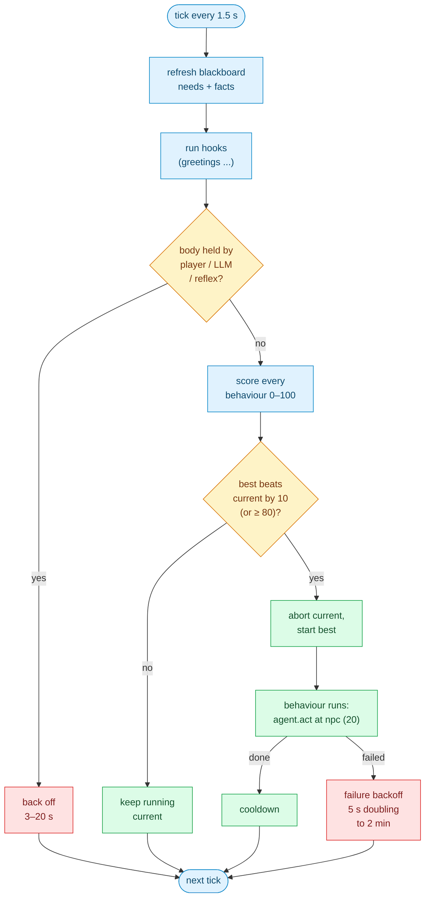

# NPC brain

`npcBrain()` (src/brains/npc/) makes a bot live on its own: wander near home, go back at
night, sleep, eat, deal with mobs, notice players, do chores when it has the skills. It is a
utility-AI loop you configure with behaviours. For behaviours that owners and LLMs switch on and tune at runtime, see [Behaviours](behaviors.md), which runs on the same controller. `variants/villager.ts` is the worked example. For brains in general see [Writing brains](writing-brains.md).

```ts
import { npcBrain, wander, goHome, sleepAtNight, fleeOrFight, greetPlayers, actionBehavior } from '../src/brains/npc/index.ts'

brains: [
  commandBrain(),          // players can still command it (player priority beats npc)
  reflexes(),              // fight back when hit, eat
  npcBrain({
    behaviors: [fleeOrFight(), sleepAtNight(), goHome(), wander({ radius: 12 })],
    hooks: [greetPlayers({ chance: 0.3 })]
  })
]
```

Add `navigation()` to the skills: most built-in behaviours use its actions (`wander`,
`go_home`, `flee`).

## How a tick works

Every `tickMs` (1.5 s) the brain:

1. refreshes the **[blackboard](#blackboard)** from the bot (needs and facts, below)
2. runs the **hooks** (cheap per-tick functions that don't need the body)
3. checks `agent.currentAction`: if a player, LLM, reflex or system caller holds the body at
   npc priority or above, it aborts its own behaviour and **backs off** (player/brain 20 s,
   reflex 3 s, system 10 s, configurable via `backoffMs`). The back-off is extended every
   tick while they hold it, so the NPC waits until they are done plus the back-off. The back-off
   is per level: behaviours with their own `priority` above the holder's keep going.
4. **scores** every behaviour, then `decide()` picks:
   - nothing running: start the best positive score
   - running behaviour now scores 0: switch to the best, or stop
   - a challenger beats the running score by `switchMargin` (10) and the running behaviour
     has had `minRunMs` (3 s), or the challenger scores at least `urgentScore` (80): switch
   - otherwise keep going

   A behaviour that keeps dropping out ("no longer applies") within `flipRunMs` (10 s) of
   starting flickers at the edge of its condition. The first such flip is free; after that it
   may only start again with a score of at least `flipBypassScore` (75) for `flipCooldownMs`
   (5 s, doubling per flip up to `maxFlipCooldownMs`, 60 s), so real dangers such as escaping
   water (78) are never held back. A run that finishes by itself resets the count.

When it switches, the old behaviour's `signal` aborts and the brain replaces its in-flight
action with the internal no-op `npc_interrupt`, so the body stops right away.

The brain only acts via `agent.act()` as `brain:npc` at `PRIORITY.npc`, so the [action lock](/concepts/architecture#the-action-lock-and-priorities)
stays in charge. A player's `!stop` aborts the NPC's action and also makes it back off.



## Blackboard

`ctx.bb` in every score and run:

| | |
|---|---|
| `needs.hunger` | 0 full .. 1 starving |
| `needs.health` | 0 .. 1 |
| `needs.danger` | 0 safe .. 1 hostile touching us (within `dangerRadius`, default 12) |
| `needs.inventoryFull` | share of slots used |
| `needs.tiredness` | ramps up at dusk, 1 at night |
| `facts.isNight` | the bed window (12542..23459) or a thunderstorm |
| `facts.sleeping`, `facts.timeOfDay` | |
| `facts.home`, `facts.homeDistance` | from the navigation skill's stored home |
| `facts.nearestHostile` | `{ id, name, distance }`, neutral mobs (`ignoreMobs`) excluded |
| `facts.nearestPlayer` | `{ name, distance }` within `playerRadius` (16) |

Custom needs: `bb.setNeed('boredom', 0.4)` in a hook, `bb.need('boredom')` in a score.
`bb.memory` is per-session scratch; `bb.recall(key, fallback)` / `bb.persist(key, value)`
store under `npc.<key>` in `agent.storage`.

## Writing a behaviour

```ts
import type { Behavior } from '../src/brains/npc/index.ts'

const fishAtDawn: Behavior = {
  name: 'fish',
  requires: ['fish'],                  // scores 0 if the bot has no "fish" action
  cooldownMs: 10 * 60_000,             // after a success
  failureCooldownMs: 30_000,           // doubles per consecutive failure, capped at 2 min
  score: ({ bb }) => bb.facts.timeOfDay > 23000 || bb.facts.timeOfDay < 1500 ? 35 : 0,
  async run (ctx) {
    await ctx.act('goto_place', { name: 'pond' })
    return ctx.act('fish', { minutes: 2 })   // ok/fail result decides cooldown vs back-off
  }
}
```

- `score(ctx)` should be cheap; return 0 when not applicable. Rough bands: idle 5-15,
  social 15-25, chores 25-45, routine 40-70, needs 50-90, danger 70-100.
  `ctx.current` names the running behaviour, so a score can commit to finishing
  (see `goHome`).
- `run(ctx)` gets `ctx.act(name, params)` (npc caller and priority filled in), `ctx.wait(ms)`
  and `ctx.signal`. When another caller takes the body, `ctx.act` throws and the brain backs
  off; you don't need to handle it. Return an action result, a string, nothing (success) or
  `false` (failure).
- `retryKey(ctx)` (optional): a short summary of what the last failure depended on (the wood
  it holds, say). While the failure back-off runs, a different value ends it early, at least
  10 s after the failure, so the behaviour [retries](/guide/profiles#retries) once the cause is gone instead of waiting
  out a long back-off. `keep_tools_upgraded` uses it with the wood it carries.
- `priority` (optional): the level it acts at instead of the brain's (`PRIORITY.npc`). A
  behaviour above whoever holds the body keeps running instead of backing off; an armed
  `keep_fed` at `PRIORITY.behavior` (35) still runs while an LLM (30) holds the body.
- `goal` and `help(ctx, failure)` (optional): what it is trying to do in a few words, and
  what would help when it keeps failing the same way. With `settings.askHelp` on, the
  controller reports failures to the agent's help desk (`src/brains/npc/help.ts`, one per
  agent, shared by every controller), which whispers the owners once after repeated failures
  of one kind; see [asking for help](./behaviors#asking-for-help).
- Prefer bounded actions over long-running ones (`goto_player` in a loop rather than
  `follow`), so the brain gets the slot back.

### Any action as a behaviour

```ts
actionBehavior('harvest', {}, ({ bb }) => bb.facts.isNight ? 0 : 30, { cooldownMs: 300_000 })
actionBehavior('deposit', { chest: 'home' }, ({ bb }) => bb.needs.inventoryFull > 0.8 ? 45 : 0)
```

It requires the action, so listing chores whose skills the bot doesn't have is harmless.

## Built-in behaviours

All are exported from `src/brains/npc/index.ts`. `wander`, `goHome`, `sleepAtNight` and
`actionBehavior` live in `src/brains/npc/behaviors/`; the ones that read Minecraft state
(`fleeOrFight`, `eatWhenHungry`, `followNearbyPlayer`, `greetPlayers`) live in
`src/adapters/minecraft-java/npc/`.

| factory | score | needs actions |
|---|---|---|
| `fleeOrFight()` | 70-100 with a hostile near; fights within 5 blocks when healthy, flees from creepers or at low health | `attack` / `flee` |
| `eatWhenHungry()` | 50-90 below food 12 ([reflexes](/concepts/world#reflexes) eat at 15 first) | `eat` |
| `sleepAtNight()` | 70 at night: go home, sleep, stay in bed until morning | `sleep` (+`go_home`) |
| `goHome()` | 35+ when over 32 blocks away, 50 at night beyond 6 | `go_home` |
| `followNearbyPlayer()` | 18 when a player is within 10: walk over, look at them for 20 s, 90 s cooldown | `goto_player` |
| `wander()` | 10: short walk near home (radius 4 at night), then a pause | `wander` |
| `greetPlayers()` (hook) | says hi to players within 8, at most once per player per 30 min and once per 5 min overall, 50% roll | - |

## Navigation skill

`navigation()` adds `wander`, `set_home`, `go_home`, `remember_place`, `forget_place`,
`places`, `goto_place` and `flee`. Home and places are stored in `agent.storage` (`home`,
`places`). The NPC brain sets home to the spawn point when none is stored (`autoHome`).

## Debugging

- `!npc_status`: current behaviour, top scores, needs, back-off. Its `data` has the full
  JSON (cooldowns, last outcome per behaviour).
- `MC_LOG_LEVEL=debug` logs every start, switch, stop, back-off and failure cooldown under
  `<bot>/npc`, and an early retry when a `retryKey` changed (`retrying early (old -> new)`).
- When nothing has run for 2 minutes, the controller logs why once every 2 minutes (debug):
  `idle 125s` with who holds the body and at what priority, how long it is paused, the
  behaviours scoring above 0 on that tick and the ones cooling down with the seconds left. A bot that
  stands around shows there whether a stale holder or failure back-offs keep it idle.
