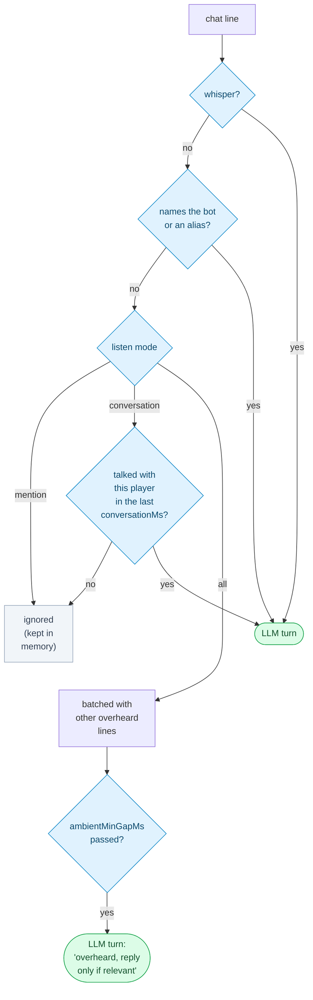
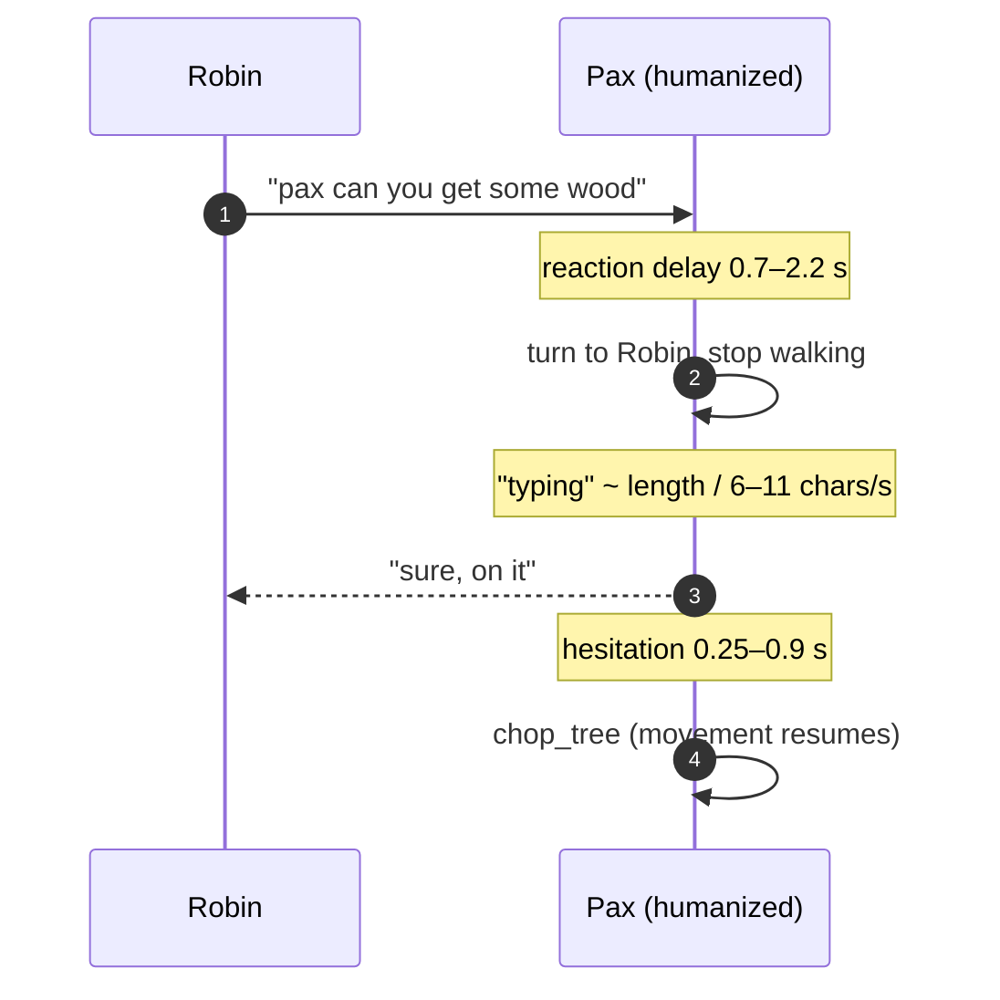

# Profiles

A profile is a saved instance of a [variant](/concepts/variants-profiles): who the bot is (username, persona), who it obeys,
where it connects, which LLM it uses and any settings. No code; one YAML file per bot in
`profiles/`. See [Variants, profiles, fleets](../concepts/variants-profiles) for how the pieces
fit.

```bash
just bots            # variants, profiles and fleets
just run pax         # profiles/pax.yaml
just run pax -v      # same, with debug logging
```

## Personal values from the environment

Profiles, their context packs (AGENTS.md, USER.md, skills, hooks.yaml), fleet files and scene
files expand `${NAME}` and `${NAME:-default}` from the environment, after loading `.env`.
Variants and scripts read the environment directly (`envOr('NAME', 'default')` from core);
`.env` is loaded as soon as core is imported, also without `--env-file`. Keep owner names and token
locations in `.env` instead of the repo:

```yaml
owners: ["${MC_OWNER:-Robin}"]
llm:
  oauthTokenVar: ${MC_OAUTH_TOKEN_VAR:-CLAUDE_CODE_OAUTH_TOKEN}
  oauthTokenFile: ${MC_OAUTH_TOKEN_FILE:-~/.config/golemkit/secrets.env}
```

## Format

```yaml
# profiles/pax.yaml
variant: companion            # variants/companion.ts
description: Test LLM companion (Sonnet 5.5, subscription token), obeys Robin
username: Pax
owners: [Robin]               # who may command it; omit for everyone
canDig: true                  # break blocks, tunnel while pathing
persona: >-                   # replaces the variant's persona
  Pax, a capable, friendly helper...
server:                       # optional; overrides .env for this bot
  host: mc.example.com
  port: 25565
  auth: offline
llm:                          # only for variants with an LLM brain
  provider: claude-subscription
  model: claude-sonnet-5-5
  effort: low
  login: .auth/pax            # isolated LLM login dir
  oauthTokenVar: CLAUDE_CODE_OAUTH_TOKEN
  oauthTokenFile: ~/.config/golemkit/secrets.env
  listen: conversation        # mention | conversation | all
  immersive: false            # true = stay in character
  aliases: [pax]
  conversationMs: 120000
  budget: { turnsPerHour: 60, tokensPerDay: 3000000 }
  goals: { maxTurns: 30, timeoutMin: 30 }   # see guide/goals-and-building
intents:                      # plain-language commands without the LLM (guide/intents)
  mode: first                 # fallback (default) | first | off
settings:                     # free-form, read with agent.settings
  home: [100, 64, -20]
logging:                      # optional, same keys as the fleet `logging:` block
  level: info,Pax/llm=debug
journal:                      # optional, event journal settings (on by default)
  retentionDays: 14
  exclude: [player_seen]
```

| key | |
|---|---|
| `variant` | required; a name in `variants/` or a path |
| `username`, `persona`, `owners`, `canDig` | identity and permissions |
| `server` | per-bot server override |
| `llm` | [LLM brain](/guide/llm-brain) settings: provider, model, effort, login, token source, `listen`, `immersive`, aliases, budget, [goals](/guide/goals-and-building) |
| `reflexes` | eat/retreat thresholds, e.g. `retreatBelow: 0` to stand its ground ([details](../concepts/world#reflexes)) |
| `retry`, `humanize`, `journal`, `context` | see the sections below and the linked guides |
| `settings` | anything the variant's skills/brains read |
| `logging` | applied when the profile is run on its own |
| `journal` | [event journal](/guide/journal): types, caps, retention, optional LLM summary; `false` turns it off. See [Event journal](./journal) |
| `context` | [context pack](/guide/context-pack) dir (default: `profiles/<name>/` if it exists), see [Context packs](./context-pack) |
| `building` | [building policy](/guide/blueprints#building-policy): `library` (default), `creative` or `ask` |
| `worldedit` | `true`/`false` forces [WorldEdit](/guide/worldedit) on or off; or `{ enabled, maxBlocks, ownersOnly, replyMs }`. Lands in `settings.worldedit` |
| `blueprints` | extra blueprint folders (relative to the profile), added to `settings.build.blueprintDirs` |
| `behaviors` | armed behaviours for the [behaviours brain](/guide/behaviors): `{ name: true \| false \| { enabled?, ...options } }`, checked against the registry when the profile is run, see [Behaviours](./behaviors) |

## LLM listening modes



- `mention`: only its name, an alias or a whisper.
- `conversation` (default): plus follow-ups without the name for `conversationMs` after it
  last answered that player.
- `all`: also reads everyone's chat and decides itself whether to join in; overheard lines
  are batched (`ambientBatchMs`, default 4 s) and rate limited (`ambientMinGapMs`, 30 s).
  It never echoes its private reasoning into chat on overheard turns.

Commands starting with `!` always go to the command brain, never the LLM. Only owners trigger
turns unless `ownersOnly: false`.

## Factual vs immersive

Both modes must report truthfully: the bot only claims something is done after the action
result says so, reports failures, and follows up when a long action (like a far `goto`)
finishes or gets stuck.

- `immersive: false` (default): plain, technical reports ("pathfinding got stuck 40 blocks
  away at 120 70 -30"), openly a bot.
- `immersive: true`: stays in character, no talk of tools, AI or game mechanics; failures in
  in-world words. It doesn't volunteer that it's a bot, but if a player sincerely asks, it
  won't claim to be human.

## Humanize (player-like timing)

For bots that should feel like players, especially in immersive mode. It lives in core, so it
affects every brain (LLM, NPC, [scenes](/guide/scenes), commands).

```yaml
humanize: true                 # defaults below; on automatically when llm.immersive is true
humanize: false                # off, even in immersive mode
humanize:
  reactionMs: [700, 2200]      # wait before starting to type a reply
  charsPerSec: [6, 11]         # typing speed; long lines take longer
  maxDelayMs: 12000            # cap per line
  pauseWhileTyping: true       # stand still while typing, then carry on walking
  lookAtSpeaker: true          # turn to the person being answered
  actionHesitationMs: [250, 900]  # short pause before doing what was asked
  lowercase: false             # write chat in lower case
  typoRate: 0                  # e.g. 0.03: occasional typo plus a "*word" correction
  idleFidget: true             # look around / at nearby players when idle
```



Pausing while typing holds the movement keys off without touching the pathfinder's goal, so a
`goto` or `follow` in progress just continues afterwards.

## Retries

```yaml
retry:
  actions: { "*": 0, goto: 2, chop_tree: 1 }   # extra attempts after a failed result (default 0)
  actionBackoffMs: [1000, 8000]                # first wait, max wait; doubles with jitter
  llm: { attempts: 2, backoffMs: [2000, 20000] }   # transient provider errors
  reconnect: { baseMs: 10000, maxMs: 300000 }  # exponential while the server is down
```

- **Actions** are retried only for failures retrying can fix ("stuck at ...", "took too
  long"), never for `busy`, bad parameters, stopped/preempted/replaced or disabled
  capabilities, and never after a player or another brain took over meanwhile.
- **LLM** retries cover timeouts, rate limits, overload, 5xx and network errors, and only
  when the failed turn hadn't called any tool yet, so actions are never repeated.
- **Reconnect** backs off exponentially after quick repeated failures and resets once a
  session lasts a minute.

Layers: env (`MC_RETRY_ACTIONS="*=0,goto=2"`, `MC_RETRY_LLM=2`, `MC_RECONNECT_DELAY_MS`,
`MC_RECONNECT_MAX_MS`) < variant `settings.retry` < profile `retry:` < [fleet](/concepts/architecture#fleets-and-multiple-servers) entry
`settings.retry`.

## LLM proxy (caveman or a gateway)

```yaml
llm:
  proxy: caveman        # the local caveman layer; started automatically if it isn't running
  # proxy: https://gateway.example/v1   # any Anthropic/OpenAI-compatible gateway
  # proxy: none
```

Only the base URL is passed to the provider (`ANTHROPIC_BASE_URL` for Claude, a per-run
`model_provider` override for Codex pointing at caveman's `/chatgpt` route); the login
isolation stays as it is. Subscription/OAuth logins pass through caveman unchanged. Also
`MC_LLM_PROXY=caveman` for every bot, and `MC_CAVEMAN_BIN` if caveman isn't found.

## Profiles in fleets

```yaml
# fleets/home.yaml
servers:
  mc02: { host: mc.example.com }
bots:
  - profile: pax
  - profile: pax              # entry fields override the profile
    username: Pax2
    settings:
      llm: { login: .auth/pax2 }  # profile llm settings live under settings.llm
  - variant: villager
    count: 3
```
