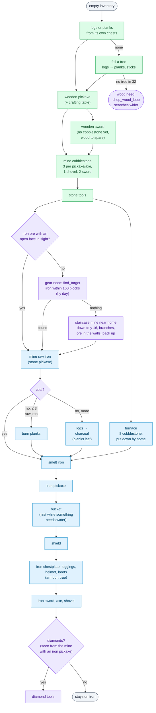
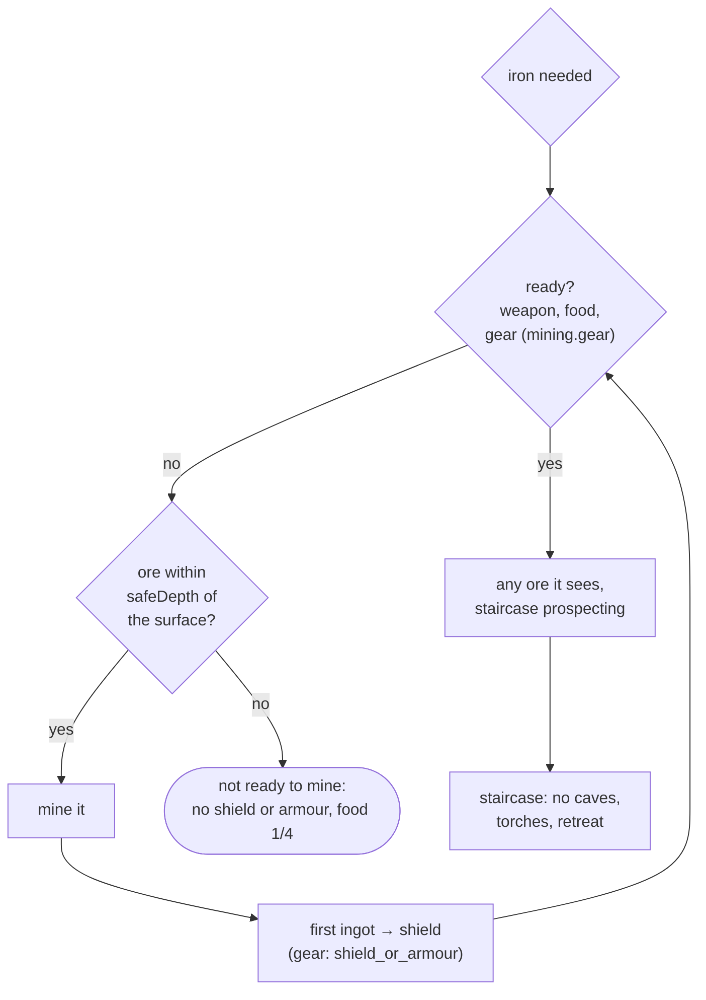
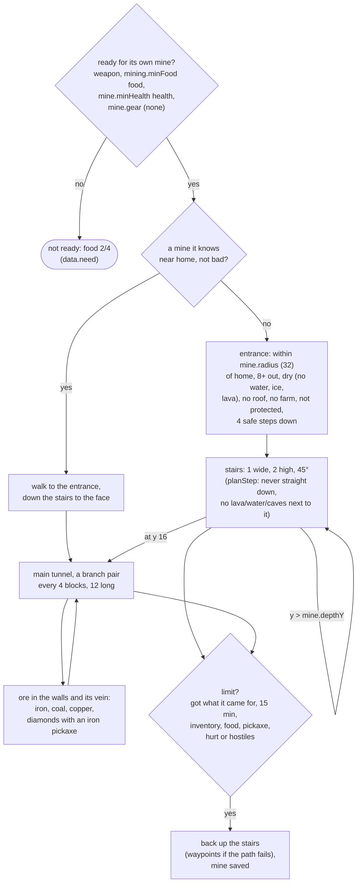

# Tool progression and gathering

Bots gather like a quick player: make a wooden pickaxe from the first tree, stone tools from
the first three cobblestone, then a furnace, iron and (when diamonds turn up) diamond tools.
Everything they fell or mine should end up in the inventory, and every result says how long
it took and what was left behind.

## The upgrade path



The decision is a pure function, `nextToolUpgrade(inventory, nearby, gameMode, { upTo, kinds, armour })`
in `src/skills/progression.ts`. It returns one step (`craft`, `gather`, `craft_furnace`,
`smelt`, `creative_get`) or nothing, and is unit tested. A step it can't do (no iron ore seen)
ends the plan, so the bot stops at the best tier it can reach and says so. In creative mode it
takes the tools with `creative_get` and never gathers.

### The iron chain

Iron goes, in order (`ironChain` in `src/skills/progression.ts`, unit tested):

1. the iron pickaxe (3 ingots): it mines diamonds and it is the tool a mine wears out;
2. a bucket (3) with `bucket` (keep_tools_upgraded: on by default): water for a farm where the water
   near home froze, and the water clutch. While the blackboard need `bucket` is set (any behaviour
   can set it: `ctx.bb.setNeed('bucket', 1)`, exported as `BUCKET_NEED` from
   `behaviors/tools.ts`) the bucket comes before the pickaxe and the [gear need](./needs-and-idle#needs)
   is urgent (0.6). A water or lava bucket counts;
3. a shield (1 ingot, 6 planks of one kind) with `shield` (on by default);
4. with `armour`: chestplate (8), leggings (7), helmet (5), boots (4), the most protection per
   ingot first. Any iron, diamond or netherite piece, carried or worn, covers its slot;
5. the other tools below iron: sword (2), axe (3), shovel (1).

Ingots wait for the next item in line while more iron is to be had (raw iron to smelt, ore in sight,
prospecting); with no more iron to be had they go to the first item further down they pay for, so 2
ingots and no ore become a shield, not a sword. Worn armour and the shield in the offhand count as
held (they are not in `inventory.items()`, which made the planner want a second helmet before).
Safe mining's shield-first rule (below) still turns the very first ingot into a shield when
`mining.gear` asks for one.

**Smelting.** Coal, then charcoal from logs (burnt with planks), then planks as the last resort for
any batch. The furnace it puts down is remembered as the place `furnace`; with no furnace within 32
blocks it walks to that one (within 128 blocks, forgotten when it is gone), else home first, so the
furnace goes by home and not at the bottom of a mine.

Tool kinds go pickaxe, sword, axe, shovel at every tier: combat (the techniques, `defend`,
bodyguard) assumes a sword, so the stone sword comes right after the stone pickaxe, and a bot
with no sword and no cobblestone makes a wooden one first when the wood also covers the sticks
for every stone tool still to come.

### Short of wood

**Planks per kind.** Recipes take planks of one kind: two spruce planks make sticks, one oak and one spruce plank
make nothing. The planner counts wood that way (`usablePlankUnits`: a lone plank of a kind no
log in the inventory turns into counts for nothing), and `ensureSticks` / `ensureTool` top up
one kind from the logs (`plankTopUp`). Before that fix Pax looped for hours on "could not make
sticks for a stone pickaxe" while carrying spruce logs, because it held 1 oak and 1 spruce plank
and counted them as the 2 planks the sticks needed.

When the next step needs logs, `upgrade_tools` first takes logs (then planks of one kind) out of
the bot's own chests within 48 blocks (the ones it placed and `storage.chests` from the profile,
those known to hold wood first), then fells a tree within 32 blocks. If neither works the step
fails with "needs wood: ..." and `data.need = 'wood'`. `keep_tools_upgraded` then sets the `wood`
need on the [blackboard](/concepts/architecture#fleets-and-multiple-servers), which makes `chop_wood_loop` run at a higher score (38 instead of 30)
and search further out (see [the wood ladder](#the-wood-ladder)). Its failure back-off has a retry key, the
usable wood it holds: as soon as that changes (a tree felled, the owner hands over logs) the
back-off ends and the upgrade runs again, instead of waiting out 60, 120, 240... seconds.

## Safe mining

Iron sits underground, and underground is where a bot without armour dies. Pax had fresh stone
tools, no armour and no torches when `keep_tools_upgraded` sent it after iron ore it could see
in a cave 60 blocks down. It pathed in, fought a creeper and a zombie at 8 health (its profile
says stand your ground), died at y 10 and lost everything. Safe mining (`settings.mining`, on by
default) is the answer; the rules are a pure planner in `src/skills/minePlan.ts`, unit tested.



**Ready** means a sword or axe (`needWeapon`), `minFood` food items, and the gear `gear` asks
for: `none` (default), `shield_or_armour` (a shield, or `minArmour` armour points worn), or
`armour`. Not ready, the bot only goes for blocks at most `safeDepth` (8) below its surface
level and under at most that much ground: `senseNearby` counts only that ore as `ironOre`
(deeper ore is `ironOreDeep`), `collect` skips deeper blocks and says why, and there is no
staircase prospecting. `upgrade_tools` then fails with "not ready to mine: no shield or armour,
food 1/4; would get 3 raw_iron ... but that means going deeper than 8 blocks" and `data.need`
(`weapon`, `food` or `gear`), so `keep_fed` and the other behaviours get their turn.
`keep_tools_upgraded` doesn't even pick the step (it scores 0 while the only way on is deep), and
after a not-ready failure its back-off ends as soon as the kit changes. With
`gear: shield_or_armour` the first iron ingot (from surface ore) becomes a shield before the iron
pickaxe, which closes the gap.

**Digging** (`mineStone`, the staircase and strip behind cobblestone and prospecting):
- never below `safeDepth` while not ready; it stops with the not-ready reason instead of digging
  a flat tunnel in dirt;
- never into a cave: a block whose neighbour is an air pocket below the surface (not the
  tunnel itself, not air open to the sky like a ravine wall) and a floor with air under it are
  unsafe steps, the same as lava or water next to it; it turns, and stops after four turns;
- a torch every `torchEvery` (8) steps on the floor behind it when the spot is dark, crafted
  from coal or charcoal and a stick when it has none (`torches: false` turns it off);
- every step checks health and hostiles: underground at `retreatBelow` (10) health or with
  `retreatHostiles` (2) hostiles within `hostileRadius` (8, the `mining.hostileRadius` toggle), it abandons the dig, skips the drop
  sweep and walks back up the staircase it came down. Running out of air (6 of 20 or less)
  counts too.

**Collecting** (`collect`, and the ore trips in `upgrade_tools`) runs the same check before
every block: losing underground, it stops and runs `climb_out`. A live test bot that was ready
(shield, bread, stone tools) went for iron ore in a cave, ended up in water at y 33 and drowned
at 4 health without a mob in sight; that is why air and health count without a hostile near.

**Underground fights** ([reflexes](/concepts/world#reflexes)): the same test runs when the bot is hit or a hostile is
within 6 blocks, or while health is still dropping (drowning, lava, a fall). Underground (3+
solid blocks overhead and little sky light) and losing, it runs
`climb_out` instead of `defend`, whatever `reflexes.retreatBelow` says (Pax keeps 0 there and
still climbs out underground). A melee mob right on it at its level still gets fought
(`keepClimbing`), and the climb is retried 15 seconds later. Once started, the climb isn't taken
over by another reflex (`ranged_defense` never, a fight only for a melee mob right next to it);
that is the [reflex referee](/concepts/world#reflexes). Once no hostile is within 6 blocks, the
reflexes eat to heal below 14 health as before.

All of it is live config (`!config_set mining.gear armour`, see [live config](./live-config)),
and `upgrade_tools safe=false` or `keep_tools_upgraded { safeMining: false }` skip it for one
call or one behaviour. Pax sets:

```yaml
settings:
  mining: { gear: shield_or_armour, minFood: 4, retreatBelow: 12, retreatHostiles: 2 }
```

## The staircase mine

Pax lives on a frozen lake: no iron ore with an open face within 160 blocks of its fortress, and
safe mining keeps it out of caves without armour. A player there digs their own mine, and so does
the bot (`dig_mine`, `src/skills/stairMine.ts`; the decisions are the pure `src/skills/stairMinePlan.ts`,
`test/stair-mine.test.ts`).



- **Readiness** is its own: a weapon (`mining.needWeapon`), `mining.minFood` food, `mine.minHealth`
  (14) health and the gear `mine.gear` asks for, `none` by default. A tunnel it digs never opens
  into a cave, which is what `mining.gear` guards against, so Pax (`mining.gear: shield_or_armour`)
  may go down its own mine with stone tools and no armour, but still not into a cave.
- **Where:** the nearest spot to home that passes every check: within `mine.radius` (32) and at
  least `mine.minFromHome` (8) from home, no water, ice or lava within 3 blocks, nothing solid
  overhead, not on a farm, not in a protected area or spawn protection, and the first 4 steps down
  plan safely. On Pax's frozen lake that rules out the shore and picks dry snow ground.
- **Down:** the staircase step of the strip miner (`planStep`), checked the same way: never under
  its own feet, nothing next to lava or water, no gravel or sand overhead, a solid floor, no cave
  next to a dug block; an unsafe step tries a flat step, then the other directions. The stairs go
  to `mine.depthY` (16; deepslate starts below 0), at least 6 above the world floor.
- **At depth:** a main tunnel in the stairs' direction with a branch on each side every
  `mine.branchSpacing + 1` (4) blocks, `mine.branchLength` (12) long, at most `mine.maxBranches`
  (6) pairs a trip. After every step it mines the wanted ore touching the tunnel and the rest of
  each vein (`mine.ores`: iron, coal, copper, diamond; each needs its pickaxe tier), unless the ore
  touches lava or water or would open a cave.
- **On the way:** a torch every `mining.torchEvery` (8) steps where it is dark (crafted from the coal
  it mines), eating at food 15 (so the eat reflex doesn't take the body), a broken pickaxe re-made
  from cobblestone, a spare stone pickaxe made before it goes down. Junk (dirt, granite, diorite,
  andesite, tuff, gravel, cobblestone over `mine.keepCobble`) is dropped at the end of a branch,
  where the walk back doesn't pick it up again.
- **Back up** when it has the raw iron it came for, after `mine.minutes` (15), with fewer than
  `mine.minFreeSlots` (3) free slots, out of food or pickaxes, or when safe mining's underground
  retreat says so (`mining.retreatBelow` health, `mining.retreatHostiles` hostiles, air). It walks
  up the stairs in one path, else stand by stand the way it came.
- **Remembered** in storage (`mines`): entrance, direction, the foot of the stairs, the face, every
  4th stair step, branches, torches, what it got. The next trip (`mine.cooldownMinutes`, 20, after
  the last) walks down to the face and carries on; a new mine only when none is known or the known
  one went bad. The [site check](./needs-and-idle#site-health) `mine` marks it flooded (water in the
  first steps), unsafe (lava) or gone (filled in), and unreachable when the walk down fails 3 times.
- A mine with a torch every ~8 stair steps counts as **lit**: with `mine.atNight` (on) the gear need
  may go down it at night.
- With no mine yet, `mine.startAtNight` (on) lets a night trip start the first one when the bot
  carries 8 torches or can make them (coal or charcoal and sticks, 4 torches each). It lights the
  stairs as it digs, so the next night it is a lit mine. A known mine that isn't lit still waits for
  the day.
- A surface search for iron that turns back at sunset goes on to the mine (when night trips may go)
  instead of home: the mine is near home and underground, so the light doesn't matter there.

`!dig_mine ore=iron count=9` runs it by hand; `fresh=true` starts a new mine.

### Live runs

`just survival-bench --kit stone` with `SURVIVAL_BOT=ProgTest`, 2026-11-26. Both the ice scenario and
Pax's full profile spend their days on other work (the frozen lake kept the test bot in the air reflex
for 7 minutes; in a forest keep_fed, seeds and the farm took the day), so the chain was measured
with a bench profile that has only keep_tools_upgraded, keep_fed, stay_safe and collect_drops, and a
16-block surface search so the mine gets used:

| run | what happened | ended with |
|---|---|---|
| forest 1300 1650, first trip | stairs from y 65 to y 22 in 281 s, 139 blocks; its only stone pickaxe wore out (no wood for a spare) | 7 coal, 5 raw iron; smelted to 5 ingots at home, then the shield failed for planks (fixed: logs to planks first) |
| forest 1300 1650 | down to y 16, 6 branches; taken over at dusk by stay_safe going home (fixed: not while in its mine) | 16 raw iron, 28 raw copper; no furnace: no crafting table and no wood (fixed: logs first) |
| windswept forest 2350 1750 | a tree for wood, stairs to y 16 in about 8 minutes, branches, taken over by a silverfish fight; smelted 13 raw iron in a furnace it put down by the mine; a second trip down a new mine (the site check had called the first one filled in before it was dug, fixed) until a creeper fight at night | iron axe, iron shovel, a bucket, a shield, 8 iron ingots, 7 coal, 74 raw copper; the iron pickaxe it made wore out on the second trip and it went on with the spare stone one; no armour yet (the 8 ingots were waiting for the chestplate when the run ended); no deaths |

### Ore trips

When `keep_tools_upgraded` (or anything else that isn't an owner) runs `upgrade_tools` and the
next step is going for iron, coal or diamonds, that is a [trip](./behaviors#trips): it first
takes food from its pantry (own and configured chests near home) up to `trips.food`, holds its best weapon and checks
its health, and stays with the reason when it can't (`would get 3 raw iron, but not ready for a
trip (an ore trip): health 9/20 (needs 12)`). When safe mining says "not ready: food 1/3", the
same top-up runs once and the plan is made again, so a full pantry ends that wait. On the way
the trip budget applies (half the food it left with, daylight for the walk home), and after a
turn-back it walks home and says so. `chop_tree` rings past 64 blocks are trips the same way.

### Iron and gear from its chests

Before planning, `upgrade_tools` takes what the steps ahead need out of its own and configured
chests near home (the pure `upgradeTakes` in `src/skills/progression.ts` and `gearWant` in
`src/skills/storagePlan.ts`), counting only what it doesn't already carry:

- cobblestone for every tool still below stone;
- iron ingots, then raw iron, for every iron tool still to make, the iron armour with `armour`,
  and the shield safe mining wants first;
- coal, then charcoal, to smelt the raw iron it will hold (one per 8);
- diamonds with `up_to=diamond`;
- a shield when it has none, and an iron, diamond or netherite piece for each armour slot it
  neither wears nor carries; these go on right away.

`keep_tools_upgraded` runs for this even when the plan has nothing else to do (no ore in sight),
going by [container memory](/guide/search#container-memory): it walks over only when it saw the
items there. On Pax that is the 9 iron ingots and the shield in the second chest by home. Iron and
fuel it carries are kept out of [deposit_when_full](/guide/behaviors#storing-at-home-deposit-when-full)
until the iron tools and armour are done.

## Where it runs

| what | when | how far |
|---|---|---|
| `upgrade_tools` action | asked for (`!upgrade_tools up_to=iron`, or the LLM) | everything it can do now, up to `up_to` |
| automatic cheap upgrades | before `gather_materials`, `collect` of stone and every `chop_tree` | stone tools (3 cobblestone + 2 sticks each) once a pickaxe exists; iron only when the iron is already in hand |
| `keep_tools_upgraded` behaviour | idle, armed in the [profile](/guide/profiles) | re-crafts a worn tool (`minDurability`), then upgrades up to `upTo` along [the iron chain](#the-iron-chain): pickaxe, bucket (`bucket`, default on), shield (`shield`, default on), iron armour with `armour: true`, then the other tools |
| gear need search | nothing scores, gear urgent, no ore in sight | exposed ore within `needs.search.radius` by day, else [its staircase mine](#the-staircase-mine), then smelts and crafts at home ([needs](./needs-and-idle#going-looking)) |

Pax arms it in `profiles/pax.yaml`:

```yaml
behaviors:
  keep_tools_upgraded: { upTo: iron, armour: true }
```

### Where the crafting table and furnace go

With no crafting table within 16 blocks (or furnace within 32) it puts one down next to itself,
but never inside the server's spawn protection (a square of `world.spawnProtection` blocks around
the world spawn, 16 by default like `spawn-protection` in server.properties; set it to the
server's value, 0 when there is none), in a [protected area](/concepts/world#protected-areas) or on
a spot the server already refused. When every spot next to it is inside spawn protection (a bot
that just respawned at the world spawn with logs) it walks out through the nearest side first. A
refused placement is reported as what it is, `the server refused to place crafting_table at 544
78 47 (spawn protection: 2 blocks from the world spawn, inside its 16-block square)`, instead of
mineflayer's `the block is still snow`; the spot is noted as protected and the next try goes to
another one.

## Gathering

**Wood.** `chop_tree` cuts the trunk from the ground, then climbs what is out of reach: it
stands where the bottom log was, cuts everything in reach, pillars one block (dirt, cobblestone
or one of the logs) and repeats, and digs the pillar again on the way down. After a short wait
for drops to land it sweeps the area, breaks the natural leaf under any drop caught in a tree
and sweeps again. The result says how many logs reached the inventory and, if any didn't, why.

### The wood ladder

`chop_tree` alone looks `radius` blocks around the bot (32 by default). With `rings` (the
`chop_wood_loop` default is 32, 64, 128, 250) it works like the food ladder: trees it remembers
first, nearest first, then the smallest ring no recent empty search covered. Rings up to 64 are
a scan of what is loaded around the bot; wider rings are a scouting trip, a spiral of waypoints
out to the ring that looks for a natural tree at every stop, and the bot walks back to where it
started after felling a tree more than 48 blocks away. The decision is the pure
`nextTreeStep` in `src/skills/treePlan.ts`.

- Natural trees only (at least 3 natural leaves), never in protected areas, never in or across
  a remembered danger zone (core `dangerMemory`); saplings are replanted as before.
- Trees seen around every felled tree and on scouting trips are remembered in storage
  (`woodcutting.treeSpots`, a spot per 24 blocks, at most 24, forgotten after 3 days) and
  journalled as `found` events. A spot found without a tree is left alone for 30 minutes.
- An empty ring is remembered for 20 minutes (`woodcutting.searches`), so the next run starts one
  ring further out instead of failing at 32 blocks every 15 minutes. A scouting trip cut short
  (night, low health, stuck three legs in a row, the 10 minute limit) is not counted as empty.
- When every ring came up empty it fails with when it will look again.
- Rings past 64 blocks (`trips.minDistance`) are a [trip](./behaviors#trips) when a behaviour
  asks (not an owner's `!chop_tree`, unless `trips.ownerOrders`): food from the pantry and a
  weapon first, home again when food or daylight runs short. A bot with less than 3 planks' worth
  of wood skips the weapon check, since the wood is what makes the weapon.

Set the rings per bot in the profile, e.g. Pax:

```yaml
behaviors:
  chop_wood_loop: { enabled: false, rings: [32, 64, 128, 250] }
```

**Stone.** Pathing to buried stone is slow on a loaded server ("Took to long to decide path to
goal!"). `collect stone`/`cobblestone` and `gather_materials` mine the stone in reach, then the
nearest exposed stone, then dig a staircase down from where the bot stands and a 3-wide strip
along the first stone layer, mining ores beside it that the pickaxe can take. Each step is
checked first and refused when:

- it would dig under the bot's own feet (it always moves forward),
- a block to dig touches lava or water, or is unloaded, or has sand/gravel right above,
- the floor under the next spot is missing (a cave or a drop),
- a block is not natural or is in a [protected area](/concepts/world#protected-areas).

Refused steps make it turn; four refusals end the run with the reason. Afterwards it walks back
up its stairs. Placed cobblestone is never mined: that is somebody's build.

**Materials for a template.** `gather_materials template=fortress` without a `material` picks
the wall block: what it already holds, planks when there is no stone or no pickaxe, cobblestone
when the trees around give fewer planks than the walls need, otherwise cobblestone (the strip
mine isn't limited by trees). The pick and the reason are in the result.

**Nothing lost.** Two mineflayer quirks used to eat wood. After a 2x2 craft in the inventory it
doesn't re-sync the window (it does for a crafting table), so on a laggy server the log stack
could stay in the crafting grid while the bot believed it was gone: `gather_materials` saw
enough logs, crafted almost nothing, and the logs only came back on a later window close (or
landed on the ground with a full inventory). `craftItem` now asks the server for the real
state and shift-clicks anything in the grid back. And mineflayer throws the cursor stack on
the ground when its model has no free slot, so crafting first keeps two slots free (throwing
away junk like rotten flesh, extra saplings and seeds, never the recipe's items) and picks up
anything that fell out. Felling and mining stop with "inventory full" instead of leaving drops
behind, and the strip mine sweeps its tunnel before it stops.

**Seeds and food.** Wheat seeds come from breaking grass (about 1 in 8 drops). The crafting
junk cleaner keeps 16 wheat seeds and 8 beetroot seeds, so seeds picked up while `keep_fed`
searches for food survive until the bot starts a farm. `gather_seeds` breaks grass on purpose,
surface grass only (within 12 blocks above or below the bot, nothing solid over it: a seed run
once led Pax 75 blocks down into a lush cave),
`forage` picks sweet berries, cuts kelp (smelted into dried kelp) and, when desperate, breaks
leaves for apples, `tend_farm` keeps a farm planted and grows it towards 9x9 with seeds beyond a
small reserve. The whole food ladder (search rings of 48, 120, 250, 400 and 600 blocks, rings
past 48 only with good enough gear or real hunger, trips to known food places, a pantry chest,
then a farm near home, with farm work between meals) is in
[behaviours](/guide/behaviors#food-keep-fed-the-food-ladder-and-farm-setup).

## Speed

- Results carry their time (`... in 95s`), mining its blocks per minute.
- The pathfinder may plan for 10 s (library default 5 s), live-configurable:
  `!config_set pathfinder.thinkTimeoutMs 15000` (see [feature toggles](./live-config)).
- Sprinting and parkour are on; the right tool is equipped for every dig.

`scripts/speed-test.ts` measures a run on the live server with an empty inventory away from
spawn: blocks broken per minute, logs broken against wood that reached the inventory, and drops
still lying around.

Measured on mc02 (loaded machine), empty inventory, before → after:

| run | before | after |
|---|---|---|
| 64 cobblestone | 51 of 64 in 184 s with a stone pickaxe already made, 25 drops left lying (≈17 cobblestone/min) | 64 of 64 in 171 s from an empty inventory, including the tree, wooden pickaxe and stone tools; the strip mine itself 60-70 blocks/min |
| 64 planks | 144 s | 119 s with a wooden axe, 70 s once stone tools exist; logs broken = logs kept (±1) |
| fortress walls (`template=fortress`) | n/a | cobblestone picked; 133 cobblestone strip-mined in 135 s (61/min) |

```sh
node scripts/speed-test.ts 700 -90 'gather_materials {"items":{"cobblestone":64}}' 'gather_materials {"items":{"planks":64}}'
```

## Digging that gives nothing

`collect` and the strip mine check two things while they dig, so a bot never mines for nothing:

- **Before each source block:** the right tool must be in hand (stone needs a pickaxe). Tools are
  picked **by name** (best pickaxe / axe / shovel), because the NeoForge [registry sync](/concepts/neoforge#_4-modded-item-and-entity-names) renumbers items
  and the pathfinder's id-based tool lookup can come back empty. No tool: it stops with
  "stone drops nothing without a pickaxe (holding cobblestone)".
- **Every 5 dug blocks:** the inventory must have grown. If not, drops lying around are swept up
  first; if that gives nothing either, it stops and says why: wrong tool, full inventory, or
  "N drops are lying around that I didn't pick up".
