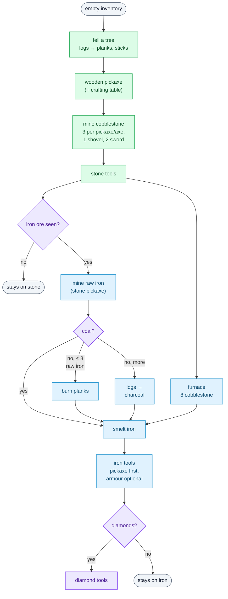

# Tool progression and gathering

Bots gather like a quick player: make a wooden pickaxe from the first tree, stone tools from
the first three cobblestone, then a furnace, iron and (when diamonds turn up) diamond tools.
Everything they fell or mine should end up in the inventory, and every result says how long
it took and what was left behind.

## The upgrade path



The decision is a pure function, `nextToolUpgrade(inventory, nearby, gameMode, { upTo, kinds, armour })`
in `src/skills/progression.ts`. It returns one step (`craft`, `gather`, `craft_furnace`,
`smelt`, `creative_get`) or nothing, and is unit tested. A step it can't do (no iron ore seen)
ends the plan, so the bot stops at the best tier it can reach and says so. In creative mode it
takes the tools with `creative_get` and never gathers.

## Where it runs

| what | when | how far |
|---|---|---|
| `upgrade_tools` action | asked for (`!upgrade_tools up_to=iron`, or the LLM) | everything it can do now, up to `up_to` |
| automatic cheap upgrades | before `gather_materials`, `collect` of stone and every `chop_tree` | stone tools (3 cobblestone + 2 sticks each) once a pickaxe exists; iron only when the iron is already in hand |
| `keep_tools_upgraded` behaviour | idle, armed in the [profile](/guide/profiles) | re-crafts a worn tool (`minDurability`), then upgrades up to `upTo`, and makes iron armour after the iron tools with `armour: true` |

Pax arms it in `profiles/pax.yaml`:

```yaml
behaviors:
  keep_tools_upgraded: { upTo: iron, armour: true }
```

## Gathering

**Wood.** `chop_tree` cuts the trunk from the ground, then climbs what is out of reach: it
stands where the bottom log was, cuts everything in reach, pillars one block (dirt, cobblestone
or one of the logs) and repeats, and digs the pillar again on the way down. After a short wait
for drops to land it sweeps the area, breaks the natural leaf under any drop caught in a tree
and sweeps again. The result says how many logs reached the inventory and, if any didn't, why.

**Stone.** Pathing to buried stone is slow on a loaded server ("Took to long to decide path to
goal!"). `collect stone`/`cobblestone` and `gather_materials` mine the stone in reach, then the
nearest exposed stone, then dig a staircase down from where the bot stands and a 3-wide strip
along the first stone layer, mining ores beside it that the pickaxe can take. Each step is
checked first and refused when:

- it would dig under the bot's own feet (it always moves forward),
- a block to dig touches lava or water, or is unloaded, or has sand/gravel right above,
- the floor under the next spot is missing (a cave or a drop),
- a block is not natural or is in a [protected area](/concepts/world#protected-areas).

Refused steps make it turn; four refusals end the run with the reason. Afterwards it walks back
up its stairs. Placed cobblestone is never mined: that is somebody's build.

**Materials for a template.** `gather_materials template=fortress` without a `material` picks
the wall block: what it already holds, planks when there is no stone or no pickaxe, cobblestone
when the trees around give fewer planks than the walls need, otherwise cobblestone (the strip
mine isn't limited by trees). The pick and the reason are in the result.

**Nothing lost.** Two mineflayer quirks used to eat wood. After a 2x2 craft in the inventory it
doesn't re-sync the window (it does for a crafting table), so on a laggy server the log stack
could stay in the crafting grid while the bot believed it was gone: `gather_materials` saw
enough logs, crafted almost nothing, and the logs only came back on a later window close (or
landed on the ground with a full inventory). `craftItem` now asks the server for the real
state and shift-clicks anything in the grid back. And mineflayer throws the cursor stack on
the ground when its model has no free slot, so crafting first keeps two slots free (throwing
away junk like rotten flesh, extra saplings and seeds, never the recipe's items) and picks up
anything that fell out. Felling and mining stop with "inventory full" instead of leaving drops
behind, and the strip mine sweeps its tunnel before it stops.

**Seeds and food.** Wheat seeds come from breaking grass (about 1 in 8 drops). The crafting
junk cleaner keeps 16 wheat seeds and 8 beetroot seeds, so seeds picked up while `keep_fed`
searches for food survive until the bot starts a farm. `gather_seeds` breaks grass on purpose,
`forage` picks sweet berries, cuts kelp (smelted into dried kelp) and, when desperate, breaks
leaves for apples, `tend_farm` keeps a farm planted and grows it towards 9x9 with seeds beyond a
small reserve, and the whole food ladder (search rings of 48, 120 and 250 blocks, a trip to a
known farm or village, the far rings by day, then a farm near home, with farm work between
meals) is in [behaviours](/guide/behaviors#food-keep-fed-the-food-ladder-and-farm-setup).

## Speed

- Results carry their time (`... in 95s`), mining its blocks per minute.
- The pathfinder may plan for 10 s (library default 5 s), live-configurable:
  `!config_set pathfinder.thinkTimeoutMs 15000` (see [feature toggles](./live-config)).
- Sprinting and parkour are on; the right tool is equipped for every dig.

`scripts/speed-test.ts` measures a run on the live server with an empty inventory away from
spawn: blocks broken per minute, logs broken against wood that reached the inventory, and drops
still lying around.

Measured on mc02 (loaded machine), empty inventory, before → after:

| run | before | after |
|---|---|---|
| 64 cobblestone | 51 of 64 in 184 s with a stone pickaxe already made, 25 drops left lying (≈17 cobblestone/min) | 64 of 64 in 171 s from an empty inventory, including the tree, wooden pickaxe and stone tools; the strip mine itself 60-70 blocks/min |
| 64 planks | 144 s | 119 s with a wooden axe, 70 s once stone tools exist; logs broken = logs kept (±1) |
| fortress walls (`template=fortress`) | n/a | cobblestone picked; 133 cobblestone strip-mined in 135 s (61/min) |

```sh
node scripts/speed-test.ts 700 -90 'gather_materials {"items":{"cobblestone":64}}' 'gather_materials {"items":{"planks":64}}'
```

## Digging that gives nothing

`collect` and the strip mine check two things while they dig, so a bot never mines for nothing:

- **Before each source block:** the right tool must be in hand (stone needs a pickaxe). Tools are
  picked **by name** (best pickaxe / axe / shovel), because the NeoForge [registry sync](/concepts/neoforge#_4-modded-item-and-entity-names) renumbers items
  and the pathfinder's id-based tool lookup can come back empty. No tool: it stops with
  "stone drops nothing without a pickaxe (holding cobblestone)".
- **Every 5 dug blocks:** the inventory must have grown. If not, drops lying around are swept up
  first; if that gives nothing either, it stops and says why: wrong tool, full inventory, or
  "N drops are lying around that I didn't pick up".
