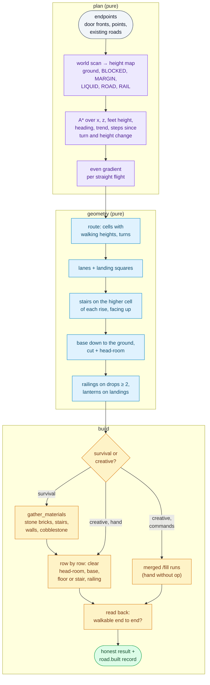

# Roads and stairs

Bots join buildings with roads that look like a person built them: straight flights of stairs,
flat landings where the road turns, switchbacks on steep ground, a base filled down to the ground,
railings where the road stands high, and T-junctions where a new road meets an old one. It works
on rough sites (a village spread over y 65 to 120 within 50 blocks) where fixed shapes (L-shapes,
detours, zig-zags) fail, because the shape comes out of a search over the terrain instead of being
picked from a list.

- **Planner** (`src/skills/road-plan.ts`, pure, unit tested in `test/roads.test.ts`): height map,
  A* search, geometry, networks.
- **Skill** (`src/skills/roads.ts`, in the extended skills): reads the world, builds, remembers
  every road it built.

## Actions

| action | |
|---|---|
| `build_road` | from the bot (or `from_x/from_z`, or `from` = a saved place or player) to `x y z` (or `to`). A point next to a door starts or ends straight out of that door; a point on one of the bot's roads joins it as a T-junction. `dry_run=true` only plans: length, stair rows, landings, cut and fill, materials. `redo=<id>` builds a removed road again. |
| `connect_buildings` | joins a set of buildings: the ones this bot finished with `build` (`source=built`, the default), doors among its own blocks (`own`), every door within `radius` (`nearby`), or given doors (`doors="x y z; x y z"`). Roads it built earlier count as part of the network. |
| `remove_road` | takes out a road it built (default the last one): breaks only blocks that are still what it placed, and in creative puts the dug-away ground back. |
| `road_list` | the roads it built, with ids. |

Common parameters: `width` (1, 3 or 5), `palette`, `lanterns`, `bridge`, `maxCut`, `maxFill`,
`gather` (survival, default on) and `method` (creative: `hand` or `commands`). They default to the
`road.*` [feature toggles](./live-config.md).

```
!build_road to=market dry_run=true
!connect_buildings
!connect_buildings source=nearby radius=40 lanterns=true
!remove_road id=3
```

## From plan to blocks



## How stairs are laid

The planner works with the **walking height** `f` of each cell (where the feet are); the road
block is at `f - 1`. Between two cells `f` changes by at most one. For every one-block rise, the
road block of the **higher** cell is a stair facing the way up, on every lane of that row. Walking
up, you step from a full block onto the low half of the stair and stand one block higher.

```
side view, walking east (uphill), one lane

            cell:   0    1    2    3    4    5    6    7
 walking height f:  65   65   66   66   67   68   68   68

   y 67                                      S    #    #      ← stair on cell 5, then floor at walking height 68
   y 66                                 S    c    c    c      ← stair on cell 4: two rises in a row
   y 65                       S    #    c    c    c    c      ← stair on cell 2, floor on cell 3
   y 64             #    #    c    c    c    c    c    c      ← floor at walking height 65
   y 63             ~~~~~~~~~~~~~~~~~~~~~~~~~~~~~~~~~~~~~~~~  natural ground

   S = stone_brick_stairs[facing=east]  # = stone_bricks  c = cobblestone base
   (a cut works the same way upside down: ground above f..f+2 is dug away instead of filled)
```

Rules that keep it looking built rather than generated:

- **Height changes only on straight moves.** A turn cell, `width/2 + 1` cells before it and
  after it are flat, so every turn sits on a full **landing**: a flat square as wide as the road.
- **No bumps.** Going up and then down on one road costs a lot (`bumpCost`), and needs a landing
  in between; `monotone` forbids it.
- **Straight flights.** Turns cost extra and need a minimum segment length (width + 1), so the
  road prefers long flights. After the search, each flight's rises are spread at an even
  gradient when the cut and fill stay within the limits and cost little more.
- **Cut and fill per lane.** Every lane stays within `road.maxCut` below and `road.maxFill` above
  its natural ground. Deep base is capped (the cost stops growing after 10 blocks).
- **Width.** All lanes (3 by default) and the railing cells beside them must be free of buildings,
  trees and [protected areas](/concepts/world#protected-areas); lanes keep out of the one-cell margin around buildings except the
  straight stub in front of a door. The road never overlaps another road or itself.

### Switchbacks

Nothing in the code builds a switchback on purpose. When the endpoints are closer together than
the rise needs (a slope steeper than one block per block), the cheapest way to gain length is two
turns the same way round with a short connector: a 180 degree turn on two landings, the parallel
flights one cell apart (the gap holds a shared railing). From the cliff test (20 up over 8 blocks,
endpoints 16 apart; letters are walking heights, `T` landings):

```
  TffghijklmnopqrstuvwxyzzT
  f.......................z
  f.......................z
  f.......................z
  Tffff...............zzzzT
```

## Junctions and networks

A road may end on (or start from) a cell of an existing road at the same walking height when that
cell, and the old road's cells across the new road's width, are flat. The new road comes in
square and never writes over the old one; its railings may replace the old road's railing where
they meet. `connect_buildings` runs `connect`: one group per door (plus one per existing road
network), then repeatedly the cheapest planned road between two groups (Kruskal on planned
costs). Each group is planned against its three nearest groups first, all pairs only when none
of those works. After each road is laid the height map knows it, so the next roads avoid it or
join it at a T, and plans that went near it are made again. Each door gets at most one road.

## Building

| | |
|---|---|
| survival | counts what isn't in place, runs `gather_materials` for the rest (stone bricks are smelted and crafted from cobblestone, see [progression](./progression.md)), walks to the start and builds row by row: head-room top-down, then base bottom-up, floor or stair (facing from the [placement planner](./goals-and-building#the-placement-planner)), railing. Lanterns last. |
| creative, hand | the same, items from the creative inventory, with the `build.handDelayMs` pause. |
| creative, commands | air runs for the cut, then all blocks merged into `/fill` boxes bottom-up (`planCommands`), lanterns last; falls back to hand without op. Each command shows to other ops. |
| digging | only natural blocks and road blocks are dug, never anything else, never in protected areas or the spawn keep-out. Without `canDig` the planner uses `maxCut 0`. |
| result | blocks placed, already there, cleared, left alone, unreachable, missing materials, op commands, and a read-back: every lane's block is the floor or the stair facing the right way with two free blocks above it. |

Each road is kept in agent storage (`road.built`): its route, surface cells with their natural
ground, railings, the blocks placed and the blocks dug out. Later scans treat it as road (not as
someone's build), `remove_road` undoes it, `build_road redo=<id>` builds the same line again.
`build` records every finished structure (`build.placements`: template, box, facing, door) for
`connect_buildings`.

## Settings

| toggle | default | |
|---|---|---|
| `road.width` | 3 | lanes (1, 3 or 5) |
| `road.palette` | stone_bricks | `stone_bricks` (stone brick floor and stairs, cobblestone base, stone brick wall), `cobblestone`, `stone`, `oak`, `spruce` |
| `road.maxCut` | 6 | deepest cut below the ground for any lane |
| `road.maxFill` | 6 | highest fill above the ground for any lane |
| `road.lanterns` | off | lanterns on posts at the landings |

Planner options not exposed as toggles (`RoadOptions`): `costCap` 10, `cutFillWeight` 0.35,
`turnCost` 3, `riseCost` 0.2, `bumpCost` 25, `monotone`, `bridgeCost` 1.5, `maxNodes` 400000,
`heuristicWeight` 1.2, `straight` 3 (cells straight out of a door), `gradientSlack` 0.25.

## Limits

- Roads are axis-aligned: no diagonals or curves, and no half steps with slabs.
- The search covers the endpoints plus 24 blocks, at most 224 blocks a side; farther places are
  connected in steps. A plan that runs out of nodes says so.
- Self-overlap is checked along the route being searched; the closed set doesn't remember the
  history, so in rare tight spots a valid route can be missed.
- Bridges are decks over the water surface with railings, no pillars.
- In survival the ground a removed road dug away isn't put back.
