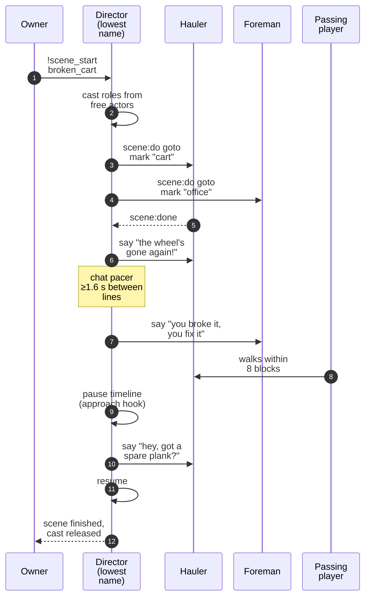

# Scenes

Scenes let several bots on the same server act something out together: a cart breaks down and
the crew argues about it, two neighbours gossip on an evening walk, a market opens at dawn.
Players can watch, walk up, talk to the cast or poke them, and the scene reacts.

Scenes are data. You write them in YAML (or TS) and the engine does the casting, timing,
chat pacing and syncing between bots.

```bash
node src/cli.ts fleet fleets/scenes.example.yaml   # three actors on mc02
```

In game:

```
!scene_list
!scene_start broken_cart
!scene_status
!scene_stop
```

## Concepts

- **Actor**: a bot with `sceneBrain()`. Actors on the same server register on the [fleet](/concepts/architecture#fleets-and-multiple-servers)
  blackboard and can be cast into scenes. `variants/actor.ts` is a ready-made one.
- **Scene**: roles, a place to stage it (anchor + marks), a timeline of beats, and optional
  player interactions and a schedule.
- **Role**: a named part (`hauler`, `foreman`). Casting gives each role a free actor.
- **Director**: one bot per running scene drives the timeline. It sends each beat to the
  cast member that performs it and waits for the result. Cues sync roles.
- **Coordinator**: one bot per server takes start/stop requests and runs schedules. Any actor
  can receive `!scene_start`; it gets routed to the coordinator.

Scene actions run at `PRIORITY.scene` (25): above NPC routines (20), below LLM brains (30),
player commands (50) and [reflexes](/concepts/world#reflexes) (60). If you tell an actor to `!follow` you mid-scene, it
follows you; the scene waits a few seconds for the body and then skips that bot's movement
beats. Its lines keep going. Reflexes (fighting back, eating) preempt scene beats the same way.

Between its beats a cast member holds its body with the internal `scene_hold` action, also at
scene priority. That keeps lower-priority brains out of the way for the whole run: an actor
that also has the [NPC brain](./npc-brain.md) backs off instead of wandering off or chatting
over the scene, and goes back to its routine once the scene ends. Actors don't need the NPC
brain, but it combines well: villagers living their lives who drop everything when the market
scene starts.



## Writing your first scene

Create `scenes/hello.yaml`:

```yaml
name: hello
description: Two bots say hello and wave.

roles:
  left: {}
  right: {}

anchor: { role: left }      # stage it where "left" is standing
marks:
  meet: [2, 0]              # 2 blocks east of the anchor (x, z offsets)

beats:
  - parallel:
      - [{ as: left, goto: meet }]
      - [{ as: right, goto: meet, range: 2 }]
  - { as: left, look: right }
  - { as: left, say: "Morning, {role:right}!" }
  - { as: right, look: left }
  - { as: right, say: ["Morning!", "Oh, hi {role:left}."] }
  - { as: right, gesture: swing, times: 2 }
```

Restart the actors (scenes load at startup), then `!scene_start hello`. If the file is
invalid the bot logs which beat is wrong, for example
`scene hello.yaml: beats[3]: unknown role "rigth"`.

The same scene in TS:

```ts
import { scene, b } from '../src/brains/index.ts'

export const hello = scene('hello', 'Two bots say hello and wave.')
  .role('left').role('right')
  .anchor({ role: 'left' })
  .mark('meet', 2, 0)
  .beats(
    b.parallel([b.goto('left', 'meet')], [b.goto('right', 'meet', { range: 2 })]),
    b.look('left', 'right'),
    b.say('left', 'Morning, {role:right}!'),
    b.look('right', 'left'),
    b.say('right', ['Morning!', 'Oh, hi {role:left}.']),
    b.gesture('right', 'swing', 2)
  )
  .build()

// variants/actor.ts: sceneBrain({ scenes: [hello] })
```

`build()` and `defineScene({...})` validate the same way YAML loading does.

## Scene format reference

### Top level

| field | |
|---|---|
| `name` | letters, digits, `_`, `-`. Used in `!scene_start <name>`. |
| `description` | shown by `!scene_list` data and in logs. |
| `roles` | map of role name to role spec (below). At least one. |
| `anchor` | where the scene is staged; see below. Default: where the first role's bot stands. |
| `marks` | named offsets from the anchor: `[dx, dz]` (walk to the surface there) or `[dx, dy, dz]`. |
| `beats` | the main timeline. |
| `tracks` | `role: [beats]`, timelines that run alongside the main one. Beats in a track default to that role. |
| `interactions` | player hooks, see [Player interaction](#player-interaction). |
| `schedule` | when to start on its own, see [Scheduling](#scheduling). |
| `vars` | initial scene variables (read as `$name`). |
| `options` | timing knobs, see [Options](#options). |

The scene ends when the main timeline and every track have finished.

### Roles

```yaml
roles:
  hauler: { description: owns the cart }
  guard: { requires: [guard, follow] }  # the bot must have these actions
  boss: { prefer: [Foreman] }           # these usernames first, if free
  extra: { optional: true }             # scene runs without it; its beats are skipped
```

### Anchor

```yaml
anchor: { pos: [120, 64, -40] }        # fixed spot
anchor: { role: hauler }               # where that bot is when the scene starts
anchor: { player: nearest, radius: 32 } # nearest player to the cast (scene fails if none)
anchor: { player: Steve }              # a named player
```

Marks are offsets from the anchor, so the same scene works anywhere. Use 2-element marks
unless you know the terrain; the bot then walks to the surface at that x/z.

### Beats

Every beat is an object with exactly one kind key. Body beats (`say`, `act`, `goto`, `look`,
`gesture`) need a role: `as: <role>`, or they inherit it from a track or an interaction.
All beats accept `timeoutMs`. A failed or timed-out beat is logged and skipped; the scene
carries on.

| beat | example | does |
|---|---|---|
| `say` | `{ as: miner, say: "Got it!" }` | public chat. A list picks one at random (never the same twice in a row). `whisper: true` whispers to the current player. `typingMs` overrides the typing delay. |
| `act` | `{ as: hauler, act: equip, params: { item: stick } }` | any action the bot has. String params are templated. |
| `goto` | `{ as: miner, goto: stash, range: 2 }` | walk to a mark, a role's bot, `player` or `anchor`. |
| `look` | `{ as: foreman, look: hauler }` | look at a mark, role, `player` or `anchor`. |
| `gesture` | `{ as: hauler, gesture: nod, times: 2 }` | `swing`, `crouch`, `nod`, `shake`, `spin`, `jump`. Harmless body language. |
| `wait` | `{ wait: 1500 }`, `{ wait: [1000, 3000] }` | pause this timeline (range = random). |
| `cue` | `{ cue: parts_here }` | fire a sync point. Also broadcast on the fleet bus as `scene:cue`. |
| `await` | `{ await: parts_here, timeoutMs: 30000 }` | block until the cue fired (in this run, or broadcast by anyone). Times out after `awaitTimeoutMs` and carries on. Cues prefixed `ext:` may come only from outside. |
| `parallel` | `parallel: [[...], [...]]` | run branches at the same time, continue when all finish. A branch can be one beat instead of a list. |
| `repeat` | `repeat: { times: [2, 4], beats: [...] }` | loop `times` (range = random), or `forMs`, or forever if neither (until stopped or `maxDurationMs`). |
| `choose` | `choose: [{ weight: 3, beats: [...] }, { beats: [...] }]` | run one branch by weight (default 1); avoids the same branch twice in a row. |
| `if` | `if: { key: $helped, equals: true }` + `then:` / `else:` | branch on a scene variable (`$name`) or a server blackboard key. Tests: `equals`, `notEquals`, `exists`, `gt`, `lt`, `chance`. |
| `set` | `set: { $helped: true, market_open: true }` | set scene variables (`$`) or blackboard keys. |

### Lines and templating

Lines (and string params of `act`) can use:

| placeholder | becomes |
|---|---|
| `{player}` | the player the scene is reacting to (or "friend") |
| `{me}` | the speaking bot's username |
| `{role:hauler}` | the username playing that role |
| `{$name}` | a scene variable |
| `{scene}` | the scene name |

YAML tip: quote any line that starts with `{`, or YAML reads it as a map.

#### lineProvider

`sceneBrain({ lineProvider })` gets every line before it is said and may return a replacement:

```ts
sceneBrain({
  lineProvider: async (req) => {
    // req: scene, role, speaker, line (default, templated), variants, player, vars, cast,
    //      context ('beat' | 'approach' | 'chat' | 'hit'), message (for chat)
    if (req.context === 'chat') return await myLlm.reply(req.speaker, req.message, req.line)
    return undefined   // keep the default
  }
})
```

Empty answers, errors and anything slower than 3 s fall back to the default line. Output is
capped at 240 characters. This is where an [LLM brain](/guide/llm-brain) can improvise.

### Options

| option | default | |
|---|---|---|
| `lineGapMs` | 1600 | minimum gap between any two lines of the cast (shared by all scenes on the server) |
| `botLineGapMs` | 2000 | minimum gap between two lines of the same bot |
| `typingMsPerChar` | 35 | typing delay before a line (clamped 0.4 to 2.5 s; 0 turns it off) |
| `beatTimeoutMs` | 45000 | default timeout for act/goto/look/gesture beats |
| `busyWaitMs` | 8000 | how long a beat waits for a bot busy with a higher-priority action |
| `recastTimeoutMs` | 20000 | how long to look for a replacement when a cast member drops |
| `maxDurationMs` | 600000 | hard limit per run |
| `maxReactions` | 4 | player reactions per run |
| `awaitTimeoutMs` | 60000 | default `await` timeout |

Vanilla servers kick for chat spam. Keep the defaults unless you know the server's limits.

## Casting and directing

When a scene starts:

1. The request reaches the **coordinator**: an online actor with `director: true`, otherwise
   the online actor with the lowest username.
2. **Casting**, in role order. First every role gets a preferred bot if one is free: the
   scene's `prefer` list, then actors that list the role in their own `roles` setting. Then the
   remaining roles get the lowest-named free actor that has the required actions. A required
   role nobody can play cancels the start (`can't cast broken_cart: no free actor for role
   miner`).
3. The **director** is a `director: true` actor if one is online, otherwise the cast member
   with the lowest username. It runs the timeline.

Actors cast in a run are busy until it ends; another scene can't use them, but a second scene
with other actors can run at the same time.

Per-bot settings go in the [fleet file](/guide/running#a-fleet):

```yaml
bots:
  - bot: actor
    username: Hauler
    settings: { scenes: { roles: [hauler, talker] } }
  - bot: actor
    username: Stage
    settings: { scenes: { director: true } }   # directs everything while online
```

`settings` from `defaults` and from a bot entry are merged shallowly, so a bot's
`settings.scenes` replaces the default `settings.scenes` as a whole.

**Recasting.** If a cast member disconnects, the director pauses the scene, interrupts what
was in flight and looks for a replacement for `recastTimeoutMs`: the same bot coming back,
or another free actor that fits the role. Then it resumes and redoes the interrupted beats.
If nobody turns up, the scene aborts and everyone is released. An optional role is just
dropped.

**Stopping.** `!scene_stop` (or the time limit, or an interaction with `then: stop`) aborts
the timeline and cancels every action the run started on every cast member, and nothing else:
a player's `follow` or a suspended NPC routine on the same bot is left alone.

**State** lives on the server blackboard (`agent.fleet.board(server)`):

| key | value |
|---|---|
| `scene:actors` | `{ [username]: { online, director, actions, roles?, busyIn? } }` |
| `scene:runs` | `{ [runId]: { scene, director, cast, status, beat, startedAt, by } }` |
| `scene:last` | the last finished run: `{ scene, result: finished/stopped/aborted, reason }` |

Other brains can watch these (`board.watch('scene:runs', ...)`) or listen to `scene:cue`
messages on the fleet bus.

## Player interaction

```yaml
interactions:
  - on: approach          # a player comes within `radius` (default 6) of a cast member
    radius: 6
    mode: pause           # pause (default): pause, react, resume. aside: react alongside.
    cooldownMs: 60000     # between two runs of this interaction (default 30 s)
    perPlayerCooldownMs: 300000   # per player (default 120 s)
    beats:
      - { as: hauler, look: player }
      - { as: hauler, say: "Hey {player}! Give us a hand?" }
      - { set: { $helped: true } }
  - on: chat              # a player chats within `radius` (default 12), or names a cast member/role
    match: "\\b(hi|hello|help)\\b"   # optional regex, case-insensitive
    mode: aside
    beats:
      - { look: player }
      - { say: "Hi {player}, bit busy right now!" }
  - on: hit               # a player hits a cast member
    then: stop            # end the scene after reacting (default: resume)
    beats:
      - { say: "Fine, we'll go elsewhere." }
```

- Body beats without `as` are performed by the cast member the player approached, addressed
  or hit.
- `{player}` and `look/goto: player` refer to that player from then on, so the main
  timeline can thank them later (`if: { key: $helped, equals: true }`).
- Only one reaction runs at a time, at most `maxReactions` per run, and only non-fleet players
  count. Several cast members seeing the same thing produce one reaction.
- In `pause` mode the scene's in-flight beats are interrupted and redone after the reaction.

Keep reactions short: two or three lines.

## Scheduling

```yaml
schedule:
  everyMs: 1800000        # every 30 min (+ random jitterMs)
  jitterMs: 300000
  at: [dawn, dusk, 9000]  # game times: dawn 0, morning 1000, noon 6000, dusk 12000, night 13000, midnight 18000, or ticks
  whenPlayersNear: 16     # when a player comes within 16 blocks of a free actor
  requirePlayersNear: 32  # only start if someone is around to watch
  chance: 0.5             # each trigger starts it with this probability
  cooldownMs: 600000      # minimum gap between scheduled runs (default 5 min)
  ambient: true           # may be picked as idle filler
```

Only the coordinator runs schedules, so a scene isn't started twice. Ambient scenes fill the
gaps: when nothing is running, every 2 to 5 minutes the coordinator picks a random ambient
scene it can cast, if a player is within 48 blocks of an actor. Tune or disable it with
`sceneBrain({ ambient: { gapMs: [60000, 180000], requirePlayersNear: 32 } })` or
`ambient: false`; `schedule: false` turns schedules off. Both can also be set per bot in
`settings.scenes`.

## Actions

| action | |
|---|---|
| `scene_start <name>` | start a scene |
| `scene_stop [name]` | stop one or all running scenes |
| `scene_status` | running scenes with their beat, status and cast |
| `scene_list` | scenes this bot knows |
| `scene_walk`, `scene_look`, `scene_gesture` | internal stage directions used by goto/look/gesture beats |
| `scene_hold` | internal: keeps the body between beats |

They come with `sceneSkill()` (and `sceneBrain()` registers them if the skill is missing).
When several actors hear the same public `!scene_start`, the first one handles it and the
others stay quiet. Who may run them is the command brain's owner check, plus
`sceneBrain({ allow: (player, op, scene) => ... })` if you want finer control.

## Troubleshooting

| symptom | likely cause |
|---|---|
| `scene x.yaml: beats[3]: ...` at startup | validation error, the path points at the beat. The file is skipped, other scenes still load. |
| `can't cast ...: no free actor for role X` | not enough online, free actors, or none with the role's `requires`. `!scene_status` shows who is busy. |
| `X is already running` | one run per scene at a time. `!scene_stop X`. |
| a bot stands still while the others carry on | it was busy with a higher-priority action (player command, reflex) and its beats were skipped. Look for `busy` in the log. |
| `scene_walk: ... skipping` | no path to the mark. Use 2-element marks (surface), smaller offsets or a larger `range`. |
| `await X: timed out` | the cue never fired: its branch failed or the cue name has a typo. |
| the scene reacts to nobody | interactions only count non-fleet players, honour cooldowns and `maxReactions`. Bots from another process do count as players. |
| lines arrive slowly | that's the pacing (`lineGapMs`, `botLineGapMs`, typing delay). Lower them only on servers without spam kicks. |
| ambient scenes never start | ambient needs `schedule.ambient: true` scenes, no running scene and a player within 48 blocks (see `ambient` options). |

Scene logs go to `<bot>/scene` with structured fields (`scene`, `run`, `beat`, `role`, ...),
so you can turn them up without the rest:

```bash
MC_LOG_LEVEL='info,*/scene=debug'               # casting, cues, branches, pauses
MC_LOG_LEVEL='info,*/scene=trace,*/action=debug' # plus every dispatched beat and action
```

Only the director's bot logs a run's decisions; members log the actions they perform under
`<bot>/action`. See [Logging](./logging.md).
