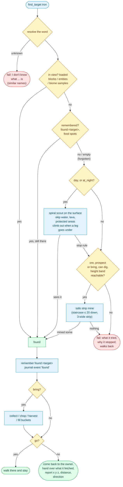
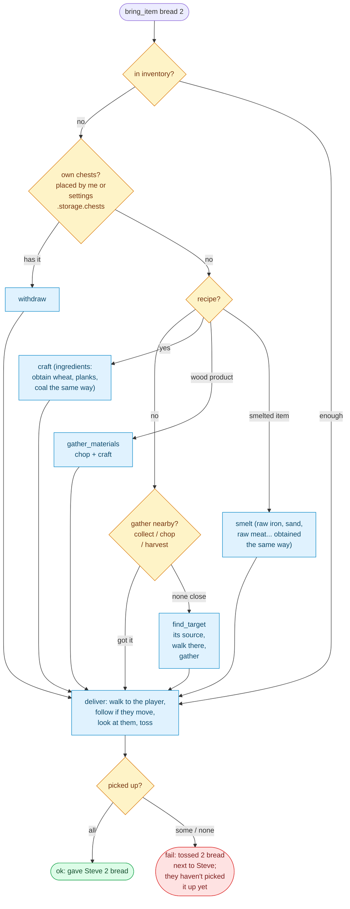

# Finding and fetching

Owners ask for things: "where's iron?", "find sheep", "bring me 16 planks", "get my stuff, I
died". The `search` skill (in the extended skills) answers these without the LLM, so
[plain-language commands](/guide/intents), chat commands and LLM tools all end up in the same three actions.

- **Decisions** (`src/skills/searchPlan.ts`, pure, unit tested in `test/search.test.ts`): what a
  word means, which search phases run, village and portal recognition, where an item comes from,
  how many items a toss really handed over, whether drops can still be reached.
- **Skill** (`src/skills/search.ts`): reads the world, walks, gathers and hands things over.

## Actions

| action | |
|---|---|
| `find_target` | `target` (a word), `radius` (160), `max_minutes` (8), `bring` + `count` (also fetch some), `go` (walk there and stay instead of coming back), `prospect` (strip mine for ores), `at_night`. |
| `bring_item` | `item`, `count` (1), `player` (default the asker), `max_minutes` (10, for a search). |
| `fetch_drops` | `player` (default the asker), `x y z` when the bot didn't see the death, `try_anyway`. |

```
!find_target iron
!find_target village go=true
!find_target sand bring=true count=16
!bring_item oak_planks 16
!bring_item bread 2
!fetch_drops
```

All three are long-running: they honour the stop signal, whisper milestones to whoever asked
(at most every 20 s; "found" and "giving up" always), and put the elapsed time in the result.

## What a word means

| word | resolves to |
|---|---|
| `iron`, `iron ore`, `raw_iron`, `diamonds`, `coal`, `lapis`... | the ore family: stone and deepslate [variants](/concepts/variants-profiles); fetching gives the drop (raw_iron, diamond) |
| `logs`, `trees`, `wood` | every natural log; fetched by felling trees |
| `wheat`, `carrots`, `potatoes`, `beetroots` | **ripe** crops on the bot's own farms or village farms (a villager within 24 blocks) |
| `water`, `lava` | source blocks with open air above; fetched into empty buckets |
| `sheep`, `cows`, `villager`, `animals` | entities (plurals are fine; "chicken" is the mob) |
| `village` | beds, a bell and villagers close together (see below) |
| `nether portal`, `portal` | a lit portal, or an obsidian frame |
| `chest` | chests and barrels: reported, never broken or emptied |
| `desert`, `snow`, `ocean`, `jungle`, `forest`... | biomes, by pattern over the server's biome names; exact names (`dark_forest`) work too |
| any block or item name | that block (fetched with `collect` when it is natural) or item |
| modded names (`andesite alloy`, `create:andesite_casing`) | from the [registry sync](/concepts/neoforge#_4-modded-item-and-entity-names); modded mobs can be found, modded blocks all look alike in the world, so they can only be brought from the inventory, chests or crafting |

## find_target



- **In view** means loaded chunks: blocks up to 96 blocks away (ores too, through the ground,
  since the bot has the chunk data; the report says how far below the surface), entities the
  server sends, biomes sampled every 16 blocks at the surface.
- **The scout** is [find_food](/guide/behaviors)'s spiral with the target's look: day only by
  default, it stops at low health with mobs near or 3+ mobs around, skips waypoints on water,
  lava, in [protected areas](/concepts/world#protected-areas) and in or past remembered
  [danger zones](/guide/behaviors#ranged-safety) (a skeleton or pillager patrol it fought
  recently), gives up on a direction where a leg got stuck, and climbs out when a leg drops
  underground under a roof.
- **Prospecting** only runs for ores whose height band the strip mine reaches from where the bot
  stands (coal, iron and copper from the surface; diamonds only from y ≈ 30 down).
- **The report** is relative to the owner when the bot can see them (or saw them in the last 15
  minutes), otherwise to where it started, and says so: "in sight: 12 iron ore at 610 41 120,
  76 blocks south-east of you (25 below the surface), remembered as found:iron".

### Village and portal

A **village** is, within 48 blocks of a bell, a villager or a bed: a bell with beds or villagers;
three villagers and two beds; two villagers, two beds and a job site; or, with nobody home, three
beds, two job sites and eight path blocks. Two villagers on their own (a
player's breeder) are not a village. A **nether portal** is a lit portal block, or obsidian that
outlines a vertical rectangle of 4..23 by 5..23 with at most the corners missing.

## bring_item



- **Chests**: only the bot's own. A chest or barrel the bot places is recorded (the skill wraps
  `bot.placeBlock`), and owners can list more in the [profile](/guide/profiles):

  ```yaml
  settings:
    storage:
      chests: ["120 64 -30", [130, 64, -30]]
  ```

  Nobody else's chest is opened for taking, whatever `respectBuilds` says.
- **Crafting** uses the existing `craftItem`; bread, sticks, torches and hay blocks fetch one level
  of ingredients first. Wood products (planks, sticks, tables, chests) go through
  `gather_materials`, which chops and crafts in one go.
- **Smelting**: ingots, glass, stone, smooth stone, charcoal, bricks, baked potatoes and cooked
  meat come out of a furnace; the input (raw iron, sand, cobblestone, logs, raw beef...) is
  obtained the same way first, one level deep.
- **Crops** come only from the bot's own farms or village farms, and each harvested crop is
  replanted when the bot has the seed.
- **Tidy**: crafting tables and furnaces it puts down while crafting are dug up again and picked up.
- **Delivery** watches the player's `playerCollect` events for 4 s after the toss, so "gave" means
  the player picked it up. Items that weren't picked up, or fewer than asked, make the result a
  failure that says so.

## fetch_drops

The skill reads death messages (the same parser as the [journal](/guide/journal)) and notes
where the player was: their entity if the bot can see them, otherwise where it last saw them
(tracked every 2 s). Items despawn after 5 minutes in loaded chunks, so the bot only goes when
the walk (3.5 blocks/s, plus 20 s to pick up) fits in the time left; otherwise it says how far it
is and how long is left. `try_anyway=true` goes regardless: items only age while somebody keeps
the area loaded. It picks up everything within 14 blocks, comes back and hands it all over, or
says "nothing left at x y z" (despawned, picked up, or keepInventory).

## Live test

`scripts/search-test.ts` runs the actions on a live server as if the tester player asked:

```sh
node scripts/search-test.ts walk 600 -150 565 -280      # both walk there, via waypoints
node scripts/search-test.ts run 'find_target {"target":"iron"}' 'bring_item {"item":"oak_planks","count":16}'
node scripts/search-test.ts drops                      # the tester drops its things, the bot fetches them back
```

Results on mc02 (bot `FindTest`, owner `FindTester`, 330 to 400 blocks from spawn in snowy spruce
taiga with lakes; neither bot had food, so both ran hungry):

| run | result |
|---|---|
| `find_target iron` | in sight, 0.1 s: "64+ iron ore at 554 45 -292, 11 blocks north-west of you (20 below the surface)" |
| `find_target water` | in sight, 0.0 s: "water at 559 62 -289, 5 blocks north-west of you" |
| `find_target iron bring=true count=3` | 317 s from an empty inventory: felled a tree, made a wooden then a stone pickaxe, mined 3 raw iron, picked both crafting tables back up; the hand-over failed (the tester was 22 blocks off in the spawn's protected woods) and the result said so |
| `find_target sheep` | no sheep anywhere: "scouted 125 blocks east, south, north-west and north-east, no sheep; stopped: health is low (1/20) with mobs near" (295 s); on an ocean site "covered every direction" in 136 s (most waypoints were water) |
| `bring_item planks 16` | 60 s: trees 34 blocks away, felled one spruce, crafted 16 spruce planks, tossed them (the tester didn't pick them up then; the bot now hands over from 2 blocks) |
| `bring_item oak_planks 16` | failed truthfully: only spruce nearby; the one oak it found was on the far side of the spawn's protected woods ("couldn't get to any of it") |
| `bring_item bread 2` | failed truthfully: no village or own farm within 160 blocks, so no wheat to harvest |
| `fetch_drops x y z` | 15 s: walked to the drop spot, picked up 78 items, came back and tossed them all; the tester picked up all 78 |

What the runs changed: `travel()` now swims up when the air runs low (the bot drowned four times on
lake beds), searches stop at critical health (a starving bot froze in powder snow), buried logs
(mineshaft beams at y 9) no longer count as trees, depth is only reported for ores, block counts
at the search cap read "64+", and one-wood planks come from that wood's logs.

## Limitations

- Biomes depend on the server's biome ids reaching mineflayer; a block without a biome name
  can't be matched.
- Modded blocks all look the same in the world, so they are never found, only brought.
- `fetch_drops` picks up everything near the death spot; it can't tell the owner's items from
  others lying there.
- Prospecting is a staircase at most 20 blocks down, so diamonds are only prospected from about y 30.
- Hunting for food items (beef, mutton) and shearing are not gather sources yet.
