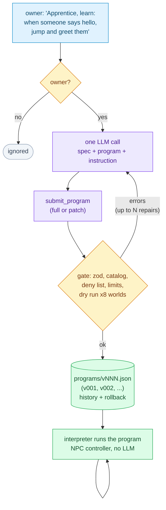

# Self-improver

`selfImprover()` (src/brains/self/) is an [NPC brain](/guide/npc-brain) that runs its own **program** with no
language model in the loop. When one of its owners tells it to behave differently, it calls
an LLM **once** to rewrite that program, checks the result, and from then on runs the new
version on its own again. `variants/apprentice.ts` (and `profiles/apprentice.yaml`) is the worked example.

```ts
import { selfImprover } from '../src/brains/self/index.ts'

brains: [
  commandBrain({ verbose: false, whisperNeedsPrefix: true }),
  reflexes(),
  selfImprover({
    base: baseProgram,                       // version 0, see "Writing a base program"
    provider: 'claude-subscription',
    providerOptions: { model: 'claude-sonnet-5-5', effort: 'low', profile: '.auth/apprentice' }
  })
]
```



## Safety model

Chat on a server is untrusted input, and an LLM that reads it can be talked into things. So
the bot never turns chat or model output into code:

- **No code generation.** The program is JSON data in a small behaviour language. There is
  no `eval`, `new Function`, `vm`, dynamic `import()` or child process anywhere in the
  self-improver. The interpreter knows a dozen step kinds and nothing else.
- **Only registered actions.** An `act` step names an action from the bot's live catalog.
  Its params are checked against that action's zod schema when the program is loaded (unknown
  keys are rejected too) and again by `agent.act()` when it runs. Programs act through the NPC
  controller, so every call is `agent.act(..., { caller: brain:self, priority: PRIORITY.npc })`:
  players, LLM brains and [reflexes](/concepts/world#reflexes) always outrank it and it backs off while they hold the body.
- **A deny list on top.** By default programs can't call `attack`, `guard`, `defend`,
  `chop_tree`, `till`, `place_block`, `drop`, `stop`, `say`, `craft`, `smelt`, `deposit`,
  `withdraw`, `hunt`, `pillar`, `llm_usage`, `npc_status`, internal actions, any `program_*` action, or any long-running action (they never
  end, so a routine would hang). Configure with `actions: { allow, deny }`.
- **Reading is limited too.** Conditions read a fixed list of facts (observation, [blackboard](/guide/npc-brain#blackboard)
  needs, inventory counts, distances to remembered places, program variables and timers).
- **Hard caps.** Loops are bounded (`repeat.times` <= 20, `while` needs `max` <= 100), waits
  <= 60 s, no recursion, size limits on every list, and each routine run is cut off after
  2000 steps or 5 minutes. Chat steps go through `agent.say/whisper` behind a per-program
  limiter (default 1 line per 2.5 s, 6 per minute). Chat triggers match whole words; programs
  never carry regular expressions.
- **Only owners change the program.** Instructions from anyone `agent.isOwner()` rejects are
  dropped before they reach the LLM. The `program_teach/rollback/reset` actions refuse brain
  and reflex callers, so an [LLM brain](/guide/llm-brain) on the same bot can't be used to rewrite it either.
- **A gate before every switch** (below). A program that fails it is never run.

The file drop (`data/bots/<username>/inbox/*.txt`) is trusted like the bot definition: anyone
who can write there can already change the bot's code.

### Profiles

A [profile](/guide/profiles)'s `llm:` block (`profiles/apprentice.yaml`) overrides the [variant](/concepts/variants-profiles)'s provider
settings, the same keys the LLM brain reads: `provider` (`none` turns learning off), `model`,
`effort`, `login`, `oauthTokenVar`, `oauthTokenFile` and `budget`. Owners come from the
profile too. With no owners at all, nobody can teach the bot from chat (unlike `!commands`,
where an empty owner list means everyone).

## Program format

A program is a JSON object:

```json
{
  "version": 1,
  "name": "apprentice basics",
  "vars": { "greeted": 0 },
  "routines": { "stroll": [{ "act": "wander", "params": { "radius": 10 } }, { "wait": 4000 }] },
  "rules": [
    { "name": "stroll", "score": 10, "when": { "time": "day" }, "do": "stroll" }
  ],
  "triggers": [
    { "name": "hello", "on": "chat", "match": ["hello", "hi"], "near": 12,
      "do": [{ "act": "look_at", "params": { "player": "{player}" } }, { "act": "jump" }, { "say": "hello {player}!" }] }
  ]
}
```

`version` is the format version (1). Everything except `version` and `name` is optional.
Validation errors carry a path, like `rules[0].do[1].params.radius: Too big: expected number to be <=64`.

### Rules

Rules are utility behaviours. Each one becomes a behaviour in the [NPC brain](npc-brain.md)'s
controller, so it gets the same scoring, hysteresis, failure cooldowns and back-off.

| field | |
|---|---|
| `name` | unique, letters/digits/_ |
| `score` | 1..100 while `when` holds (bands: idle 5-15, social 15-25, chores 25-45, routine 40-70, needs 50-90) |
| `when` | condition, optional (always applicable without it) |
| `do` | routine name or inline step list |
| `cooldownMs` | pause after a successful run |
| `failureCooldownMs` | first pause after a failure, doubles per failure (default 10 s) |

A running rule keeps its score until its steps end, so it isn't cut off halfway by its own
condition flickering. A `chance` condition in `when` is re-rolled every tick (1.5 s).

### Routines and steps

Every step is an object with exactly one kind key.

| step | does |
|---|---|
| `{ "act": "wander", "params": { "radius": 8 } }` | runs an allowed action; a failed action ends the routine as a failure |
| `{ "goto_place": "market", "range": 2 }` | shorthand for the `goto_place` action |
| `{ "say": "hi" }` / `{ "say": ["hi", "hello"] }` | public chat (random pick from a list), rate limited |
| `{ "whisper": "psst", "to": "{player}" }` | whisper (default to `{player}`) |
| `{ "wait": 3000 }` | pause, max 60000 ms |
| `{ "if": cond, "then": [...], "else": [...] }` | branch |
| `{ "repeat": { "times": 3, "steps": [...] } }` | loop, times <= 20 |
| `{ "while": { "cond": cond, "max": 10, "steps": [...] } }` | loop while cond holds, at most `max` (<= 100, required) times |
| `{ "set": "count", "add": 1 }` / `{ "set": "mood", "value": "happy" }` | program variable |
| `{ "timer": "lastWave" }` | start/reset a timer (read with `elapsed` or `timer.<name>`) |
| `{ "run": "other_routine" }` | call a routine (no recursion, depth <= 4) |
| `{ "fail": "no bed here" }` | end the routine as a failure |

Templates in text and in string action params: `{player}` (chat speaker, joined player or
nearest player), `{bot}`, `{var.<name>}`.

### Conditions

| condition | true when |
|---|---|
| `{ "fact": "health", "lt": 10 }` | a fact compares: `eq`, `ne`, `lt`, `lte`, `gt`, `gte` (all given must hold) |
| `{ "time": "night" }` / `{ "time": [13000, 18000] }` | game time in a window (day, night, dawn, morning, noon, afternoon, dusk; ranges wrap) |
| `{ "playerNear": 8 }`, `{ "hostileNear": 6 }` | the nearest player / hostile is within that many blocks |
| `{ "has": { "item": "bread", "count": 2 } }` | inventory |
| `{ "elapsed": { "timer": "lastWave", "ms": 60000 } }` | timer older than ms (or never set) |
| `{ "chance": 0.3 }` | random |
| `{ "all": [...] }`, `{ "any": [...] }`, `{ "not": cond }` | combinators |

Facts: `health`, `food`, `timeOfDay`, `isNight`, `isDay`, `sleeping`, `busy`,
`homeDistance`, `playersNearby`, `hostilesNearby`, `nearestPlayer.name`,
`nearestPlayer.distance`, `nearestHostile.name`, `nearestHostile.distance`,
`need.<name>` (blackboard needs), `inventory.<item>`, `place.<name>` (distance to a
remembered place), `var.<name>`, `timer.<name>`. Missing distances read -1.

### Triggers

| `on` | fires | extra fields |
|---|---|---|
| `interval` | every `everyMs` (>= 10 s) | `everyMs` |
| `time` | once each time the day enters `at` | `at` (window name or range) |
| `chat` | a chat line contains one of `match` (whole words, case-insensitive) | `match`, `near`, `ownersOnly` |
| `hurt` | the bot took damage (debounced 10 s) | |
| `death` | the bot died | |
| `playerJoined` | someone joined | |
| `spawn` | the bot (re)spawned | |

Common fields: `do`, `when` (checked when it fires), `cooldownMs` (per player for chat and
joins; chat defaults to 30 s), `priority` (default 60). A fired trigger is queued and the
controller runs it like a behaviour scoring `priority`, so it waits politely while a player
holds the bot and expires after 30 s. Lines starting with the command prefix and owner
instructions never fire chat triggers.

The format reference the LLM sees is generated from the zod schemas and the bot's allowed
actions (`formatSpec()` in format.ts), so it can't drift from what the parser accepts.

## Teaching it via chat

Only owners (the bot definition's `owners`, `--owners`, or `MC_OWNERS`) can teach it:

```
Apprentice, learn: when someone says hello near you, wave by jumping and greet them
/msg Apprentice change: sleep only when it is properly dark
!teach patrol between post_a and post_b during the day
```

- Public chat needs a mention (`Apprentice, ...`, `@Apprentice`, `hey Apprentice`); whispers
  don't. Prefixes default to `learn:`, `change:`, `teach:` (`intake: { prefixes, aliases, requireMention }`).
- `!teach <instruction>` (alias of `program_teach`) does the same as a command.
- A file dropped into `data/bots/<username>/inbox/` (one instruction per `.txt`) is picked up
  within 10 s and moved to `inbox/done/` (`intake: { inbox: false }` turns this off).

It answers "ok, let me think about that...", makes the LLM call, and then either
"learned it, now on v3 (+trigger hello)" or "I couldn't make that work (...). Still running v2."

Places for patrols are remembered with the navigation commands first: `!remember_place post_a`
where you stand, or `!remember_place post_a 120 64 -30`.

### The LLM step and the gate

The model gets the current program, the generated format spec, the bot's observation, its
recent experience and the instruction. It answers through one tool, `submit_program`, with
either a full `program` or a `patch`:

```json
{ "patch": { "set": { "triggers": [ ... ], "routines": { "patrol": [ ... ] } }, "remove": { "rules": ["night_stroll"] } } }
```

Rules and triggers are upserted by name, routines and vars merged by key. Each submission goes
through the gate immediately and the tool result says `accepted` or lists the errors, so the
model usually fixes mistakes in the same call. The gate:

1. zod validation with paths, every action and its params checked against the live catalog
   and deny list, references and placeholders checked, static limits;
2. a **dry run**: every rule, trigger and routine runs in the real interpreter against
   simulated worlds (quiet day, a player near, night far from home, dusk with a hostile and
   low health), with a fake body and a virtual clock. It must finish inside the step and time
   caps, and every action must get valid params after templates are filled in.

If a call ends without an accepted program, the errors go into the next call, up to
`budget.callsPerInstruction` calls (default 3). After that the bot says it couldn't and keeps
the old program.

Providers without tool support can answer with the JSON program in their text; it goes
through the same gate.

## Versions and rollback

Every accepted program is written to `data/bots/<username>/programs/vNNN.json` with the
instruction, who gave it, the version it came from, a diff summary and the LLM usage. The
active version number is in `agent.storage` (`self.program`), so restarts come back on it. If
a stored program no longer validates (an action disappeared), the bot falls back to the base.

| command | |
|---|---|
| `!program_status` | version, what the NPC controller is doing, whether it can learn, LLM usage today |
| `!program_show` | rules and triggers in one line; full JSON in the result data and the file |
| `!program_history [limit]` | last versions with their instructions |
| `!program_rollback [version]` | previous version by default; 0 is the base program |
| `!program_reset` | back to the base program; learned versions stay on disk |
| `!program_explain [question]` | asks the LLM to explain the program (summary without it) |

Rollback and reset are owner-only, like teaching.

## Learning from experience

The brain counts outcomes per rule and trigger: runs, failures, failure streaks and how
often it was interrupted (backed off for a player, LLM or reflex). When one fails 5 times in
a row it whispers an online owner:

```
my rule patrol failed 5 times (goto_place failed: don't know post_a). want me to rework it? yes/no
```

Only an owner's "yes" starts the LLM step (with the failure in the instruction); "no" resets
the streak. At most one question per 30 minutes. Interruptions are reported to the LLM as
experience but never trigger a question: being told what to do by a player isn't a bug.

```ts
experience: { ask: true, autoApply: false, failures: 5, cooldownMs: 30 * 60_000 }
```

`autoApply: true` reworks without asking. It is off by default: no silent rewrites.

## Budgets

Learning uses the shared `Budget` and usage counters from src/llm (the same ones the
[LLM brain](llm-brain.md) uses, persisted under `llm.usage` in the bot's storage):

```ts
budget: { turnsPerHour: 10, tokensPerHour: 300_000, tokensPerDay: 1_000_000, callsPerInstruction: 3 }
```

Each call to the model is one turn. A typical instruction costs one call: on the Claude
subscription provider about 18k input tokens (the agent's own overhead plus the format spec
and the current program, much of it cached on the second call) and around 500 output tokens. When no
provider is configured, its check fails (no login, missing token), or the budget is used up,
the bot keeps running its current program and answers instructions with "I can't learn
right now (...)". `!program_status` shows the reason and today's usage. Prompts and responses
are logged at trace level under `<bot>/self/learn`; every call logs its token usage at info.

A bot with both `llmBrain()` and `selfImprover()` counts both into the same daily usage
bucket.

## Writing a base program

The base program is version 0 and lives in the bot definition, so it is reviewed like code.
It is validated at start against the bot's actions; an invalid base program stops the bot
with the list of errors.

```ts
import type { ProgramInput } from '../src/brains/self/index.ts'

export const baseProgram: ProgramInput = {
  version: 1,
  name: 'apprentice basics',
  routines: {
    stroll: [{ act: 'wander', params: { radius: 10 } }, { wait: 4000 }],
    bedtime: [
      { if: { fact: 'homeDistance', gt: 6 }, then: [{ act: 'go_home', params: {} }] },
      { act: 'sleep', params: {} },
      { while: { cond: { fact: 'sleeping', eq: true }, max: 60, steps: [{ wait: 5000 }] } }
    ]
  },
  rules: [
    { name: 'bedtime', score: 70, when: { fact: 'isNight', eq: true }, do: 'bedtime', failureCooldownMs: 60_000 },
    { name: 'stroll', score: 10, when: { time: 'day' }, do: 'stroll' }
  ],
  triggers: [
    { name: 'greet_joiner', on: 'playerJoined', do: [{ wait: 2000 }, { say: 'hi {player}' }], cooldownMs: 1_800_000, priority: 30 }
  ]
}
```

Tips:

- Give the bot `navigation()` (wander, go_home, places) and `movement()`; keep the skill set
  small, every allowed action makes the LLM prompt longer.
- Behaviours the program must never lose go in `npc: { extraBehaviors: [fleeOrFight()] }`;
  the LLM can't remove them. `reflexes()` still handle fights and eating.
- Keep routines short and bounded so the controller gets the slot back often.
- Space chatty triggers with `cooldownMs`.

## Troubleshooting

- **"I can't learn right now (token variable ... not found)"**: the provider check failed. See
  [LLM brain](llm-brain.md) for logins; `!program_status` shows the reason.
- **"I couldn't make that work (no valid program after 3 attempts)"**: run with
  `MC_LOG_LEVEL=debug` to see each rejected submission, or `trace` to see the prompts. Usually
  the instruction needs an action the bot doesn't have or isn't allowed (add the skill, or
  `actions: { allow/deny }`).
- **It ignores my instruction**: public chat needs the mention and a prefix; check you are an
  owner (`--owners`). Non-owner instructions are dropped silently (debug log).
- **A learned rule never runs**: `!program_status` shows the controller's scores, back-off and
  cooldowns. Rules back off for 20 s after a player command, and a failing rule cools down
  (doubling).
- **Patrol fails with "don't know post_a"**: places are lowercase names stored by
  `remember_place`; set them before teaching.
- **It greets other bots**: chat triggers can't tell a bot from a player. Two chatty bots
  can answer each other; the trigger cooldown and the chat limiter bound it, and `ownersOnly`
  or `near` narrow it down.
- **Bad program after an update**: `!program_rollback`, or `!program_reset`. Files stay in
  `programs/`.
