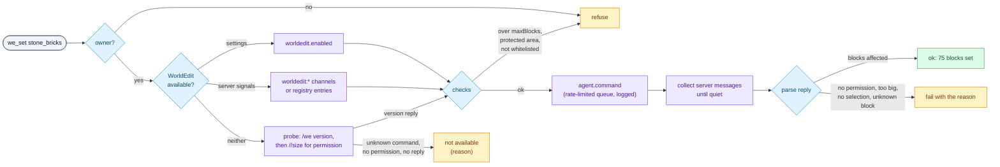

# WorldEdit

On a server that runs WorldEdit (the NeoForge or Fabric mod, the Bukkit plugin, or
FastAsyncWorldEdit) and lets the bot use it, an owner can have the bot do in one command what a
`build` does block by block: fill a region, put up walls, copy and paste, load a [schematic](/guide/blueprints#import) the
server already has. The skill is `worldedit()` in `src/skills/worldedit.ts`, part of the
extended skills.

It is meant for owners who ask for it. Pax's rules say so too: WorldEdit only when robin asks and
the server has it.

## How an action runs



### Detection

In this order, cached for the session:

1. `worldedit.enabled` in settings: `true` skips detection (the [profile](/guide/profiles) key `worldedit: true` sets
   it), `false` turns the skill off.
2. What the server announced: a `worldedit:*` (or `fawe:*`) channel in the NeoForge channel list
   the bot learned at login, a `minecraft:register` payload from a Bukkit plugin, or `worldedit`
   entries in the [registry sync](/concepts/neoforge#_4-modded-item-and-entity-names).
3. If neither says anything, `/we version`. A reply naming WorldEdit or FAWE means it is
   installed; "Unknown or incomplete command", a permission error or silence means it isn't.
4. Installed isn't usable yet: `/we version` answers everyone, while the editing commands only
   answer players with permission (vanilla command trees hide the rest as "unknown command").
   So the bot also sends `//size` with no selection: "Make a region selection first" means it may
   use WorldEdit, "unknown command" means it may not.

`we_status` shows the answer and how it was reached. On mc02 (2026-11-21) WorldEdit 7.3.8 for
NeoForge is installed, but not for the bot:

```
!we_status
WorldEdit not available: no WorldEdit channels or registry entries among 210 channels;
/we version answered WorldEdit 7.3.8+6939-7d32b45, but I have no permission for its commands
(//size: unknown command). no selection; clipboard unknown; limit 50000 blocks, owners only
```

The mod's channels don't show up in the bot's channel list there: the list is learned from the
server's negotiation errors, and optional channels like `worldedit:cui` never cause one. That is
why the probe exists.

### Sending commands

Commands go through `agent.command()`, a small addition to the core: it uses the same queue and
rate limit as chat (one line per 1.1 s, at most 8 waiting), skips the humanize styling (no typos
or lower-casing in a command), never splits a line, logs each command, and resolves once the
command actually went out. Chat still goes through `agent.say`.

### Reading the reply

After a command is sent, the server messages that follow are collected until they stop for
0.6 s (at most `worldedit.replyMs`, 3 s by default) and parsed:

| reply | result |
|---|---|
| `Operation completed (75 blocks affected).`, `45 block(s) have been replaced.` | ok, with the count |
| `First position set to (10, 64, -3)` | the position WorldEdit really set |
| `Size: (5, 4, 7)`, `# of blocks: 140`, `Offset: ...` | clipboard size before a paste |
| `You don't have permission to do this.` | fail: no permission |
| `Unknown or incomplete command` | fail: not installed or not allowed |
| `Max blocks changed in an operation reached` | fail: over the server's limit |
| `Make a region selection first.` / `Your clipboard is empty.` | fail, saying what to do first |
| `Does not match a valid block type` | fail: unknown block or pattern |
| nothing | fail: no reply |

## Actions

All owners only (`worldedit.ownersOnly: false` opens them to everyone); `we_status` answers anyone.

| action | WorldEdit | |
|---|---|---|
| `we_status` | `/we version` | available or not, and why; selection, clipboard, limit |
| `we_select` | `//pos1`, `//pos2` | two corners, or a box around the asking player (`radius`, `height`, `down`) |
| `we_set pattern` | `//set` | fill the selection |
| `we_replace from to` | `//replace` | |
| `we_walls pattern` | `//walls` | sides only |
| `we_outline pattern` | `//faces` | all six faces |
| `we_hollow` | `//hollow` | |
| `we_copy` / `we_cut` | `//copy`, `//cut` | the clipboard remembers where the bot stood |
| `we_paste` | `//size -c`, `//paste -a` | `skip_air` (default), `original` (`-o`), or walk to `x y z` first |
| `we_rotate degrees` / `we_flip` | `//rotate`, `//flip` | |
| `we_undo` / `we_redo` | `//undo`, `//redo` | `times` |
| `we_schem_list` / `we_schem_load name` / `we_schem_save name` | `//schem ...` | the server's schematics folder |
| `we_raw command` | whitelisted | expand, contract, shift, outset, inset, size, count, distr, sel, desel, chunk, stack, move, smooth, naturalize, overlay, center, line... |
| `we_build template` | list, load, paste | a library [blueprint](/guide/goals-and-building#blueprint-format), see below |

Block patterns are passed as WorldEdit reads them (`stone_bricks`, `50%stone,50%cobblestone`,
`oak_stairs[facing=north]`) but only with letters, digits and `, : % [ ] = # . - _ ! ^ & | ~ *`: no
spaces, slashes or quotes, so an argument can't smuggle in another command.

## Safety

- **Selection first.** Region edits only work on a selection the bot made with `we_select` in this
  session, so it knows the size. `we_raw` commands that move the selection (`//expand`...) forget
  it again.
- **Block limit.** Every change is checked against `worldedit.maxBlocks` (50000 by default, a
  [feature toggle](./live-config.md): `!config_set worldedit.maxBlocks 20000`). It counts the
  selection's volume (times the count for `//stack`, twice for `//move`), and for a paste the
  clipboard volume from `//size -c`. The server's own WorldEdit limits apply on top.
- **[Protected areas](/concepts/world#protected-areas).** A region that touches an area where the server refused block breaking, or
  the spawn keep-out square (`settings.build.spawnKeepOut`, 24), is refused unless an owner passes
  `protected_ok=true`.
- **Whitelist.** `we_raw` refuses anything not on the list: no `//regen`, `//butcher`,
  `//generate`, `//sphere`, `//limit`, `/we reload`, `//schem delete` or snapshots.

## Building a library blueprint with WorldEdit

`we_build template=cottage x=.. y=.. z=..` looks for a schematic with the blueprint's name (or
`schematic=`) in `//schem list`. If the server has it, the bot loads it, checks its size, walks to
the spot and pastes it with `-a`. If WorldEdit isn't there, the server has no such schematic, or
the load fails, it builds the blueprint the normal way (`build`), unless `fallback=false`. A
client can't upload files, so the schematic has to be on the server already (an admin copies it
into `plugins/WorldEdit/schematics/` or `config/worldedit/schematics/`).

## Settings

```yaml
# profile
worldedit: true                 # skip detection; or false to turn it off
settings:
  worldedit:
    maxBlocks: 50000
    ownersOnly: true
    replyMs: 3000
```

## Testing

`test/worldedit.test.ts` covers reply parsing (WorldEdit 6/7 and FAWE wordings), the whitelist,
pattern and name checks, limits, protected areas, detection (including the mc02 case) and the
actions against a fake agent that answers commands like a server, with and without WorldEdit.

## Limitations

- If `/we version` itself is hidden from the bot, "not installed" and "installed but not for me"
  look the same.
- The bot can only paste where it stands (or at the original position); it walks there first.
- Replies are matched in English. A reply the parser doesn't recognise counts as done, with
  WorldEdit's own text in the result, so on a server with translated messages read that text.
