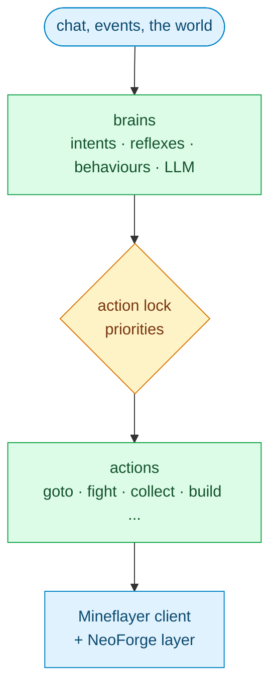

## Up and running in a minute

```bash
git clone https://github.com/thereisnotime/golemkit.git && cd golemkit
asdf install && just setup      # Node 26 + just, npm ci, creates .env
$EDITOR .env                    # MC_HOST, MC_OWNER, ...
just run                        # the buddy bot; say "help" to it in game
```

Then pick a bigger bot: `just run pax` is an LLM companion, `just bots` lists the rest, and
[writing a variant](/guide/writing-a-bot) shows how to make your own.

## How a bot is put together



Every capability is one action with a zod schema: the same definition is a chat command, an LLM
tool and a typed function. Several brains run at once and share the body through priorities.
More in [Architecture](/concepts/architecture).

<p class="home-footnote">Open source under the <a href="https://github.com/thereisnotime/golemkit/blob/main/LICENSE">LGPL-3.0</a>.</p>
